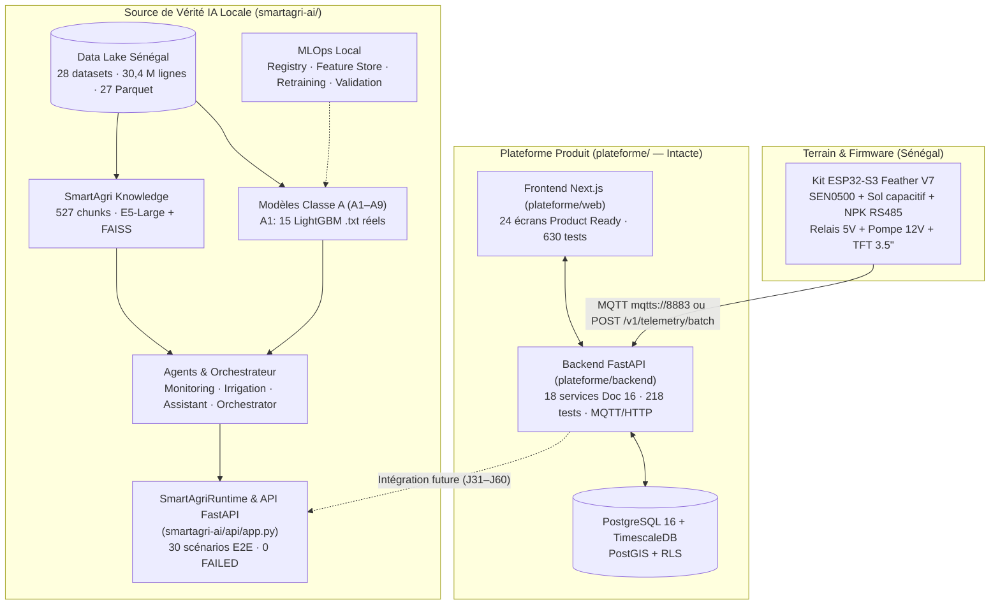

# SMARTAGRI_MASTER_CONTEXT — Contexte de Référence Définitif SmartAgri92

**Date** : 22 novembre 2026  
**Mission** : `CONTEXT-SYNC-01` — Synchronisation officielle du contexte post-OctOpus  
**Statut** : Référentiel maître du projet SmartAgri92 (aucun code modifié, aucun modèle entraîné)

---

## 1. Sources de Vérité et Gouvernance Documentaire

### 1.1 Pivot d'architecture : `smartagri-ai/` devient la source de vérité
- **Source de vérité IA & MLOps (`VSCode`)** : [`smartagri-ai/`](./smartagri-ai/) centralise désormais le Data Lake curé, les modèles, le moteur RAG, les agents, le runtime FastAPI local et le registre MLOps.
- **Rôle d'OctOpus ML** : OctOpus devient exclusivement un **laboratoire historique**, un **support de démonstration PAS Challenge** et une **référence documentaire**.
- **Règle d'indépendance applicative** : [`plateforme/web/`](./plateforme/web/) (Frontend « Product Ready ») et [`plateforme/backend/`](./plateforme/backend/) (Backend FastAPI Sprint D8) restent intacts et découplés jusqu'à la phase d'intégration produit.

### 1.2 État des documents de référence sur disque
| Document de référence | Emplacement vérifié | Statut |
|---|---|---|
| `SMARTAGRI_SOURCE_OF_TRUTH.md` | [`SMARTAGRI_SOURCE_OF_TRUTH.md`](./SMARTAGRI_SOURCE_OF_TRUTH.md) | **Lu et intégré** |
| `FINAL_EXPORT_AUDIT.md` | [`FINAL_EXPORT_AUDIT.md`](./FINAL_EXPORT_AUDIT.md) | **Lu et intégré** |
| `SMARTAGRI_AI_RUNTIME_READY.md` | [`SMARTAGRI_AI_RUNTIME_READY.md`](./SMARTAGRI_AI_RUNTIME_READY.md) | **Lu et intégré** |
| `LOCAL_AI_END_TO_END_REPORT.md` | [`LOCAL_AI_END_TO_END_REPORT.md`](./LOCAL_AI_END_TO_END_REPORT.md) | **Lu et intégré** |
| `LOCAL_SMARTAGRI_AI_STATUS.md` | [`smartagri-ai/LOCAL_SMARTAGRI_AI_STATUS.md`](./smartagri-ai/LOCAL_SMARTAGRI_AI_STATUS.md) | **Lu et intégré** |
| `INVENTAIRE_PROJET_SMARTAGRI92.md` | *Non présent dans l'arborescence disque actuelle* | **Manquant sur disque** *(complété par [`13_inventaire_donnees.md`](./plateforme/docs/13_inventaire_donnees.md) et [`smartagri-ai/metrics/inventaire_datasets.csv`](./smartagri-ai/metrics/inventaire_datasets.csv))* |
| `SMARTAGRI_DATA_AND_LLM_REFERENCE_FINAL.md` | *Non présent dans l'arborescence disque actuelle* | **Manquant sur disque** *(complété par [`56_real_ai_portfolio.md`](./smartagri-ai/docs/56_real_ai_portfolio.md) et [`knowledge_service.py`](./smartagri-ai/rag/knowledge_service.py))* |

---

## 2. Architecture Actuelle du Système SmartAgri92

---

## 3. Cartographie Complète par Couche

### 3.1 Données (`smartagri-ai/datasets/` & `plateforme/ml/data/real/`)
- **Volume officiel** : **28 datasets**, **30,4 millions de lignes**, **27 fichiers Parquet** (**25 bruts** dans `smartagri-ai/datasets/raw/` + **2 curés** `train.parquet` / `test.parquet` dans `smartagri-ai/datasets/curated/`, `173,54 Mo` sur disque), vérifiés `PAR1` et `23/23` SHA-256.
- **Couverture nationale Sénégal** : grille `0,05°` (**6 945 cellules**, **14/14 régions**), **76 mailles NASA POWER** (`0,5° × 0,625°`), pluie quotidienne CHIRPS (2015–2026), météo & $ET_0$ FAO-56 (2015–2026), sols iSDAsoil `30 m` + contrôle SoilGrids, occupation du sol ESA WorldCover `10 m`, catalogue Sentinel-2 (`20 722` scènes) + NDVI mensuel 2025, prix WFP sur `79` marchés (2000–2026), rendements FAOSTAT (1961–2024).
- **Zones de validation spatiale** : Mboro, Potou et Richard-Toll (5 mailles NASA POWER) isolées hors entraînement.
- **Tables de vérité & SHAP** : `27/27` tables CSV (`24` dans `metrics/`, `2` dans `rag/`, `1` dans `shap/wx_rain_prob_shap_summary.csv`) + `lgb_feature_importance.png`.

### 3.2 Modèles Classe A (`A1` → `A9`) & Vérité des Artefacts
Conformément au cadrage officiel et à [`FINAL_EXPORT_AUDIT.md`](./FINAL_EXPORT_AUDIT.md) :
- **A1 `SoilNowcast`** : **artefacts réels présents et opérationnels** (`15` boosters natifs LightGBM `lgb_y_plus_{1d,2d,3d}_pct_fold{0..4}.txt` + `lgb_config.json`, $R^2 = 0,8353$, $\text{RMSE} = 7,447$).
- **A2–A9** : **considérés comme absents / à reconstruire localement et re-valider** dans un environnement Linux/WSL/Docker non bloqué par Windows App Control. Les datasets Parquet, hyperparamètres (`docs/93`), métriques cibles (`champions_summary.json`, `metrics/*.csv`) et scripts (`train_A2_et0.py`, `train_A3_yield_A5_price.py`, `train_A6_A7_A9.py`, `mlops/retraining/train_class_a_enriched.py`) existent.

| Code | Modèle | Champion de référence (`champions_summary.json`) | Métriques cibles | État réel des artefacts & scripts |
|---|---|---|---|---|
| **A1** | `SoilNowcast` | `LightGBM` | $R^2=0,8353$ · $\text{RMSE}=7,447$ | **Présent (15 `.txt` + config)** — inférence active (~19–39 ms) |
| **A2** | `ET0 Forecast` | `CatBoost` | $R^2=0,9997$ · $\text{RMSE}=0,039$ | **À reconstruire** — `train_A2_et0.py` + `manifest.json` présents |
| **A3** | `Yield Forecast` | `CatBoost` | $R^2=0,9509$ · $\text{RMSE}=2,0083$ | **À reconstruire/valider** — `train_A3_yield_A5_price.py` présent *(`.pkl` expérimental sur disque dans `models/yield/`)* |
| **A4** | `Rain Intelligence` | `CatBoost` | $\text{AUC}=0,9625$ · $F_1=0,7642$ · $\text{Brier}=0,0611$ | **Absent** — `RainIntelligenceService` prêt avec abstention contrôlée |
| **A5** | `Price Forecast` | `XGBoost` | $R^2=0,8995$ · $\text{RMSE}=66,67$ | **À reconstruire/valider** — `train_A3_yield_A5_price.py` présent *(chargement `yield_price_market_service.py` prêt)* |
| **A6** | `Crop Calendar` | `CatBoost` | $F_{1,\text{macro}}=0,9799$ · $\text{Acc}=0,9811$ | **Absent** — `train_A6_A7_A9.py` présent |
| **A7** | `NDVI Anomaly` | `LightGBM` | $F_{1,\text{macro}}=0,9943$ · $\text{Acc}=0,9976$ | **Absent** — `train_A6_A7_A9.py` présent |
| **A8** | `Anomaly Intelligence` | `One-Class SVM` | $F_1=0,0969$ · $\text{Prec}=0,09$ | **Poids ML absents** — **5 seuils métier critiques actifs** (`drought`, `flood`, `heatwave`, `cold_snap`, `et0_extreme`) |
| **A9** | `Market Clustering` | `KMeans k=7` | $\text{Silhouette}=0,3597$ | **À reconstruire/valider** — `train_A6_A7_A9.py` présent |

### 3.3 IA Générative & RAG (`smartagri-ai/rag/`)
- **SmartAgri Knowledge** : **`527` chunks** (`smartagri_knowledge_chunks.csv`, `10` domaines) + jeu d'évaluation (`20` requêtes dans `smartagri_knowledge_eval.csv`).
- **Moteur vectoriel dense** : **`intfloat/multilingual-e5-large`** + **`FAISS` (`IndexFlatIP`)** persisté dans `e5_large_chunks.npy` (`2,16 Mo`) et `e5_large.faiss`, avec repli automatique `TF-IDF + cosine`.

### 3.4 Agents & Orchestrateur (`smartagri-ai/agents/`)
- **`MonitoringEngine`** (`agents/monitoring/monitoring_engine.py`) : évaluation des risques et alertes agro-climatiques.
- **`IrrigationEngine`** (`agents/irrigation/irrigation_engine.py`) : décision FAO-56 + garde-fou *hard-stop* pluie $> 5\text{ mm}$.
- **`AssistantService`** (`agents/assistant/assistant_service.py`) : réponses agronomiques ancrées sur RAG + données sol/irrigation.
- **`SmartAgriOrchestrator`** (`agents/orchestrator/orchestrator.py`) : routage multi-intentions (`answer`, `monitor`, `recommend`, `escalate`), gestion des abstentions et escalade humaine.

### 3.5 Runtime & API Locale (`smartagri-ai/runtime/`, `smartagri-ai/api/`)
- **Point d'entrée unifié** : [`SmartAgriRuntime`](./smartagri-ai/runtime/runtime.py) et API FastAPI autonome [`api/app.py`](./smartagri-ai/api/app.py) (`/health`, `/mlops/registry`, `/soil/predict`, `/rain/predict`, `/anomaly/detect`, `/yield/predict`, `/price/predict`, `/market/clusters`, `/knowledge/search`, `/agents/*`, `/orchestrator/*`).
- **Validation E2E (`demo_e2e_30.py`)** : **30 / 30 scénarios exécutés** — **15 `PASSED`**, **15 `PARTIAL`** (9 `PARTIAL_RAIN_ABSTAINED`, 6 `PARTIAL_MISSING_MODEL`), **0 `FAILED`**. Temps d'inférence moyen : **114,73 ms** ; confiance moyenne : **0,8297** ; mémoire pic : **2 690,25 Mo** ; `pytest` : **9 passed**.

### 3.6 MLOps (`smartagri-ai/mlops/`)
- **Registry** : [`LocalModelRegistry`](./smartagri-ai/mlops/registry/registry.py) + `champions_summary.json` + `requirements.txt`.
- **Feature Store** : `features_by_model.json`, `datasets_inventory.json`, `knowledge_stats.json`, `analysis_part1.json`.
- **Retraining & Validation** : `train_class_a_enriched.py`, [`validate_metrics.py`](./smartagri-ai/mlops/retraining/validate_metrics.py), `docs/87_smartagri_retraining_strategy.md` et specs YAML `mlops/architecture/{datasets,models,sources}.yaml`.

### 3.7 Backend (`plateforme/backend/`), Frontend (`plateforme/web/`) & Firmware
- **Backend FastAPI** : Sprint D8 achevé, **218 tests passants**, 18 services Doc 16 § 9.3, ingestion MQTT (`mqtt_bridge.py`) et HTTP (`POST /v1/telemetry/batch`), base PostgreSQL/TimescaleDB/PostGIS avec RLS (`001`–`003`).
- **Frontend Next.js** : **24 écrans « Product Ready »** (`fr`/`wo`/`ff`, WCAG 2.1 AA, **630 tests unitaires**, 16 tests de contrat live).
- **Firmware & Matériel Kit** : [`code-kitsmartagri92.ino`](./code-kitsmartagri92.ino) (**V7**) sur **Adafruit Feather ESP32-S3 (No PSRAM)**, TFT ILI9488 480×320, `SEN0500` I2C (T/HR/Pression/UV/Luminosité), sonde sol capacitive analogique (`GPIO8`), sonde NPK RS485 `SEN0605` (Modbus), relais 5 V pompe 12 V, LED/Buzzer. *Manquent côté matériel v1.1* : débitmètre, capteur tension/courant batterie (`battery_mv`), carte SD activée, modem GSM/LoRaWAN.

---

## 4. Synthèse : Existant / Reconstruit / Manquant

| Catégorie | État synthétique |
|---|---|
| **Existant (actifs sources)** | Data Lake national 27 Parquet (`30,4 M` lignes), **A1 LightGBM (15 `.txt`)**, `527` chunks RAG, `27` CSV métriques/SHAP, scripts `train_A2..A9`, Backend D8, Frontend E6, Firmware V7. |
| **Reconstruit localement** | `SmartAgriRuntime`, API FastAPI `smartagri-ai/api/app.py`, RAG dense `multilingual-e5-large + FAISS`, 4 agents + `SmartAgriOrchestrator`, `LocalModelRegistry`, suite `pytest` (9/9) et E2E 30 scénarios (0 `FAILED`). |
| **Manquant** | Poids de production validés pour **A2–A9** (sous environnement Linux/WSL non bloqué), **14–27 docs historiques OctOpus** (`65`–`78`…), couche DB locale `GET /db/{collection}`, **données terrain IoT réelles** (`0` ligne dans `measurements`), étalonnage gravimétrique `sm_calibration`, débitmètre v1.2, et **2 docs nommés** (`INVENTAIRE_PROJET_SMARTAGRI92.md`, `SMARTAGRI_DATA_AND_LLM_REFERENCE_FINAL.md`) absents sur disque. |

---

## 5. Dépendances Critiques

1. **Environnement d'entraînement Linux / WSL / Docker** : sous Windows, la stratégie de contrôle d'application bloque certaines DLL natives (`pyarrow._fs.pyd`, `fastparquet.cencoding.pyd`, binaires `catboost`/`xgboost`). Tout ré-entraînement `A2–A9` exige WSL2 ou un conteneur Linux.
2. **Qualité mémoire du Runtime** : `e5-large` + `LightGBM` consomme **~2,69 Go RAM** en exécution ; prévoir $\ge 4\text{ Go}$ RAM sur le conteneur de déploiement IA.
3. **Déploiement physique des kits ESP32-S3** : indispensable pour passer du proxy satellite (`GWETROOT`) à la télémétrie réelle `measurements_1h` et à l'étalonnage gravimétrique `sm_calibration`.
4. **Conventions & Matériel v1.2** : débitmètre + capteur batterie `INA219` (pour `irr_need_24h` et `pump_health`) ; conventions `ISRA/CDH`, `DPV`, `SIM/CSA` (pour fertilisation, ravageurs et prix officiels).

---

## 6. Feuille de Route Réelle des 90 Prochains Jours

| Horizon | Chantier prioritaire | Livrables & Objectifs vérifiables |
|---|---|---|
| **J1 – J30** *Reconstruction & Socle IA Local* | 1. **Environnement Linux/WSL Docker** pour `smartagri-ai/` (lever le blocage DLL Windows). 2. **Ré-entraînement & validation `A2`–`A9`** via `train_*.py` et `validate_metrics.py` contre `champions_summary.json` (objectif : **30 / 30 `PASSED`** sur `demo_e2e_30.py`). 3. **Couche DB locale** (SQLite/PostgreSQL pour les 27 CSV) + conteneurisation Docker de `smartagri-ai/api/app.py`. | 9/9 modèles Classe A prêts localement ; 0 scénario `PARTIAL` ; image Docker IA reproductible. |
| **J31 – J60** *Intégration Produit & Premiers Kits Terrain* | 1. **Branchement `plateforme/backend` ↔ `smartagri-ai` API** (adaptateur `inference/` FastAPI, préservant le contrat Doc 16 § 9.2 et la chaîne de repli 3 paliers). 2. **Pose des 5–10 premiers kits ESP32-S3** (protocole `48_field_deployment_protocol.md` + étalonnage gravimétrique `sm_calibration`). 3. **Supervision `mqtt_bridge` + qualité Jour 1** (`49` & `50`). | Backend servi par le runtime IA local sur les routes v1 ; flux réel continu dans `measurements_1h` ; 30 prélèvements `sm_calibration`. |
| **J61 – J90** *IA Terrain Réelle & Évolution Matérielle v1.2* | 1. **Accumulation 6–8 semaines de télémétrie réelle** multi-zones (`>= 5 000–13 000` points horaires) et ré-entraînement de `SoilNowcast` sur vraies sondes (validation spatiale Mboro/Potou/Richard-Toll). 2. **Activation `AnomalyService` sur résidus réels** + intégration `ISRA/DPV` en `rules`. 3. **Spécification kit v1.2** (débitmètre effet Hall, INA219, lecteur SD activé, UV/Lux `SEN0500`). | 1er modèle `SoilNowcast` calibré sur capteurs réels en production ; dossier matériel v1.2 prêt pour `irr_need_24h`. |
