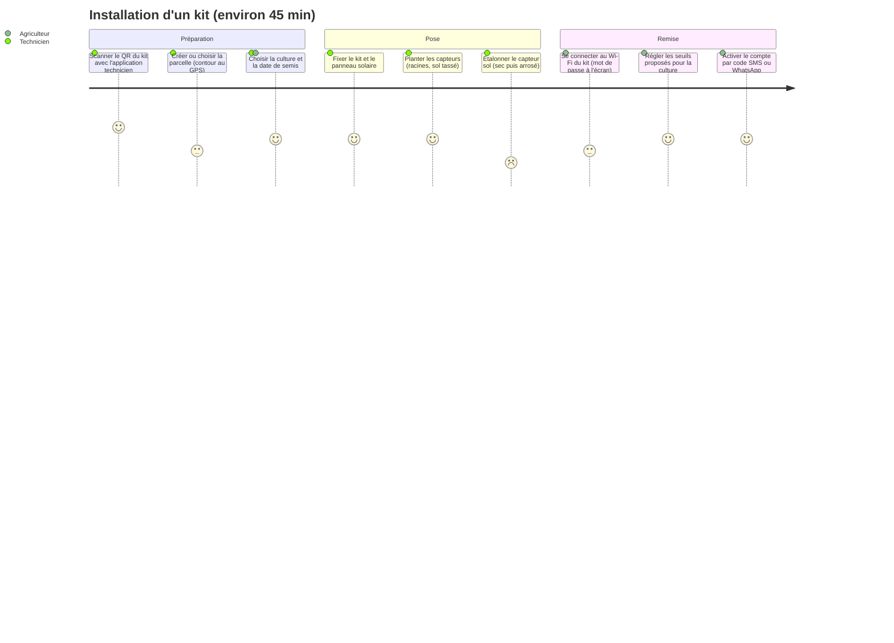
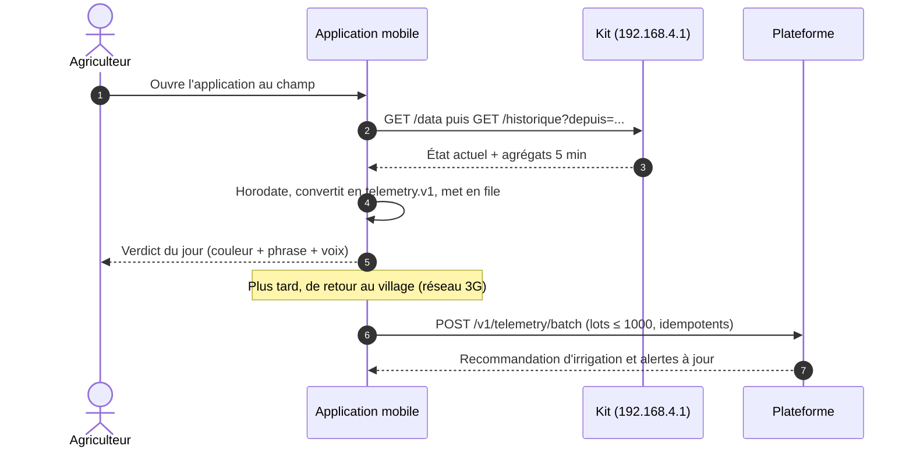
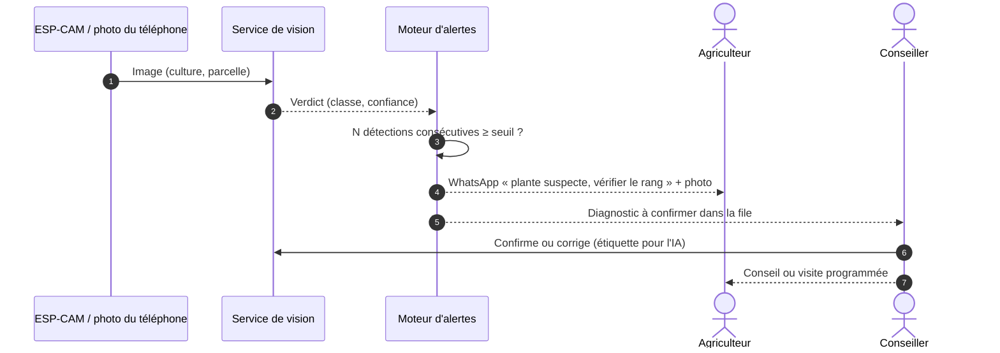
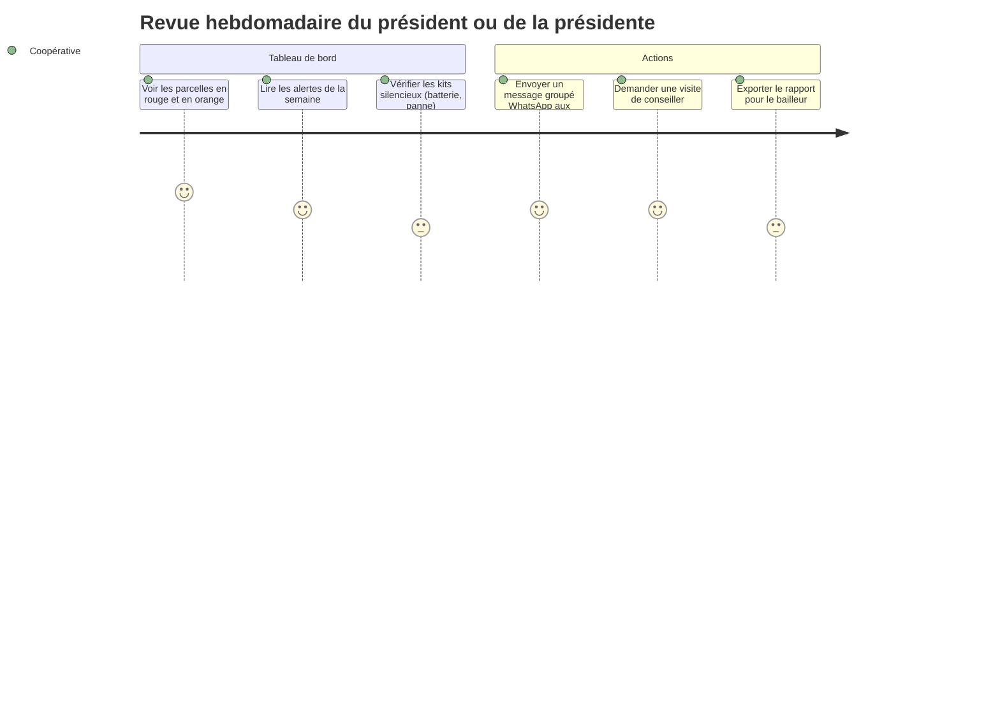

# 01 — Analyse métier

Confidentiel — réservé aux partenaires de travail.

## 1. Résumé exécutif

**Le problème.** Au Sénégal, les petits producteurs irriguent souvent à l'œil, au mauvais moment ou en trop grande quantité. Ils découvrent les carences et les maladies trop tard. Ils pompent une eau de plus en plus chère : carburant, électricité, nappe qui baisse et se salinise dans les Niayes. Aux champs, Internet est faible ou absent.

**La solution.** Smart Agri92 associe trois éléments :
- un **kit de terrain autonome** : capteurs de sol et d'air, pompe pilotée, alertes locales, panneau solaire ;
- une **application mobile qui fonctionne hors ligne** et récupère les données du kit ;
- une **plateforme** de suivi, de recommandations et d'IA : irrigation, alertes nutriments, détection des maladies, assistant en langue locale.

Le kit fonctionne seul. La plateforme le rend plus intelligent dès qu'une connexion est disponible.

**Le segment de départ.** Le maraîchage irrigué des Niayes, organisé en coopératives : oignon, tomate, chou, carotte, pomme de terre. La valeur à l'hectare y est élevée, l'eau coûte cher, les filières d'export sont structurées et le climat du littoral est relativement homogène.

**La promesse mesurable (à valider par le pilote).** Moins d'eau et d'énergie de pompage, moins de pertes liées aux maladies et une décision plus rapide. Ces gains sont des **hypothèses** : seul le pilote avec parcelles témoins permettra de les chiffrer.

**Le modèle économique (hypothèses à tester).**
- Kit vendu à la coopérative, ou loué à l'agriculteur avec paiement mobile échelonné.
- Abonnement léger au service : historique, alertes WhatsApp, assistant, conseil.
- Offres B2B pour les exportateurs (traçabilité de l'irrigation), les assureurs (données pour l'assurance indicielle) et les projets de bailleurs (suivi d'impact).

**Ce qu'il faut maintenant.**
1. Valider le firmware v1.1 sur le matériel.
2. Lancer un pilote de 10 kits sur une saison avec un agronome.
3. Construire la base d'images locale.
4. Livrer le MVP de la plateforme (voir `07_feuille_de_route_budget.md`).

## 2. Contexte et marché

| Dimension | Constat | Conséquence produit |
|---|---|---|
| Producteurs | Exploitations familiales, petites surfaces, téléphones Android d'entrée de gamme, alphabétisation variable | Interface par icônes et couleurs, voix, wolof et pulaar, gros boutons |
| Eau | Nappe des Niayes sous pression (baisse, intrusion saline), pompage coûteux | La valeur numéro un est l'eau économisée : il faut la mesurer (débitmètre) |
| Climat | Saison sèche longue, chaleur, harmattan, pluies concentrées et irrégulières | ET0 élevée, recommandations qui changent avec la saison, matériel tropicalisé |
| Réseau | 3G/4G inégale, coût des données important pour le ménage | Hors ligne d'abord, synchronisation par lots compressés, kit sans abonnement |
| Paiement | Paiement mobile très répandu (Wave, Orange Money) | Location et paiement échelonné possibles sans banque |
| Encadrement | Conseil agricole public et privé (ANCAR, ISRA, CDH, ONG), coopératives et GIE | Le conseiller et la coopérative sont des canaux de distribution et de confiance |
| Réglementation | Loi 2008-12 sur les données personnelles, CDP | Consentement, registre des traitements, hébergement documenté |

Les chiffres de marché (nombre d'exploitations maraîchères, surfaces, part des Niayes dans la production nationale) restent **à sourcer** auprès de l'ANSD, de la DHORT et de la FAO avant tout document destiné aux investisseurs. Je n'en invente pas ici.

### Segmentation et priorités

| Segment | Intérêt pour le kit | Difficulté | Priorité |
|---|---|---|---|
| Maraîchage irrigué des Niayes | Très fort (eau, maladies, valeur) | Moyenne | **1 — tête de pont** |
| Arboriculture (mangue, agrumes) | Fort pour l'irrigation goutte-à-goutte et les maladies des fruits | Moyenne | 2 |
| Agro-exportateurs (haricot vert, tomate cerise, melon) | Fort : traçabilité et normes d'export | Faible (clients solvables) | 2 (B2B) |
| Riz irrigué, vallée du fleuve | Faible pour l'humidité du sol (riz inondé) ; fort pour la gestion de la lame d'eau et les maladies | Élevée | 3 (autre capteur) |
| Cultures pluviales (arachide, mil) | Faible pour le kit ; fort pour le conseil satellite et météo | Élevée (faible valeur/ha) | 3 (service sans kit) |

## 3. Personas

Les personas sont décrits par leur rôle ; ils sont à valider en entretiens pendant le pilote.

### P1 — Maraîcher ou maraîchère des Niayes
- **Profil :** 0,5 à 2 ha, oignon et tomate, puits et motopompe ou forage, smartphone Android partagé dans le ménage, lit le français avec difficulté, parle wolof.
- **Objectifs :** dépenser moins en carburant, éviter de perdre une récolte, vendre au bon moment.
- **Frustrations :** les maladies vues trop tard, des conseils contradictoires, des applications compliquées et en français.
- **Ce qu'il faut :** un verdict clair (« arroser ce soir 20 min », « regarder les feuilles du rang 3 »), une alerte WhatsApp vocale, un fonctionnement sans données mobiles.

### P2 — Président ou présidente de coopérative / GIE
- **Profil :** 30 à 300 membres, négocie l'achat d'intrants et la vente groupée, utilise WhatsApp et un peu Excel.
- **Objectifs :** des rendements réguliers pour les contrats, des comptes à rendre aux bailleurs, une gestion partagée des kits.
- **Ce qu'il faut :** un tableau de bord multi-parcelles, des alertes agrégées, des rapports simples (eau, alertes, interventions), une gestion des membres et des kits.

### P3 — Conseiller ou conseillère agricole (ANCAR, ONG, exportateur)
- **Profil :** suit 50 à 200 producteurs, se déplace à moto, formation technique solide.
- **Objectifs :** prioriser ses visites et confirmer les diagnostics à distance.
- **Ce qu'il faut :** une file de diagnostics à confirmer (photo, culture, historique), des demandes de visite venant de l'assistant, une carte des parcelles à risque. Ses confirmations deviennent des **étiquettes** pour l'IA.

### P4 — Agro-exportateur
- **Objectifs :** sécuriser l'approvisionnement, prouver de bonnes pratiques (eau, traitements) aux acheteurs.
- **Ce qu'il faut :** un accès en lecture seule aux parcelles sous contrat, des exports de traçabilité et une API.

### P5 — Partenaire institutionnel (bailleur, assureur, ministère, chercheur)
- **Ce qu'il faut :** des indicateurs agrégés et anonymisés, des données météo et sol pour l'assurance indicielle, des rapports d'impact. Aucune donnée personnelle sans base légale.

### P6 — Technicien ou technicienne d'installation et de maintenance
- **Ce qu'il faut :** l'enregistrement du kit par QR code, l'étalonnage guidé, le diagnostic des capteurs (`soil_sensor_ok`, `bme_ok`, `npk_ok`), l'historique des interventions et le remplacement d'un capteur sans perdre l'historique.

## 4. Cas d'usage

| ID | Acteur | Cas d'usage | Exigence d'origine | Version |
|---|---|---|---|---|
| UC-01 | P6 | Installer et enregistrer un kit (QR, parcelle, culture, étalonnage) | F1, F10, F13 | MVP |
| UC-02 | P1 | Voir l'état du kit sur place, sans Internet | F8, F11 | Kit (fait) |
| UC-03 | P1 | Synchroniser l'historique du kit via le téléphone | F9, F11 | MVP (firmware v1.2) |
| UC-04 | P1 | Régler les seuils d'arrosage (sur place ou à distance) | F3 | MVP |
| UC-05 | P1 | Recevoir une recommandation d'irrigation (durée, moment) | F2 + ET0 | MVP |
| UC-06 | P1 | Recevoir une alerte (sol sec persistant, panne de pompe, capteur débranché, NPK bas, plante suspecte) par l'application, WhatsApp ou SMS | F6, F7 | MVP |
| UC-07 | P1 | Photographier une plante et obtenir un pré-diagnostic | F7 | V2 |
| UC-08 | P3 | Confirmer ou corriger un pré-diagnostic | §12 | V2 |
| UC-09 | P1 | Poser une question à l'assistant en wolof ou en français, à l'écrit ou à la voix | — | V2 (texte en MVP+) |
| UC-10 | P2 | Suivre toutes les parcelles et tous les kits de la coopérative | F9 | MVP |
| UC-11 | P2 | Exporter un rapport mensuel (eau, alertes, interventions) | — | V2 |
| UC-12 | P1, P2 | Voir les courbes jour, semaine, mois et année | F9 | MVP |
| UC-13 | P4, P5 | Consulter des données agrégées, une API partenaire | — | V3 |
| UC-14 | P1 | Payer la location ou l'abonnement par paiement mobile | — | V2 |
| UC-15 | Plateforme | Prévoir le rendement et le risque de la parcelle | — | V3 |
| UC-16 | P6 | Mettre à jour le firmware à distance (OTA signée) | — | V2 |

## 5. Parcours utilisateurs

### 5.1 Installation et premier usage (P6 et P1)

### 5.2 Visite quotidienne sans Internet (P1)

### 5.3 Alerte maladie (P1, P3)

### 5.4 Pilotage de la coopérative (P2)

## 6. Principes d'expérience utilisateur

1. **Le verdict d'abord, les chiffres ensuite :** vert, orange ou rouge, avec une phrase d'action. Les courbes sont un second niveau.
2. **La voix et les pictogrammes** pour celles et ceux qui lisent peu. Chaque alerte existe en message vocal en wolof (enregistré par un locuteur natif, pas en synthèse automatique au départ).
3. **Hors ligne par défaut :** chaque écran affiche la date de la dernière synchronisation. Rien ne bloque en l'absence de réseau.
4. **Économie de données :** pages légères, images compressées, synchronisation par lots. La consommation de données de l'application doit être mesurée.
5. **Téléphones modestes :** Android 8 ou plus, 2 Go de RAM, écran de 5 pouces, plein soleil (contraste élevé, gros boutons).
6. **Confiance :** dire ce que l'IA ne sait pas, montrer la photo et la confiance, toujours proposer de « demander à un conseiller ».
7. **Partage :** un téléphone peut servir à plusieurs membres d'une famille, et un kit à plusieurs producteurs d'une coopérative. Le modèle de droits est prévu pour (rôles par organisation).

## 7. Exemple de site web — reçu et analysé

Le prototype « Smart Agri92 — Tableau de bord du champ » a été fourni avec le brief OctOpus. Son analyse critique,
la refonte en 13 modules, les parcours, les droits par rôle et les maquettes sont dans `10_web_ux.md` ; les
maquettes cliquables sont dans `maquettes/` (locales, non publiées).

Règle maintenue : **le site public ne montre ni cartes, ni capteurs, ni caméra**. Ces écrans ne sont visibles
qu'après connexion, et seulement pour l'organisation de l'utilisateur.

## 8. Indicateurs de succès

| Indicateur | Définition | Cible pilote (hypothèse) |
|---|---|---|
| Eau économisée | m³/ha/saison, parcelles équipées comparées aux témoins | À mesurer ; objectif de 20 % à valider |
| Disponibilité du kit | % du temps avec des mesures valides | ≥ 95 % |
| Fraîcheur des données | Délai médian entre mesure et plateforme | < 24 h hors ligne, < 5 min connecté |
| Précision des alertes maladie | Part des alertes confirmées par un conseiller | ≥ 70 % (à ajuster) |
| Rétention | Agriculteurs actifs chaque semaine / équipés | ≥ 60 % à 3 mois |
| Satisfaction | Score de recommandation (entretiens) | Suivi qualitatif |
| Économie unitaire | Coût de revient par kit et par an comparé aux revenus | Positif en V3 |

## 9. Modèle économique — options à tester

| Option | Description | Avantages | Risques |
|---|---|---|---|
| Vente à la coopérative | La coopérative achète les kits et les partage entre membres | Un seul payeur, logistique simple | Usage partagé, appropriation faible |
| Location avec paiement mobile | Mensualités via Wave ou Orange Money, kit récupérable | Accessible, revenus récurrents | Recouvrement, logistique de reprise |
| Abonnement au service | Kit à prix coûtant, service payant (alertes, assistant, conseil) | Marge sur le logiciel | Faible disposition à payer au départ |
| B2B2C | Un exportateur ou un projet de bailleur finance les kits de ses producteurs | Solvabilité, échelle | Dépendance à un client |
| Données et indices | Indicateurs agrégés pour assureurs et chercheurs, avec consentement | Revenus additionnels | Conformité, confiance des producteurs |

Hypothèse de coût matériel par kit (à confirmer par devis) : **90 000 à 120 000 FCFA**, soit environ 140 à 185 €. Le détail est dans `07_feuille_de_route_budget.md`.
