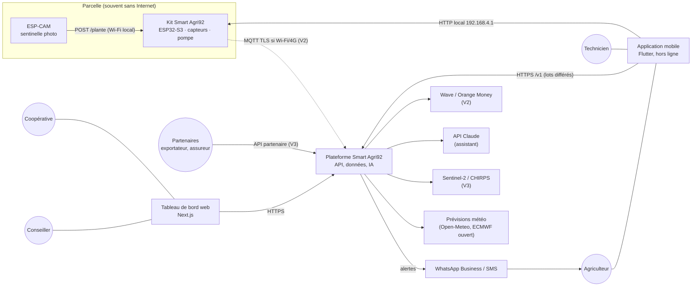
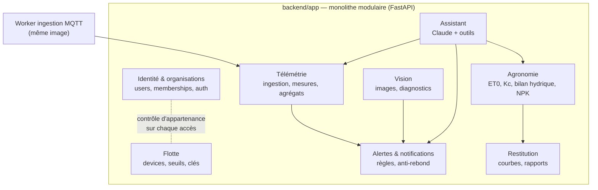
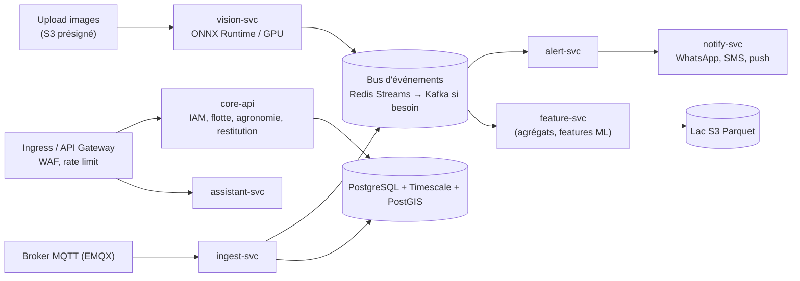
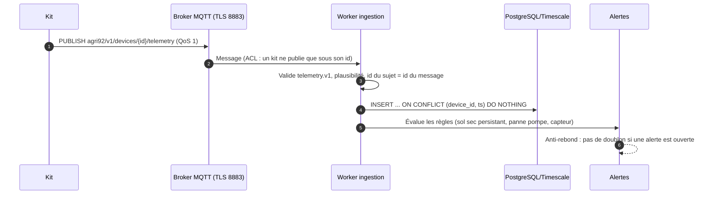
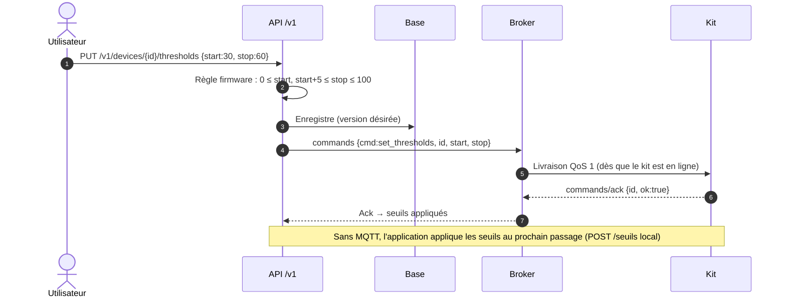
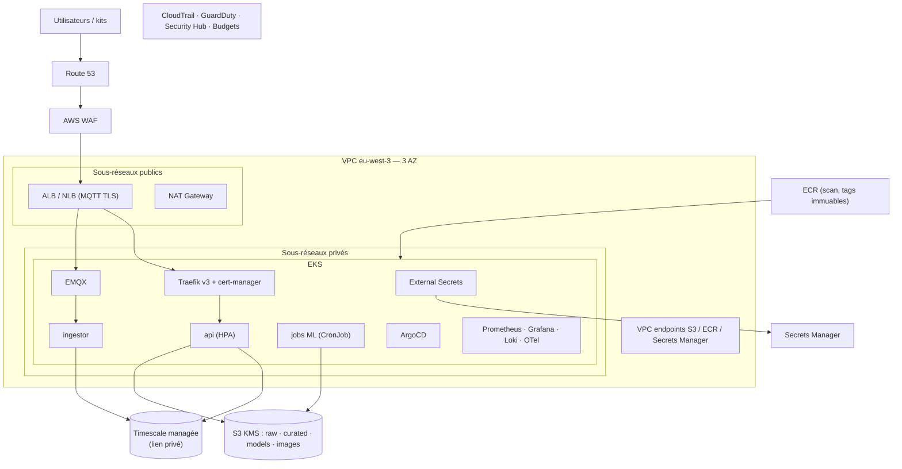
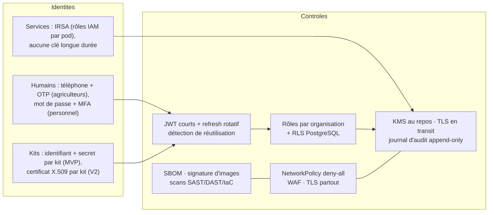

# 02 — Architecture globale

Confidentiel — réservé aux partenaires de travail.

Ce document couvre l'architecture applicative, cloud, de services, de données et de sécurité. Les contrats précis (API, MQTT, schéma, variables) sont dans `../CONVENTIONS.md`. Le code correspondant se trouve dans `backend/`, `db/`, `infra/`, `web/` et `mobile/`.

## 1. Vue de contexte



## 2. Architecture terrain (edge)

### 2.1 Rôles

| Élément | Rôle | Fait aujourd'hui (v1.1) | À ajouter |
|---|---|---|---|
| Kit ESP32-S3 | Mesure toutes les 2 s, arrosage par hystérésis, alertes locales, point d'accès Wi-Fi | Oui | v1.2 : historique LittleFS, horloge, `/historique`, `/plante` enrichi, OTA signée ; V2 : mode client Wi-Fi + MQTT |
| ESP-CAM | Photo périodique, verdict envoyé au kit | Non intégré | Envoyer l'image au téléphone ou à la plateforme ; verdict local limité |
| Téléphone | Lecture locale, réglages, **relais différé** vers la plateforme | Non | Application Flutter (`mobile/`) |
| Passerelle (V3) | LoRaWAN ou routeur 4G de coopérative | Non | Selon le pilote |

### 2.2 Chemin des données vers la plateforme — trois variantes

| | Compétition / démo | Production | Compromis recommandé (MVP → V2) |
|---|---|---|---|
| Lien | Kit en Wi-Fi client sur un partage de connexion 4G, MQTT direct | Kit en Wi-Fi client sur un routeur 4G de coopérative, ou passerelle LoRaWAN, avec MQTT TLS et certificats par kit | **Téléphone relais différé** dès le MVP (aucun coût de connectivité), MQTT pour les kits proches d'un routeur à partir de V2 |
| Fraîcheur | Temps réel | Temps réel à 5 min près | Au prochain passage du téléphone (en général < 24 h) |
| Coût récurrent | Nul (démo) | Abonnement data par passerelle | Nul pour le relais |
| Complexité | Faible | Élevée (PKI, gestion de flotte) | Moyenne |

### 2.3 Évolutions du firmware nécessaires (v1.2)

- Tampon circulaire d'agrégats sur 5 min en LittleFS : min, moyenne et max pour chaque mesure, plus l'état de la pompe et les drapeaux, soit environ 8 640 enregistrements sur 30 jours.
- `POST /heure` (protégé par le jeton) : le téléphone fournit l'heure UTC ; SNTP quand le kit a Internet.
- `GET /historique?depuis=<epoch>&max=500` : pagination, réponse en JSON compact ou CBOR.
- `POST /plante` avec un corps JSON (classe, confiance) ; garder `etat=0|1` pour la compatibilité.
- OTA signée (partitions A/B, rollback automatique si le watchdog ne valide pas le nouveau firmware).
- **Ne pas** activer le chiffrement flash ni Secure Boot en développement : ces opérations brûlent des eFuses de façon irréversible. Elles se planifient avec l'industrialisation (voir le rapport d'audit).

## 3. Architecture applicative

### 3.1 Choix : un monolithe modulaire d'abord

| | Compétition / démo | Production à grande échelle | Compromis recommandé |
|---|---|---|---|
| Forme | Monolithe simple (une app FastAPI) | Microservices (ingestion, vision, notifications, assistant séparés) | **Monolithe modulaire** à contextes délimités + un worker d'ingestion séparé, même image |
| Pourquoi | Vitesse | Mise à l'échelle indépendante, isolement des pannes | Une petite équipe (6 à 8 personnes) livre plus vite ; les frontières de modules permettent d'extraire un service le jour où une mesure l'impose |

Critères pour **extraire** un module en service (approche « strangler ») :
1. son profil de charge est différent (ingestion MQTT à fort débit, inférence vision sur GPU) ;
2. son cycle de livraison est différent (modèles ML re-déployés chaque semaine) ;
3. il est critique et doit être isolé (notifications) ;
4. une équipe dédiée existe.

Ordre probable : **ingestion → inférence vision → notifications → assistant**.

### 3.2 Contextes délimités



Règles :
- Un module n'accède aux tables d'un autre module qu'à travers ses services (pas de requêtes SQL croisées). L'extraction future en dépend.
- Tout accès à une ressource vérifie l'organisation de l'utilisateur. Une ressource d'une autre organisation renvoie **404** (pas 403) pour ne rien divulguer.
- L'assistant n'utilise **jamais** un identifiant fourni par le modèle de langage sans refaire ce contrôle.

### 3.3 Cible microservices (V3, si les critères sont remplis)



## 4. Flux principaux

### 4.1 Kit connecté (MQTT, V2)



### 4.2 Changement de seuils à distance



### 4.3 Assistant agronomique

```mermaid
sequenceDiagram
    autonumber
    actor U as Agriculteur
    participant API as /v1/assistant/chat
    participant C as API Claude
    participant T as Outils (côté serveur)
    U->>API: « Est-ce que je dois arroser ce soir ? »
    API->>C: system (en cache) + outils (en cache) + historique
    C-->>API: tool_use get_latest_measurements(device_id)
    API->>T: Contrôle d'appartenance de device_id pour CET utilisateur
    T-->>API: Mesures (ou erreur « accès refusé »)
    API->>C: tool_result
    C-->>API: tool_use get_weather_forecast(field_id)
    API->>C: tool_result
    C-->>API: Réponse finale (stop_reason = end_turn)
    API-->>U: Réponse + sources ; proposition de demander un conseiller
```

## 5. Architecture cloud

### 5.1 Hébergement — trois variantes

| | Compétition / démo | Production | Compromis recommandé |
|---|---|---|---|
| Calcul | 1 VM + `docker compose` | AWS EKS multi-AZ (eu-west-3, Paris), comptes séparés prod / staging / sécurité | **EKS** pour la portabilité Kubernetes, 2 nœuds au départ ; staging sur instances spot |
| Base | Conteneur Timescale | TimescaleDB managée (Timescale Cloud, région la plus proche disponible) ou auto-hébergée avec réplication | Timescale managée ; repli documenté sur PostgreSQL RDS + partitionnement natif (RDS ne propose pas l'extension TimescaleDB) |
| Broker | Mosquitto | EMQX en cluster (ou AWS IoT Core) | Mosquitto en dev, EMQX en prod |
| Coût mensuel indicatif | 20–40 € | 1 500–3 000 € à 10 000 kits | 400–900 € (MVP, staging inclus) |

**Souveraineté.** Le Sénégal n'a pas encore de région chez les grands fournisseurs de cloud. Paris offre en général la meilleure latence depuis Dakar (à mesurer). Le choix de Kubernetes, de Terraform et d'images standard permet de déplacer la plateforme vers un hébergeur local, par exemple le datacenter national de Diamniadio, si la loi, un client public ou un bailleur l'exige. Les transferts de données hors du Sénégal doivent être déclarés et encadrés auprès de la CDP (voir `06_devsecops.md`).

### 5.2 Schéma AWS



Le code Terraform correspondant est dans `infra/terraform/` et les manifestes Kubernetes dans `infra/k8s/`.

## 6. Architecture des données

| Couche | Technologie | Contenu | Rétention |
|---|---|---|---|
| Transactionnelle | PostgreSQL 16 | Organisations, utilisateurs, parcelles (PostGIS), kits, seuils, alertes, diagnostics, conversations | Durée du contrat + obligations légales |
| Séries temporelles | TimescaleDB (hypertable `measurements`) | Mesures brutes (pas de 5 min recommandé côté cloud), agrégats continus 1 h / 1 j | Brut 2 ans compressé, agrégats sans limite |
| Lac de données | S3 : `raw/` (immuable), `curated/` (Parquet), `models/`, `images/` | Copies brutes, jeux d'entraînement, images, modèles | Cycle de vie : passage en IA à 90 j, puis Glacier |
| Analytique | DuckDB / Athena sur Parquet | Analyses, jeux ML, rapports partenaires | — |
| Vecteurs (RAG) | pgvector (V2) | Fiches techniques agronomiques découpées | Versionnées |
| Cache / file | Redis (V2) | Limitation de débit, files courtes | Éphémère |

Volumétrie (hypothèse de 10 000 kits, 1 point toutes les 5 min) :
- environ 2,9 millions de lignes par jour, soit environ 1 milliard par an ;
- environ 100 octets par ligne non compressée, soit environ 100 Go par an, ramenés à quelques dizaines de Go avec la compression Timescale ;
- débit MQTT d'environ 33 messages/s, ce qui est très faible pour un broker.

Le volume n'est donc pas la difficulté. La difficulté, c'est la **qualité** : horodatage, capteurs dégradés, étalonnage.

## 7. Architecture de sécurité (vue d'ensemble)



Le modèle de menaces STRIDE de la plateforme, les contrôles OWASP API et OWASP LLM et la gestion des secrets sont détaillés dans `06_devsecops.md`.

## 8. Exigences non fonctionnelles

| Exigence | MVP | Production |
|---|---|---|
| Disponibilité API | 99,5 % | 99,9 % |
| RPO / RTO base | 15 min / 4 h | 5 min / 1 h |
| Latence API p95 (hors assistant) | < 500 ms | < 300 ms |
| Ingestion d'un lot de 1 000 points | < 2 s | < 1 s |
| Fonctionnement hors ligne du kit | 100 % des fonctions locales (F1–F8) | Idem |
| Délai d'alerte (kit connecté) | < 5 min | < 1 min |

## 9. Décisions d'architecture (ADR)

| ADR | Décision | Alternatives écartées | Raison principale |
|---|---|---|---|
| 001 | Monolithe modulaire FastAPI + worker séparé | Microservices dès le départ | Taille de l'équipe, vitesse ; extraction prévue |
| 002 | PostgreSQL + TimescaleDB + PostGIS | InfluxDB + Postgres ; MongoDB | Une seule base pour relations, séries et géographie ; SQL standard ; agrégats continus pour F9 |
| 003 | MQTT (Mosquitto en dev, EMQX en prod) | HTTP polling ; AWS IoT Core | Standard IoT, QoS 1, faible consommation ; IoT Core reste possible (lien propriétaire) |
| 004 | Application mobile native Flutter | PWA ; React Native ; Kotlin | Accès HTTP local au kit (impossible en PWA), un seul code Android/iOS, bonnes performances sur téléphones modestes |
| 005 | AWS Paris + conception portable | Cloud local seul ; Cape Town | Services managés et latence ; portabilité vers un hébergeur souverain |
| 006 | Assistant Claude avec boucle d'outils manuelle et contrôle d'accès par outil | Chatbot RAG sans outils ; agent autonome | Réponses fondées sur les données réelles de l'utilisateur, sans fuite entre organisations |
| 007 | Téléphone en relais différé | Carte SIM dans chaque kit | Coût nul, fonctionne sans couverture ; MQTT ajouté en V2 |
| 008 | Connexion par téléphone + OTP pour les agriculteurs | Identifiant + mot de passe (F10 du dossier) | Pas de mot de passe à retenir ; canal déjà utilisé (SMS / WhatsApp) |
| 009 | Recommandations d'irrigation physiques (FAO-56) avant le ML | ML pur | Peu de données au départ ; résultats explicables ; le ML corrige ensuite (doc 03) |
