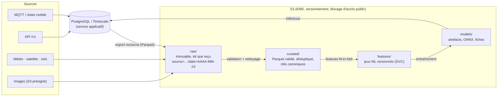
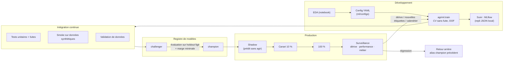

# 04 — Données et MLOps

Confidentiel — réservé aux partenaires de travail.

## 1. Inventaire des sources

| Source | Nature | Fréquence | Volume (10 000 kits) | Données personnelles |
|---|---|---|---|---|
| Télémétrie kit (`telemetry.v1`) | Séries temporelles | 5 min (agrégats) | ~2,9 M lignes/jour | Indirectes (liées à une parcelle) |
| Événements kit (pompe, défauts, acquittements) | Événements | À l'occurrence | Faible | Indirectes |
| Images (téléphone, ESP-CAM) | Fichiers JPEG | Horaires (ESP-CAM) ou à la demande | 50–500 Go/an selon la politique ESP-CAM | Possibles (visages, lieux) : floutage et consentement |
| Diagnostics et confirmations des conseillers | Étiquettes | À l'occurrence | Faible, **très précieux** | Indirectes |
| Analyses de sol en laboratoire | Tabulaire | Ponctuelle | Centaines | Non |
| Prévisions météo (Open-Meteo / ECMWF) | Grilles ou points | 1 à 4 fois par jour | Faible si on extrait seulement les points des parcelles | Non |
| Pluie satellite (CHIRPS), Sentinel-2 | Raster | Journalière / ~5 jours | Moyen : extraction par parcelle seulement | Non |
| Sols (iSDAsoil, SoilGrids) | Raster statique | Une fois | Faible | Non |
| Comptes, parcelles, conversations | Transactionnel | Continu | Faible | **Oui** : téléphone, position, texte |
| Retours utilisateurs (pouces, actions faites) | Événements | Continu | Faible | Indirectes |

## 2. Lac de données

Conventions :
- **Partitionnement** : `s3://agri-<zone>/<domaine>/<table>/date=AAAA-MM-JJ/part-*.parquet`.
- **Immuabilité** : `raw/` n'est jamais réécrit. Une correction produit une nouvelle version dans `curated/`.
- **Cycle de vie** : `raw/` en stockage peu fréquent après 90 jours, en Glacier après 365 jours. `curated/` et `models/` restent en standard.
- **Format** : Parquet compressé zstd. Le schéma est enregistré dans le catalogue et toute évolution passe par une revue.

## 3. Ingestion

| Flux | Mode | Composant | Garanties |
|---|---|---|---|
| Kit connecté | Flux continu | Broker MQTT → worker `app.ingestion.mqtt_bridge` | QoS 1, idempotence `(device_id, ts)`, rejet si l'id du sujet diffère de celui du message |
| Relais mobile | Lots | `POST /v1/telemetry/batch` (≤ 1 000 points) | Idempotence, file locale persistante côté téléphone, reprise avec backoff exponentiel |
| Images | Fichiers | URL S3 présignée → événement → inférence | Taille et type contrôlés ; métadonnées EXIF de position supprimées avant stockage public |
| Météo, satellite | Lots planifiés | Tâches de l'orchestrateur | Rejouables, horodatage de la source |
| Export vers le lac | Lot nocturne | Requête Timescale → Parquet `raw/` | Fenêtres fermées, contrôle des comptes de lignes |

## 4. ETL / ELT et qualité

**Approche ELT.** Les données arrivent brutes, puis sont transformées en SQL (Timescale ou DuckDB) et en Python (`agriml`).

**Contrôles de qualité** appliqués à chaque étape :
- schéma (types, colonnes obligatoires) ;
- plages plausibles (celles de `CONVENTIONS.md` §3) ;
- unicité de `(device_id, ts)` ;
- fraîcheur (dernier point par kit) ;
- complétude (taux de `null` par capteur) ;
- cohérence (la pompe en marche doit faire monter l'humidité dans les 30 min, sinon on signale une anomalie).

| | Compétition | Production | Compromis |
|---|---|---|---|
| Orchestrateur | Scripts + `make` / DVC | Airflow (ou Dagster) managé, avec alertes et reprises | **DVC pour le ML + CronJobs Kubernetes** au MVP ; Airflow en V2 (DAG déjà écrit : `ml/pipelines/airflow/retrain_dag.py`) |
| Qualité des données | Assertions dans le notebook | Great Expectations ou pandera, contrats de données, tableau de bord qualité | Fonctions de validation `agriml` + tests pytest, puis pandera |
| Transformations | pandas | dbt sur Postgres/DuckDB, avec lignage | SQL versionné + `agriml` |

## 5. Gouvernance des données

- **Propriété** : l'agriculteur reste propriétaire des données de sa parcelle. La coopérative y accède selon la convention signée. Les partenaires ne voient que des agrégats, sauf consentement explicite.
- **Classification** :

  | Classe | Exemples |
  |---|---|
  | Publique | Agrégats régionaux |
  | Interne | Télémétrie |
  | Confidentielle | Position des parcelles, photos |
  | Personnelle | Téléphone, nom, conversations |

- **Conformité (loi 2008-12, CDP)** :
  - registre des traitements, avec finalités et bases légales ;
  - déclaration ou autorisation auprès de la CDP, y compris pour les transferts hors du Sénégal (hébergement à Paris) ;
  - information et consentement en langue locale ;
  - droits d'accès, de rectification et d'effacement (procédure et délai) ;
  - analyse d'impact (AIPD) pour l'assistant et les photos.
- **Minimisation** : pas de nom dans les jeux ML (identifiants pseudonymisés), position des parcelles arrondie dans les exports partenaires, floutage des visages sur les images.
- **Rétention** : la politique figure dans `02_architecture.md` §6. Les conversations de l'assistant sont conservées 12 mois puis anonymisées (à valider avec un juriste).
- **Catalogue et lignage** : un README par jeu de données au MVP, OpenMetadata ou DataHub en V3.
- **Accès** : IAM par rôle, sans accès direct à la production pour l'équipe ML, qui travaille sur `curated/` pseudonymisé. Les accès sont journalisés.

## 6. Pipeline MLOps

Les expériences, l'entraînement et le suivi tournent sur **OctOpus ML** (https://octopus.ml/app). Le cadre complet (flux de données, pseudonymisation, registre, repli, coûts, questions au fournisseur) est dans `09_octopus_ml.md`. Trois règles le résument :

1. **Source de vérité inchangée** : PostgreSQL/TimescaleDB et S3 gardent les données brutes, MLflow reste le registre de référence. OctOpus reçoit des **instantanés pseudonymisés** (sel `AGRIML_PSEUDO_SALT`, jamais journalisé) produits par `ml/src/agriml/octopus/exporter.py`.
2. **Le holdout ne quitte jamais notre stockage** : la décision de promotion se fait chez nous, sur le jeu figé, quel que soit le score affiché par OctOpus.
3. **Pas de dépendance dure** : si OctOpus est indisponible, l'inférence retombe sur le bundle local, puis sur les règles FAO-56 (`INFERENCE_BACKEND`, voir `CONVENTIONS.md` §7).

### 6.1 Briques

| Brique | Outil | Où dans le code |
|---|---|---|
| Versionnement des données | DVC (`dvc.yaml`, `params.yaml`), stockage sur S3 | `ml/dvc.yaml` |
| Expériences et entraînement | OctOpus ML (hub) ; MLflow en local (repli : suivi JSON/CSV si MLflow est absent) | `ml/src/agriml/octopus/`, `ml/src/agriml/tracking.py` |
| Export vers OctOpus | Instantanés pseudonymisés, manifeste avec l'identifiant du sel | `ml/src/agriml/octopus/exporter.py` |
| Registre | MLflow Model Registry, alias `champion` / `challenger`, synchronisé avec OctOpus et la table `model_registry` | `ml/src/agriml/mlops/registry.py`, `ml/src/agriml/octopus/registry_sync.py` |
| Promotion | Règles champion / challenger du §6.2 | `ml/src/agriml/mlops/promotion.py` |
| Réglage des hyperparamètres | Optuna avec élagage médian (repli : recherche aléatoire avec graine) | `ml/src/agriml/tuning.py` |
| Service | FastAPI (lots), ONNX Runtime (vision), modèles embarqués sur téléphone | `backend/`, `ml/src/agriml/predict.py` |
| Réentraînement | Airflow (DAG) ou CronJob Kubernetes, autour du flux `retrain_flow` | `ml/src/agriml/mlops/retrain_flow.py`, `ml/pipelines/airflow/retrain_dag.py`, `infra/k8s/` |
| Dérive | PSI et KS par variable, dérive des prédictions, performance sur étiquettes différées | `ml/src/agriml/monitoring/drift.py` |

### 6.2 Règles de promotion (champion / challenger)

1. Le challenger est entraîné avec le même code, sur des données plus récentes ou avec une nouvelle configuration.
2. Il est évalué sur un **jeu de validation figé** (jamais utilisé pour le réglage), découpé dans le temps.
3. Il est promu seulement s'il dépasse le champion d'une **marge minimale** (par exemple 1 % relatif sur la métrique principale), **sans régression** sur les sous-groupes critiques (cultures, zones), et après validation humaine pour la vision.
4. Il passe ensuite en *shadow*, puis en canari, puis en déploiement complet. Le retour arrière consiste à remettre l'alias `champion` sur la version précédente.

### 6.3 Déclencheurs de réentraînement

| Déclencheur | Seuil indicatif | Action |
|---|---|---|
| Calendrier | Début de chaque saison (sèche / hivernage) | Réentraînement complet |
| Dérive des entrées | PSI > 0,2 sur une variable importante pendant 7 jours | Alerte + réentraînement si confirmé |
| Nouvelles étiquettes | +20 % d'étiquettes confirmées depuis le dernier entraînement | Réentraînement vision ou risque |
| Performance | Baisse > 10 % de la métrique sur les étiquettes récentes | Enquête, réentraînement, retour arrière éventuel |

### 6.4 Niveaux de maturité visés

| Période | Niveau | Contenu |
|---|---|---|
| M0–M6 | 0 → 1 | Entraînements reproductibles (config + graine + DVC), suivi des expériences, tests de fuite en CI |
| M7–M12 | 1 | Pipeline de réentraînement automatisé, registre, surveillance de la dérive, *shadow* |
| M13–M24 | 2 | CI/CD des modèles, canari automatique, rétroaction des étiquettes de conseillers, tableaux de bord métier |

## 7. Observabilité de l'IA

| Volet | Mesures | Outil |
|---|---|---|
| Modèles classiques | Distribution des entrées et sorties, PSI, latence d'inférence, taux de rejet hors distribution, performance différée | Prometheus (métriques exportées), rapports JSON de dérive, Grafana |
| Assistant (LLM) | Une trace par conversation (chaque appel d'outil, sa durée, son résultat), jetons d'entrée et de sortie, jetons servis depuis le cache, coût estimé, `stop_reason` (y compris refus), taux de transfert vers un conseiller, retours utilisateurs | OpenTelemetry → Tempo/Grafana ; au choix, Langfuse auto-hébergé |
| Qualité des réponses | Jeu d'évaluation hors ligne à chaque changement de prompt ou de modèle, échantillon hebdomadaire noté par des humains, couverture des citations | Script d'évaluation + revue par des agronomes |
| Métier | Eau économisée, alertes confirmées, actions réalisées | Tableau de bord produit |

| | Compétition | Production | Compromis |
|---|---|---|---|
| Observabilité | Journaux locaux | Traçage complet, alertes SLO, revue humaine continue, tableaux de coûts | **OTel + Grafana** (déjà dans `infra/observability/`) + journal structuré des conversations ; Langfuse en V2 si le besoin se confirme |

## 8. Protection contre les fuites (rappel transverse)

- Toute transformation apprise (encodage cible, normalisation, imputation) est ajustée **dans** le pli d'entraînement.
- Les retards et fenêtres glissantes sont décalés par groupe (kit ou parcelle) : jamais de valeur future.
- La validation croisée suit la structure réelle : groupes (parcelle, coopérative), temps (saisons, avec un intervalle de purge), espace (blocs).
- Le jeu de validation figé ne sert jamais au réglage.

Ces règles sont vérifiées par des tests automatiques dans `ml/tests/`, et détaillées dans `08_competition_ia.md`.
