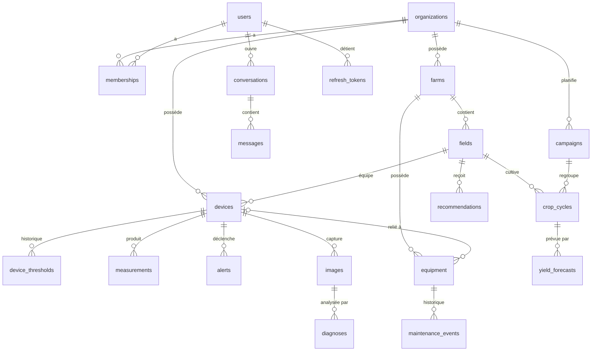

# 05 — Choix technologiques et API

Confidentiel — réservé aux partenaires de travail.

Pour les briques logicielles, les trois variantes se lisent ainsi :
- **compétition / démo** : ce qui donne la meilleure démonstration en un temps limité ;
- **production** : la cible à 10 000 kits ;
- **compromis** : ce que l'on construit maintenant, sans se fermer la route vers la production.

Les versions exactes sont épinglées dans les fichiers de dépendances de chaque dossier.

## 1. Synthèse

| Couche | Compétition / démo | Production | **Compromis retenu** | Pourquoi |
|---|---|---|---|---|
| Firmware kit | Arduino-ESP32 | ESP-IDF (OTA signée, Secure Boot, partitions maîtrisées) | **Arduino-ESP32 core 3.x** (base ESP-IDF 5) | L'équipe l'utilise déjà ; les API ESP-IDF restent accessibles pour l'OTA et la sécurité |
| Application mobile | Flutter | Flutter + modules natifs Android ciblés | **Flutter** | Accès HTTP local au kit, hors ligne (SQLite), un seul code Android/iOS, performances correctes sur téléphones d'entrée de gamme |
| Web | Next.js (App Router) | Next.js + BFF, rendu serveur, cache CDN | **Next.js + TypeScript + Tailwind + TanStack Query + ECharts + next-intl** | Écosystème mature, rendu serveur léger pour les connexions lentes, i18n fr/wo/ff |
| API | FastAPI | FastAPI (modules extraits en services si nécessaire) | **FastAPI + Pydantic v2 + SQLAlchemy 2** | Python commun avec la data/ML, OpenAPI automatique, typage, rapidité de développement |
| Base | PostgreSQL + Timescale (conteneur) | Timescale managée + PostGIS, répliques | **PostgreSQL 16 + TimescaleDB + PostGIS** | Une seule base pour les relations, les séries et la géographie |
| Broker | Mosquitto | EMQX en cluster, TLS, ACL par kit | **Mosquitto (dev) → EMQX (prod)** | Même protocole, migration sans toucher aux kits |
| Stockage objets | MinIO | S3 + KMS | **S3 (MinIO en local)** | API S3 standard, portable |
| File / cache | — | Redis / Valkey, puis Kafka seulement si plus de 10 000 messages/s | **Aucun au MVP**, Redis en V2 | YAGNI : le débit est faible (environ 33 messages/s à 10 000 kits) |
| ML tabulaire | LightGBM, XGBoost, CatBoost, stacking | XGBoost ou LightGBM, modèle unique ou petit ensemble | **scikit-learn + XGBoost** (LightGBM et CatBoost en option) | Performance et coût d'inférence |
| Vision | timm (grands modèles), k-fold, TTA | MobileNetV3 / EfficientNet-Lite int8 sur téléphone (ONNX ou TFLite) | **PyTorch + torchvision → ONNX Runtime** sur serveur, puis sur téléphone | Itérer vite, puis aller vers le hors ligne |
| LLM | Modèle le plus capable, effort élevé | `claude-opus-5-5`, effort adapté par requête, cache, repli serveur | **`claude-opus-5-5`, effort moyen, cache, repli** | Qualité du raisonnement agronomique et de l'usage des outils |
| Orchestration | `make` + DVC | Airflow ou Dagster managé | **DVC + CronJobs**, Airflow en V2 | Moins de composants à opérer |
| Hébergement | 1 VM + Docker Compose | EKS multi-AZ, comptes séparés | **EKS, 2 nœuds**, portable | Voir `02_architecture.md` §5 |
| IaC | — | Terraform (ou OpenTofu), modules, état distant verrouillé | **Terraform** | Standard, modules AWS officiels |
| CI/CD | GitHub Actions | GitHub Actions + ArgoCD (GitOps), signature d'images | **GitHub Actions + ArgoCD** | Traçabilité : chaque déploiement correspond à un commit |
| Observabilité | Journaux | Prometheus, Grafana, Loki, Tempo, OpenTelemetry, Sentry | **Prometheus + Grafana + OTel** | Open source, portable |
| Messagerie agriculteurs | Notifications push | WhatsApp Business Platform + SMS via un agrégateur local | **WhatsApp texte + SMS de secours** | Canal déjà utilisé par les producteurs |
| Paiement | — | API Wave / Orange Money | V2 | Selon le modèle économique retenu |
| Cartes | OSM en ligne | MapLibre + tuiles vectorielles, cache hors ligne sur le téléphone | **MapLibre + OSM** | Gratuit, compatible hors ligne |

## 2. Pourquoi pas…

- **Une PWA à la place de l'application** : un site servi en HTTPS ne peut pas appeler `http://192.168.4.1` (contenu mixte bloqué), et le stockage en arrière-plan est peu fiable sur Android d'entrée de gamme.
- **React Native** : viable, mais Flutter offre un rendu plus constant sur les téléphones modestes et un bon accès à SQLite et aux tâches de fond.
- **Django** : excellent pour un back-office, mais FastAPI est plus naturel pour une API typée et asynchrone, partagée avec l'équipe ML.
- **InfluxDB** : il faudrait une deuxième base pour les relations et la géographie, et le SQL serait moins standard.
- **AWS IoT Core** : il ferait gagner du temps sur la gestion des certificats, mais il enferme la plateforme chez un fournisseur et complique un hébergement souverain. Il reste une option pour la V2.
- **Kafka** : surdimensionné pour le débit prévu ; il ne viendrait qu'au-delà d'environ 10 000 messages/s ou s'il faut rejouer les flux pour plusieurs consommateurs.

## 3. API REST v1 — détail

Les conventions générales (enveloppe, rôles, liste des routes) sont dans `../CONVENTIONS.md` §5. La documentation OpenAPI est générée par FastAPI sur `/docs`, désactivée en production. Les exemples ci-dessous sont **indicatifs** : la référence est l'OpenAPI produite par `backend/`.

### 3.1 Authentification

```http
POST /v1/auth/token
Content-Type: application/json

{ "username": "+221770000000", "password": "••••••••" }
```

```json
{
  "success": true,
  "data": { "access_token": "eyJ…", "refresh_token": "eyJ…", "token_type": "bearer", "expires_in": 900 },
  "error": null,
  "meta": null
}
```

- Jeton d'accès de 15 minutes et jeton de rafraîchissement de 30 jours.
- Le jeton de rafraîchissement est **à usage unique**. Le réutiliser révoque toute la famille de jetons, ce qui détecte un vol.
- La connexion par code à usage unique (SMS ou WhatsApp) des agriculteurs viendra s'ajouter avec `POST /v1/auth/otp/request` et `POST /v1/auth/otp/verify` (V1.1). Elle nécessite un fournisseur SMS/WhatsApp.

### 3.2 Télémétrie par lots (relais mobile, passerelle)

```http
POST /v1/telemetry/batch
X-Device-Key: <secret du kit>        (ou Authorization: Bearer <JWT> d'un membre de l'organisation)
Content-Type: application/json

{
  "points": [
    { "schema": "telemetry.v1", "device_id": "SA92-000123", "fw": "1.1.0", "seq": 1234,
      "ts": "2026-10-26T10:00:00Z", "source": "relay",
      "m": { "soil_moisture_pct": 42.0, "air_temp_c": 31.5, "pump_on": false, "soil_sensor_ok": true } }
  ]
}
```

```json
{ "success": true, "data": { "accepted": 1, "duplicates": 0, "rejected_values": 0 }, "error": null, "meta": null }
```

- 1 000 points au plus par lot ; au-delà, la requête est rejetée.
- Une valeur hors plage plausible est enregistrée à `null` et comptée dans `rejected_values`.
- Un doublon `(device_id, ts)` est ignoré et compté, sans erreur : le téléphone peut renvoyer un lot sans risque.

### 3.3 Séries pour les courbes (F9)

```http
GET /v1/devices/{device_id}/measurements?from=2026-10-01T00:00:00Z&to=2026-10-26T00:00:00Z&bucket=1d
Authorization: Bearer <JWT>
```

- `bucket` ∈ `raw`, `1h`, `1d`, `1w`, `1mo`. Les courbes « jour », « semaine », « mois » et « année » utilisent respectivement `1h`, `1h`, `1d` et `1w`.
- En PostgreSQL, les buckets `1h` et `1d` sont lus dans les agrégats continus Timescale (`measurements_1h`, `measurements_1d`).

### 3.4 Seuils

```http
PUT /v1/devices/{device_id}/thresholds
{ "start": 30, "stop": 60 }
```

Erreur si la règle du firmware n'est pas respectée (`0 ≤ start`, `start + 5 ≤ stop ≤ 100`) :

```json
{ "success": false, "data": null,
  "error": { "code": "THRESHOLDS_INVALID", "message": "seuils invalides : 0 <= start, start + 5 <= stop <= 100" },
  "meta": null }
```

### 3.5 Assistant

```http
POST /v1/assistant/chat
{ "conversation_id": null, "message": "Est-ce que je dois arroser ce soir ?", "device_id": "…", "lang": "fr" }
```

La réponse contient le texte, les citations des fiches utilisées, la liste des outils appelés, une indication de transfert vers un conseiller et l'identifiant de conversation. Si l'assistant n'est pas configuré (clé absente), l'API renvoie `503 ASSISTANT_UNAVAILABLE`.

### 3.6 Codes d'erreur principaux

| Code HTTP | `error.code` | Cas |
|---|---|---|
| 400 | `THRESHOLDS_INVALID`, `DEVICE_NOT_ON_FARM`, `INVALID_RANGE`, `INVALID_SCOPE`… | Règle métier ou paramètre invalide |
| 401 | `UNAUTHENTICATED`, `INVALID_CREDENTIALS`, `TOKEN_EXPIRED`, `TOKEN_INVALID`, `REFRESH_TOKEN_REUSED`, `DEVICE_KEY_INVALID` | Authentification |
| 403 | `FORBIDDEN`, `DEVICE_MISMATCH` | Rôle insuffisant **dans sa propre organisation** |
| 404 | `NOT_FOUND`, `NO_ACTIVE_CYCLE` | Ressource inexistante **ou d'une autre organisation** |
| 409 | `CONFLICT`, `DEVICE_EXISTS`, `DEVICE_INACTIVE` | Doublon ou état incompatible |
| 413 | `PAYLOAD_TOO_LARGE`, `BATCH_TOO_LARGE` | Corps ou lot trop gros (plus de 1 000 mesures) |
| 422 | `VALIDATION_ERROR` | Corps invalide |
| 429 | `RATE_LIMITED` | Limitation de débit (en-tête `Retry-After`) |
| 502 | `ASSISTANT_MODEL_NOT_FOUND`, `ASSISTANT_BAD_REQUEST`, `ASSISTANT_UPSTREAM_ERROR` | Réponse invalide du fournisseur LLM |
| 503 | `NOT_READY`, `MODEL_UNAVAILABLE`, `WEATHER_UNAVAILABLE`, `ASSISTANT_UNAVAILABLE`… | Dépendance indisponible |

`MODEL_UNAVAILABLE` est renvoyé quand toute la chaîne de repli a échoué (bundle local, lot OctOpus, règles FAO-56) : l'API préfère ne rien recommander plutôt que recommander au hasard. Le catalogue complet, avec le statut de chaque code, est dans `../CONVENTIONS.md` §5.3 ; il est vérifié contre `backend/app/`.

### 3.7 Client OctOpus

Le backend et `ml/` parlent à OctOpus ML par un client HTTP maison (`httpx`), isolé dans `ml/src/agriml/octopus/client.py` et `backend/app/services/inference/`. **Ne jamais installer le paquet PyPI `octopus-ml`** : il porte le même nom mais n'a aucun lien avec la plateforme https://octopus.ml/app (risque de confusion de dépendance). Le contrat exact de l'API OctOpus n'est pas public : les points à confirmer avec le fournisseur sont listés dans `09_octopus_ml.md` §11.

## 4. API locale du kit (firmware v1.1) et évolutions v1.2

| Route | v1.1 (actuel) | v1.2 (proposé) |
|---|---|---|
| `GET /` | Page minimale | Inchangé |
| `GET /data` | JSON des mesures et états | + `fw`, `uptime_s`, `heure_ok`, `param_version`, et la provenance de chaque valeur dérivée (`16_architecture_octopus.md`) |
| `POST /seuils?start=&stop=` | `X-Agri-Token`, 400/401/405 | Inchangé |
| `POST /plante?etat=0\|1` | `X-Agri-Token` | + corps JSON `{etat: 0\|1\|2, confiance, classe, version, calcule_a}`, gardé en cache pour la page locale |
| `POST /parametres` | — | Jeu de paramètres versionné (seuils, seuils NPK, étalonnage), bornes contrôlées, NVS, retour aux valeurs d'usine (`16_architecture_octopus.md`) |
| `POST /pompe`, `POST /mode` | — | Commande manuelle limitée (10 min au plus) et bascule auto/manuel, journalisées dans les événements (`10_web_ux.md` §1.3) |
| `POST /heure` | — | Le téléphone fournit l'heure UTC |
| `GET /historique?depuis=&max=` | — | Agrégats sur 5 min depuis LittleFS, paginés |
| `POST /ota` | — | Image signée, partitions A/B |

## 5. Schéma de base de données

Le schéma de référence est `db/migrations/001_init.sql` puis `002_extensions.sql` (campagnes, équipements, maintenance, cache météo, prévisions de rendement, registre des modèles) ; le modèle ORM utilisé pour les tests est dans `backend/app/db/`. Les migrations sont appliquées dans l'ordre par `python -m app.db.migrate` (voir `../CONVENTIONS.md` §6).



`weather_cache` (clé : position arrondie et date) et `model_registry` (miroir du registre MLflow / OctOpus) n'ont pas de clé étrangère métier.
