# 06 — DevSecOps

Confidentiel — réservé aux partenaires de travail.

## 1. Cycle de développement sécurisé

```mermaid
flowchart LR
    DEV["Poste développeur<br/>pre-commit : ruff, gitleaks"] --> PR["Pull request<br/>revue obligatoire, CODEOWNERS"]
    PR --> CI["CI GitHub Actions"]
    subgraph CI_STAGES["Étapes CI (bloquantes)"]
        L["Lint + types"]
        T["Tests + couverture ≥ 80 %"]
        S["SAST : bandit, semgrep<br/>Secrets : gitleaks<br/>Dépendances : pip-audit, npm audit"]
        I["IaC : tflint, checkov, kubeconform"]
        B["Build image → trivy → SBOM syft → signature cosign"]
    end
    CI --> CI_STAGES
    CI_STAGES --> REG["ECR (tags immuables)"]
    REG --> GITOPS["PR de mise à jour du tag<br/>(overlay prod)"]
    GITOPS --> ARGO["ArgoCD synchronise"]
    ARGO --> STG["Staging<br/>DAST ZAP baseline + tests E2E"]
    STG --> APPROVE{"Approbation manuelle"}
    APPROVE --> PROD["Production"]
```

- **Branches** : développement sur le tronc avec des branches courtes. `main` est protégée (revue, CI verte, historique linéaire).
- **Commits** : Conventional Commits (`feat:`, `fix:`, `docs:`…), signés.
- Les fichiers correspondants sont `.github/workflows/ci.yml`, `.github/workflows/cd.yml`, `.github/dependabot.yml` et `.pre-commit-config.yaml`.

| | Compétition / démo | Production | Compromis |
|---|---|---|---|
| Portes de qualité | Lint + tests | Tous les contrôles ci-dessus bloquants, signature vérifiée à l'admission (Kyverno ou Sigstore policy-controller), DAST | **Tout bloquant sauf DAST** (rapport seulement) ; vérification des signatures en V2 |

## 2. Chaîne d'approvisionnement logicielle

- Dépendances **épinglées** (fichiers de verrouillage), mises à jour par Dependabot chaque semaine.
- Images de base minimales (`python:3.12-slim`), utilisateur non root, aucun outil de compilation dans l'image finale.
- Une **SBOM** (syft) par image, stockée avec l'artefact.
- **Signature** des images avec cosign en mode keyless (identité OIDC GitHub).
- Les GitHub Actions doivent être épinglées par **SHA de commit**. Les versions par tag dans les workflows fournis sont à convertir avant la mise en production.
- Objectif : SLSA niveau 2 en V2 (provenance signée générée par la CI).

## 3. Sécurité applicative

Cible : **OWASP ASVS niveau 2**.

### 3.1 OWASP API Security Top 10 (2023) — correspondance avec le code

| Risque | Contrôle mis en place |
|---|---|
| API1 BOLA (accès à l'objet d'un autre) | Filtrage par organisation sur chaque ressource ; 404 hors périmètre ; RLS PostgreSQL en défense en profondeur ; tests dédiés |
| API2 Authentification défaillante | argon2 ; JWT HS256 courts avec `iss`, `aud` et `type` ; refresh rotatif avec détection de réutilisation ; limitation de débit renforcée sur `/v1/auth/token` |
| API3 Exposition de propriétés | Schémas de réponse Pydantic explicites (jamais d'objet ORM brut) ; secret de kit montré une seule fois |
| API4 Consommation de ressources | Limitation de débit, lots ≤ 1 000, pagination, plafond d'itérations et de jetons pour l'assistant |
| API5 Contrôle des fonctions | Rôles par organisation (`farmer`, `coop_manager`, `agronomist`, `admin`) vérifiés par dépendance FastAPI |
| API6 Flux métier sensibles | Seuils validés comme dans le firmware ; commandes de kit journalisées |
| API7 SSRF | Les fournisseurs externes (météo) ont une URL de base fixe ; aucune URL fournie par l'utilisateur n'est appelée |
| API8 Mauvaise configuration | En-têtes de sécurité, `/docs` désactivé en production, CORS restreint, erreurs sans pile d'appels |
| API9 Inventaire | OpenAPI versionnée, préfixe `/v1`, dépréciation annoncée |
| API10 Consommation d'API tierces | Réponses météo et LLM validées ; délais d'expiration ; erreurs du SDK traduites |

**CSRF.** L'API utilise des jetons Bearer et non des cookies, donc elle n'est pas exposée au CSRF. Le BFF web garde les jetons dans des cookies `HttpOnly`, `Secure`, `SameSite=Strict`, et ses routes de modification exigent un en-tête personnalisé.

### 3.2 OWASP Top 10 pour les applications LLM — assistant

| Risque | Contrôle |
|---|---|
| Injection de prompt (directe ou par une fiche) | Les outils exécutent un contrôle d'accès côté serveur, quoi que dise le modèle ; contenus externes marqués comme données ; aucun outil d'écriture sensible |
| Divulgation d'informations | Les outils ne renvoient que les données de l'utilisateur ; pas de secret dans le prompt ; conversations isolées par utilisateur |
| Agentivité excessive | Outils en lecture seule, sauf `request_advisor_visit` (qui crée une demande, sans action physique) ; l'assistant **ne pilote pas la pompe** |
| Sortie dangereuse | Pas de dose au-delà de l'étiquette ; renvoi vers un conseiller ; rendu en texte simple (pas de HTML) côté client |
| Consommation non bornée | Plafond d'itérations d'outils, `max_tokens`, quotas par utilisateur, surveillance des coûts |
| Désinformation | Citations obligatoires des fiches, jeu d'évaluation, revue par des agronomes |

## 4. Sécurité IoT

| Élément | État | Suite |
|---|---|---|
| Mot de passe Wi-Fi unique par kit, jeton API, POST uniquement, validation des seuils, CRC Modbus, sécurité pompe, watchdog | **Corrigé en v1.1** (non compilé, non testé sur le matériel) | Valider sur banc |
| OTA signée avec retour arrière | À faire (v1.2) | Clé de signature conservée hors ligne |
| Identité cloud du kit | Secret par kit, haché côté serveur (MVP) | Certificat X.509 par kit (V2), rotation |
| MQTT | TLS 8883, ACL par `device_id` | Révocation d'un kit volé depuis la plateforme |
| Chiffrement flash + Secure Boot v2 | **Recommandé, non appliqué** : irréversible (eFuses) | À planifier avec l'industrialisation, sur un lot pilote, avec une procédure écrite |
| Accès physique | Boîtier fermé | Vis inviolables, port USB interne |

## 5. Sécurité cloud (AWS)

- **Comptes séparés** (AWS Organizations) : `prod`, `staging`, `security` (journaux et outils), `shared` (ECR), avec des SCP qui interdisent la désactivation de CloudTrail et la sortie des régions autorisées.
- **Journalisation** : CloudTrail sur toute l'organisation, GuardDuty, Security Hub (CIS AWS Foundations), AWS Config.
- **Identités** : aucune clé d'accès longue durée. La CI assume un rôle par OIDC, les pods via IRSA, et chaque rôle a un périmètre minimal (`infra/terraform/modules/iam`).
- **Réseau** : endpoint EKS privé, sous-réseaux privés, endpoints VPC pour S3, ECR et Secrets Manager, WAF devant l'ALB, NetworkPolicy deny-all par défaut. Le HTTPS sortant (443) n'est ouvert qu'aux pods étiquetés `smartagri92.io/egress-https` ; la clé `OCTOPUS_API_KEY` n'est montée que dans l'espace `ml`. Une NetworkPolicy standard filtre par pod, pas par nom DNS : avec le composant Cilium (`infra/k8s/components/egress-fqdn-cilium/`), seuls les pods `smartagri92.io/octopus=true` de l'espace `smartagri92-ml` joignent `octopus.ml`, et seuls les pods étiquetés de l'espace applicatif joignent `api.anthropic.com` et `api.open-meteo.com` (plus S3 et STS). Sans Cilium, un pod autorisé au 443 peut joindre n'importe quelle destination : c'est un risque accepté au MVP, à fermer avant la production.
- **Données** : KMS sur S3, la base et les secrets ; S3 avec blocage de l'accès public et politique TLS uniquement ; sauvegarde PITR de la base ; restauration testée chaque trimestre.
- **Budget** : alertes AWS Budgets (module `budget`).

| | Compétition / démo | Production | Compromis |
|---|---|---|---|
| Comptes | 1 compte | 4 comptes + SCP | **2 comptes** (prod, non-prod) au MVP, 4 en V2 |
| Détection | — | GuardDuty, Security Hub, SIEM | GuardDuty + CloudTrail + alertes Grafana |

## 6. Gestion des secrets

| Secret | Stockage | Rotation |
|---|---|---|
| `JWT_SECRET` | Secrets Manager → External Secrets → variable d'environnement du pod | Tous les 90 jours (V2 : identifiant `kid` pour une rotation sans coupure) |
| `DATABASE_URL` | Secrets Manager | Selon le fournisseur ; utilisateur applicatif sans droits DDL |
| `ANTHROPIC_API_KEY` | Secrets Manager | Tous les 90 jours et à tout départ dans l'équipe |
| `OCTOPUS_API_KEY` | Secrets Manager → External Secrets, monté seulement dans les pods ML | Tous les 90 jours et à tout départ dans l'équipe ; une clé par environnement, périmètre le plus étroit que propose OctOpus |
| `AGRIML_PSEUDO_SALT` | Secrets Manager (jamais dans OctOpus, jamais journalisé) | Changement = nouvel `AGRIML_PSEUDO_SALT_ID` ; les anciens instantanés restent liés à l'ancien identifiant |
| Secrets des kits | Base (empreinte HMAC + poivre) ; le poivre est dans Secrets Manager | Régénération via l'API (le secret est affiché une seule fois) |
| Mot de passe Wi-Fi et jeton des kits | NVS du kit + stockage sécurisé du téléphone | Réinitialisation par appui long (procédure à définir) |
| Local | `.env` ignoré par git, `.env.example` sans valeur | — |

En CI, gitleaks bloque tout secret commité. Un secret exposé est révoqué immédiatement, puis on cherche s'il a été utilisé.

## 7. Supervision, journaux, incidents

- **Journaux** JSON structurés avec `request_id`, sans données personnelles (numéros de téléphone masqués, aucun contenu de conversation dans les journaux d'infrastructure). Rétention : 30 jours à chaud, 1 an archivés.
- **Métriques** RED (débit, erreurs, durée) par route, plus des métriques d'ingestion (retard, points rejetés, doublons), de kits silencieux, de coût de l'assistant et de dérive des modèles. Les règles sont dans `infra/observability/`.
- **SLO** : disponibilité API de 99,5 % (MVP), latence p95 inférieure à 500 ms, ingestion de 99 % des lots en moins de 2 s. Un budget d'erreur trop consommé gèle les nouvelles fonctionnalités.
- **Astreinte** : en petite équipe, une rotation hebdomadaire et des alertes vers Grafana OnCall, ou vers un canal de messagerie dédié.
- **Incidents** : un runbook par alerte, un post-mortem sans recherche de coupable, et une notification à la CDP et aux personnes concernées en cas de violation de données personnelles, dans les délais prévus par la loi.

## 8. Stratégie de tests

| Niveau | Outils | Contenu | Où |
|---|---|---|---|
| Unitaires | pytest | Règles métier (seuils, ET0, alertes), sécurité (jetons), features ML, absence de fuite | `backend/tests`, `ml/tests` |
| Intégration | pytest + conteneur Timescale en CI | Migration SQL, hypertable, agrégats continus, RLS | `ci.yml` (job backend) |
| Contrat | Schemathesis sur l'OpenAPI | Robustesse de toutes les routes | V1.1 |
| E2E web | Playwright | Connexion, tableau de bord, seuils, alertes | V1.1 |
| E2E mobile | `integration_test` de Flutter + faux kit HTTP | Lecture locale, file d'envoi, reprise | V1.1 |
| Matériel en boucle | Banc avec un kit réel + script qui simule le sol (relais, potentiomètre) | Plan de tests du rapport d'audit (401, 405, 400, capteur débranché, CRC, verrouillage pompe) | Avant le pilote |
| Charge | k6 ou Locust | 10 000 kits simulés, lots de 1 000 points | V2 |
| Sécurité dynamique | OWASP ZAP baseline | Staging | CD |
| ML | pytest + smoke sur données synthétiques | Fuites, CV, métriques, promotion | `ml/tests` |
| Assistant | Jeu d'évaluation (voir `03_ia.md` §13) | Exactitude, sécurité, langue | Avant chaque changement de prompt ou de modèle |

Couverture visée : ≥ 80 % sur `backend/app` et `ml/src/agriml`.

## 9. Conformité et données personnelles

- **Loi n° 2008-12** sur la protection des données à caractère personnel et **CDP** :
  - déclaration des traitements ;
  - autorisation des transferts hors du Sénégal (hébergement à Paris) ;
  - information des personnes, consentement, droits ;
  - un nouveau cadre légal est en préparation, à surveiller.
- **AIPD** pour l'assistant (conversations), les photos, le partage de données avec les partenaires **et l'envoi d'instantanés vers OctOpus ML**. Pour OctOpus, la déclaration CDP doit couvrir le transfert hors du Sénégal (localisation des serveurs à confirmer avec le fournisseur, voir `09_octopus_ml.md` §11). Seules des données pseudonymisées y partent : identifiants remplacés par un HMAC salé, positions arrondies, aucun numéro de téléphone ni texte de conversation.
- Politique de confidentialité et conditions d'utilisation en français et en wolof (version audio).
- **Contrats** avec les sous-traitants (hébergeur, fournisseur du LLM, OctOpus ML, fournisseur SMS/WhatsApp) : clauses de protection des données et localisation déclarée.
