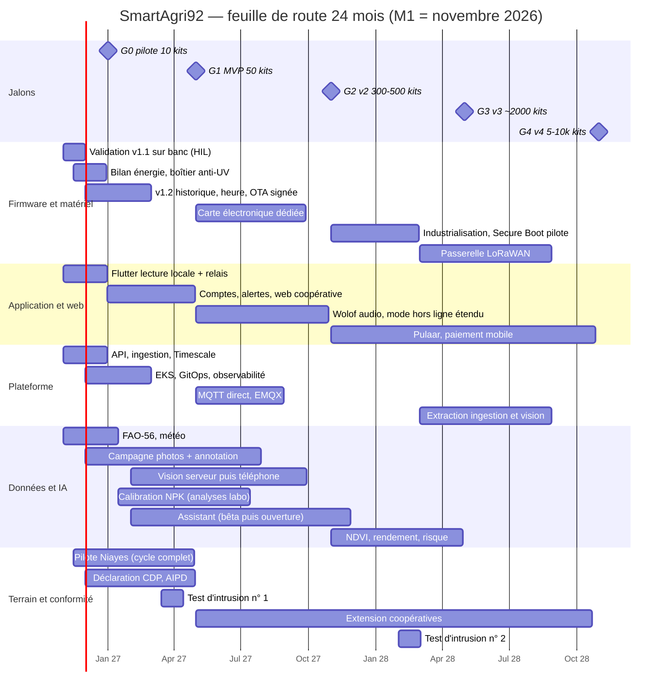

# 07 — Feuille de route, équipe et budget

Confidentiel — réservé aux partenaires de travail.

Tous les montants sont des **hypothèses à valider** par des devis et par le marché local. 1 € = 655,957 FCFA. M1 = novembre 2026.

## 1. Versions successives

| Version | Période | Kits installés (cumul) | Contenu | Porte de passage |
|---|---|---|---|---|
| **v0.1 Pilote** | M1–M2 (nov.–déc. 2026) | 10 | Firmware v1.1 validé sur banc puis sur le terrain ; application Flutter (lecture locale, seuils, relais vers le cloud) ; ingestion, stockage, tableau de bord minimal ; recommandations FAO-56 | G0 |
| **v1 MVP** | M3–M6 (janv.–avr. 2027) | 50 | Firmware v1.2 (historique, heure, OTA signée) ; comptes et organisations ; alertes WhatsApp/SMS ; web coopérative ; météo ; assistant en français (bêta fermée) ; détection de maladies côté serveur (indicative) ; test d'intrusion n° 1 | G1 |
| **v2** | M7–M12 (mai–oct. 2027) | 300–500 | Wolof (texte et audio) ; détection de maladies sur le téléphone, hors ligne ; risque de maladie lié à la météo ; calibration NPK par ML ; tableau de bord agronome ; MQTT direct si le kit a une connectivité ; déclaration CDP finalisée | G2 |
| **v3** | M13–M18 (nov. 2027–avr. 2028) | ≈ 2 000 | Indices satellite (NDVI) ; prévision de rendement ; score de risque pour les partenaires financiers (avec contrôle d'équité) ; pulaar ; recommandations personnalisées ; test d'intrusion n° 2 | G3 |
| **v4** | M19–M24 (mai–oct. 2028) | 5 000–10 000 | Passerelles LoRaWAN pour les zones sans couverture ; extraction des premiers microservices (ingestion, vision) ; option d'hébergement souverain ; paiement mobile | G4 |

**Saisons.** La contre-saison (novembre à juin) est la grande saison du maraîchage dans les Niayes, donc le pilote démarre au bon moment. L'hivernage (juillet à octobre) sert surtout à collecter des données sur les maladies, quand l'humidité est forte.

**Le test de 7 jours prévu dans le dossier est trop court.** Les 10 kits pilotes restent installés jusqu'à la fin du MVP pour couvrir au moins **un cycle de culture complet** (oignon ou tomate, 3 à 4 mois), avec des parcelles témoins sans kit.

## 2. Diagramme de Gantt

## 3. Périmètre du MVP (v1)

| Priorité | Contenu |
|---|---|
| **Indispensable** | Firmware v1.1 validé, puis v1.2 ; application : appairage, lecture locale, seuils, file d'envoi vers le cloud, alertes ; API : authentification, exploitations, parcelles, kits, télémétrie par lots, séries, seuils, alertes ; web coopérative ; recommandation d'irrigation FAO-56 + météo ; notifications WhatsApp/SMS ; socle de sécurité (doc 06) |
| **Souhaitable** | Assistant en français (bêta fermée, plafond d'usage) ; détection de maladies côté serveur, présentée comme indicative ; export CSV pour l'agronome |
| **Exclu du MVP** | Prévision de rendement, score de risque financier, satellite, LoRaWAN, paiement, wolof audio |

Ce choix suit une règle simple : **le MVP doit prouver que le kit fait économiser de l'eau sans perdre de rendement, et que l'agriculteur s'en sert**. Tout le reste vient après.

## 4. Indicateurs et portes de passage

Les valeurs cibles sont des hypothèses de départ que le comité de pilotage ajustera avec les premières données.

| Porte | Critères de passage (tous requis) |
|---|---|
| **G0** (fin M2) | Tous les tests de sécurité et de fonctionnement du rapport d'audit passent sur le banc ; 10 kits en service ≥ 90 % du temps sur 4 semaines ; ≥ 95 % des points relevés arrivent dans le cloud ; aucun incident de pompe |
| **G1** (fin M6) | 50 kits ; ≥ 70 % des agriculteurs utilisent l'application chaque semaine ; économie d'eau mesurée contre parcelles témoins (objectif −20 %) sans baisse de rendement ; coût du kit à ±10 % de la cible ; test d'intrusion sans constat critique ouvert |
| **G2** (fin M12) | 300 à 500 kits ; abandon < 15 % ; < 0,3 ticket de support par kit et par mois ; modèle de maladies au-dessus du seuil défini sur données terrain ; déclaration CDP faite ; marge brute positive par kit |
| **G3** (fin M18) | ≈ 2 000 kits ; plusieurs coopératives ; erreur de prévision de rendement sous la cible ; assistant validé sur le jeu d'évaluation, en français et en wolof (relecture native) |
| **G4** (M24) | 5 000 à 10 000 kits ; coût par kit d'une passerelle LoRaWAN validé ; SLO tenus 3 mois de suite |

Un échec à une porte ne veut pas dire arrêt : on prolonge la phase et on corrige avant d'augmenter le nombre de kits.

## 5. Équipe

### 5.1 Équipe recommandée (scénario standard)

Les coûts sont des **coûts employeur mensuels** supposés, en FCFA, à valider avec le marché dakarois.

| Rôle | ETP M1–M6 | ETP M7–M12 | ETP M13–M24 | Coût mensuel supposé |
|---|---|---|---|---|
| CTO / architecte principal | 1 | 1 | 1 | 1 300 000 |
| Développeur backend / DevOps | 1 | 1 | 1 | 900 000 |
| Développeur mobile et web | 1 | 1 | 1 | 800 000 |
| Ingénieur embarqué / IoT | 1 | 1 | 1 | 800 000 |
| Data scientist / ML | 1 | 1 | 1 | 900 000 |
| Agronome terrain | 1 | 1 | 1 | 550 000 |
| Designer UX/UI | 0,5 | 1 | 1 | 700 000 (temps plein) |
| Chef de produit | 0,5 | 0,5 | 0,5 | 900 000 (temps plein) |
| Techniciens terrain | — | 2 | 4 | 275 000 chacun |
| Développeur full-stack junior | 1 (dès M3) | 1 | 1 | 400 000 |
| Data engineer / MLOps | — | — | 1 | 900 000 |
| Support et animation | — | — | 1 | 350 000 |
| SRE / sécurité | — | — | 0,5 | 1 100 000 (temps plein) |
| **Total** | **7, puis 8 dès M3** | **10,5** | **15** | **6,05 M (M1–M2), 6,45 M (M3–M6) → 7,35 M → 9,7 M par mois** |

Le développeur full-stack junior arrive à M3 au lieu de M7 (recommandation de `12_plan_developpement.md` §6) : une seule personne porterait sinon l'application Flutter et le web pendant tout le MVP. Surcoût : 4 × 400 000 = 1,6 M FCFA.

Fourchettes utilisées : senior 0,9 à 1,5 M ; confirmé 0,5 à 0,9 M ; junior 0,3 à 0,5 M ; agronome 0,4 à 0,7 M ; technicien 0,2 à 0,35 M.

Quand le recrutement d'un profil senior est difficile, il y a deux solutions : un poste à temps partagé (par exemple un SRE en freelance) ou un partenariat avec des écoles d'ingénieurs locales pour les stages.

### 5.2 Tableau des rôles du dossier (§17), proposition

| Domaine | Responsable proposé | Échéance |
|---|---|---|
| Matériel et électronique | Ingénieur embarqué / IoT | Bilan énergie et choix de la batterie : M1 ; carte dédiée : M11 |
| Firmware (code du kit) | Ingénieur embarqué / IoT, revue par le CTO | v1.1 validé : M1 ; v1.2 : M4 |
| IA de détection des plantes | Data scientist / ML, étiquettes validées par l'agronome | Serveur : M6 ; téléphone : M12 |
| Site web et application | Développeur mobile et web + backend | Pilote : M2 ; MVP : M6 |
| Boîtier 3D et fabrication | Ingénieur embarqué + fablab partenaire | Boîtier anti-UV : M2 ; série : M15 |
| Tests terrain et documentation | Agronome terrain + chef de produit | Protocole : M1 ; rapport de cycle complet : M6 |

Les noms sont à compléter par l'équipe.

## 6. Coût d'un kit (BOM)

Prix unitaires estimés pour une petite série, en FCFA, à remplacer par des devis.

| Composant | Coût estimé |
|---|---|
| Adafruit ESP32-S3 Feather | 12 000 |
| ESP-CAM (caméra OV2640) | 7 000 |
| Écran TFT 3,5" tactile | 9 000 |
| Capteur d'humidité du sol capacitif | 2 000 |
| BME280 | 3 000 |
| Sonde NPK RS485 + MAX485 | 25 000 |
| Module relais + pompe 12 V | 9 000 |
| Buzzer, LED, connecteurs | 3 000 |
| Panneau solaire 20 W | 12 000 |
| Batterie ≥ 50 Wh + chargeur | 16 000 |
| Boîtier imprimé 3D (ASA ou PETG, résistant aux UV) + joints | 6 000 |
| Câbles, presse-étoupes, petite carte | 4 000 |
| Assemblage, test, transport | 7 000 |
| **Total prototype** | **≈ 115 000** |

Ce qu'il faut retenir :
- **La sonde NPK représente plus de 20 % du coût**, et sa précision reste à démontrer (voir `03_ia.md`). Il faut prévoir une **variante sans NPK, à environ 90 000 FCFA**, avec des analyses de sol périodiques à la place.
- **Le PLA standard ne résiste pas au soleil.** Le boîtier doit être imprimé en ASA ou en PETG.
- En série (v3), une carte dédiée avec un module ESP32-S3 à la place de la Feather, et un écran plus petit, permettent de viser **≈ 90 000 FCFA** avec NPK.

## 7. Budget sur 24 mois

### 7.1 Scénario standard (détail)

| Poste | Hypothèse | FCFA (M) | ≈ k€ |
|---|---|---|---|
| Masse salariale | Équipe du §5.1 : 2 × 6,05 M + 4 × 6,45 M + 6 × 7,35 M + 12 × 9,7 M | 198,4 | 302,5 |
| Kits pilote et MVP | 50 kits terrain + 10 de rechange et de banc, à 115 000 FCFA | 6,9 | 10,5 |
| Matériel de développement | Banc de test (HIL), prototypes, outillage | 3,0 | 4,6 |
| Cloud | 50 €/mois (M1–M6), 500 €/mois (M7–M12), 1 200 €/mois (M13–M24) | 11,6 | 17,7 |
| Assistant (LLM) | Enveloppe plafonnée ; voir §7.3 | 6,0 | 9,1 |
| Plateforme ML OctOpus | Pro+ (30 $/mois) pour 1 data scientist en M1–M2, puis Team en M3–M24 provisionné à 200 $/mois (prix public « à partir de 100 $ », probablement par siège) ; ≈ 4 460 $ à ≈ 600 FCFA/$. Enterprise / VPC sur devis, **non inclus**. Montants en USD à confirmer avec le fournisseur (`09_octopus_ml.md` §11–12) | 2,7 | 4,1 |
| Analyses de sol en laboratoire | ≈ 300 échantillons pour calibrer les sondes NPK (≈ 15 000 FCFA chacun, devis à obtenir) | 4,5 | 6,9 |
| Annotation des photos | ≈ 10 000 images validées par des agronomes | 2,0 | 3,0 |
| Messagerie WhatsApp / SMS | Alertes et codes de connexion | 3,0 | 4,6 |
| Opérations terrain | Transport, installation, formation : ≈ 1 M par mois | 24,0 | 36,6 |
| Audit de sécurité / tests d'intrusion | 2 campagnes (avant le MVP et avant la v3) : firmware, application, API, cloud | 15,0 | 22,9 |
| Juridique et conformité | CDP, AIPD, CGU, contrats de sous-traitance | 4,0 | 6,1 |
| Outils et licences | Dépôt de code, suivi d'erreurs, design | 2,0 | 3,0 |
| **Sous-total** | | **283,1** | **431,6** |
| Imprévus (15 %) | | 42,5 | 64,7 |
| **Total** | | **≈ 325,6** | **≈ 496** |

### 7.2 Trois scénarios

| | **Léger** | **Standard** | **Accéléré** |
|---|---|---|---|
| Objectif à M24 | v2 (≈ 500 kits) | v4 (5 000 à 10 000 kits) | v4 avec avance, extension régionale |
| Équipe | 5,5 ETP constants (CTO, full-stack/DevOps, embarqué, data/ML, agronome, 0,5 produit) | 7 → 8 (M3) → 10,5 → 15 ETP | 7 → 15 → 20 ETP (+ mobile, data science, techniciens, partenariats) |
| Masse salariale | 117,6 M | 198,4 M | 246,3 M |
| Autres postes (dont OctOpus) | 49,6 M (OctOpus 2,7 M) | 84,7 M (OctOpus 2,7 M) | 123,9 M (OctOpus 4,0 M : Team provisionné à 300 $/mois) |
| Imprévus 15 % | 25,1 M | 42,5 M | 55,5 M |
| **Total** | **≈ 192 M FCFA (≈ 293 k€)** | **≈ 326 M FCFA (≈ 496 k€)** | **≈ 426 M FCFA (≈ 649 k€)** |
| Risque principal | Lenteur, départ d'une personne clé | Recrutement | Coût d'acquisition, dette technique |

Recommandation (le **compromis**) : **commencer en scénario léger jusqu'à G1**, puis passer au standard si G1 est atteint et si un financement est obtenu. On n'engage pas le coût d'une équipe de 15 personnes avant d'avoir prouvé l'économie d'eau et l'usage réel.

### 7.3 Ce qui n'est pas dans ce budget

- **Le fonds de roulement des kits vendus.** À partir de la v2, les kits sont vendus ou financés par un partenaire (coopérative, institution de microfinance, location). Avec les volumes du §1, il faut avancer ≈ 190 M FCFA (≈ 289 k€) de kits d'ici M18 (450 kits à ≈ 105 000 et 1 500 kits à ≈ 95 000). La v4 demande ensuite entre 270 et 720 M FCFA de plus (3 000 à 8 000 kits à ≈ 90 000). C'est le **premier besoin de financement** du projet, avant la masse salariale.
- **Le coût de l'assistant à grande échelle.** L'enveloppe ci-dessus suppose une bêta plafonnée. Il faut la recalculer avec la formule suivante, en prenant les prix officiels du fournisseur au moment du calcul :
  - `coût mensuel = utilisateurs actifs × échanges par mois × (jetons d'entrée × prix d'entrée + jetons de sortie × prix de sortie)` ;
  - les leviers sont le cache du prompt système et des outils, l'effort adapté à la question, un modèle plus léger pour les questions simples, et un plafond par utilisateur.
- **Le marketing et la distribution**, qui dépendent du modèle économique retenu (voir `01_analyse_metier.md`).

### 7.4 Sources de financement possibles

Elles sont à étudier selon l'éligibilité, et peuvent se combiner :
- subventions et programmes d'innovation agricole ou numérique, nationaux et internationaux ;
- concours et incubateurs : la présentation aux investisseurs et aux fablabs prévue dans le dossier peut s'appuyer sur ces documents ;
- partenariats avec des coopératives et des ONG agricoles (préfinancement des kits) ;
- institutions de microfinance et banques agricoles (crédit kit adossé à l'économie d'eau) ;
- investisseurs early-stage, une fois G1 atteint.

## 8. Plan court si une compétition a une échéance

Le cas visé est un concours ou une démonstration avec une date fixe, sur 6 semaines.

| Semaine | Livrable |
|---|---|
| 1 | Firmware v1.1 compilé et testé sur banc ; 2 kits fonctionnels |
| 2 | Application : lecture locale + seuils ; backend en Docker Compose avec données simulées |
| 3 | Tableau de bord web (courbes, alertes) ; recommandation FAO-56 |
| 4 | Modèle de la compétition : référence solide, puis ensemble (voir `08_competition_ia.md`) |
| 5 | Assistant sur 3 scénarios scriptés ; vidéo de secours en cas de panne réseau |
| 6 | Répétition de la démo, dossier, chiffres d'impact sourcés |

Ce qu'on **ne fait pas** pour une démo : EKS, multi-comptes, LoRaWAN. Une seule VM avec Docker Compose suffit (voir `02_architecture.md` §5).

## 9. Registre des risques

| # | Risque | Probabilité | Impact | Réponse |
|---|---|---|---|---|
| R1 | Le firmware v1.1 n'a été ni compilé ni testé sur le matériel | Élevée | Élevé | Banc HIL en M1 ; G0 bloquant |
| R2 | Sondes NPK imprécises (mesure fondée sur la conductivité) | Élevée | Moyen | Calibration avec analyses de labo ; variante sans NPK |
| R3 | Autonomie solaire insuffisante | Moyenne | Élevé | Mesure du bilan énergétique en M1 ; batterie ≥ 50 Wh ; mode veille |
| R4 | Faible adoption (lecture, langue, confiance) | Moyenne | Élevé | Interface vocale en wolof, techniciens terrain, coopératives relais |
| R5 | Pas de réseau sur la parcelle | Élevée | Moyen | Téléphone en relais différé ; LoRaWAN en v4 |
| R6 | Vol ou casse des kits | Moyenne | Moyen | Fixation, boîtier robuste, responsabilité de la coopérative, révocation à distance |
| R7 | Coût ou indisponibilité du LLM | Moyenne | Moyen | Plafonds, cache, repli serveur, modèle configurable, fonctions de base sans assistant |
| R8 | Non-conformité données personnelles (CDP, transfert hors du Sénégal) | Moyenne | Élevé | AIPD, déclaration en M2–M6, option d'hébergement souverain |
| R9 | Trop peu d'images étiquetées pour les maladies locales | Élevée | Moyen | Campagne d'annotation, apprentissage actif, résultat présenté comme indicatif |
| R10 | Difficulté à recruter des profils seniors | Moyenne | Élevé | Temps partagé, freelances, partenariats écoles |
| R11 | Fonds de roulement des kits non financé | Élevée | Élevé | Préfinancement par les coopératives, location, crédit partenaire |
| R12 | Commande de pompe détournée (sécurité) | Faible | Élevé | Jeton, POST seul, verrouillage pompe, commandes signées, journal d'audit |
| R13 | Saisonnalité (peu d'irrigation en hivernage) | Certaine | Moyen | Calendrier calé sur la contre-saison ; l'hivernage sert à la détection des maladies |
| R14 | Composants importés payés en dollars | Moyenne | Faible | Achats groupés, stock tampon ; l'euro est fixe par rapport au FCFA |
