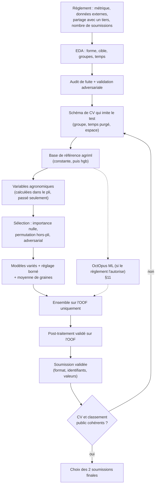
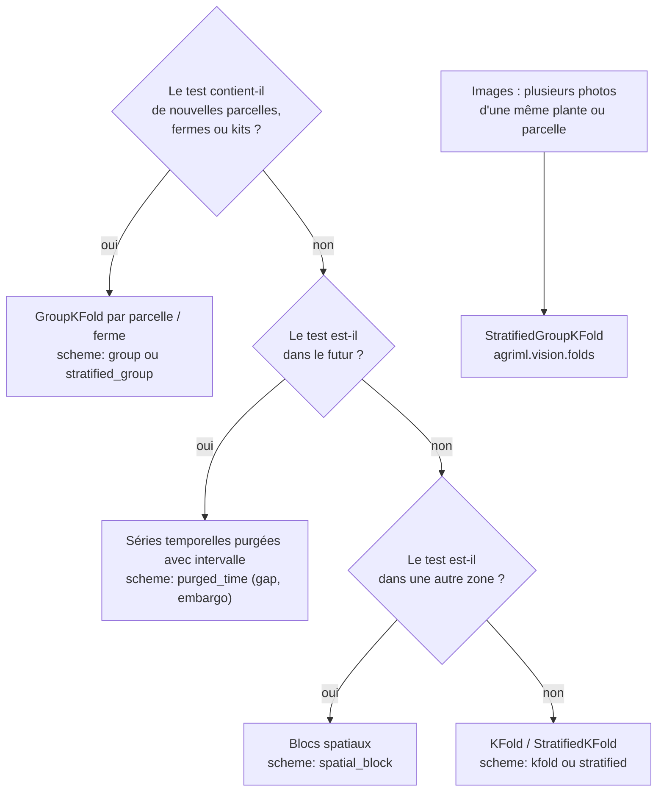
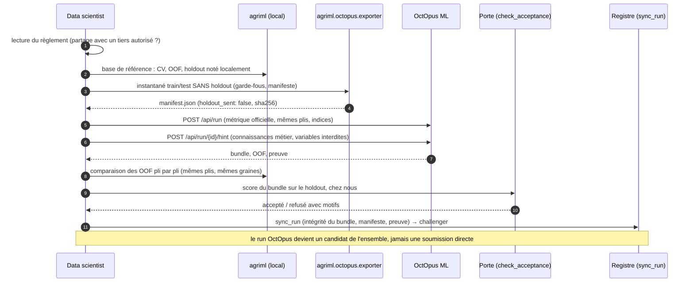

# 08 — Méthode de compétition IA

Confidentiel — réservé aux partenaires de travail.

Ce document décrit comment nous abordons une compétition de data science agricole, avec la méthode des meilleurs compétiteurs (« grandmaster ») : lire le règlement, comprendre les données, construire une validation qui imite le test, puis seulement chercher le score. Il complète `03_ia.md` (cas d'usage, trois variantes par cas), `04_data_mlops.md` (§8, protection contre les fuites) et `09_octopus_ml.md` (OctOpus ML comme plateforme d'expérimentation).

Le code se trouve dans `ml/` (paquet `agriml`). Chaque règle ci-dessous renvoie à la fonction qui l'applique. Les chiffres du §14 viennent de données **synthétiques** : ils prouvent que la chaîne fonctionne, pas qu'un modèle est bon sur des données réelles.

Pour chaque choix, trois réponses sont données quand elles diffèrent :

| | Ce que l'on optimise | Ce que l'on accepte |
|---|---|---|
| **Compétition** | Le score privé du classement | Coût de calcul élevé, ensembles lourds, complexité |
| **Production** | Fiabilité, explication, coût, maintenance | Quelques points de score en moins |
| **Compromis réaliste** | L'essentiel du gain avec une équipe réduite | Ensemble léger, réglage borné |

## 1. Règles d'or

1. **Le règlement d'abord.** Rien n'est téléversé chez un tiers (OctOpus compris) avant de l'avoir lu (§2.1).
2. **La validation croisée (CV) est le seul juge.** Le classement public sert à vérifier que la CV le suit, pas à choisir les modèles.
3. **Une base de référence `agriml` avant tout le reste**, et avant tout run OctOpus (`09_octopus_ml.md` §5, règle 1).
4. **Aucune information du pli de validation dans l'entraînement** : encodages, imputations, normalisations, retards et fenêtres sont calculés dans le pli (`04_data_mlops.md` §8).
5. **Le holdout figé ne sert jamais au réglage** et n'est **jamais envoyé** à OctOpus (`holdout_sent: false`).
6. **Tout est rejouable** : une expérience = un fichier YAML de `ml/configs/`, des graines fixes, des sorties dans `ml/artifacts/<exp>/`.
7. **Deux soumissions finales, deux hypothèses différentes** (§10).

## 2. Méthode d'ensemble



### 2.1 Lire le règlement

Avant d'écrire une ligne de code, on remplit cette liste dans le ticket de la compétition :

| Question | Pourquoi |
|---|---|
| Métrique officielle exacte (formule, moyenne micro ou macro, arrondis) | `agriml.metrics` doit calculer **la même** valeur ; sinon la CV ment |
| Données externes autorisées ? Lesquelles ? | Météo, imagerie satellite, sols : gros gain possible, ou disqualification |
| **Partage des données avec un tiers autorisé ?** | Conditionne tout usage d'OctOpus et de ses fournisseurs de modèles (§11) |
| Pseudo-étiquetage du test autorisé ? | Certains règlements l'interdisent explicitement (§8) |
| Nombre de soumissions par jour, nombre de soumissions finales | Stratégie de soumission (§10) |
| Part du test sur le classement public | Plus elle est petite, moins le classement public est fiable |
| Code ou rapport exigé des gagnants, licence | Reproductibilité ; bibliothèques autorisées |
| Taille d'équipe, fusions, date limite | Organisation |

### 2.2 EDA

Le carnet `ml/notebooks/01_eda.ipynb` est généré par `ml/scripts/build_eda_notebook.py`. Il suit cette liste :

1. Forme, types, valeurs manquantes dans le train **et** le test.
2. Cible : distribution, asymétrie (une cible asymétrique appelle une transformation `log1p` ou une métrique adaptée), valeurs extrêmes.
3. Groupes et temps : les parcelles du test sont-elles dans le train ? Le test est-il dans le futur ? La réponse fixe le schéma de CV (§3).
4. Audit de fuite (§2.3).
5. Validation adversariale train/test (`agriml.adversarial.adversarial_validation`).

Exemple de piège rencontré pendant les essais : avec la colonne `year`, l'AUC adversariale vaut **1,0**, car le test est dans le futur. Le temps se traite par la CV, pas comme une variable à comparer. Sans elle, l'AUC tombe à 0,637 (décalage modéré, §14).

### 2.3 Audit de fuite

| Fuite | Comment la détecter | Parade dans `agriml` |
|---|---|---|
| Identifiant partagé train/test ou corrélé à la cible | ID communs, importance anormale d'un ID | Colonne `id` exclue des variables ; importance nulle (§5) |
| Doublons entre plis | `duplicated` hors ID et cible | CV groupée sur la clé de doublon |
| Variable calculée après coup (rendement mesuré, diagnostic) | \|r\| > 0,95 avec la cible, connaissance métier | `columns.drop` dans le YAML |
| Valeur future dans un retard ou une fenêtre | Test « le futur modifié ne change pas le passé » | `features.temporal` décale par groupe ; testé dans `tests/test_pipeline_e2e.py` |
| Encodage de la cible calculé sur tout le train | Écart CV/classement | Encodage ajusté dans le pli (`features/encoding.py`) |
| Même parcelle ou même jour dans deux plis | `check_no_leakage` | `cv.assert_no_leakage`, appelé à chaque entraînement |
| Ordre des lignes porteur d'information | Corrélation entre index et cible | Mélange des lignes, ID retiré |

## 3. Validation croisée selon le type de données

La question à se poser : **comment le test a-t-il été découpé ?** La CV doit reproduire ce découpage.



| Données | Schéma `agriml` (`cv.scheme`) | Réglages | Piège évité |
|---|---|---|---|
| Parcelles, fermes, kits capteurs | `group` / `stratified_group` (`columns.group`) | 5 plis ; stratification de la cible par quantiles en régression | Le modèle apprend la parcelle au lieu de l'agronomie |
| Séries temporelles (humidité, météo, rendement par saison) | `purged_time` (`columns.time`) | `gap` ≥ horizon de prévision, `embargo` après le pli ; `forward: true` pour un walk-forward pessimiste | Valeurs futures dans les retards ; autocorrélation entre plis |
| Prévision horaire du sol | `forecast/soil_moisture.py` | `gap_hours` ≥ 72 pour un horizon J+3 ; refusé s'il est plus court que l'horizon | Fuite par recouvrement des fenêtres |
| Zones géographiques | `spatial_block` (`columns.lat`, `columns.lon`) | Taille de bloc ≥ portée de l'autocorrélation spatiale | Parcelles voisines quasi identiques dans deux plis |
| Images de maladies | `StratifiedGroupKFold` par plante/parcelle (`vision/folds.py`) | Stratification sur la classe | Même feuille photographiée deux fois, dans deux plis |
| Tabulaire sans structure | `kfold` / `stratified` | 5 plis × plusieurs graines | — |

Contrôles systématiques :

- **Cohérence CV / classement public** : on note la paire (CV, score public) à chaque soumission. Si l'ordre de trois soumissions n'est pas le même dans les deux colonnes, on revoit le schéma de CV avant de continuer.
- **Plusieurs graines de découpage** (`seeds: [42, 7, 2025]`) : l'écart-type entre plis dit si une amélioration est réelle. Un gain inférieur à l'écart-type n'est pas un gain.
- **Holdout figé** (`data.test_labels`) : noté à la fin, **jamais** utilisé pour choisir (rapport seulement dans `cv_scores.json`).

## 4. Variables agronomiques et temporelles

Toutes ces variables sont calculées avec des données disponibles **au moment de la prédiction**. Les retards et fenêtres sont décalés par groupe (parcelle ou parcelle-saison). Le même code sert à la compétition et à la production (`features/pipeline.py`), ce qui garantit la parité d'inférence (§14).

| Famille | Variables | Fonction |
|---|---|---|
| Chaleur | Degrés-jours de croissance (base 10 °C, plafond 30 °C), jours > 35 °C | `features.agronomy.growing_degree_days` |
| Eau | ET0 de Hargreaves, rayonnement extraterrestre, bilan hydrique (pluie + irrigation − ET0 × Kc), ratio eau/demande | `hargreaves_et0_mm`, `extraterrestrial_radiation_mj`, `add_agronomy_features` |
| Air | Déficit de pression de vapeur (VPD), humidité, heures d'humectation foliaire | `vapour_pressure_deficit_kpa` |
| Télédétection | NDVI, EVI ; sur une série : maximum, date du pic, aire sous la courbe, pente | `features.remote_sensing.add_series_features` |
| Temps | Retards, moyennes glissantes, différences (par groupe, passé seulement) ; jour de l'année en sinus/cosinus | `features.temporal.add_lag_features`, `add_rolling_features`, `add_diff_features`, `add_cyclical_features` |
| Catégories | Encodage de la cible lissé, ajusté dans le pli | `features/encoding.py` |
| Sol (capteurs) | Variation sur 1 h, 6 h, 24 h ; temps depuis la dernière pluie ou irrigation | `forecast/soil_moisture.py` |

Idées à fort rendement en compétition, à valider sur l'OOF : anomalies par rapport à la normale de la parcelle (valeur − moyenne historique de la parcelle, calculée dans le pli), cumul de stress hydrique sur les stades sensibles (floraison), interactions culture × sol.

## 5. Sélection de variables

Le module `agriml.selection` regroupe trois méthodes complémentaires :

| Méthode | Question posée | Fonction | Décision |
|---|---|---|---|
| Importance nulle | La variable est-elle plus importante avec la vraie cible qu'avec une cible permutée ? | `null_importance(estimateur, X, y, n_null=20)` | Retirer si `p_value` > 0,10 ou si l'importance réelle ne dépasse pas le quantile 75 % nul |
| Permutation hors-pli | Le score de validation baisse-t-il quand on mélange la variable ? | `permutation_importance_cv(estimateur, X, y, plis, métrique)` | Retirer si la perte moyenne ≤ 0 sur la majorité des plis |
| Adversariale | La variable sépare-t-elle le train du test ? | `adversarial_prune(train, test, colonnes, max_auc=0.6)` | Retirer seulement les variables sans valeur métier stable ; rendre relatives les variables utiles qui dérivent |

```python
from agriml.cv import kfold_splits
from agriml.metrics import get_metric
from agriml.selection import null_importance, permutation_importance_cv
from sklearn.ensemble import HistGradientBoostingRegressor, RandomForestRegressor

nulles = null_importance(RandomForestRegressor(n_estimators=200, max_depth=8), X, y, n_null=20)
inutiles = [s.name for s in nulles if not s.useful]
perm = permutation_importance_cv(HistGradientBoostingRegressor(), X.drop(columns=inutiles), y,
                                 kfold_splits(len(X), 5, seed=42), get_metric("rmse"))
```

La sélection se valide elle-même par la CV : on garde la liste réduite seulement si le score OOF ne se dégrade pas, sur plusieurs graines. En production, moins de variables veut aussi dire moins de capteurs à surveiller.

## 6. Modèles et réglage

| | Compétition | Production | Compromis |
|---|---|---|---|
| Tabulaire | hgb, xgb, LightGBM, CatBoost (extra `boosting`), rf, linéaires, MLP torch/keras (extra `deep`) | hgb seul (rapide, gère valeurs manquantes et catégories) | hgb + xgb |
| Réglage | Optuna (TPE, élagage médian), 100 à 500 essais par modèle | Hyperparamètres figés, revus une fois par saison | 20 à 50 essais, budget de temps fixe |
| Graines | 3 à 5 graines par modèle, prédictions moyennées | 1 graine | 2 graines |
| Images | Plusieurs architectures `timm`, augmentation au test, distillation | Petit modèle distillé, exporté en ONNX | Un modèle moyen + distillation |

- `agriml.tuning.tune` utilise Optuna s'il est installé. Sinon, il bascule sur une recherche aléatoire à graine fixe, avec le même espace et le même arrêt précoce. Le journal indique le mode utilisé.
- Le réglage se fait **sur la CV**, jamais sur le holdout ni sur le classement public.
- **Moyenne de graines** : la même configuration entraînée avec plusieurs graines (`seeds` dans le YAML). Le gain est faible mais presque gratuit, et réduit la variance de la soumission finale.

## 7. Ensembles : uniquement sur l'OOF

Les poids et les méta-modèles sont appris sur les prédictions **hors-pli** (OOF) produites avec **les mêmes plis** pour tous les modèles. Les prédictions du test sont la moyenne des modèles des plis.

| Méthode (`ensemble.method`) | Principe | Quand |
|---|---|---|
| `mean` / `rank` | Moyenne simple ou des rangs | Point de départ ; métriques de rang (AUC) |
| `hill_climbing` | Ajout glouton avec remise du modèle qui améliore le plus l'OOF | Défaut : robuste, peu de surapprentissage |
| `weights_opt` | Poids optimisés sur l'OOF | Quand les modèles sont nombreux et variés ; vérifier la stabilité entre graines |
| `stacking` | Méta-modèle entraîné en validation croisée sur l'OOF (méta-OOF imbriqué) | Compétition, avec beaucoup de lignes |

Exemple tiré des essais (§14) : l'optimisation des poids gagne 1,3 % d'OOF sur le meilleur modèle seul (0,694 contre 0,703), alors que la montée de colline garde hgb seul. Ce gain, mesuré sur les données qui ont servi à fixer les poids, est du même ordre que l'écart-type entre plis (± 0,145). Il ne justifie donc pas un ensemble en production. En compétition, on le soumet comme seconde hypothèse (§10).

## 8. Pseudo-étiquetage

Seulement si le règlement l'autorise. Règles :

1. Pseudo-étiquettes produites par un ensemble dont la CV est stable, pour les lignes du test les plus sûres : probabilité > 0,95 ou < 0,05 ; en régression, faible écart entre graines.
2. Les lignes pseudo-étiquetées vont **uniquement** dans les plis d'entraînement, jamais dans un pli de validation. La CV reste calculée sur les vraies étiquettes.
3. Poids réduit (0,3 à 0,5), une seule itération, deux au maximum.
4. Gardé seulement si l'OOF progresse sur plusieurs graines **et** si l'AUC adversariale ne monte pas.
5. Production : non. Les modèles en production apprennent sur des étiquettes réelles. Les observations agronomes validées remplacent le pseudo-étiquetage.

## 9. Post-traitement

Chaque post-traitement est choisi sur l'OOF puis appliqué au test, jamais l'inverse.

| Post-traitement | Outil | Exemple |
|---|---|---|
| Bornes physiques | `clip_min` / `clip_max` (YAML), `submission.build_submission` | Rendement ≥ 0 ; humidité du sol entre 0 et 100 % |
| Cible transformée | `metrics` (inverse de `log1p`) | Rendements très asymétriques |
| Seuil de décision | `metrics.optimize_f1_threshold` | Seuil F1 optimal sur l'OOF : 0,327 pour le risque maladie (§14) |
| Calibration | `agriml.evaluate` (Brier, ECE) | Métrique logloss, alertes agronomiques |
| Format | `submission.validate_submission`, `align_to_sample` | Identifiants, ordre, colonnes et valeurs identiques au fichier d'exemple |

## 10. Stratégie de soumission

- **Soumettre peu, mais à chaque fois une hypothèse.** Chaque soumission est notée avec sa CV, sa configuration et le hachage de son fichier (`artifacts/<exp>/`).
- **Le classement public ne choisit pas les modèles.** Il sert à vérifier la corrélation entre la CV et le score public, au moins sur trois soumissions.
- **Règle des deux soumissions finales :**
  1. **La meilleure CV**, avec le schéma de validation qui imite le test : c'est la soumission en laquelle on a confiance.
  2. **Une hypothèse différente** : un ensemble plus diversifié, un modèle robuste au décalage (variables relatives, repondération adversariale), ou le meilleur score public **seulement** s'il reste dans l'intervalle de la CV.
  Jamais deux soumissions quasi identiques : la seconde doit couvrir le risque que la première ne couvre pas.
- **Dernière semaine** : plus de nouvelles variables ; moyenne de graines, nettoyage, reproductibilité (`dvc.yaml`, configurations figées), relecture du règlement.

## 11. Avec OctOpus

OctOpus ML (`09_octopus_ml.md`) est notre plateforme d'expérimentation. Un agent autonome y explore des modèles à partir d'un instantané de données, sous nos garde-fous. En compétition, il ne remplace pas la méthode : il élargit la recherche une fois que la base de référence et la CV sont solides.

**Conditions préalables, sans exception :**

1. **Le règlement est lu avant tout téléversement.** Si le partage avec un tiers n'est pas explicitement autorisé (OctOpus et ses fournisseurs de modèles de langage), on reste sur `agriml` en local. Aucune donnée privée de compétition n'est envoyée en cas de doute.
2. **La base de référence `agriml` existe** (CV, OOF, holdout noté). Sans elle, on ne sait pas juger un run autonome.
3. **Le holdout n'est jamais envoyé.** L'exporteur écrit `holdout_sent: false` dans le manifeste, et `sync_run` refuse tout run dont le manifeste ne le garantit pas.
4. **Espace dédié** `agri92-comp-<slug>`, jamais mélangé avec nos données de production.



**Étapes et code** (programme `ml/src/agriml/octopus/programs/competition_template.yaml`, copié en `competition_<slug>.yaml` **après** lecture du règlement) :

1. **Instantané.** `python -m agriml.octopus.exporter --program competition_<slug> --train … --test … --version … --out …`. L'exporteur refuse d'écrire (code de sortie 2) si une colonne interdite reste (e-mail, téléphone, coordonnées précises). Le sel de pseudonymisation vient de `AGRIML_PSEUDO_SALT`, fourni par le gestionnaire de secrets, et n'est jamais écrit.
2. **Run avec indices.** Les indices du gabarit demandent à l'agent de reproduire **exactement** nos plis et nos graines, de respecter le règlement (pas de données externes ni de pseudo-étiquetage s'ils sont interdits) et de rendre les OOF complets.
   ```python
   from agriml.octopus.client import OctopusClient, run_id_of
   from agriml.octopus.programs import load_program

   program = load_program("competition_<slug>")
   with OctopusClient() as client:          # OCTOPUS_BASE_URL et OCTOPUS_API_KEY lus dans l'environnement
       run_id = run_id_of(client.start_run(program.run_request("s3://agri-curated-<env>/octopus/<jeu>/v=<ver>/")))
       client.hint(run_id, "Bilan hydrique FAO-56 ; aucune variable postérieure à la date de prédiction.")
       client.wait_for_run(run_id)
       proof = client.proof(run_id)
   ```
3. **Comparaison des OOF.** Sur les mêmes plis : score par pli de chaque côté, différence appariée, nombre de plis gagnés. Un gain inférieur à l'écart-type entre plis n'est pas retenu.
4. **Contrôle de conformité.** `check_acceptance(program.acceptance, holdout_score, baseline_score, octopus_cv_score, proof_verified)` refuse le modèle si le gain sur le holdout est insuffisant, si l'écart entre la CV annoncée et le holdout dépasse le seuil (5 % en compétition : surapprentissage ou fuite probable), ou si la preuve n'est pas vérifiée.
5. **Enregistrement.** `sync_run(OctopusRunRecord(...))` vérifie le hachage du bundle, le manifeste (`holdout_sent: false`) et la preuve, puis l'enregistre comme challenger. En cas de doute, il lève `SyncRefused` sans rien écrire.
6. **Utilisation.** Les OOF OctOpus entrent dans l'ensemble `agriml` (§7) comme un modèle de plus. La soumission reste produite et validée par `agriml`.

| | Compétition | Production | Compromis |
|---|---|---|---|
| Données envoyées | Données de la compétition, **si le règlement le permet** | Instantanés pseudonymisés, sans le holdout | Instantanés pseudonymisés, sans PII ni coordonnées exactes |
| Rôle d'OctOpus | Exploration large ; modèles candidats pour l'ensemble | Challenger soumis à la porte champion/challenger | Un run par trimestre ou après dérive |
| Décision | OOF appariés + `check_acceptance` (gain minimal 0) | Porte : holdout figé, marge de 1 %, pas de régression par tranche, revue humaine pour la vision et le rendement | Porte de production, sans revue systématique hors vision et rendement |

Les corps de requête OctOpus sont « à vérifier » auprès du fournisseur (`09_octopus_ml.md` §11). Aucune instance réelle n'a été contactée pendant le développement.

## 12. Par cas d'usage

Les objectifs et métriques métier sont dans `03_ia.md`. Ce tableau donne, pour chaque cas, la validation et l'approche de modélisation.

| Cas d'usage (CV) | Compétition | Production | Compromis réaliste |
|---|---|---|---|
| **IA-1 Irrigation** — humidité du sol J+1..J+3 (`purged_time`, gap ≥ 72 h, groupe = kit) | Boosting direct par horizon + modèles séquentiels, ensemble par horizon, variables météo prévues | Boosting par horizon sur l'écart à la valeur actuelle, bornes 0–100 %, repli sur la persistance si un capteur est muet | hgb par horizon + règle FAO-56 pour le conseil (`forecast/irrigation.py`) |
| **IA-2 Météo agricole** — correction MOS (`purged_time` par station) | Ensemble de correcteurs par variable et par échéance, données externes si autorisées | Régression MOS par station et échéance, réentraînée chaque mois | MOS linéaire + hgb sur les résidus |
| **IA-3 Maladies par image** (`StratifiedGroupKFold` par plante/parcelle) | Plusieurs architectures `timm`, augmentation au test, pseudo-étiquetage si autorisé, ensemble | Petit modèle distillé, ONNX sur mobile, seuil de confiance avec renvoi vers un agronome | Un modèle moyen distillé, augmentation au test légère |
| **IA-4 Risque maladies** — météo (`stratified_group` par parcelle) | hgb + xgb + rf multi-graines, stacking, seuil F1 sur l'OOF | hgb calibré, seuil fixé avec les agronomes (un faux négatif coûte plus cher) | Moyenne hgb + régression logistique |
| **IA-6 Calibration NPK** (`group` par capteur) | Boosting sur mesures + covariables (humidité, température, conductivité), ensemble | Régression par lot de capteurs, contrôle par échantillons de laboratoire | Régression linéaire robuste + hgb sur les résidus |
| **IA-8 Rendement** (`purged_time` par saison, ou `group` par parcelle si le test contient de nouvelles parcelles) | Ensemble hgb/xgb/CatBoost, encodage de la parcelle dans le pli, variables NDVI de saison | hgb, variables agronomiques explicables, recalibrage après chaque récolte | hgb + xgb, poids figés, 2 graines |
| **IA-9 Risque agricole** (`group` par exploitation, `spatial_block` si zones nouvelles) | Agrégats d'IA-4 et IA-8, boosting, ensemble | Score composite explicable, révisé par saison | Moyenne de quelques modèles simples |
| **IA-10 Anomalies capteurs** (`purged_time` par kit) | Classifieur supervisé sur anomalies étiquetées + scores non supervisés | Règles physiques + score robuste (écart à la médiane glissante), alerte avec explication | Règles + un modèle non supervisé |

IA-5 (assistant conversationnel) et IA-7 (moteur de recommandations) relèvent de l'évaluation de systèmes, pas d'une compétition de prédiction tabulaire. Voir `03_ia.md`.

## 13. Commandes exactes

Depuis `plateforme/ml`, avec l'interpréteur de l'environnement (`PYTHONPATH=src` évite l'installation) :

```bash
# Données synthétiques (remplacées par l'extraction curated sur données réelles)
python scripts/make_synthetic.py --out data/synthetic --seed 42

# EDA (carnet exécuté ignoré par Git)
python scripts/build_eda_notebook.py --execute

# Base de référence puis réglage
python -m agriml.train --config configs/yield_regression.yaml --no-tuning
python -m agriml.train --config configs/yield_regression.yaml --output-dir artifacts/_smoke_tuning
python -m agriml.evaluate --run artifacts/yield_regression
python -m agriml.export --run artifacts/yield_regression --out bundles/yield_regression

# Séries temporelles et vision
python -m agriml.forecast.soil_moisture --config configs/soil_moisture_forecast.yaml
python -m agriml.vision.train_vision --config configs/vision_disease.yaml --epochs 12

# Instantané OctOpus : le sel n'existe que dans l'environnement de la commande, jamais dans un fichier
AGRIML_PSEUDO_SALT="$(python -c 'import secrets; print(secrets.token_hex(32))')" \
AGRIML_PSEUDO_SALT_ID=smoke-2026-10-27 \
python -m agriml.octopus.exporter --program yield_forecast \
  --train data/synthetic/yield/yield_train.csv --test data/synthetic/yield/yield_test.csv \
  --version 20261027-smoke01 --out <dossier_temporaire>/octopus_export --source-query synthetic:yield

# Réentraînement + porte (webhook de notification non défini : notification dans le journal)
python -m agriml.mlops.retrain_flow --config configs/yield_regression.yaml \
  --holdout <holdout_étiqueté.csv> --model-name yield_regression --workdir <dossier> \
  --champion-run artifacts/yield_regression --slice-column crop [--reference <csv> --current <csv>] [--force]

# Tests
python -m pytest -q
```

En production, le sel vient du gestionnaire de secrets (`06_devsecops.md`), avec un identifiant stable par période. Le sel aléatoire ci-dessus ne sert qu'aux essais.

## 14. Résultats des essais (données SYNTHÉTIQUES)

Données produites par `scripts/make_synthetic.py` (graine 42), le 26 et le 27/10/2026, sur processeur. Le détail est dans `ml/RESULTS_SMOKE.md`.

| Essai | Résultat |
|---|---|
| Rendement, sans réglage (CV purgée par années, 5 plis × 3 graines) | RMSE CV : hgb **0,703**, xgb 0,940, ridge 1,864 ; holdout figé 0,660 ; référence constante 8,415 ; AUC adversariale 0,600 |
| Rendement, avec réglage (Optuna absent → recherche aléatoire) | xgb : CV 0,940 → **0,881** ; ensembles OOF : moyenne 0,885, montée de colline 0,703, poids optimisés 0,694, stacking 0,699 ; modèle retenu hgb ; 4 min 09 s |
| Risque maladie (CV stratifiée groupée) | AUC CV : régression logistique **0,935**, xgb 0,929, hgb 0,928, rf 0,922 ; holdout 0,953 ; Brier 0,067 ; ECE 0,013 ; seuil F1 0,327 |
| Parité d'inférence (`predict` contre `submission.csv`) | Écart maximal 1,1 × 10⁻¹⁴ (rendement), 0 (maladie) |
| Humidité du sol, RMSE contre persistance | J+1 4,93 contre 8,56 (−42 %) ; J+2 6,68 contre 11,73 (−43 %) ; J+3 8,62 contre 13,54 (−36 %) |
| Correction MOS (température) | RMSE 2,18 → 0,88 |
| Vision (5 plis × 12 époques, 96 px, n = 90) | Exactitude OOF 0,678 ; F1 macro 0,647 ; logloss 0,764 ; export ONNX non vérifié (`onnx` absent) |
| EDA rendement | 0 ID commun, 0 doublon, aucune variable à \|r\| > 0,95 ; AUC adversariale 0,637 sans la colonne temps (1,0 avec) |
| Exporteur OctOpus | Instantané écrit (3 000 lignes, `field_id` pseudonymisé, coordonnées arrondies à 0,01°, `holdout_sent: false`) ; refus (code 2) quand une colonne contient des e-mails |
| Réentraînement | Sans dérive : aucun réentraînement ; forcé : challenger v1 **non promu** (gain +0,00 % < 1 %), porte respectée |

## 15. Limites connues

- LightGBM, CatBoost, Optuna, MLflow, timm, onnx, DVC et Airflow ne sont pas installés dans l'environnement de développement : les chemins correspondants sont codés avec un repli propre mais n'ont pas tous été exécutés.
- La couverture de tests n'a pas pu être mesurée (`pytest-cov` absent) ; l'objectif reste 80 %.
- Aucune instance OctOpus réelle n'a été contactée ; les formats de requête et de réponse sont à vérifier.
- Les résultats ci-dessus portent sur des données synthétiques ; ils seront remplacés par ceux des données réelles de la compétition.
