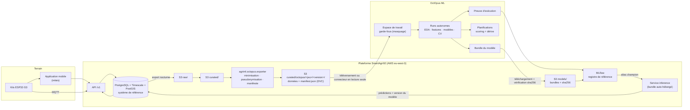
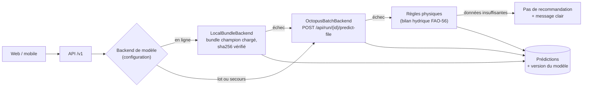
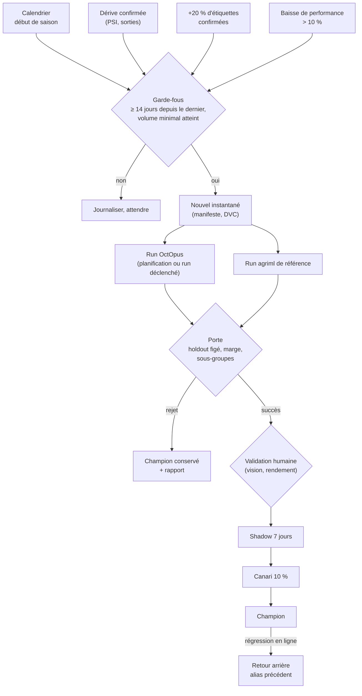

# 09 — Plateforme IA : OctOpus ML

Confidentiel — réservé aux partenaires de travail.

Ce document décrit comment l'IA, la data science, le ML, le DL et le MLOps du projet s'organisent autour d'**OctOpus ML** (https://octopus.ml/app). Il complète `03_ia.md` (cas d'usage), `04_data_mlops.md` (lac de données, MLOps général) et `08_competition_ia.md` (méthode de compétition).

Les informations sur OctOpus viennent de sa documentation publique, consultée le 26/10/2026 (`octopus.ml/docs`, `octopus.ml/security`). Les points marqués **« à vérifier »** ne sont pas documentés publiquement et doivent être confirmés par le fournisseur (liste au §11).

## 1. Ce que demande le projet, et notre position

**Demande.** Toutes les données sont centralisées sur OctOpus. Les jeux de données y sont importés ou connectés, les expériences, entraînements et pipelines y sont exécutés, les modèles et les données y sont versionnés, et les modèles sont consommés par l'application web via une API.

**Ce qu'OctOpus apporte (documenté).**
- Un data scientist autonome piloté par LLM. On décrit l'objectif, et la plateforme enchaîne l'EDA, les features, la recherche de modèles, la validation et une **preuve d'exécution** vérifiable.
- Une API REST authentifiée par `Bearer` : `discover`, `run`, `status`, `stream` (SSE), `cancel`, `hint`, `predict-file`, `proof`, `proof/verify`, `connect`, `schedules`, `workspaces/{name}/guardrails`.
- Des **planifications** (réentraînement et scoring récurrents) avec des contrôles de dérive des entrées, des prédictions et du schéma.
- Des **garde-fous** par espace de travail : colonnes masquées ou supprimées, approbation du propriétaire.
- Le **téléchargement du modèle** sous forme de bundle avec un serveur de prédiction, ce qui permet de l'auto-héberger.
- Un **flux Kaggle** avec un contrôle de conformité de la soumission.
- Des options VPC privé et Desktop (offre Enterprise).

**Ce qui pose problème si on y met « toutes » les données.**

| Constat (documentation publique) | Conséquence pour SmartAgri92 |
|---|---|
| Le stockage des fichiers téléversés est décrit comme **éphémère** | OctOpus ne peut pas être le **système de référence** des données |
| **Aucune région d'hébergement** n'est indiquée | Transfert hors du Sénégal non qualifiable pour la CDP tant que ce n'est pas précisé |
| La plateforme **peut envoyer du contexte, des échantillons ou les données d'entraînement complètes** à des fournisseurs de LLM | Aucune donnée personnelle, ni position exacte de parcelle, ne doit partir chez OctOpus |
| Pas de **SOC 2** ni d'ISO 27001 annoncés | Contrat et clauses de protection des données indispensables avant d'envoyer des données réelles |
| Pas de **versionnement des jeux** ni de **registre de modèles** documentés | Traçabilité à assurer de notre côté (DVC + MLflow) |
| Les corps de requête de l'API sont en grande partie **non documentés** | Client maison, contrats isolés dans un seul module, tests sur bouchons |
| Le paquet PyPI **`octopus-ml` est un projet sans rapport** (autre auteur) | Risque de chaîne d'approvisionnement : ne **jamais** l'installer |

**Décision (CTO / Lead IA).** OctOpus est le **hub de travail ML** : tous les jeux d'entraînement y sont publiés, et toutes les expériences, tous les entraînements et les scorings planifiés y passent. La **donnée de référence** reste dans PostgreSQL/Timescale et S3, chez nous. Le **registre de référence** est MLflow. Le **service en ligne** charge le bundle téléchargé dans notre infrastructure.

En résumé : centralisé sur OctOpus pour le travail ML, souverain pour la donnée et le service.

Le tableau ci-dessous donne les trois variantes. La variante retenue est le **compromis**.

| | Compétition | Production | **Compromis retenu (MVP → V2)** |
|---|---|---|---|
| Rôle d'OctOpus | Moteur principal : runs autonomes, indices, flux Kaggle, soumissions | Entraînement et scoring dans un **déploiement VPC privé (Enterprise)**, données réelles pseudonymisées | Runs sur jeux **pseudonymisés et minimisés** ; offre Team ; VPC à la mise à l'échelle |
| Données envoyées | Données de la compétition, si le règlement le permet | Instantanés pseudonymisés, en VPC | Instantanés pseudonymisés, sans PII ni coordonnées exactes |
| Service en ligne | `predict-file` (lot) | Bundle auto-hébergé dans EKS | **Bundle auto-hébergé** ; `predict-file` pour le lot et en secours |
| Registre | Preuves OctOpus + tableau de suivi | MLflow + preuves OctOpus | **MLflow + preuves OctOpus** |
| Chemin parallèle `agriml` | Base de référence et OOF pour l'empilement | Modèle de secours explicable | **Base de référence obligatoire** à chaque cas d'usage |

## 2. Qui fait quoi

| Fonction | Où | Pourquoi |
|---|---|---|
| Collecte, stockage de référence, historique | PostgreSQL/Timescale + S3 (`raw/`, `curated/`) | Souveraineté, rétention maîtrisée, droits des personnes |
| Préparation des jeux ML, pseudonymisation | `agriml.octopus.exporter` (chez nous) | Rien ne sort sans filtrage |
| Versionnement des jeux | Manifeste sha256 + DVC sur S3 | Non documenté chez OctOpus |
| EDA, features, sélection de modèles, réglage | **OctOpus** (runs) + `agriml` (base de référence) | Productivité, plus une référence reproductible |
| Entraînement vision (images) | **OctOpus si la prise en charge des images est confirmée**, sinon GPU à la demande (`agriml.vision`) | Prise en charge des images non documentée : **à vérifier** |
| Preuve d'exécution | **OctOpus** (`/api/run/{id}/proof`, vérifiable par `/api/proof/verify`) | Audit, partenaires, jury |
| Registre, alias `champion` / `challenger` | MLflow (avec `octopus_run_id`, preuve, sha256 du bundle et du manifeste) | Source de vérité indépendante du fournisseur |
| Service en ligne | Service `inference` dans EKS (bundle téléchargé) | Latence, disponibilité, données qui ne sortent pas |
| Scoring par lots | `predict-file` OctOpus, ou bundle local en CronJob | Simplicité |
| Contrôles de dérive | Planifications OctOpus **et** `agriml.monitoring.drift` → Prometheus | Les seuils d'alerte restent chez nous |
| Décision de promotion | Porte champion/challenger `agriml` + validation humaine | Aucun modèle ne passe en production sur la seule décision d'un agent autonome |

## 3. Architecture de données



### 3.1 Modes d'alimentation d'OctOpus

| Mode | Fonctionnement | Quand |
|---|---|---|
| Téléversement de fichier | L'exporteur produit un CSV ou un Parquet, puis le pipeline le téléverse au lancement du run | **MVP**. Contrôle total de ce qui sort |
| Connecteur (`POST /api/connect`) | OctOpus lit une source déclarée : préfixe S3 en lecture seule, ou vue d'une réplique de base | V2, si les connecteurs disponibles le permettent (**à vérifier**). Jamais vers la base principale |
| VPC privé (Enterprise) | OctOpus tourne dans notre compte ou dans un réseau dédié | Production à grande échelle, données réelles en volume |

Règle : OctOpus ne reçoit **jamais** d'accès à `raw/` ni à la base transactionnelle, seulement aux instantanés `curated/octopus/` déjà filtrés.

## 4. Organisation des jeux de données

### 4.1 Arborescence

```
s3://agri-curated-<env>/octopus/
└── <jeu>/                                  ex. irrigation_need
    └── v=<AAAAMMJJ>-<git_sha7>/
        ├── train.parquet                   (ou train.csv si le run l'exige)
        ├── test.parquet                    (sans cible, si le cas d'usage a un jeu de test)
        ├── manifest.json                   empreintes, schéma, provenance
        └── README.md                       fiche du jeu (finalité, colonnes, biais connus)
```

Le **holdout figé** (validation finale de la porte de promotion) n'est **jamais envoyé** à OctOpus. Un agent autonome qui voit toutes les étiquettes pourrait s'en servir pour choisir ses modèles, et la validation ne serait plus aveugle. Le holdout reste dans `curated/holdout/<jeu>/`, et nous évaluons le bundle téléchargé dessus, chez nous.

### 4.2 Manifeste

```json
{
  "dataset": "irrigation_need",
  "version": "20261126-3f2a9c1",
  "created_at": "2026-11-26T02:10:00Z",
  "git_sha": "3f2a9c1…",
  "source": { "query_id": "irrigation_need_v1.sql", "window": ["2026-06-01", "2026-11-25"] },
  "rows": 184320,
  "schema": { "field_key": "string", "ts": "timestamp", "soil_moisture_pct": "float", "et0_mm": "float", "target_need_mm_24h": "float" },
  "target": "target_need_mm_24h",
  "groups": "field_key",
  "time_column": "ts",
  "pseudonymisation": { "method": "HMAC-SHA256", "salt_id": "pseudo-2026-q4" },
  "dropped_columns": ["phone", "owner_name", "lat", "lon"],
  "rounded_columns": { "lat_r": 0.01, "lon_r": 0.01 },
  "files": { "train.parquet": "sha256:…", "README.md": "sha256:…" },
  "holdout_window": ["2026-11-01", "2026-11-25"],
  "holdout_sent": false
}
```

Le **sel** de pseudonymisation n'est jamais écrit dans le manifeste ni envoyé : seul son identifiant y figure. Il est conservé dans Secrets Manager. Changer de sel change toutes les clés : on ne le fait qu'au début d'une saison, en le documentant.

### 4.3 Catalogue des jeux

| Jeu | Cas d'usage | Grain | Cible | Validation | Métrique principale | Disponibilité |
|---|---|---|---|---|---|---|
| `irrigation_need` | IA-1 | Parcelle × jour | Besoin en eau sur 24 h (mm), ou minutes de pompe | Temporelle purgée + groupes par parcelle | MAE ; erreur sur les jours de stress | MVP, d'abord sur données simulées et pilotes |
| `soil_nowcast` | IA-1 / IA-10 | Kit × heure | Humidité du sol à t + 6 h et t + 24 h | Temporelle purgée, intervalle ≥ horizon | MAE, couverture de l'intervalle | MVP |
| `local_weather_bias` | IA-2 | Kit × heure | Écart entre la prévision ouverte et le BME280 | Temporelle | MAE par heure de la journée | V2 |
| `disease_images` | IA-3 | Image | Classe (sain, maladie x, carence…) | Groupes par plante et parcelle, stratifiée | F1 macro, rappel des classes graves | Collecte dès le MVP, modèle en V2 |
| `pest_risk` | IA-4 | Zone × jour | Événement confirmé (oui/non) | Temporelle par saison | PR-AUC, calibration | V2 |
| `npk_calibration` | IA-6 | Kit × analyse de laboratoire | Valeur de laboratoire | Groupes par kit | MAE, biais | V2 |
| `yield` | IA-8 | Cycle cultural | Rendement (t/ha) | Groupes par exploitation, puis par saison | RMSE, couverture p10–p90 | V3 (plusieurs saisons nécessaires) |
| `sensor_anomaly` | IA-10 | Kit × heure | Anomalie confirmée | Temporelle + groupes par kit | PR-AUC | Règles au MVP, ML en V2 |
| `competition_<slug>` | Compétition | Selon le règlement | Selon le règlement | Selon la structure des données (`08_competition_ia.md`) | Métrique officielle | Dès réception du règlement |

### 4.4 Espaces de travail OctOpus

| Espace | Contenu | Garde-fous |
|---|---|---|
| `agri92-sandbox` | Données synthétiques (`ml/scripts/make_synthetic.py`) et données publiques (météo, sols) | Aucun |
| `agri92-pilot` | Instantanés pseudonymisés des pilotes | Colonnes interdites masquées ou supprimées, approbation du propriétaire pour tout nouveau jeu |
| `agri92-prod` | Instantanés pseudonymisés en production | Idem, plus une clé d'API dédiée ; en VPC dès que les volumes le justifient |
| `agri92-comp-<slug>` | Données de la compétition | Selon le règlement ; jamais mélangé avec nos données |

Chaque espace a sa clé d'API, rangée dans Secrets Manager. Les garde-fous OctOpus sont une **deuxième barrière**. La première est l'exporteur, qui refuse d'écrire un instantané contenant une colonne interdite.

## 5. Workflow MLOps

```mermaid
sequenceDiagram
    autonumber
    participant ORC as Orchestrateur (CronJob / Airflow)
    participant EXP as agriml.octopus.exporter
    participant S3 as S3 curated/octopus
    participant OCT as OctOpus ML
    participant AG as agriml (base de référence)
    participant MLF as MLflow
    participant GATE as Porte champion/challenger
    participant INF as Service inference
    ORC->>EXP: construire l'instantané (jeu, fenêtre)
    EXP->>S3: données + manifest.json (sha256)
    ORC->>AG: entraînement de référence (CV sans fuite, OOF)
    AG->>MLF: run de référence + métriques
    ORC->>OCT: POST /api/run (jeu, objectif, métrique, garde-fous, indices)
    OCT-->>ORC: run_id
    ORC->>OCT: GET /api/run/{id}/stream (suivi)
    ORC->>OCT: GET /api/run/{id}/proof
    ORC->>OCT: téléchargement du bundle
    ORC->>MLF: run miroir (octopus_run_id, preuve, sha256 bundle + manifeste)
    ORC->>GATE: évaluer le bundle sur le holdout figé (chez nous)
    GATE-->>MLF: alias challenger si la marge est atteinte, sinon rejet motivé
    Note over GATE,MLF: validation humaine obligatoire pour la vision et le rendement
    MLF->>INF: shadow → canari 10 % → champion
    INF-->>ORC: métriques en ligne ; retour arrière automatique si régression
```

**Règles du workflow.**
1. **Une base de référence `agriml` avant tout run OctOpus.** Sans référence, on ne sait pas si le run autonome est bon. Elle sert aussi de modèle de secours explicable et réduit la dépendance au fournisseur.
2. **Les indices** (`/api/run/{id}/hint`) transmettent nos connaissances métier : bilan hydrique FAO-56, décalage par parcelle, fenêtre de purge, variables interdites car elles fuient l'avenir. Ils sont versionnés dans `ml/src/agriml/octopus/programs/`.
3. **Aucune promotion automatique sans la porte.** La porte applique les règles de `04_data_mlops.md` §6.2 : holdout figé, marge minimale, pas de régression sur les sous-groupes (culture, zone, type de sol).
4. **Tout est rattaché.** Un modèle en production se rattache à une version de jeu, un run OctOpus, une preuve, un bundle et une image (§9).

## 6. Pipelines d'entraînement

### 6.1 Tabulaire et séries temporelles (IA-1, 2, 4, 6, 8, 9, 10)

| Étape | Chemin OctOpus | Chemin `agriml` (référence) |
|---|---|---|
| Préparation | Instantané pseudonymisé téléversé | Même instantané, lu depuis S3 |
| Validation | Schéma imposé par les indices : temporelle purgée, groupes par parcelle | `agriml.cv` (GroupKFold, TimeSeriesSplit purgé, StratifiedGroupKFold) |
| Features | Automatiques, plus les features métier fournies dans l'instantané (ET0, GDD, déficit hydrique, retards par groupe) | `agriml.features` (ajustement dans le pli uniquement) |
| Modèles | Recherche autonome | XGBoost / LightGBM / CatBoost, régressions physiques, petits ensembles |
| Réglage | Interne à OctOpus | Optuna (repli : recherche aléatoire avec graine) |
| Sortie | Bundle + preuve + métriques | Modèle + OOF + `cv_scores.json` |

**Features calculées avant export** (elles portent le savoir agronomique et ne dépendent pas d'OctOpus) :
- ET0 de Hargreaves ou de Penman-Monteith ;
- coefficient cultural Kc selon le stade ;
- bilan hydrique cumulé ;
- degrés-jours ;
- pluie CHIRPS sur 3, 7 et 14 jours ;
- texture du sol (iSDAsoil) ;
- NDVI Sentinel-2 interpolé ;
- retards et fenêtres glissantes **décalés par parcelle**.

### 6.2 Vision (IA-3)

| | Compétition | Production | Compromis |
|---|---|---|---|
| Entraînement | Grands modèles timm, k-fold, TTA, sur GPU | EfficientNet-Lite / MobileNetV3, distillation, quantification int8 | **OctOpus si les images sont prises en charge (à vérifier)**, sinon `agriml.vision` sur GPU à la demande. Dans les deux cas, suivi dans MLflow |
| Données | Jeux publics (PlantVillage, PlantDoc) + jeu local | Jeu local confirmé par les conseillers, visages floutés, sans EXIF | Jeux publics pour le pré-entraînement, jeu local pour l'ajustement et l'évaluation |
| Service | Serveur | Téléphone (ONNX / TFLite), hors ligne | Serveur au MVP, téléphone en V2 |

Les photos ne partent chez OctOpus qu'après floutage et suppression des métadonnées. Elles ne partent jamais si les conditions du fournisseur sur l'envoi aux LLM ne sont pas clarifiées (§11).

## 7. Pipelines d'inférence



| Mode | Usage | Mise en œuvre | Objectif |
|---|---|---|---|
| En ligne | Recommandation à l'ouverture d'une parcelle, diagnostic d'une photo | Service `inference` (bundle chargé en mémoire), appelé par l'API | p95 < 300 ms (tabulaire), < 1,5 s (image) |
| Lot nocturne | Recommandations du lendemain, prévisions de rendement, scores de risque | CronJob : bundle local, ou `predict-file` | Fin avant 05:00 UTC |
| Planifié chez OctOpus | Scoring récurrent avec contrôle de dérive | `/api/schedules` | Comparaison avec notre propre scoring |
| Embarqué | Diagnostic hors ligne sur téléphone | ONNX / TFLite int8 | V2 |
| Kit | Arrosage par seuils | Firmware (règles, sans ML) | Fonctionne sans réseau |

**Règles d'inférence.**
- Le backend n'envoie que les **colonnes de features**, avec un identifiant de ligne pseudonyme. Ni nom, ni téléphone, ni coordonnées exactes.
- Le **même code de features** sert à l'entraînement de référence et à l'inférence (`agriml`). Les features calculées par OctOpus sont embarquées dans le bundle. Un test de parité compare, sur un échantillon fixe, les prédictions du bundle local et celles de `predict-file`.
- Chaque prédiction stockée porte `model_name`, `model_version` et `source` (`octopus` ou `agriml`).
- Le **format du bundle** et sa licence d'utilisation sont **à vérifier**. Si le bundle embarque son propre serveur de prédiction, on l'exécute comme conteneur privé, sans accès sortant, derrière le service `inference`.
- La sortie d'un modèle est **toujours bornée par l'agronomie** : jamais plus d'eau que la capacité au champ, jamais de dose d'intrant au-delà de l'étiquette.

## 8. Surveillance et réentraînement

### 8.1 Surveillance

| Couche | Indicateurs | Seuil d'alerte indicatif | Outil |
|---|---|---|---|
| Qualité des entrées | Taux de `null` par capteur, valeurs rejetées, fraîcheur | > 10 % de `null` sur 24 h ; kit muet 6 h | Ingestion → Prometheus |
| Dérive des entrées | PSI et KS par variable, **par zone et par culture** | PSI > 0,2 pendant 7 jours sur une variable importante | `agriml.monitoring.drift` + planifications OctOpus |
| Dérive des sorties | Distribution des prédictions, part de recommandations « arroser » | Écart > 25 % sur 7 jours à météo comparable | Idem |
| Schéma | Colonnes, types, plages | Toute rupture | Exporteur + planifications OctOpus |
| Performance différée | IA-1 : humidité observée après la recommandation. IA-3 : confirmation du conseiller. IA-8 : rendement récolté | Baisse > 10 % sur la fenêtre glissante | Tâche nocturne → MLflow + Grafana |
| Service | Latence, erreurs, part du secours (OctOpus ou règles), erreurs de l'API OctOpus | p95 > SLO ; secours > 5 % ; erreurs OctOpus > 2 % | Prometheus (`infra/observability/`) |
| Métier | Eau économisée, recommandations suivies, alertes confirmées | Revue mensuelle | Centre de rapports |
| Coût | Abonnement et consommation OctOpus, heures GPU | Budget mensuel | AWS Budgets + suivi manuel des factures OctOpus |

Les contrôles de dérive d'OctOpus sont utiles, mais **les alertes et les seuils restent chez nous**. Ainsi, un changement chez le fournisseur ne coupe pas la surveillance.

### 8.2 Réentraînement automatique



- Les planifications OctOpus déclenchent le run. Notre orchestrateur, lui, décide de la promotion.
- Le **holdout figé est renouvelé à chaque saison** : la saison la plus récente sert de holdout, et elle n'entre dans l'entraînement qu'à la saison suivante.
- Le **challenger peut être le modèle `agriml`**. Si le run OctOpus ne bat pas la référence, la référence est promue.
- Un réentraînement ne peut pas être déclenché plus d'une fois par 14 jours, sauf pour un incident.

## 9. Versionnement et traçabilité

| Objet | Identifiant | Où |
|---|---|---|
| Code | SHA git | Dépôt |
| Jeu de données | `v=<date>-<sha7>` + sha256 du manifeste + révision DVC | S3 + `ml/dvc.yaml` |
| Programme de run (objectif, indices, garde-fous) | Fichier YAML versionné | `ml/src/agriml/octopus/programs/` |
| Run OctOpus | `run_id` + preuve (JSON) | MLflow (tags) |
| Bundle | sha256 | S3 `models/` + MLflow |
| Modèle enregistré | Nom + version + alias (`champion`, `challenger`) | MLflow Model Registry |
| Déploiement | Digest de l'image + commit GitOps | ECR + ArgoCD |
| Prédiction | `model_name`, `model_version`, `source` | Table des prédictions |

En partant d'une recommandation affichée à un agriculteur, on remonte ainsi jusqu'au jeu de données et à la preuve OctOpus qui l'ont produite.

## 10. Sécurité et conformité

- **Jamais envoyé à OctOpus** :
  - nom, téléphone, e-mail ;
  - coordonnées exactes (arrondies à 0,01°, soit environ 1 km) ;
  - texte des conversations de l'assistant ;
  - photos non floutées ou avec métadonnées EXIF ;
  - commentaires libres.
- **Pseudonymisation** : HMAC-SHA256 avec un sel conservé dans Secrets Manager. Les clés pseudonymes ne permettent pas de remonter aux identifiants sans le sel.
- **Clés d'API** : une par espace de travail, stockée dans Secrets Manager et injectée par External Secrets (`OCTOPUS_API_KEY`). Rotation tous les 90 jours et à chaque départ dans l'équipe. Elles ne sont jamais journalisées.
- **Réseau** : seuls les pods des espaces de noms `ml` et `inference` peuvent sortir vers `octopus.ml:443`. Un filtrage par nom de domaine exige Cilium ou un proxy de sortie.
- **Chaîne d'approvisionnement** : client HTTP maison (`agriml.octopus.client`, avec httpx). Le paquet PyPI `octopus-ml` est interdit et doit être bloqué dans la configuration de Dependabot et dans la revue des dépendances.
- **CDP (loi 2008-12)** :
  - ajouter OctOpus et ses fournisseurs de LLM au registre des traitements et à l'AIPD ;
  - obtenir l'autorisation de transfert hors du Sénégal ;
  - signer un contrat de sous-traitance (DPA).
  
  Tant que ces points ne sont pas réglés, seuls les espaces `agri92-sandbox` et `agri92-comp-<slug>` sont utilisés.
- **Données de compétition** : certains règlements interdisent de partager les données avec des tiers. Le règlement est lu **avant** tout téléversement (`08_competition_ia.md`).
- **Agent autonome** : OctOpus exécute du code et choisit ses méthodes. On ne lui donne jamais d'accès en écriture à nos systèmes. Ses sorties (bundle, métriques) sont vérifiées chez nous avant usage.

## 11. Questions à poser au fournisseur avant les données réelles

1. **Région d'hébergement** et liste des sous-traitants, y compris les fournisseurs de LLM et leurs régions.
2. **Rétention** des données téléversées, des journaux et des prompts. Existe-t-il une option sans conservation chez les fournisseurs de LLM, et une option « pas d'envoi des données brutes au LLM » ?
3. **Certifications** (SOC 2, ISO 27001) ou feuille de route, rapport de test d'intrusion, DPA type.
4. **Format et licence du bundle** : peut-on l'exécuter sans connexion à OctOpus, et sans limite de durée ?
5. **Prise en charge des images** et du GPU ; limites de taille des jeux.
6. **Corps exacts des requêtes**, versionnement de l'API, limites de débit, SLA.
7. **Connecteurs** disponibles pour `POST /api/connect` (S3 en lecture seule, PostgreSQL), et méthode d'authentification.
8. **Export** des expériences, du code généré et des métriques en cas de départ (réversibilité).
9. **Prix** de l'offre Team et de l'offre Enterprise/VPC ; ce que couvre l'abonnement en calcul.
10. Pourquoi le paquet `octopus-ml` sur PyPI n'est pas le leur, et quel est le canal officiel du SDK.

## 12. Coûts

D'après les tarifs publics consultés le 26/10/2026 (à confirmer, hors taxes) : Free, Pro (10 $/mois), Pro+ (30 $/mois), Team (à partir de 100 $/mois), Enterprise (sur devis).

| Période | Offre conseillée | Usage |
|---|---|---|
| M1–M2 (pilote, compétition) | Pro+ par data scientist | `agri92-sandbox` et compétition |
| M3–M12 (MVP, V2) | Team | Espaces pilote et production, une fois la CDP et le DPA réglés |
| M13+ (≥ 2 000 kits) | Enterprise / VPC, si le devis le justifie | Données réelles en volume, région maîtrisée |

S'y ajoutent, déjà comptés dans `07_feuille_de_route_budget.md` : MLflow (petite base + S3), le stockage des instantanés et les heures GPU à la demande pour la vision. Une ligne « Plateforme ML OctOpus » est ajoutée au budget (§7 du document 07).

## 13. Risques

| Risque | Probabilité | Impact | Parade |
|---|---|---|---|
| Fuite de données personnelles via le LLM du fournisseur | Moyenne | Fort (CDP, confiance) | Exporteur filtrant, garde-fous, sandbox tant que le DPA n'est pas signé |
| Fournisseur jeune : API instable, arrêt du service | Moyenne | Fort | Base de référence `agriml` toujours entraînée, bundle auto-hébergé, client isolé dans un module |
| Fuite de la cible par un agent autonome (feature du futur) | Moyenne | Fort (modèle faux en production) | Holdout figé jamais envoyé, indices explicites, test de parité, revue des features du bundle |
| Bundle inexploitable hors OctOpus (format, licence) | Inconnue | Fort | Question n° 4 avant l'engagement ; repli sur `predict-file` puis sur `agriml` |
| Coût qui dérive (runs longs, planifications) | Moyenne | Moyen | Budget mensuel, plafond de runs par semaine, revue des planifications |
| Paquet PyPI homonyme installé par erreur | Faible | Fort | Interdiction documentée, revue des dépendances, client maison |
| Données de compétition partagées contre le règlement | Faible | Fort (disqualification) | Lecture du règlement avant tout téléversement |

## 14. Code concerné

| Élément | Emplacement |
|---|---|
| Client de l'API OctOpus, exporteur, synchronisation du registre, programmes de run | `ml/src/agriml/octopus/` |
| Base de référence, CV, features, ensembles, dérive | `ml/src/agriml/` |
| Backends d'inférence (`LocalBundleBackend`, `OctopusBatchBackend`) et table `model_registry` | `backend/app/services/inference/`, `db/migrations/002_extensions.sql` |
| Service `inference`, CronJob de réentraînement, ExternalSecret, NetworkPolicy, règles d'alerte | `infra/k8s/`, `infra/observability/` |
| Variables `OCTOPUS_BASE_URL`, `OCTOPUS_API_KEY` | `.env.example`, `CONVENTIONS.md` §7 |
