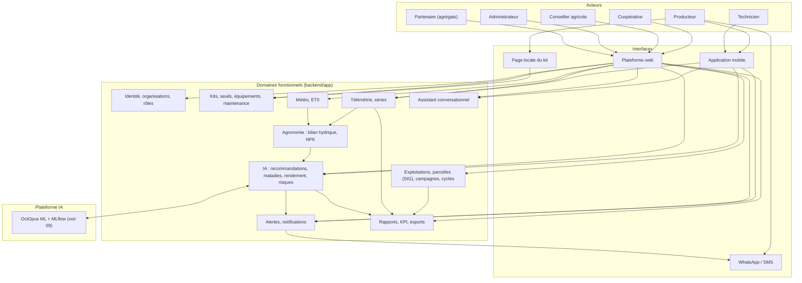

# 10 — Prototype web, expérience utilisateur et architecture fonctionnelle

Confidentiel — réservé aux partenaires de travail.

Ce document analyse le prototype fourni, « Smart Agri92 — Tableau de bord du champ » (fichier HTML autonome), puis propose la nouvelle plateforme : architecture fonctionnelle, 13 modules, écrans, système de design, accessibilité et fonctionnement hors ligne. Les maquettes cliquables sont dans `../maquettes/index.html` (fichier local, à ouvrir dans un navigateur, ne pas publier).

## 1. Analyse du prototype

### 1.1 Ce que c'est

Une page unique en HTML, CSS et JavaScript sans dépendance (230 lignes, 139 Ko, dont environ 110 Ko pour une photo de fond encodée en base64 dans le CSS). Elle simule un kit : les valeurs sont tirées au hasard toutes les 2 s, et le pied de page l'annonce honnêtement. Elle est pensée pour être ouverte sur le téléphone connecté au Wi-Fi du kit (« Fonctionne sans Internet »).

| Section | Contenu |
|---|---|
| En-tête | Logo, navigation par ancres, bascule clair/sombre |
| Bandeau d'accueil | « Bonjour, voici l'état de votre champ », pastilles « Kit connecté », « Fonctionne sans Internet », heure |
| Mesures en direct | Humidité du sol (jauge et verdict), température, humidité de l'air, pression, NPK avec jauges, courbe des dernières mesures avec les deux seuils |
| Irrigation | État de la pompe, mode automatique, bouton « Arroser maintenant », curseurs de seuils, simulation de l'écran du kit (appelé OLED dans le prototype ; le matériel prévu est un TFT 3,5", doc 07), de la LED et du buzzer |
| Santé des plantes | Dernière analyse, confiance, conseil, renvoi vers un technicien |
| Alertes | Six derniers événements |
| Guide, FAQ, À propos | Quatre étapes, trois questions, présentation du projet |
| Courbes (fenêtre modale) | Jour, semaine, mois, année, lecture au doigt, min/moy/max |

### 1.2 Forces à garder

1. **Le verdict avant les chiffres** : « Sol sec », « Humidité correcte », « Engrais nécessaire ». C'est le principe n° 1 de `01_analyse_metier.md` §6.
2. **Un ton juste** : « Vous restez décideur : le kit vous aide, il ne vous remplace pas », et « en cas de doute, demandez l'avis d'un technicien agricole ». L'IA y est présentée avec prudence.
3. **De gros chiffres lisibles**, des cartes simples et une grille qui s'adapte à la largeur de l'écran.
4. **Thème sombre** complet, avec des jetons de couleur sur `:root`, le respect de `prefers-color-scheme` et un choix mémorisé.
5. **Cohérence avec le matériel** : la simulation de l'écran, de la LED et du buzzer reprend le comportement du firmware, et les seuils apparaissent sur la courbe. Deux écarts restent à corriger : le prototype parle d'un écran OLED alors que le firmware pilote un TFT 3,5" (TFT_eSPI), et il bipe toutes les 0,9 s alors que le firmware bipe toutes les 10 s.
6. **Courbes jour, semaine, mois, année**, lisibles au doigt, avec min, moyenne et max : c'est l'exigence F9 du dossier.
7. **Honnêteté** : « Historique de démonstration », « Les valeurs affichées sont une démonstration ».
8. **Robustesse** : chaque accès à `localStorage` est protégé par `try/catch`, et la page n'a aucune dépendance externe.

### 1.3 Limites fonctionnelles

| Limite | Conséquence |
|---|---|
| Aucune donnée réelle : ni appel à `GET /data`, ni historique | Démonstration seulement |
| Les seuils restent dans le navigateur (« gardés sur cet appareil ») et ne sont pas envoyés au kit (`POST /seuils` avec `X-Agri-Token`) | Le réglage affiché n'est pas celui que le kit applique |
| Le mode manuel et « Arroser maintenant » n'existent pas dans le firmware v1.1 | Promesse non tenue ; à concevoir avec la sécurité de la pompe (10 min au plus, verrouillage) |
| Un seul champ et un seul kit, pas de compte | Ne convient pas à une coopérative ni à un conseiller |
| « Lancer une analyse » fait défiler trois résultats prédéfinis, avec une confiance de 94 % sans modèle | À marquer comme démonstration ; ne jamais montrer une confiance inventée à un producteur |
| Même seuil de 30 mg/kg pour N, P et K, et jauges NPK graduées de 0 à 100 alors que la plage est de 0 à 1999 mg/kg | Agronomiquement faux : les seuils dépendent de l'élément et de la culture, et le capteur doit être calibré (IA-6). La page recalcule aussi l'alerte avec une autre règle que le firmware (N < 20, P < 10, K < 80) : elle doit lire `alerteEngrais` dans `/data` (`14_cartographie_modeles.md` § 4.2.1) |
| Pas de météo, pas de recommandation, pas de carte, pas de rapport | Ce sont 9 des 13 modules demandés |
| Français uniquement, texte seul | Wolof et pulaar, voix et pictogrammes nécessaires (`01_analyse_metier.md` §6) |

### 1.4 Défauts relevés (numéros de ligne du fichier HTML)

| # | Ligne | Défaut | Correction |
|---|---|---|---|
| D1 | 195–196 | L'écart minimal de 5 points entre les seuils n'est imposé que si les curseurs se croisent : 57 % / 60 % est accepté, alors que le firmware le refuse (`start + 5 ≤ stop`) | Valider exactement la règle du firmware, et afficher l'erreur 400 du kit si elle survient |
| D2 | 163, 171 | `innerHTML` construit avec des chaînes. Sans risque tant que les textes sont internes, mais c'est une injection de script (XSS) dès que les alertes viennent du kit ou de l'API | Créer les nœuds DOM et utiliser `textContent` |
| D3 | 130 | La liste des alertes n'a pas `aria-live` : les lecteurs d'écran n'annoncent pas une nouvelle alerte | `role="log"` + `aria-live="polite"`, et `role="alert"` pour le bandeau critique |
| D4 | 113–114 | Les `<label>` des curseurs ne sont pas reliés à leur champ (`for` absent) | Ajouter `for="low"` et `for="high"` |
| D5 | 30, 58, 59, 11 | Clignotements permanents (pastille, LED, bandeau), défilement doux, sans respect de `prefers-reduced-motion` ; le bandeau clignote sans pouvoir être arrêté (WCAG 2.2.2) | Media query `prefers-reduced-motion`, bandeau fixe avec une icône |
| D6 | 37 | Contrastes des étiquettes insuffisants en thème clair : orange `#e08a00` sur `#fff3e0` ≈ 2,5:1, rouge `#d32f2f` sur `#fdecea` ≈ 4,4:1, vert `#2e7d32` sur `#e8f3e6` ≈ 4,5:1 (limite). Le seuil AA est de 4,5:1 | Texte orange `#8a5300`, rouge `#b3261e`, vert `#1b5e20` (§5) |
| D7 | 104, 152 | Les courbes SVG n'ont pas d'alternative textuelle, et la lecture des valeurs ne se fait qu'au pointeur (pas au clavier) | `role="img"` + `aria-label` avec le résumé ; tableau de données accessible ; flèches gauche et droite |
| D8 | 186–187 | En mode manuel, la pompe ne s'arrête qu'à `seuil haut + 10`, sans durée maximale : ce n'est pas la règle de sécurité du firmware | Toute commande manuelle passe par le kit, qui applique ses limites |
| D9 | 227 | `setInterval` toutes les 2 s, même onglet masqué | Interroger le kit toutes les 5 s, et seulement quand la page est visible (`visibilitychange`) |
| D10 | 8 | Photo de fond de 110 Ko en base64, dans une page destinée à être servie par l'ESP32 | WebP d'environ 25 Ko, ou pas de photo dans la version servie par le kit |
| D11 | 83–98 | Les emojis des titres sont lus par les lecteurs d'écran (« goutte », « thermomètre ») | Icônes SVG avec `aria-hidden="true"` |

### 1.5 Verdict

Le prototype est une **bonne base pour la page locale du kit**, celle que voit le producteur sur le Wi-Fi du kit, sans Internet. Il n'est pas la base de la plateforme web. Le dossier de projet l'avait d'ailleurs déjà indiqué : un site servi en HTTPS ne peut pas appeler `http://192.168.4.1` (`00_lecture_critique.md`, L3).

Nous en tirons donc **trois interfaces**, qui partagent le même système de design :

| Interface | Public | Technologie | Ce qu'elle reprend du prototype |
|---|---|---|---|
| **Page locale du kit** (v1.2) | Producteur, au champ, sans Internet | HTML/CSS/JS servi par l'ESP32 (LittleFS, gzip, < 40 Ko) | Presque tout : verdicts, jauges, courbes, écran du kit (TFT). Les défauts D1–D11 sont corrigés. Connexion à `/data`, `/seuils`, `/historique`. Origine de chaque valeur dérivée d'un modèle : `14_cartographie_modeles.md` § 4.2.1 |
| **Application mobile** (Flutter) | Producteur, technicien | Relais hors ligne kit → cloud, diagnostic photo, alertes, voix | Écran « Mon champ », vocabulaire, couleurs |
| **Plateforme web** (Next.js) | Coopérative, conseiller, administrateur, partenaire | Les 13 modules ci-dessous | Jetons de couleur, cartes, verdicts, courbes |

Le dossier interdit les cartes, les capteurs et la caméra sur le **site public**. La cartographie SIG et les données de capteurs sont donc réservées à la **plateforme authentifiée**.

## 2. Architecture fonctionnelle



Ces domaines reprennent les contextes délimités de `02_architecture.md` §3.2. Trois s'y ajoutent : **campagnes**, **équipements** et **météo**. Ils restent dans le monolithe modulaire.

## 3. Les 13 modules

### 3.1 Navigation

- **Ordinateur** : barre latérale à gauche, avec cinq groupes :
  - **Pilotage** : Tableau de bord, Rapports ;
  - **Terrain** : Exploitations, Parcelles, Carte, Météo ;
  - **Cultures** : Analyse des cultures, Campagnes, Rendement ;
  - **IA** : Recommandations, Maladies, Assistant ;
  - **Matériel** : Équipements.
- **Téléphone** : barre du bas avec quatre entrées (Accueil, Carte, Alertes, Assistant) et un menu pour le reste.
- **Barre du haut** : choix de l'organisation et de la campagne active (filtre global), recherche d'une parcelle ou d'un kit, alertes, langue, thème, compte.
- **État de synchronisation** visible en permanence (« Données à jour il y a 3 min », ou « Hors ligne »).

### 3.2 Contenu et données

| # | Module | Ce que l'utilisateur fait | Contenu principal | API (`/v1`) | Version |
|---|---|---|---|---|---|
| 1 | Tableau de bord agricole | Voir en 10 s ce qui demande son attention | Verdicts par parcelle (vert, orange, rouge), alertes ouvertes, KPI (eau, kits actifs, recommandations suivies), météo du jour, activité récente | `reports/kpis`, `alerts`, `devices`, `farms` | MVP |
| 2 | Exploitations | Gérer les exploitations et les membres | Liste, fiche (surface, localité, producteurs, kits), invitation d'un membre | `farms`, `me` | MVP |
| 3 | Parcelles | Suivre une parcelle et régler l'irrigation | Évolution de la page du prototype : jauges, pompe, seuils (règle du firmware), courbes J/S/M/A, NPK, culture en place, historique des commandes | `farms/{id}/fields`, `devices/{id}`, `devices/{id}/measurements`, `devices/{id}/thresholds` | MVP |
| 4 | Cartographie SIG | Voir toutes les parcelles et leur état sur une carte | MapLibre, contours GeoJSON colorés par humidité du sol, kits en points, couche satellite (NDVI en V2), dessin du contour d'une parcelle | `farms/{id}/map`, `farms/{id}/fields` | MVP (lecture), V2 (dessin, NDVI) |
| 5 | Météo | Anticiper | Prévision sur 7 jours, pluie, ET0, conseil (« pluie prévue demain : arrosage réduit »), écart avec le capteur du kit | `fields/{id}/weather?days=7` | MVP |
| 6 | Analyse des cultures | Suivre les cycles et la nutrition | Cycles (semis, stades, récolte prévue), Kc du stade, NPK comparé aux besoins de la culture, historique | `fields/{id}`, `devices/{id}/measurements` | V1.1 |
| 7 | Recommandations IA | Décider et tracer | Liste par parcelle : action, raison, confiance, source (règle ou modèle et sa version), accepter, refuser, faire plus tard | `fields/{id}/recommendations` | MVP (irrigation) |
| 8 | Détection des maladies | Faire diagnostiquer une photo | Téléversement ou caméra, résultat, confiance, conseil, bouton « Demander à un conseiller » (proposé d'office si la confiance est faible), file de validation pour les conseillers | `diagnoses`, `images` | V2 (collecte dès le MVP) |
| 9 | Prévision des rendements | Prévoir la récolte | Bande p10–p90 et médiane, comparaison avec la saison précédente, facteurs principaux | `fields/{id}/yield-forecast` | V3 (affiché « expérimental » avant) |
| 10 | Équipements | Entretenir le matériel | Liste par type (pompe, cuve, panneau solaire, batterie, capteur, caméra, passerelle), état, journal de maintenance, coût | `equipment`, `equipment/{id}/maintenance` | V1.1 |
| 11 | Campagnes agricoles | Organiser la saison | Campagnes (contre-saison, hivernage), parcelles et cultures engagées, bilan (eau, alertes, rendement prévu et réel) | `campaigns`, `campaigns/{id}/summary` | V1.1 |
| 12 | Assistant IA | Poser une question en langage naturel | Conversation, citations des fiches, outils appelés (affichés), transfert vers un conseiller, saisie vocale en V2 ; affichage en texte simple | `assistant/chat` | MVP+ |
| 13 | Centre de rapports / KPI | Rendre compte (coopérative, bailleur) | Filtres (périmètre, période, campagne), graphiques, tableau, export CSV, rapport PDF en V2 | `reports/kpis`, `reports/export.csv` | MVP (KPI de base) |

### 3.3 Droits par rôle

| Module | `farmer` | `coop_manager` | `agronomist` | `admin` | Partenaire (V2) |
|---|---|---|---|---|---|
| Tableau de bord | Ses parcelles | Organisation | Organisations suivies | Tout | Agrégats |
| Exploitations, parcelles | Lecture et seuils de ses parcelles | Gestion | Lecture | Gestion | — |
| Carte | Ses parcelles | Organisation | Organisations suivies | Tout | Agrégats arrondis |
| Recommandations | Accepter ou refuser | Lecture | Rédiger, valider | Tout | — |
| Maladies | Envoyer des photos | Lecture | **Valider les diagnostics** | Tout | — |
| Équipements | Lecture | Gestion | Lecture | Gestion | — |
| Campagnes | Lecture | Gestion | Lecture | Gestion | Agrégats |
| Assistant | Oui | Oui | Oui | Oui | — |
| Rapports | Ses données | Organisation, export | Organisations suivies | Tout | Agrégats exportables |

Le rôle partenaire n'existe pas encore dans `CONVENTIONS.md` (quatre rôles). Il est prévu en V2 sous le nom `partner_viewer`, limité aux agrégats.

## 4. Écrans clés

### 4.1 Tableau de bord (coopérative)

```
┌───────────────────────────────────────────────────────────────────────────────┐
│ ☰ SmartAgri92   [GIE Niayes ▾] [Contre-saison 2026-27 ▾]  🔍   🔔 3  FR ▾  ◐  │
├──────────────┬────────────────────────────────────────────────────────────────┤
│ Pilotage     │ Bonjour. 3 parcelles demandent votre attention.   À jour · 3 min │
│ ▸ Tableau    │ ┌──────────┐┌──────────┐┌──────────┐┌──────────┐               │
│   Rapports   │ │Kits actifs││Eau (7 j) ││Recos     ││Alertes   │               │
│ Terrain      │ │ 46 / 50  ││ 312 m³   ││suivies 71%││ 2 ● 1 ●  │               │
│   Exploit.   │ └──────────┘└──────────┘└──────────┘└──────────┘               │
│   Parcelles  │ À traiter                                                      │
│   Carte      │ ● Parcelle Keur Mbaye 2 — Sol sec (24 %), pompe en défaut  [Voir]│
│   Météo      │ ● Parcelle Thiès 7 — Kit muet depuis 7 h                   [Voir]│
│ Cultures     │ ● Parcelle Bayakh 1 — Suspicion de mildiou (71 %), à valider [Voir]│
│ IA           │ ┌ Carte miniature ────────────┐┌ Météo · Thiès ──────────────┐ │
│ Matériel     │ │ (parcelles colorées)        ││ 33 °C · pluie 0 mm · ET0 6,1 │ │
│              │ └─────────────────────────────┘└─────────────────────────────┘ │
└──────────────┴────────────────────────────────────────────────────────────────┘
```

### 4.2 Parcelle (évolution du prototype)

```
┌ Parcelle Keur Mbaye 2 · Oignon · stade bulbaison (j 54) ·  Kit SA92-000123 ● en ligne ┐
│ [ Sol sec ] 24 %  ▓▓▓▓░░░░░░  seuil de démarrage 30 %                                  │
│ Pompe : en défaut (arrêt de sécurité, reprise possible dans 18 min)                    │
│ Recommandation : arroser 22 min ce soir après 18 h. Raison : ET0 6,1 mm, pas de pluie   │
│ prévue. Confiance 0,82 · modèle irrigation_need v12   [Accepter] [Plus tard] [Refuser]  │
├ Mesures ──────────────────────────────────────────────────────────────────────────────┤
│ Air 33,1 °C · 41 %   Pression 1009 hPa   N 42 · P 18 ⚠ · K 95 mg/kg (capteur non calibré) │
│ [Jour] [Semaine] [Mois] [Année]   courbe humidité + seuils + arrosages + pluie         │
├ Seuils ───────────────────────────────────────────────────────────────────────────────┤
│ Démarrer sous [30] %   Arrêter à [60] %    Règle : écart ≥ 5, arrêt ≤ 100 [Enregistrer]│
│ Dernier envoi au kit : accepté le 26/10 à 18:02 (via le téléphone de l'exploitant)      │
└──────────────────────────────────────────────────────────────────────────────────────┘
```

Les autres écrans (carte, météo, maladies, rendement, équipements, campagnes, assistant, rapports) sont dans les maquettes cliquables.

## 5. Système de design

Il reprend les jetons du prototype, avec les corrections de contraste.

| Jeton | Clair | Sombre | Usage |
|---|---|---|---|
| `--bg` | `#f4f7f2` | `#0f1712` | Fond |
| `--card` | `#ffffff` | `#18231b` | Cartes |
| `--ink` | `#1b2a1f` | `#e6efe7` | Texte |
| `--mute` | `#5f6f63` | `#9bb0a0` | Texte secondaire (≥ 4,5:1 sur `--card`) |
| `--line` | `#dfe7da` | `#26362b` | Bordures |
| `--g` | `#2e7d32` | `#66bb6a` | Action principale, état « bon » |
| `--g2` | `#66bb6a` | `#43a047` | Jauges |
| `--ok-ink` / `--ok-bg` | `#1b5e20` / `#e8f3e6` | `#a5d6a7` / `#1d2e21` | Étiquette « bon » (corrige D6) |
| `--warn-ink` / `--warn-bg` | `#8a5300` / `#fff3e0` | `#ffb74d` / `#3a2c10` | Étiquette « attention » (corrige D6) |
| `--bad-ink` / `--bad-bg` | `#b3261e` / `#fdecea` | `#ef9a9a` / `#3a1a1a` | Étiquette « critique » (corrige D6) |
| `--blue` | `#1976d2` | `#64b5f6` | Eau, pluie, seuil haut |

- **Typographie** : police système (aucun téléchargement de police, pour économiser les données). Base 16 px, chiffres clés à 2 rem en gras, chiffres tabulaires pour les tableaux.
- **Formes** : rayon de 14 px pour les cartes et de 10 px pour les boutons. Cibles tactiles d'au moins 44 × 44 px.
- **Statut** : couleur **et** icône **et** mot, jamais la couleur seule (daltonisme, plein soleil).
- **Graphiques** (ECharts) :
  - séries dans un ordre fixe : bleu `#2a78d6` (sombre `#3987e5`), puis orange `#eb6834` (sombre `#d95926`) ; la couleur suit la série, jamais son rang ;
  - lignes de 2 px, barres d'au plus 24 px à bout arrondi, grille fine, un seul axe vertical (deux grandeurs d'échelles différentes, comme la pluie et l'ET0, vont dans deux graphiques) ;
  - seuils en lignes de référence pointillées, nommées en texte ;
  - légende dès deux séries, aucune pour une série seule ; les textes restent dans les couleurs de texte, jamais dans celle de la série ;
  - info-bulle à réticule sur les courbes, info-bulle par barre sur les histogrammes, mêmes informations au clavier ;
  - un tableau des valeurs pour chaque graphique.
- **Carte** : humidité du sol en cinq classes d'**une seule teinte bleue**, du clair (sec) au foncé (humide) en thème clair : `#86b6ef`, `#5598e7`, `#2a78d6`, `#1c5cab`, `#104281`. En thème sombre, l'ordre s'inverse (sec = proche du fond) : `#184f95`, `#2a78d6`, `#5598e7`, `#86b6ef`, `#b7d3f6`. Les deux rampes passent le validateur (une teinte, luminance monotone, écarts visibles, classe la plus faible ≥ 2:1 sur la carte). Pas d'opposition rouge-vert. Les alertes s'affichent par une **icône** sur la parcelle, pas par la couleur. Légende graduée toujours visible, et indication « Données de 7 h » si elles datent.
- **Icônes** : SVG (jeu Lucide), plus d'emoji dans l'interface.
- **Mouvement** : animations courtes ; aucune quand `prefers-reduced-motion` est actif ; pas de clignotement permanent.

## 6. Accessibilité, langues, faible débit

| Exigence | Mise en œuvre |
|---|---|
| WCAG 2.1 AA | Contrastes vérifiés (§5), labels reliés, navigation au clavier, focus visible, `aria-live` pour les alertes, alternatives textuelles des courbes et de la carte (tableau des parcelles) |
| Peu de lecture | Pictogrammes et verdicts sur tous les écrans ; messages vocaux en wolof dans l'application mobile (enregistrés par des locuteurs natifs) |
| Langues | `fr` par défaut ; `wo` et `ff` via next-intl ; traductions relues par des locuteurs natifs ; pas de texte dans les images |
| Faible débit | JS initial < 200 Ko compressé par page, rendu serveur, images WebP, pagination, cache TanStack Query, données de carte simplifiées (au plus 1 000 sommets par parcelle) |
| Hors ligne (web) | Dernières données en cache, bandeau « Hors ligne, données de 9 h 12 », actions mises en file. Le vrai hors ligne est dans l'application mobile |
| Plein soleil | Thème clair contrasté par défaut sur téléphone, gros chiffres |
| Performance | LCP < 2,5 s et INP < 200 ms sur un Android d'entrée de gamme en 3G, mesurés avec Lighthouse en CI |

## 7. Sécurité côté interface

- Le BFF Next.js garde les jetons dans des cookies `HttpOnly`, `Secure`, `SameSite=Strict`. Le navigateur ne voit jamais le JWT.
- Les routes de modification du BFF exigent l'en-tête `X-Requested-With` (défense CSRF en plus de `SameSite`).
- CSP stricte, sans script en ligne ; aucune source de script tierce.
- Les réponses de l'assistant et des modèles sont affichées **en texte**, jamais en HTML (corrige le risque D2).
- Les seuils sont validés côté client (même règle que le firmware), puis par l'API et par le kit.
- Toute commande vers la pompe passe par le kit, qui garde le dernier mot sur la sécurité (D8).

## 8. Trois variantes

| | Compétition / démo | Production | **Compromis retenu** |
|---|---|---|---|
| Périmètre | Les 13 modules en maquettes cliquables, avec des données simulées réalistes ; parcours démo de 5 min | Les 13 modules complets, partenaires, rapports PDF, hors ligne avancé | **MVP : modules 1, 2, 3, 4 (lecture), 5, 7, 12, 13**. Modules 6, 10, 11 en V1.1, 8 en V2, 9 en V3, mais visibles dès le MVP avec l'étiquette « bientôt » ou « expérimental » |
| Technologie | Une page statique (comme le prototype) | Next.js + BFF + CDN, tests E2E, mesures de performance | **Next.js + BFF**, Playwright en V1.1 |
| Page locale du kit | Prototype corrigé (D1–D11) | Page servie par le kit, gzip, signée avec le firmware | **Prototype corrigé, relié à `/data` et `/seuils`, en v1.2** |
| Données | Simulées | Réelles | Réelles dès le pilote, simulées pour la démo |

## 9. Maquettes

`../maquettes/index.html` est une maquette cliquable, sans dépendance externe et utilisable hors ligne, des 13 modules. Elle utilise les jetons du §5 et des données fictives. C'est un support de revue avec les utilisateurs : sessions dans les Niayes avec 5 producteurs et 2 coopératives avant le développement des modules V1.1. Elle reste un fichier local et ne doit pas être publiée.
