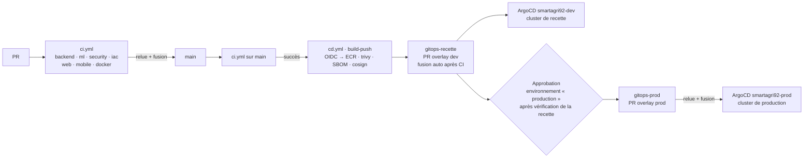
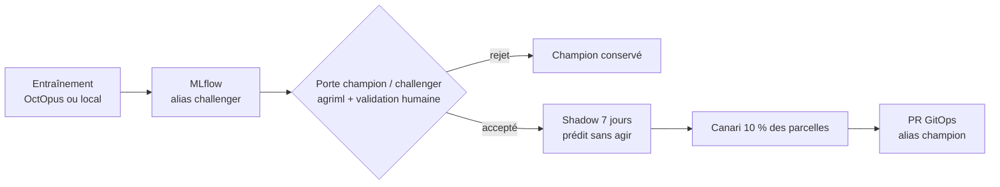

# 11 — Plan de déploiement

Confidentiel — réservé aux partenaires de travail.

Ce document répond au livrable 16 : comment le code, les modèles, le firmware et l'application mobile passent du poste du développeur au champ, et comment on revient en arrière. Il s'appuie sur des fichiers réels du dépôt :

| Sujet | Fichiers |
|---|---|
| Intégration continue | `.github/workflows/ci.yml` |
| Déploiement continu (images, PR GitOps) | `.github/workflows/cd.yml`, `infra/scripts/gitops-bump.sh` |
| GitOps | `infra/argocd/` (`project.yaml`, `app-dev.yaml`, `app-prod.yaml`) |
| Manifestes | `infra/k8s/base/{app,ml}`, `infra/k8s/overlays/{dev,prod}` |
| Cloud | `infra/terraform/envs/{staging,prod}`, `infra/terraform/modules/*` |
| Local et démo | `docker-compose.yml`, `Makefile`, `.env.example` |
| Alertes | `infra/observability/prometheus/rules/`, `infra/k8s/base/app/prometheusrules.yaml` |

**État de vérification.** Les deux overlays sont rendus sans erreur par `kubectl kustomize` (52 objets en recette, 55 en production), la pile locale passe `docker compose config`, et tous les fichiers YAML et JSON se lisent sans erreur. **Aucun déploiement réel n'a été fait** : il n'existe encore ni compte AWS, ni dépôt GitHub, ni cluster. Terraform n'a pas été validé (outil absent du poste), et les workflows GitHub n'ont jamais tourné.

## 1. Principes

1. **Git est la seule porte d'entrée de la production.** Personne ne lance `kubectl apply` ni `helm upgrade` à la main en production ; ArgoCD applique ce qui est fusionné dans `main` et corrige les dérives (`selfHeal: true`).
2. **Une image correspond à un commit et à un condensat.** Les étiquettes sont immuables (`sha-<40 caractères>`), le condensat `sha256` est écrit dans l'overlay, et l'image est signée avec cosign et accompagnée de son SBOM.
3. **Ce qui part en production est d'abord passé en recette**, avec les mêmes condensats.
4. **Toute mise en production se défait par un `git revert`** de la PR GitOps.
5. **Le schéma de base évolue en expand/contract** : l'ancienne et la nouvelle version de l'API doivent pouvoir tourner en même temps sur le même schéma.
6. **L'arrosage ne dépend jamais du cloud.** Le kit arrose seul, par hystérésis. Une panne de la plateforme dégrade le conseil, pas l'irrigation. C'est pourquoi le cloud peut être déployé en continu, alors que le firmware et l'application mobile suivent un calendrier agricole (§10).

## 2. Environnements

| Environnement | Où | Définition | Données | Mise à jour | Accès |
|---|---|---|---|---|---|
| Local | Poste du développeur | `docker-compose.yml` (`make up`, `make up-obs`) | Jeu de démonstration (`make seed`) | À la main | Développeur |
| Démo / compétition | 1 VM | Même `docker-compose.yml`, `.env` dédié | Synthétiques ou publiques | À la main, figée avant l'événement | Jury, partenaires |
| Recette (*staging*) | Compte AWS staging, EKS eu-west-3, 2 AZ, 1 à 3 nœuds `t3.medium` | `infra/terraform/envs/staging`, overlay `dev`, application ArgoCD `smartagri92-dev` | Synthétiques ; **jamais de données de production** | Automatique après chaque commit sur `main` | Équipe, agronome, testeurs pilotes |
| Production | Compte AWS prod, EKS eu-west-3, 3 AZ, 3 à 6 nœuds `t3.large` | `infra/terraform/envs/prod`, overlay `prod`, application ArgoCD `smartagri92-prod` | Réelles (loi 2008-12, déclaration CDP) | PR GitOps approuvée, puis relue | Utilisateurs ; équipe en lecture seule, accès d'urgence journalisé |

Le nom d'overlay `dev` désigne le cluster de recette (`APP_ENV=staging`). Il n'y a pas de cluster « dev » partagé : le poste local suffit.

### 2.1 Trois variantes

| | Compétition / démo | Production | Compromis retenu |
|---|---|---|---|
| Cibles | 1 VM + `docker compose` | Comptes séparés prod / staging / sécurité / partagé, EKS multi-AZ, base managée à haute disponibilité | **Local + recette + production**, recette sur un compte séparé et dimensionnée petit |
| Livraison | `git pull && make up` | GitOps, canari automatisé (Argo Rollouts), signatures vérifiées à l'admission | **GitOps + mise à jour progressive** ; canari automatisé en V2 (§4) |
| Retour arrière | Relancer l'image précédente | Abandon automatique du canari sur analyse Prometheus | **`git revert` de la PR GitOps**, documenté et répété |
| Coût indicatif | 20–40 €/mois | 1 500–3 000 €/mois à 10 000 kits | 400–900 €/mois au MVP, recette comprise (`02_architecture.md` §5) |

## 3. Chaîne de livraison



| Étape | Contrôle | Bloquant |
|---|---|---|
| `ci.yml` (PR et `main`) | Lint et tests avec couverture ≥ 80 % (backend, ML), entraînement de fumée ML, gitleaks, pip-audit, bandit, Semgrep ; Terraform `fmt`/`validate`, tflint, Checkov, promtool, kustomize + kubeconform, `docker compose config` (`iac`) ; web : `npm audit`, lint, types, tests, i18n, build ; Flutter : format, `analyze`, tests ; images construites, analysées par Trivy et accompagnées d'un SBOM | Oui |
| `build-push` | Trivy sur l'image publiée (CRITIQUE et HAUTE corrigeables), SBOM SPDX, signature et attestation cosign sans clé | Oui |
| `gitops-recette` | Rendu `kubectl kustomize` de l'overlay, PR avec fusion automatique dès que la CI de la PR passe | Oui |
| Approbation « production » | Un relecteur obligatoire vérifie la recette (§11, partie « Avant chaque mise en production ») | Oui |
| `gitops-prod` | Rendu de contrôle, PR relue ; avant de fusionner, `cosign verify` sur les condensats | Oui |
| ArgoCD | Synchronisation automatique, `prune: false` en production : une suppression demande une synchronisation manuelle | — |

Deux garde-fous évitent les surprises :

- **Pas de boucle.** Une fusion de PR GitOps ne modifie que `infra/k8s/overlays/*/kustomization.yaml`. `ci.yml` ignore ces poussées sur `main` (`paths-ignore`) : sinon chaque fusion relancerait la construction, puis une nouvelle PR, et ainsi de suite.
- **La fusion automatique de recette exige une application GitHub** (`GITOPS_APP_ID`). Une PR ouverte avec `GITHUB_TOKEN` ne déclenche pas la CI, donc ses contrôles obligatoires ne passeraient jamais. Sans application, la PR de recette est fusionnée à la main.

### 3.1 Premier déploiement (amorçage)

1. Créer les comptes AWS (Organizations) et les états Terraform (S3 versionné et chiffré), puis lancer `terraform apply` dans `infra/terraform/envs/staging` et ensuite dans `infra/terraform/envs/prod`. Les fichiers `backend.hcl.example` et `terraform.tfvars.example` sont à copier ; les copies ne sont pas versionnées.
2. Base de données : souscrire Timescale Cloud en eu-west-3, ouvrir la connexion privée (peering VPC ou PrivateLink), puis déposer `DATABASE_URL` dans Secrets Manager (`smartagri92-<env>/database`). Aucune base n'est créée par Terraform (`infra/terraform/README.md`).
3. Installer dans chaque cluster les prérequis listés dans `infra/k8s/README.md` : Traefik v3, cert-manager, External Secrets Operator ≥ 0.16, kube-prometheus-stack + Pushgateway, metrics-server, et éventuellement Cilium.
4. Installer ArgoCD, puis appliquer `infra/argocd/project.yaml` et l'application du cluster (`app-dev.yaml` en recette, `app-prod.yaml` en production).
5. Dans GitHub, créer la variable `AWS_ECR_PUSH_ROLE_ARN` (sortie Terraform `github_ecr_push_role_arn`), les environnements `ecr-push` (branche `main` seulement) et `production` (relecteurs obligatoires), l'application GitOps, et activer l'option « Allow auto-merge ».
6. Remplacer les comptes fictifs (`111111111111`, `222222222222`) et les domaines `smartagri92.example`.
7. Lancer `cd.yml` à la main (`workflow_dispatch`), vérifier la recette, puis approuver la production.

## 4. Mise en production des services (API, web, ingestor, inférence)

| | Compétition | Production | Compromis retenu |
|---|---|---|---|
| Stratégie | Arrêt puis relance | Canari Argo Rollouts : 10 %, 50 %, 100 %, avec `AnalysisTemplate` sur les taux d'erreur 5xx et la latence p95 | **Mise à jour progressive** Kubernetes (`maxUnavailable: 0`, `maxSurge: 1`), sondes de disponibilité, PDB, 3 répliques d'API en production |
| Détection | À l'œil | Analyse automatique, abandon automatique | Alertes `ApiDown`, `ApiHigh5xxRate`, `ApiLatencyP95High`, `InferenceUnavailable`, `TelemetryIngestionStalled` surveillées 30 min après la synchronisation |
| Retour arrière | Image précédente | Automatique | `git revert` (§4.1) |

**Pourquoi pas un canari dès le MVP.** Avec 50 kits et quelques dizaines d'utilisateurs, 10 % du trafic représente quelques requêtes par minute. Aucune analyse statistique ne peut conclure sur un volume aussi faible : le canari donnerait une fausse impression de sécurité et ajouterait un composant à exploiter. Il devient utile en V2 (300 à 500 kits, MQTT en continu). Argo Rollouts remplace alors les `Deployment` de l'API et du web.

**Compatibilité pendant la mise à jour.** L'API et le web partent dans la même PR GitOps, mais les pods sont remplacés un par un. Pendant quelques minutes, l'ancien web peut appeler la nouvelle API, et l'inverse. Les changements de `/v1` doivent donc être additifs : un champ ou une route peut être ajouté, mais rien n'est retiré ni renommé sans passer par `/v2`.

### 4.1 Retour arrière

Cas normal (5 à 10 minutes) :

1. Ouvrir une PR `git revert <commit de la PR GitOps>` sur `main`, avec l'étiquette `gitops`, et la faire relire par une personne. La CI de PR valide le rendu.
2. Après la fusion, ArgoCD resynchronise l'overlay avec les condensats précédents, qui sont toujours dans ECR puisque les étiquettes sont immuables.
3. Vérifier que les alertes retombent, puis noter l'incident dans le registre.

Urgence (l'API ne répond plus et la PR ne peut pas attendre) :

```bash
argocd app set smartagri92-prod --sync-policy none     # ArgoCD refuse un retour arrière quand la synchronisation automatique est active
argocd app history smartagri92-prod
argocd app rollback smartagri92-prod <ID>
# puis : PR git revert, fusion, et réactivation
argocd app set smartagri92-prod --sync-policy automated --self-heal
```

Un retour arrière **ne défait pas une migration de base**. C'est pourquoi les migrations suivent la règle du §5 : la version N-1 du code doit fonctionner sur le schéma N.

## 5. Migrations de base de données

Le schéma est décrit par `db/migrations/*.sql` (`001_init.sql`, `002_extensions.sql` ; PostgreSQL 16 + TimescaleDB + PostGIS). Ces fichiers sont copiés dans l'image `api` (contexte de build nommé `migrations`) et appliqués par `python -m app.db.migrate` (`backend/app/db/migrate.py`) :

- ordre lexical des fichiers, un verrou consultatif PostgreSQL pour empêcher deux exécutions simultanées, puis chaque instruction en autocommit (agrégats continus Timescale, `CREATE INDEX CONCURRENTLY`) ;
- chaque fichier appliqué est inscrit dans `schema_migrations` (version, empreinte SHA-256, date). Le lanceur **s'arrête si un fichier déjà appliqué a changé** : une correction passe toujours par un nouveau fichier ;
- `--dry-run` liste les migrations en attente sans rien appliquer. Code de sortie : 0 succès, 1 échec, 2 usage ;
- connexion par `MIGRATION_DATABASE_URL` (rôle propriétaire du schéma, droits DDL), distinct du rôle de l'API (`DATABASE_URL`).

Où il tourne :

| Environnement | Mécanisme | Ordre |
|---|---|---|
| Local | Service compose `migrate` (`make migrate`, et lancé par `make up`) | `api` et `ingestor` attendent qu'il se termine avec le code 0 |
| Recette, production | Job `migrate` (`infra/k8s/base/app/migrate-job.yaml`), hook ArgoCD `Sync` | Vagues : -3 namespace et comptes de service, -2 `SecretStore` et `ExternalSecret`, -1 Job, 0 Deployments |

**Pourquoi un hook `Sync` en vague -1 et non `PreSync`.** Un hook `PreSync` passe avant toute ressource de l'application. Au premier déploiement, le namespace, le `SecretStore` et le Secret `agri-database-migrate` n'existeraient pas encore, et le Job resterait bloqué. Avec les vagues, ArgoCD crée et attend ces ressources avant de lancer le Job. Si le Job échoue, la synchronisation s'arrête avant les Deployments : l'ancienne version de l'API reste en service, sur un schéma qu'elle doit savoir lire (§5.1). Le Job précédent est conservé jusqu'à la synchronisation suivante (`BeforeHookCreation`) pour lire ses journaux.

Le secret AWS `<prefix>/database` porte deux propriétés : `DATABASE_URL` (recopiée dans `agri-database`, pour l'API et l'ingestion) et `MIGRATION_DATABASE_URL` (recopiée dans `agri-database-migrate`, pour le seul Job). Le Job n'a ni droit AWS ni sortie réseau autre que PostgreSQL (NetworkPolicy `migrate`).

Les migrations sont écrites pour être rejouables (`IF NOT EXISTS`, `if_not_exists => TRUE`, `DROP … IF EXISTS` avant recréation). Une base locale créée avant le lanceur (anciennement par un script `psql` au premier démarrage) n'a pas de `schema_migrations` : le premier passage rejoue 001 et 002 sans effet, puis les inscrit.

### 5.1 Règle expand / contract

| Étape | Livraison | Exemple : renommer `fields.area` en `fields.area_ha` |
|---|---|---|
| 1. Expand | Release N | Ajouter `area_ha` (nullable) ; le code écrit dans les deux colonnes et lit `area` |
| 2. Rattrapage | Job ponctuel | `UPDATE … SET area_ha = area` par lots de 5 000 lignes, avec pause entre les lots |
| 3. Bascule | Release N+1 | Le code lit `area_ha` et écrit toujours dans les deux colonnes |
| 4. Contract | Release N+2, au plus tôt 30 jours après N+1 | Retirer l'écriture dans `area`, puis supprimer la colonne |

**Le délai de 30 jours est propre au projet.** Avec le relais différé (ADR 007), un téléphone peut garder plusieurs semaines de mesures en file d'attente et les envoyer avec le format de l'ancienne version de l'application. L'API de télémétrie accepte donc les deux dernières versions du format de lot (champ `schema`, aujourd'hui `telemetry.v1`, voir `CONVENTIONS.md` §3), et une colonne n'est supprimée qu'une fois les versions concernées de l'application sorties du parc (§7).

### 5.2 Règles d'écriture

- `SET lock_timeout = '5s'` et `SET statement_timeout = '15min'` en tête de chaque migration : il vaut mieux échouer et réessayer que bloquer l'API.
- Les index se créent avec `CREATE INDEX CONCURRENTLY` (hors transaction). Sur une hypertable, utiliser `WITH (timescaledb.transaction_per_chunk)`.
- Pas de `ALTER TABLE … ADD COLUMN … DEFAULT <expression volatile>` sur une grosse table, pas de changement de type en place, et pas de `NOT NULL` ajouté sans contrainte `CHECK … NOT VALID` validée au préalable.
- Les hypertables compressées limitent certains `ALTER`. Chaque migration est donc **répétée sur une copie de la recette contenant des segments compressés** avant de passer en production.
- Avant une migration destructive (contract), noter l'horodatage pour la restauration à un instant donné (PITR) et vérifier que la dernière sauvegarde est restaurable (§9).

## 6. Kits : firmware et mise à jour à distance

**État actuel.** Le firmware v1.1 n'a **été ni compilé ni testé sur le matériel**. Pour le pilote (10 kits), le flashage se fait par USB, sur place, par la personne responsable de l'embarqué. Les opérations irréversibles sur les eFuses (chiffrement de la flash, Secure Boot) **ne sont pas appliquées** : elles relèvent d'une décision produit (`06_devsecops.md`).

**v1.2 : mise à jour signée (OTA).** Partitions A/B ; la nouvelle image n'est validée (`esp_ota_mark_app_valid_cancel_rollback`) qu'après un autotest au démarrage (capteurs lus, relais au niveau sûr, serveur HTTP actif). Sinon, le chien de garde redémarre le kit sur l'ancienne partition. La clé de signature est conservée hors ligne.

**Acheminement au MVP.** Les kits fonctionnent en point d'accès, sans Internet. L'application mobile télécharge l'image signée et son empreinte depuis la plateforme, puis la pousse au kit sur place par `POST /ota`, avec le jeton `X-Agri-Token`. Le kit vérifie la signature avant d'écrire. La route de distribution côté plateforme est à ajouter à `CONVENTIONS.md` §5. En V2, avec MQTT, le kit télécharge lui-même l'image.

| Vague | Parc | Durée minimale | Condition pour continuer |
|---|---|---|---|
| 0 — Banc | 2 kits au labo, pompe sur bac | 72 h | Aucun retour sur l'ancienne partition, aucun redémarrage du chien de garde, coupure pompe et verrouillage de 30 min vérifiés |
| 1 — Pilotes suivis | 10 % des kits, visités par l'agronome | 7 jours | Mesures complètes, aucun `defautPompe` inexpliqué |
| 2 | 50 % | 7 jours | Même critère, et pas de hausse des tickets du support |
| 3 | 100 % | — | — |

L'application refuse la mise à jour si la pompe tourne ou si le kit est en défaut. Pour revenir en arrière, il suffit de repousser l'image précédente, qui est toujours signée et conservée sur la partition B. Aucune vague n'est lancée pendant la période de pointe d'irrigation ni dans les 15 jours qui suivent un semis.

## 7. Application mobile (Flutter)

| | Compétition | Production | Compromis retenu |
|---|---|---|---|
| Distribution | APK installé à la main | Play Store et App Store, déploiement progressif | **Android d'abord** (Play Console) ; iOS (TestFlight puis App Store) seulement si la demande le justifie |
| Progression | — | Interne → test fermé → 5 % → 20 % → 50 % → 100 % | Même chose, sur environ 7 jours |
| Arrêt | — | Automatique sur les indicateurs de stabilité | Arrêt si les sessions sans plantage passent sous 99 % ou si les erreurs de synchronisation augmentent |

Règles propres au relais différé :

- **La file d'attente locale survit aux mises à jour.** Le schéma de la base locale est migré dans l'application, et cette migration est testée d'une version N-2 vers N. L'application ne vide jamais sa file pour cause de mise à jour.
- **Les versions anciennes restent prises en charge.** L'API accepte les deux dernières versions du format de lot (§5.1). Elle publie une version minimale ; en dessous, l'application affiche « Mise à jour nécessaire » mais continue d'envoyer sa file. La route qui porte la version minimale est à ajouter à `CONVENTIONS.md` §5.
- La clé de téléversement Play est gardée dans le coffre de l'équipe et n'est jamais dans le dépôt. La signature finale est confiée à Play App Signing.
- L'application doit rester légère (moins de 30 Mo, format App Bundle) : beaucoup de téléphones des exploitants ont peu de stockage.

## 8. Modèles d'IA

La promotion d'un modèle est une PR GitOps qui change `MODEL_BUNDLE_URI` et `MODEL_BUNDLE_SHA256` (ConfigMap `inference-bundle`). Le conteneur d'initialisation de l'inférence télécharge le paquet et vérifie son empreinte ; la sonde de disponibilité recalcule cette empreinte toutes les 60 s. **Aucun modèle n'est mis en production automatiquement** (`09_octopus_ml.md`).



| Élément | État | Prévu |
|---|---|---|
| Inférence champion (`infra/k8s/base/ml/inference.yaml`) | Manifeste prêt ; la commande `serve` est à fournir par le lot ML | MVP |
| CronJob `retrain` (lundi 02:00, heure de Dakar) | Suspendu (`suspend: true`) jusqu'à la livraison du pipeline. Le pipeline refuse un ré-entraînement à moins de 14 jours du précédent, sauf incident | M3–M6 |
| CronJob `drift` (tous les jours à 04:30) | Suspendu, point d'entrée à fournir | M3–M6 |
| Shadow et canari | **Pas encore de manifeste.** Ajouter un `Deployment` `inference-challenger` avec son propre paquet | M7–M12 (`04_data_mlops.md` §6) |

**Un canari par parcelle, pas par requête.** L'API choisit le modèle par un hachage stable de `field_id` : une même parcelle reçoit toujours le conseil du même modèle pendant le canari. Si le choix se faisait requête par requête, l'exploitant verrait sa recommandation changer d'un jour à l'autre sans raison. En *shadow*, l'API appelle le challenger sans attendre sa réponse et journalise la comparaison.

**Retour arrière.** Annuler la PR, ce qui ramène le paquet précédent. Si l'inférence tombe, la chaîne de repli prend le relais : `LocalBundleBackend` → `OctopusBatchBackend` → règles FAO-56 → pas de recommandation. L'alerte `InferenceUnavailable` se déclenche.

**Assistant.** Le modèle (`claude-opus-5-5`) et les prompts sont versionnés avec le code. Changer de modèle ou de prompt est un déploiement comme un autre, précédé du jeu d'évaluation hors ligne (`04_data_mlops.md`, qualité des réponses).

## 9. Reprise après sinistre

| | MVP | Production |
|---|---|---|
| RPO base (perte maximale) | 15 min | 5 min |
| RTO base (remise en service) | 4 h | 1 h |

| Composant | Protection | Restauration | Temps visé (MVP) |
|---|---|---|---|
| Base (Timescale Cloud) | Restauration à un instant donné (PITR) et sauvegardes quotidiennes du fournisseur ; en production, une réplique de haute disponibilité | Nouveau service restauré à l'instant T, mise à jour de `smartagri92-<env>/database` dans Secrets Manager, rafraîchissement par External Secrets, redémarrage de l'API et de l'ingestor | 2–4 h |
| Mesures en transit | **File d'attente des téléphones** : un lot n'est retiré qu'après l'accusé de réception de l'API | Les téléphones renvoient leur file quand l'API revient | Automatique |
| S3 (raw, curated, models, images) | Versionnage et expiration des versions non courantes (`modules/datalake`) ; chiffrement KMS | Restaurer une version antérieure de l'objet. En production, ajouter une réplication vers une autre région (pas encore dans Terraform) | 1 h |
| Cluster EKS | Rien à sauvegarder : tout est décrit dans Git | `terraform apply`, prérequis, ArgoCD, synchronisation | 2–3 h |
| Images | ECR, étiquettes immuables | Reconstruction depuis le commit (`workflow_dispatch`) | 1 h |
| Secrets | AWS Secrets Manager | Réplication régionale en production | — |
| MLflow | Métadonnées dans la base, artefacts dans S3 | Comme la base et S3 | Comme la base |
| Code et GitOps | GitHub | Miroir quotidien vers un second hébergeur | 1 h |
| Kits | Autonomes : l'arrosage continue sans cloud | — | — |

Le RPO de 15 min du MVP vaut pour les données saisies en ligne (parcelles, campagnes, comptes). Pour les mesures, la perte réelle dépend surtout de la durée de conservation de la file sur les téléphones (30 jours proposés, à confirmer avec le lot mobile).

**Exercice de restauration chaque trimestre** (`06_devsecops.md`), le premier avant la porte G1 :

1. Restaurer la base de production à T − 1 h dans un nouveau service, sur le compte de recette, sans l'exposer.
2. Lancer les contrôles : nombre de lignes par table, dernière mesure par kit, `SELECT postgis_version()` et la liste des hypertables.
3. Pointer une API de recette sur cette copie, puis faire un parcours de connexion et lire un tableau de bord.
4. Chronométrer chaque étape, comparer avec le RTO visé et consigner le résultat dans le registre.
5. Détruire la copie, car elle contient des données réelles.

| Scénario | Effet | Réponse |
|---|---|---|
| Pod ou nœud perdu | Aucun (3 répliques, PDB) | Automatique |
| Mauvaise version | Erreurs 5xx, alertes | `git revert` (§4.1) |
| Migration ratée | Erreurs SQL | Correction vers l'avant ; si des données sont abîmées, PITR |
| Zone de disponibilité perdue | Capacité réduite | Pods replanifiés sur les autres zones |
| Région perdue | Plateforme indisponible ; les kits arrosent toujours et les téléphones gardent les mesures | Reconstruction dans une autre région à partir de Terraform, des sauvegardes et des réplications ; RTO réel à mesurer (plus de 24 h au MVP) |
| Compromission | Variable | Plan de réponse de `06_devsecops.md` : isoler, révoquer et faire tourner les secrets |

## 10. Calendrier et fenêtres

- **Cloud (API, web, modèles)** : du mardi au jeudi, de 09:00 à 15:00 à Dakar, avec une personne d'astreinte disponible deux heures après. Pas de mise en production le vendredi ni la veille d'un jour férié.
- **Firmware et application mobile** : vagues décrites aux §6 et §7, jamais au démarrage d'une saison. La contre-saison va de novembre à juin (`07_feuille_de_route_budget.md`).
- **Gel avant les portes** : 5 jours ouvrés sans nouvelle fonctionnalité avant les revues G0 et G1 ; seuls les correctifs passent.
- **Correctif urgent** : la même chaîne avec une seule relecture, puis une revue a posteriori sous 48 h.

## 11. Liste de contrôle de mise en service (porte G1)

Infrastructure et livraison

- [ ] `terraform plan` sans écart sur staging et prod, état distant verrouillé.
- [ ] ArgoCD : `smartagri92-prod` est `Synced` et `Healthy`, et aucune ressource n'a été modifiée à la main.
- [ ] Le Job `migrate` (hook `Sync`, vague -1) a été exécuté en recette, sur une copie contenant des segments compressés, et `schema_migrations` liste toutes les migrations.
- [ ] Les actions GitHub sont épinglées par SHA de commit (Dependabot actif).
- [ ] Le retour arrière par `git revert` a été répété en recette, et sa durée notée.

Sécurité et conformité

- [ ] Images signées ; `cosign verify` documenté dans la PR de production.
- [ ] Aucun secret dans le dépôt (gitleaks) ; les secrets viennent de Secrets Manager.
- [ ] La déclaration ou l'autorisation CDP couvre l'hébergement à Paris ; avis juridique sur la loi 2008-12.
- [ ] La sortie vers `octopus.ml` est limitée au ré-entraînement (Cilium ou proxy) ; aucune donnée brute n'est envoyée à OctOpus.
- [ ] La limitation de débit sur `/v1/auth/*` et les en-têtes de sécurité Traefik sont actifs.

Données et reprise

- [ ] La restauration à un instant donné (PITR) est active, et le premier exercice de restauration a été fait et chronométré.
- [ ] Le versionnage S3 est actif et l'accès public bloqué.
- [ ] La conservation de la file des téléphones a été testée (mode avion pendant 7 jours, puis synchronisation complète).

Observabilité et exploitation

- [ ] Les alertes du §4 et `DeviceSilent` arrivent sur le canal d'astreinte ; un essai de déclenchement a été fait.
- [ ] Le tableau de bord Grafana `smartagri92-overview` est rempli en production.
- [ ] Un guide d'intervention existe pour chaque alerte critique ; la rotation d'astreinte est publiée.

Terrain

- [ ] Les kits pilotes sont flashés avec une version validée sur banc (§6, vague 0).
- [ ] L'application est en test fermé chez les exploitants pilotes, et l'agronome est formé.
- [ ] Le support (numéro et heures) est communiqué aux coopératives.

Avant chaque mise en production (approbation de l'environnement « production »)

- [ ] La recette est synchronisée sur les mêmes condensats.
- [ ] Parcours vérifiés en recette : connexion (mot de passe au MVP, code OTP à partir de la V1.1), tableau de bord, envoi d'un lot de mesures, recommandation, assistant.
- [ ] Les migrations de la release sont de type expand, ou un contract autorisé par le délai du §5.1.

## 12. Reste à faire

| Élément | Pourquoi | Quand |
|---|---|---|
| Exécuter le Job `migrate` en recette (rôle propriétaire créé, propriété `MIGRATION_DATABASE_URL` posée dans `<prefix>/database`) | Le Job est écrit et rendu par kustomize, mais n'a jamais tourné sur un cluster | Avant la première mise en recette |
| Valider Terraform (`fmt`, `validate`, `tflint`, `plan`) | Jamais exécuté | Avant l'amorçage |
| Timescale Cloud en code (fournisseur Terraform `timescale`) | La base est créée à la main | V1.1 |
| Réplication S3 et ECR vers une autre région | RPO et RTO de production | Avant le passage à la production complète |
| Tests de fumée automatiques après synchronisation (hook `PostSync`) | Aujourd'hui, la vérification de la recette est manuelle | V1.1 |
| Argo Rollouts et `AnalysisTemplate` | Canari automatisé | V2 |
| `inference-challenger` (*shadow*, canari par parcelle) | Promotion progressive des modèles | M7–M12 |
| Routes de distribution du firmware et de version minimale de l'application | §6 et §7 | v1.2 |
