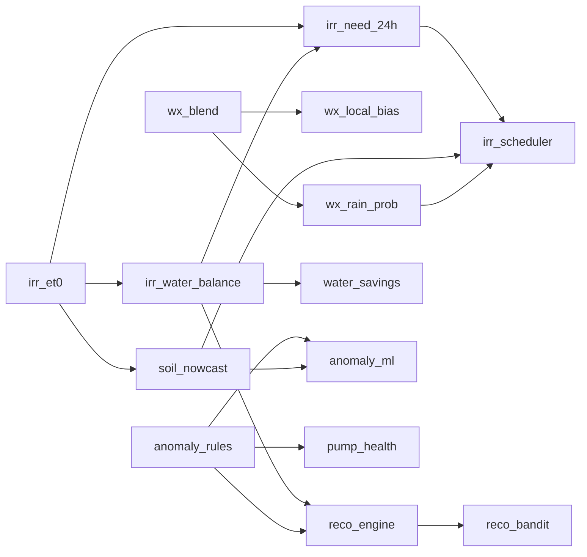

# 14 — Cartographie des modèles (phase 2)

Confidentiel — réservé aux partenaires de travail.

Ce document répond à la phase 2 du brief IA, Data et MLOps du 27/10/2026 : pour chaque fonctionnalité de la plateforme, il dit quel modèle la sert, avec quelles données, quelle variante viser et comment l'entraîner, le servir et le remplacer quand il tombe. Il part des 13 modules web du [doc 10 § 3.2](10_web_ux.md), puis couvre le mobile, le kit et les partenaires.

- **Source de vérité** : `ml/catalog/models.yaml` (39 modèles). La lignée complète d'un modèle, des sources jusqu'aux variables, s'obtient avec `python -m agriml.catalog lineage <modèle>`. Voir [ml/catalog/README.md](../ml/catalog/README.md).
- **Détail complet** : les fiches générées dans [A3 — Modèles](annexes/A3_modeles.md) et les matrices dans [A4 — Matrices](annexes/A4_matrice.md). Ce document ne les recopie pas : il en tire les arbitrages.
- **Avant** : les données dans le [doc 13](13_inventaire_donnees.md). **Après** : leur acquisition dans le [doc 15](15_acquisition_donnees.md), l'architecture OctOpus dans le [doc 16](16_architecture_octopus.md).

**Conventions.**

- **Données** : ● obligatoire, ◐ recommandée, ○ optionnelle, au sens du doc 13. Les identifiants sont ceux du catalogue.
- **Trois variantes** par modèle :
  - **compétition** : le meilleur score atteignable, sans contrainte de coût ni de latence ;
  - **production** : la cible industrialisée, une fois les données réunies ;
  - **compromis** : ce qu'on peut livrer maintenant avec les données disponibles.
- **Avis** : la variante recommandée et la condition pour passer à la suivante.
- **Lieu d'entraînement** :
  - **OctOpus** : un programme existe dans `ml/src/agriml/octopus/programs/` ; seuls des instantanés pseudonymisés y partent, jamais le holdout ;
  - **local** : notre infrastructure, suivi dans MLflow ;
  - **local strict** : notre infrastructure, sans export d'aucune sorte, car les données sont trop sensibles ;
  - **aucun** : règles, modèle physique ou API ; les paramètres sont calés et versionnés, mais rien n'est appris.
- **Fiche** : chaque modèle a une seule fiche, dans son module principal ; les autres modules y renvoient.

## 1. Ce qu'il faut retenir

1. **39 modèles, dont 9 au MVP.** Aucun modèle du MVP n'apprend sur des données du projet : ce sont des règles, des modèles physiques, un LLM par API et une moyenne de prévisions publiques. C'est voulu. Le MVP sert surtout à **collecter les étiquettes** dont la V2 a besoin : bouton « fait / pas fait », diagnostics validés par les conseillers, dates de semis et de récolte.
2. **Où ils s'entraînent** : 4 sur OctOpus (`soil_nowcast`, `irr_need_24h`, `vis_disease`, `yield_forecast`), 19 en local, 3 en local strict (`asst_asr`, `field_boundary`, `agri_risk_score`) et 13 sans apprentissage. OctOpus n'est donc pas le chemin par défaut : c'est l'accélérateur des quatre modèles où un gain de score vaut de l'argent.
3. **Deux portes matérielles bloquent la V2.**
   - **L'étalonnage des sondes** (`sm_calibration`, V1.1) : tant qu'il manque, tout modèle d'humidité apprend le biais de la sonde.
   - **Le débitmètre** : sans lui, `irr_need_24h`, `water_savings` et `pump_health` apprennent sur une estimation (minutes de pompage × débit nominal) et non sur une mesure.
4. **Le programme OctOpus de `yield_forecast` doit être corrigé avant le premier export.** Il valide par parcelle (GroupKFold), sans tenir la saison à l'écart : le score sera optimiste. Correction au § 6.1 et au doc 16.
5. **Un budget de notifications commun.** `risk_rules` (≤ 3 alertes par parcelle et par mois) et `reco_engine` (≤ 3 recommandations par jour et par exploitation) ont chacun leur plafond, mais rien ne plafonne leur somme. Tout envoi doit passer par un seul service (§ 6.7).
6. **Le module 2 (Exploitations) n'a aucun modèle**, mais c'est là que naissent les données les plus critiques : registre, membres, consentements (doc 13 § 1).
7. **Règle de promotion** : un modèle passe à la variante suivante seulement si sa porte de données est franchie **et** s'il bat son compromis ou son repli sur le holdout figé (§ 7).
8. **La page locale du kit est le front de référence au champ** (prototype « Tableau de bord du champ »). Elle n'affiche jamais un résultat d'IA sans sa source, sa version et son âge, et ne recalcule jamais une alerte que le kit a déjà calculée (§ 4.2.1).

## 2. Matrice des modules

★ = fiche dans ce module. Les autres modèles sont décrits dans le module indiqué entre parenthèses.

| # | Module | Ce que l'IA affiche | Modèles (version) | Repli visible à l'écran |
|---|---|---|---|---|
| 1 | Tableau de bord | Verdict par parcelle, météo du jour, recommandations, kits en défaut, eau économisée | `soil_nowcast` V2 (3), `wx_blend` MVP (5), `reco_engine` MVP (7), `anomaly_rules` MVP (10), `water_savings` V1.1 (13) | Humidité mesurée contre les seuils ; âge de la donnée affiché |
| 2 | Exploitations | — | Aucun | — |
| 3 | Parcelles | Bilan hydrique, humidité prévue, stade, contour proposé | ★ `irr_water_balance` MVP, ★ `soil_nowcast` V2, ★ `phenology_stage` V2, ★ `field_boundary` V3, `irr_need_24h` V2 (7) | Seuils du firmware ; calendrier cultural ; tracé manuel |
| 4 | Cartographie SIG | NDVI, carte des cultures, risque de salinité, couvert, risque ravageur | ★ `ndvi_gapfill` V2, ★ `crop_type_map` V3, ★ `salinity_risk` V3, `vis_canopy` V2 (6), `pest_risk_ml` V2 (8), `field_boundary` V3 (3) | Dernière image claire marquée « ancienne » ; culture déclarée |
| 5 | Météo | Prévision 7 j, pluie, ET0, écart avec le kit | ★ `irr_et0` MVP, ★ `wx_blend` MVP, ★ `wx_local_bias` V2, ★ `wx_rain_prob` V2 | IFS brut, puis climatologie, avec la date d'émission |
| 6 | Analyse des cultures | Couvert, NPK étalonné, dose d'engrais | ★ `vis_canopy` V2, ★ `npk_calibration` V2, ★ `fert_reco` V1.1, `ndvi_gapfill`, `phenology_stage` (3, 4), `salinity_risk` (4) | Valeurs de laboratoire ; barème régional ISRA |
| 7 | Recommandations IA | Besoin d'eau, plan de pompage, liste priorisée des actions | ★ `irr_need_24h` V2, ★ `irr_scheduler` V3, ★ `reco_engine` MVP, ★ `reco_bandit` V3, `irr_et0`, `irr_water_balance`, `wx_rain_prob`, `risk_rules`, `fert_reco` | Conseil générique de saison, source « règle » affichée |
| 8 | Détection des maladies | Diagnostic photo, comptage de pièges, risque ravageur | ★ `vis_disease` V2, ★ `vis_pest_count` V3, ★ `risk_rules` V1.1, ★ `pest_phenology` V2, ★ `pest_risk_ml` V2 | File du conseiller ; relais des alertes DPV |
| 9 | Prévision des rendements | Bande p10–p90, facteurs | ★ `yield_forecast` V3, ★ `yield_crop_model` V3 | Statistique régionale × ratio NDVI, marquée « expérimental » |
| 10 | Équipements | Défauts de capteurs, santé de la pompe, étalonnage | ★ `anomaly_rules` MVP, ★ `sm_calibration` V1.1, ★ `anomaly_ml` V2, ★ `pump_health` V2, `irr_scheduler` V3 (7) | Drapeaux du firmware ; courbe usine « non étalonnée » |
| 11 | Campagnes agricoles | Prix attendus, rendement prévu, bilan eau | ★ `price_forecast` V3, `yield_forecast` (9), `water_savings` (13) | Saisonnalité naïve |
| 12 | Assistant IA | Réponse citée, voix | ★ `asst_llm` MVP, ★ `asst_retrieval` MVP, ★ `asst_guard` MVP, ★ `asst_asr` V2 | FAQ validées et transfert vers un conseiller |
| 13 | Rapports / KPI | Économie d'eau avec intervalle, prix | ★ `water_savings` V1.1, `price_forecast` (11) | Économie marquée « estimée », exclue des KPI partenaires |
| — | Mobile | 25 modèles consommés, 2 embarqués | ★ `vis_quality` MVP, ★ `asst_tts` V2 | Cache hors ligne daté |
| — | Kit (page locale) | Paramètres reçus et résultats mis en cache, aucun modèle appris à bord | 10 modèles (§ 4.2) | Seuils du firmware ; « non disponible » pour la santé des plantes |
| — | Partenaire | Agrégats, scores, indices | ★ `agri_risk_score` V3, ★ `index_insurance` V3, `yield_forecast`, `yield_crop_model`, `crop_type_map`, `water_savings` | Décision humaine du partenaire |

## 3. Modules web

### 3.1 Tableau de bord agricole (module 1, MVP)

Aucune fiche : le tableau de bord n'affiche que des sorties d'autres modèles. Deux règles :

- chaque tuile montre sa **source** (règle ou modèle et version) et l'**âge** de la donnée ;
- le verdict par parcelle (vert, orange, rouge) repose au MVP sur l'humidité mesurée comparée aux seuils, puis en V2 sur la prévision de `soil_nowcast`. Une tuile ne calcule jamais rien elle-même : la logique reste dans le modèle, versionnée.

### 3.2 Exploitations (module 2, MVP)

Aucun modèle. Ce module produit pourtant les données dont dépendent le plus de modèles : registre des exploitations, membres, consentements, comptes (doc 13 § 1, matrice A4.3). La qualité de saisie à l'installation est donc un sujet IA : champs obligatoires, contrôles de cohérence, consentement par finalité.

### 3.3 Parcelles (module 3, MVP)

L'écran le plus utilisé. Il affiche aussi le besoin d'eau de `irr_need_24h` (§ 3.7).

#### `irr_water_balance` — Bilan hydrique FAO-56 (MVP, physique) · aussi : web:7, mobile, kit

- **Données** : ● `iot.telemetry_hourly`, `iot.irrigation_events`, `agronomie.crop_cycles`, `agronomie.crop_params`, `sols.field_profile`, `meteo.forecast_asof`, `meteo.grid_daily` · ◐ `features.rain_events`, `sols.lab_results` · ○ `satellite.field_indices`.
- **Variables** : Kc par stade, profondeur racinaire Zr, fraction p, réserves TAW et RAW, pluie efficace (0,8 × P), humidité mesurée pour le recalage. Dépend de `irr_et0`.
- **Variantes** : compétition — double Kc (Kcb + Ke) avec assimilation de l'humidité par filtre de Kalman d'ensemble · production — Kc simple, recalé chaque jour sur l'humidité mesurée · compromis — Kc simple recalé, plus un Kc dérivé du NDVI dès que Sentinel-2 est disponible.
- **Mesure** : RMSE entre déficit prédit et humidité mesurée à J+1 ; seuil ≤ 5 points, et aucune dose hors bornes (0 ≤ dose ≤ TAW).
- **Entraînement** : aucun ; paramètres FAO-56 et ISRA, p et Zr calés par culture sur les parcelles pilotes. **Inférence** : lot, toutes les heures et après chaque émission de prévision, < 5 min. **Repli** : seuils du firmware (`threshold_start_pct`, `threshold_stop_pct`).
- **Avis** : production dès le MVP ; ajouter le Kc issu du NDVI quand `ndvi_gapfill` existe (V2). Tant que `sm_calibration` (V1.1) manque, la métrique est en partie circulaire, car le modèle est recalé sur l'humidité qu'il prédit : la valider sur des prélèvements gravimétriques.

#### `soil_nowcast` — Prévision d'humidité du sol à 1–48 h (V2, ML) · aussi : web:1, mobile

- **Données** : ● `features.soil_nowcast` · ◐ `features.local_weather_bias` · ○ `satellite.field_indices`.
- **Variables** : humidité passée (retards de 1 à 72 h), pompe en marche, pluie, température et humidité de l'air passées, ET0 prévue, distance au seuil de démarrage, capacité au champ, point de flétrissement. Dépend de `irr_et0`.
- **Variantes** : compétition — ensemble LightGBM multi-horizon direct et N-HiTS ou TFT, cible = variation · production — LightGBM multi-horizon (1, 6, 24, 48 h) sur la variation, quantiles p10, p50, p90 · compromis — LightGBM global et correction glissante du biais résiduel par kit.
- **Mesure** : RMSE à 24 h ; seuil : skill ≥ 20 % contre la persistance à 24 h sur le holdout figé.
- **Entraînement** : OctOpus, programme `soil_moisture_nowcast` (validation temporelle purgée de 72 h, groupée par kit, horizons 24, 48 et 72 h) ; réentraînement mensuel. **Inférence** : lot, toutes les heures, < 2 min. **Repli** : persistance, puis `irr_water_balance`.
- **Avis** : compromis d'abord. N'ouvrir le programme OctOpus qu'après une saison complète (hivernage et contre-saison). La persistance est presque imbattable à 1–6 h : la valeur se joue à 24–48 h.

#### `phenology_stage` — Stade phénologique (V2, statistique) · aussi : web:6

- **Données** : ● `features.phenology` · ◐ `images.espcam_series` · ○ `images.drone_mosaics`.
- **Variables** : série NDVI lissée, degrés-jours, date de semis déclarée. Dépend de `ndvi_gapfill`.
- **Variantes** : compétition — transformer temporel sur séries Sentinel-1, Sentinel-2 et degrés-jours · production — lissage Whittaker du NDVI et degrés-jours, détection des transitions · compromis — degrés-jours calés sur la date de semis, NDVI en contrôle.
- **Mesure** : MAE de la date de stade ; seuil ≤ 7 jours pour la floraison.
- **Entraînement** : local, à chaque saison. **Inférence** : lot, tous les 5 jours, < 5 min. **Repli** : calendrier cultural FAO et date de semis.
- **Avis** : compromis. Demander la date de semis à la création du cycle de culture : c'est la donnée la plus rentable du projet, elle nourrit aussi `irr_water_balance`, `pest_phenology` et `yield_forecast`.

#### `field_boundary` — Contour de parcelle (V3, apprentissage profond) · aussi : web:4, mobile

- **Données** : ● `features.field_boundaries` · ◐ `geo.open_field_boundaries`.
- **Variables** : composites Sentinel-2 à 10 m, PlanetScope à 3 m si un contrat existe, tracés déjà saisis.
- **Variantes** : compétition — ResUNet-a multi-tâche (étendue, limite, distance) sur Sentinel-2 et PlanetScope · production — modèle ouvert affiné sur Sentinel-2, proposé à l'utilisateur pour validation · compromis — tracé GPS dans l'app avec accrochage aux limites détectées.
- **Mesure** : IoU par parcelle ; seuil ≥ 0,7 pour les parcelles de plus de 0,5 ha.
- **Entraînement** : local strict, annuel. **Inférence** : lot, à la demande, < 1 min par exploitation. **Repli** : tracé manuel.
- **Avis** : compromis. À 10 m, une parcelle de 0,25 ha ne fait que 25 pixels : le modèle propose, l'utilisateur valide. Un contour est une donnée personnelle directe, d'où le local strict. Cible : 5 000 polygones.

### 3.4 Cartographie SIG (module 4, MVP en lecture, V2 pour le NDVI)

La carte superpose aussi le couvert de `vis_canopy` (§ 3.6), le risque de `pest_risk_ml` (§ 3.8) et les contours de `field_boundary` (§ 3.3).

#### `ndvi_gapfill` — Série NDVI sans trous (V2, statistique) · aussi : web:6

- **Données** : ● `satellite.field_indices` · ◐ `satellite.s2_chips`.
- **Variables** : NDVI, EVI et NDWI Sentinel-2 des passages clairs ; Sentinel-1 VV et VH ; Landsat ou HLS.
- **Variantes** : compétition — fusion Sentinel-1 et Sentinel-2 par réseau profond (CNN-LSTM) · production — lissage Whittaker et régression VV/VH → NDVI par culture · compromis — Whittaker et HLS (Landsat + Sentinel-2) pour densifier la série.
- **Mesure** : RMSE du NDVI reconstruit sur des pixels clairs masqués ; seuil ≤ 0,08.
- **Entraînement** : local, par saison et par culture. **Inférence** : lot, à chaque passage (5 jours), < 10 min par tuile. **Repli** : dernière valeur claire marquée « ancienne ».
- **Avis** : compromis ; ajouter la régression radar VV/VH en hivernage, quand les nuages masquent la plupart des passages optiques.

#### `crop_type_map` — Carte des cultures (V3, ML) · aussi : partenaire

- **Données** : ● `features.crop_type` · ◐ `geo.open_field_boundaries`.
- **Variables** : statistiques temporelles Sentinel-1 et Sentinel-2 par parcelle, phénologie, texture. Dépend de `ndvi_gapfill`.
- **Variantes** : compétition — transformer temporel (L-TAE ou Presto) sur Sentinel-1 et Sentinel-2 · production — LightGBM sur statistiques temporelles par parcelle · compromis — random forest sur NDVI décadaire.
- **Mesure** : F1 macro par culture ; seuil ≥ 0,75.
- **Entraînement** : local, annuel, validation par blocs spatiaux. **Inférence** : lot, deux fois par saison, < 1 h par région. **Repli** : culture déclarée.
- **Avis** : compromis, avec une classe dédiée aux cultures associées, fréquentes et mal servies par les jeux publics. Cible : 2 000 points par campagne.

#### `salinity_risk` — Risque de salinité (V3, ML) · aussi : web:6

- **Données** : ● `features.salinity_risk` · ◐ `eau.water_quality`.
- **Variables** : conductivité (EC) et SAR de l'eau, profondeur de la nappe, distance au fleuve ou au Saloum, NDVI, texture.
- **Variantes** : compétition — krigeage avec dérive externe (EC, nappe, NDVI) · production — LightGBM de classe de risque par parcelle · compromis — règles FAO-29 (EC, SAR) et carte des zones à risque (delta, Saloum).
- **Mesure** : accord de classe avec les mesures d'EC (kappa) ; seuil ≥ 0,6.
- **Entraînement** : local, annuel. **Inférence** : lot, saisonnière, < 10 min. **Repli** : règles FAO-29.
- **Avis** : compromis. Le kit ne mesure pas l'EC : il faut un capteur ou des analyses d'eau, sans quoi même les règles tournent à vide.

### 3.5 Météo (module 5, MVP)

#### `irr_et0` — ET0 de référence (MVP, physique) · aussi : web:7, mobile

- **Données** : ● `meteo.forecast_asof`, `meteo.grid_daily` · ◐ `features.local_weather_bias` · ○ `iot.telemetry_hourly`.
- **Variables** : Tmin, Tmax, humidité relative, vent à 2 m, rayonnement Rs, altitude, latitude, jour julien.
- **Variantes** : compétition — Penman-Monteith FAO-56 sur prévision multi-modèles corrigée du biais local, Rs CM SAF · production — Penman-Monteith sur IFS (ECMWF Open Data), repli Hargreaves-Samani · compromis — Penman-Monteith sur IFS et biais moyen glissant de 30 j par maille.
- **Mesure** : MAE de l'ET0 journalière contre une station de référence ; seuil ≤ 0,6 mm/j sur les stations ANACIM ou TAHMO disponibles.
- **Entraînement** : aucun ; coefficient de Hargreaves et biais de Rs calés par zone sur 3 ans d'ERA5-Land. **Inférence** : lot, 4 fois par jour après chaque émission, < 1 min pour 20 000 parcelles. **Repli** : Hargreaves-Samani, puis climatologie décadaire ERA5-Land.
- **Avis** : production dès le MVP, elle ne coûte rien. Sans station de référence, la MAE ne se mesure que contre ERA5-Land, lui-même biaisé : obtenir l'accès à 3–5 stations ANACIM ou TAHMO avant de publier un chiffre de précision.

#### `wx_blend` — Prévision multi-modèles (MVP, statistique) · aussi : web:1, mobile

- **Données** : ● `meteo.forecast_asof` · ◐ `meteo.grid_daily` · ○ `meteo.stations_clean`.
- **Variables** : prévisions IFS, AIFS, ICON et GFS par échéance, heure d'émission, climatologie de la maille.
- **Variantes** : compétition — EMOS ou régression quantile par maille sur multi-modèles et ensembles ECMWF ENS · production — moyenne pondérée IFS, ICON et GFS, poids appris par maille et par échéance sur l'historique as-of · compromis — IFS seul, corrigé chaque mois de son biais contre ERA5-Land.
- **Mesure** : CRPS de la température et de la pluie de J+1 à J+7 ; seuil : 5 % sous le meilleur modèle brut.
- **Entraînement** : local, mensuel, sur prévisions as-of. **Inférence** : lot, 4 fois par jour, < 5 min. **Repli** : IFS brut, puis climatologie.
- **Avis** : compromis au MVP. Commencer **dès maintenant** à archiver les prévisions telles qu'émises : les poids multi-modèles ont besoin de cet historique, qu'aucun fournisseur ne revend.

#### `wx_local_bias` — Correction locale au kit (V2, ML) · aussi : mobile, kit

- **Données** : ● `features.local_weather_bias` · ◐ `meteo.stations_clean` · ○ `geo.field_context`.
- **Variables** : écart capteur − prévision (température, humidité, pression), heure, saison, altitude, occupation du sol. Dépend de `wx_blend`.
- **Variantes** : compétition — modèle bayésien hiérarchique par kit et krigeage des résidus entre kits · production — Ridge ou LightGBM du résidu par kit, fenêtre glissante de 30 j · compromis — biais moyen glissant par kit et par heure.
- **Mesure** : MAE de la température de l'air à J+1 au kit ; seuil : −15 % contre `wx_blend`.
- **Entraînement** : local, hebdomadaire, fenêtres glissantes. **Inférence** : lot, 4 fois par jour, < 2 min. **Repli** : `wx_blend` sans correction.
- **Avis** : compromis, mais corriger d'abord le matériel. Le BME280 chauffe au soleil dans le boîtier : sans abri ventilé, le modèle apprend le biais du boîtier, pas celui du microclimat.

#### `wx_rain_prob` — Probabilité de pluie (V2, ML) · aussi : web:7, mobile

- **Données** : ● `features.rain_events` · ◐ `meteo.grid_daily` · ○ `meteo.seasonal_outlook`.
- **Variables** : fraction des membres d'ensemble au-dessus du seuil, pluie moyenne prévue, mois, zone climatique. Dépend de `wx_blend`.
- **Variantes** : compétition — LightGBM multi-seuils sur les 50 membres ENS, calibration isotone · production — régression logistique sur la fraction des membres ≥ seuil, calibration isotone · compromis — fraction brute des membres ≥ seuil.
- **Mesure** : score de Brier de P(pluie ≥ 5 mm) à 24 et 48 h ; seuil : BSS ≥ 0,1 contre la climatologie.
- **Entraînement** : local, mensuel ; vérité terrain CHIRPS, IMERG et stations. **Inférence** : lot, 4 fois par jour, < 2 min. **Repli** : fraction des membres, puis climatologie.
- **Avis** : compromis, puis calibration isotone après une saison. Prendre les ensembles chez ECMWF Open Data plutôt que dans l'offre payante d'Open-Meteo. Le kit n'a pas de pluviomètre : la vérité terrain reste à 5–10 km de la parcelle (doc 13 § 4).

### 3.6 Analyse des cultures (module 6, V1.1)

Le module montre aussi le NDVI de `ndvi_gapfill` (§ 3.4), le stade de `phenology_stage` (§ 3.3) et le risque de `salinity_risk` (§ 3.4).

#### `vis_canopy` — Couvert végétal par caméra (V2, statistique) · aussi : web:4

- **Données** : ● `images.espcam_series` · ◐ `satellite.field_indices` · ○ `images.drone_mosaics`.
- **Variables** : indices ExG et ExGR, fraction de couvert, tendance sur 7 jours.
- **Variantes** : compétition — segmentation SegFormer ou U-Net végétation/sol et suivi temporel · production — ExG et seuillage d'Otsu, suivi de la fraction de couvert · compromis — ExG, puis U-Net léger dès 500 masques annotés.
- **Mesure** : IoU de la végétation ; seuil ≥ 0,8.
- **Entraînement** : local ; aucun pour ExG, trimestriel pour le U-Net. **Inférence** : lot, 4 fois par jour, < 1 s par image. **Repli** : NDVI Sentinel-2 seul.
- **Avis** : production (ExG et Otsu). Le U-Net ne se justifie que si les erreurs à l'ombre persistent malgré des prises de vue à heure fixe.

#### `npk_calibration` — Étalonnage du capteur NPK (V2, statistique) · aussi : kit

- **Données** : ● `features.npk_calibration` · ◐ `sols.lab_results`.
- **Variables** : lectures brutes N, P et K, conductivité, humidité, température du sol, type de sol.
- **Variantes** : compétition — modèle bayésien hiérarchique par lot de capteurs et type de sol · production — régression robuste (Huber) par type de sol, corrigée de l'humidité · compromis — classes faible, moyen et élevé au lieu de mg/kg.
- **Mesure** : accord de classe avec le laboratoire (kappa de Cohen) ; seuil ≥ 0,6 sur 3 classes, sinon aucune valeur en mg/kg affichée.
- **Entraînement** : local, à chaque campagne d'analyses ; au moins 30 paires capteur–laboratoire par type de sol. **Inférence** : lot, quotidienne, < 1 min. **Repli** : valeurs de laboratoire, sinon iSDAsoil ou SoilGrids.
- **Avis** : compromis. Collecter les paires capteur–laboratoire dès la V1.1 : 150 à 1 000 par an (doc 13 § 5).

#### `fert_reco` — Recommandation de fumure (V1.1, règles) · aussi : web:7, mobile, kit

- **Données** : ● `sols.field_profile`, `agronomie.crop_params`, `agronomie.crop_cycles` · ◐ `sols.lab_results`, `economie.costs` · ○ `features.npk_calibration`, `satellite.field_indices`.
- **Variables** : besoins de la culture, fourniture du sol, rendement visé, prix des engrais.
- **Variantes** : compétition — optimisation économique de la dose (QUEFTS, courbes de réponse, prix) · production — bilan de fumure : besoins − fourniture du sol (laboratoire ou iSDAsoil), barèmes ISRA · compromis — barèmes ISRA par zone, ajustés par l'analyse de laboratoire si elle existe.
- **Mesure** : écart de dose avec la recommandation d'un agronome ; seuil ≤ 20 % sur 50 cas revus.
- **Entraînement** : aucun ; barèmes revus chaque année avec l'ISRA. **Inférence** : lot, à la demande, < 1 s. **Repli** : barème régional ISRA.
- **Avis** : compromis. QUEFTS seulement si des essais rendement × dose existent localement ; sinon l'optimisation économique repose sur des courbes empruntées ailleurs.

### 3.7 Recommandations IA (module 7, MVP pour l'irrigation)

Chaque recommandation affiche son action, sa raison, sa confiance et sa source : règle, ou modèle et version (doc 10 § 3.2). Le module agrège aussi `irr_et0`, `irr_water_balance`, `wx_rain_prob`, `risk_rules` et `fert_reco`.

#### `irr_need_24h` — Besoin d'irrigation à 24 h (V2, ML) · aussi : web:3, mobile, kit

- **Données** : ● `features.irrigation_need` · ◐ `features.local_weather_bias` · ○ `features.rain_events`.
- **Variables** : ET0, Kc, pluie efficace, humidité et tendance, TAW, NDVI, culture et stade, texture du sol, historique de pompage. Dépend de `irr_et0` et `irr_water_balance`.
- **Variantes** : compétition — empilement LightGBM et CatBoost sur le résidu du bilan FAO-56, contraintes monotones · production — LightGBM sur le résidu (besoin observé − bilan), sortie bornée par la capacité au champ · compromis — bilan FAO-56 et correction LightGBM plafonnée à ±30 %.
- **Mesure** : MAE du besoin à 24 h ; seuil ≤ 3 mm sur le holdout, et régression ≤ 3 % par tranche.
- **Entraînement** : OctOpus, programme `irrigation_need` (validation purgée de 72 h, groupée par parcelle) ; hebdomadaire en saison. **Inférence** : lot, toutes les 6 h, < 5 min. **Repli** : `irr_water_balance`, puis seuils du firmware.
- **Avis** : compromis tant que les volumes ne sont pas mesurés au débitmètre. Contraintes monotones obligatoires : plus d'ET0 ne doit jamais donner moins d'eau.

#### `irr_scheduler` — Plan de pompage (V3, optimisation) · aussi : web:10, kit

- **Données** : ● `features.irrigation_need`, `economie.costs` · ◐ `iot.device_health`, `features.rain_events` · ○ `eau.water_quality`.
- **Variables** : besoin prévu, probabilité de pluie, tarif horaire de l'énergie, débit de la pompe, tours d'eau, main-d'œuvre. Dépend de `irr_need_24h`, `soil_nowcast` et `wx_rain_prob`.
- **Variantes** : compétition — MPC stochastique sur scénarios de pluie et RL hors ligne évalué de façon contrefactuelle · production — MPC déterministe sur 72 h (programmation linéaire, OR-Tools) · compromis — règles et MPC sur 48 h, report automatique si P(pluie ≥ 5 mm) ≥ 60 %.
- **Mesure** : m³ et kWh par parcelle et par campagne contre un témoin ; seuil : −20 % d'eau sans hausse des jours en stress, sur essai apparié.
- **Entraînement** : aucun pour le MPC ; le RL reste en recherche. **Inférence** : lot, toutes les 6 h, < 1 min par exploitation. **Repli** : `irr_need_24h`, puis seuils du firmware.
- **Avis** : compromis en V3, après avoir mesuré la flexibilité réelle (tours d'eau, solaire). Le MPC stochastique et le RL restent hors périmètre tant qu'un essai apparié n'a pas montré le gain du MPC déterministe.

#### `reco_engine` — Moteur de recommandations (MVP, règles) · aussi : web:1, mobile

- **Données** : ● `agronomie.crop_cycles`, `agronomie.crop_params`, `iot.telemetry_hourly`, `meteo.forecast_asof` · ◐ `phyto.reference`, `utilisateurs.reco_events` · ○ `phyto.outbreaks`.
- **Variables** : sorties des modèles, urgence, impact attendu, confiance, historique d'acceptation. Dépend de `irr_water_balance` et `anomaly_rules`.
- **Variantes** : compétition — classement appris (learning-to-rank) sur les retours, avec contraintes de sûreté · production — règles priorisées (urgence × impact × confiance), gabarits français et wolof · compromis — règles et pondération apprise sur le taux d'acceptation.
- **Mesure** : taux d'acceptation ; seuil ≥ 60 %, et ≤ 3 recommandations par jour et par exploitation.
- **Entraînement** : aucun au MVP ; poids revus chaque mois. **Inférence** : lot, toutes les heures et sur événement, < 1 min. **Repli** : conseil générique de saison.
- **Avis** : production au MVP, avec gabarits français et wolof et le bouton « fait / pas fait », qui crée la vérité terrain de `reco_bandit`. Il refuse de recommander sur un capteur signalé par `anomaly_rules`. Toutes les notifications doivent passer par lui (§ 6.7).

#### `reco_bandit` — Formulation et heure d'envoi (V3, ML) · aussi : mobile

- **Données** : ● `features.reco_bandit` · ◐ `utilisateurs.reco_events`.
- **Variables** : contexte (culture, heure, canal), formulation, historique de réponse. Dépend de `reco_engine`.
- **Variantes** : compétition — bandit contextuel (LinUCB, Thompson) et évaluation hors ligne doublement robuste · production — Thompson sur la formulation et l'heure · compromis — tests A/B classiques.
- **Mesure** : gain d'acceptation contre les règles ; seuil ≥ 5 points, sans baisse de sûreté.
- **Entraînement** : local, continu, exploration plafonnée à 10 %. **Inférence** : en ligne, à chaque envoi, < 50 ms. **Repli** : `reco_engine`.
- **Avis** : tests A/B d'abord. Le bandit n'explore jamais le contenu agronomique (dose, produit, date) : seulement la formulation et l'heure.

### 3.8 Détection des maladies (module 8, V2, collecte dès le MVP)

#### `vis_disease` — Diagnostic sur photo (V2, apprentissage profond) · aussi : mobile, kit

- **Données** : ● `features.disease_images` · ◐ `phyto.reference` · ○ `features.pest_risk`. Pré-entraîné : `vision_backbones`.
- **Variables** : image recadrée de 224 à 384 px, culture déclarée, stade, risque régional a priori.
- **Variantes** : compétition — ensemble ConvNeXt, EfficientNetV2 et ViT (DINOv2 affiné), augmentation au test, calibration · production — EfficientNet-B0 ou MobileNetV3 affiné, ONNX ou TFLite int8, seuil d'abstention · compromis — EfficientNet-B3 sur serveur et MobileNetV3 sur mobile ; abstention transmise au conseiller.
- **Mesure** : F1 macro sur le holdout terrain ; seuil ≥ 0,80, avec rappel « malade » ≥ 0,90 et ECE ≤ 0,05.
- **Entraînement** : OctOpus, programme `disease_image_classification` (StratifiedGroupKFold par plant) ; mensuel en saison, double étiquetage. **Inférence** : en ligne, à la demande, < 2 s sur serveur, < 300 ms sur mobile. **Repli** : diagnostic par un conseiller (file d'attente) et fiche générique.
- **Avis** : compromis, avec abstention. PlantVillage est photographié en laboratoire : il sert au pré-entraînement seulement, la validation se fait sur nos photos de terrain. Le rappel prime sur le F1 : rater une maladie coûte plus qu'une fausse alerte relue par un conseiller. Cible : ≥ 5 000 diagnostics validés, ≥ 300 par classe.

#### `vis_pest_count` — Comptage sur pièges (V3, apprentissage profond) · aussi : kit

- **Données** : ● `features.pest_trap_images` · ◐ `phyto.reference`. Pré-entraîné : `vision_backbones`.
- **Variables** : image du piège (ESP32-CAM), espèce visée par la phéromone, date de pose.
- **Variantes** : compétition — détection RT-DETR et comptage par carte de densité · production — détecteur léger sous licence permissive (RT-DETR, Apache-2.0), comptage par piège · compromis — classifieur présence/absence et comptage manuel assisté dans l'app.
- **Mesure** : MAE du comptage par piège ; seuil ≤ 2 insectes ou ≤ 15 %.
- **Entraînement** : local, par campagne ; au moins 1 000 images annotées en boîtes. **Inférence** : lot, 4 fois par jour, < 10 s par image. **Repli** : comptage manuel.
- **Avis** : compromis. RT-DETR et non YOLO, dont les versions courantes sont sous AGPL. Cible : environ 3 000 images.

#### `risk_rules` — Alertes phytosanitaires par règles (V1.1, règles) · aussi : web:7, mobile

- **Données** : ● `meteo.forecast_asof`, `agronomie.crop_cycles`, `phyto.reference` · ◐ `phyto.outbreaks` · ○ `meteo.grid_daily`.
- **Variables** : température, humidité, pluie, durée d'humectation estimée, culture et stade, alertes officielles de la zone.
- **Variantes** : compétition — règles et modèle d'humectation foliaire calé sur capteurs · production — règles ISRA et DPV : seuils T, HR et pluie × stade × culture · compromis — règles et relais des alertes DPV et FAMEWS par zone.
- **Mesure** : précision des alertes (part confirmée par observation) ; seuil ≥ 50 %, et ≤ 3 alertes par parcelle et par mois.
- **Entraînement** : aucun ; seuils revus chaque campagne avec les agronomes. **Inférence** : lot, quotidienne, < 1 min. **Repli** : relais des alertes DPV.
- **Avis** : production, plus le relais des alertes DPV et FAMEWS. Le plafond de 3 alertes doit être tenu par le budget de notifications commun, pas par le modèle seul.

#### `pest_phenology` — Cycle des ravageurs en degrés-jours (V2, physique) · aussi : mobile

- **Données** : ● `meteo.grid_daily`, `phyto.reference`, `agronomie.crop_cycles` · ◐ `features.local_weather_bias` · ○ `phyto.outbreaks`.
- **Variables** : degrés-jours cumulés (seuils de la littérature), date de semis, premières captures. Dépend de `wx_blend`.
- **Variantes** : compétition — modèles à distribution de retard calés sur pièges · production — degrés-jours par ravageur (chenille légionnaire, Tuta absoluta, mouche des fruits) · compromis — degrés-jours recalés sur la première capture.
- **Mesure** : erreur sur la date du pic de vol ; seuil ≤ 7 jours.
- **Entraînement** : aucun ; seuils de la littérature recalés à chaque campagne. **Inférence** : lot, quotidienne, < 1 min. **Repli** : calendrier de risque régional.
- **Avis** : compromis. Les seuils publiés viennent pour la plupart d'hors du Sahel : sans pièges suivis, on ne peut ni les recaler ni mesurer l'erreur.

#### `pest_risk_ml` — Risque de foyer à 7 jours (V2, ML) · aussi : web:4, mobile

- **Données** : ● `features.pest_risk` · ◐ `features.rain_events` · ○ `features.pest_trap_images`.
- **Variables** : météo passée et prévue, foyers voisins (distance, date), NDVI, culture, stade, degrés-jours. Dépend de `pest_phenology`.
- **Variantes** : compétition — modèle spatio-temporel (GNN sur graphe de parcelles) et LightGBM · production — LightGBM calibré P(foyer à 7 j) par couple culture–ravageur · compromis — régression logistique pénalisée et règles en garde-fou.
- **Mesure** : PR-AUC de P(foyer à 7 j) ; seuil ≥ 2 × la prévalence, et précision au moins égale à celle de `risk_rules`.
- **Entraînement** : local, mensuel en saison, validation par blocs spatiaux et dans le temps. **Inférence** : lot, quotidienne, < 2 min. **Repli** : `risk_rules`.
- **Avis** : compromis en V2, LightGBM après au moins 2 saisons. Biais de signalement : on ne voit que les foyers déclarés. Pondérer par l'effort d'observation et enregistrer les relevés à zéro.

### 3.9 Prévision des rendements (module 9, V3, « expérimental » avant)

#### `yield_forecast` — Rendement par parcelle (V3, ML) · aussi : web:11, partenaire

- **Données** : ● `features.yield` · ◐ `agronomie.crop_model_params` · ○ `agronomie.yield_potential`.
- **Variables** : NDVI intégré, pic et date du pic, degrés-jours, pluie cumulée par phase, stress hydrique, sol, culture et variété, statistiques régionales. Dépend de `phenology_stage` et `ndvi_gapfill`.
- **Variantes** : compétition — ensemble LightGBM et hybride (sorties AquaCrop et SARRA en variables), quantiles conformes · production — LightGBM quantile (p10, p50, p90) avec prédiction conforme par culture · compromis — régression sur NDVI intégré et pluie cumulée par culture, intervalles conformes.
- **Mesure** : RMSE sur le holdout figé ; seuil ≤ 20 % du rendement moyen, avec une couverture de l'intervalle entre 75 et 85 %.
- **Entraînement** : OctOpus, programme `yield_forecast` ; annuel. **Inférence** : lot, décadaire en saison, < 10 min. **Repli** : statistiques régionales DAPSA ou FAOSTAT × ratio NDVI.
- **Avis** : compromis la première saison, LightGBM quantile à partir de 3 saisons. Corriger le programme avant tout export (§ 6.1). Publier l'erreur par saison et par région, pas seulement la moyenne. Cibles : 40 000 déclarations par an et 300 carrés de récolte par campagne.

#### `yield_crop_model` — Modèle de culture (V3, physique) · aussi : partenaire

- **Données** : ● `agronomie.crop_model_params`, `meteo.grid_daily`, `sols.field_profile`, `agronomie.crop_cycles` · ◐ `iot.telemetry_hourly`, `iot.irrigation_events` · ○ `agronomie.yield_potential`.
- **Variables** : météo journalière, TAW du sol, date de semis, irrigation apportée, variété. Dépend de `phenology_stage`.
- **Variantes** : compétition — assimilation (EnKF) du LAI et de l'humidité dans AquaCrop · production — SARRA-Py pour les céréales pluviales et AquaCrop-OSPy pour l'irrigué, calés localement · compromis — SARRA-Py seul, AquaCrop après lecture de sa licence.
- **Mesure** : RMSE du rendement simulé contre l'observé ; seuil ≤ 25 %.
- **Entraînement** : aucun ; paramètres calés chaque année avec l'ISRA. **Inférence** : lot, décadaire, < 30 min. **Repli** : `yield_forecast` seul.
- **Avis** : compromis. SARRA-Py est sous GPLv3 : aucune contrainte tant qu'il tourne sur nos serveurs sans être distribué, à faire confirmer par un juriste. GYGA est exclu (non commercial).

### 3.10 Équipements (module 10, V1.1)

Le module affiche aussi le plan de pompage de `irr_scheduler` (§ 3.7).

#### `anomaly_rules` — Détection de défauts par règles (MVP, règles) · aussi : web:1, mobile, kit

- **Données** : ● `iot.telemetry_clean`, `iot.device_health` · ◐ `iot.irrigation_events`.
- **Variables** : valeurs hors plage, variance nulle, sauts, pompe sans effet sur l'humidité, drapeaux du firmware.
- **Variantes** : compétition — règles et détection statistique (CUSUM, filtre de Hampel) · production — règles de plage, de gel, de saut et de cohérence pompe → humidité · compromis — règles et CUSUM sur l'humidité.
- **Mesure** : faux positifs par kit et par mois ; seuil ≤ 1.
- **Entraînement** : aucun ; seuils revus chaque trimestre. **Inférence** : flux, à chaque message, < 1 min. **Repli** : drapeaux du firmware (`soil_sensor_ok`, `bme_ok`, `npk_ok`, `pump_fault`).
- **Avis** : production dès le MVP. Ajouter CUSUM quand le journal des interventions terrain existe, car c'est lui qui dira quelles alertes étaient vraies.

#### `sm_calibration` — Étalonnage des sondes d'humidité (V1.1, statistique) · aussi : kit

- **Données** : ● `iot.telemetry_clean`, `sols.field_profile` · ◐ `sols.lab_results`.
- **Variables** : lecture capacitive brute, texture, température du sol, mesures gravimétriques.
- **Variantes** : compétition — étalonnage bayésien hiérarchique par sonde, corrigé de la température · production — courbe polynomiale par classe de texture, calée sur mesures gravimétriques · compromis — étalonnage usine et correction par texture SoilGrids ou iSDAsoil.
- **Mesure** : RMSE de la teneur en eau contre la gravimétrie ; seuil ≤ 3 points.
- **Entraînement** : local, à l'installation et à chaque saison ; au moins 10 prélèvements par classe de texture. **Inférence** : lot, à chaque nouvel étalonnage, < 1 min. **Repli** : courbe usine marquée « non étalonnée ».
- **Avis** : production, **avant** tout ML sur l'humidité. Cible : 3 profondeurs × 5 dates × 30 parcelles.

#### `anomaly_ml` — Défauts subtils (V2, ML) · aussi : mobile

- **Données** : ● `features.sensor_anomaly` · ◐ `meteo.forecast_asof`.
- **Variables** : résidus de prévision, corrélations entre capteurs, tension, historique des pannes. Dépend de `anomaly_rules` et `soil_nowcast`.
- **Variantes** : compétition — autoencodeur LSTM ou transformer et isolation forest · production — isolation forest et résidu de `soil_nowcast` par kit · compromis — résidus de prévision seuillés (z-score robuste).
- **Mesure** : PR-AUC sur incidents étiquetés ; seuil ≥ 0,5, avec une précision ≥ 70 %.
- **Entraînement** : local, mensuel. **Inférence** : lot, toutes les heures, < 2 min. **Repli** : `anomaly_rules`.
- **Avis** : compromis ; isolation forest seulement quand des pannes étiquetées existent.

#### `pump_health` — Santé de la pompe (V2, ML) · aussi : mobile

- **Données** : ● `features.sensor_anomaly` · ◐ `iot.irrigation_events` · ○ `economie.costs`.
- **Variables** : courant, débit, durée de marche, m³ par kWh, démarrages par jour. Dépend de `anomaly_rules`.
- **Variantes** : compétition — modèle de survie (Weibull, DeepSurv) sur signatures électriques · production — dérive du débit et du courant contre la courbe de la pompe (régression robuste) · compromis — seuil de rendement hydraulique (m³/kWh).
- **Mesure** : part des pannes détectées au moins 48 h avant ; seuil ≥ 50 %, avec ≤ 1 fausse alerte par pompe et par trimestre.
- **Entraînement** : local, trimestriel. **Inférence** : lot, quotidienne, < 1 min. **Repli** : alerte `pump_fault` du firmware.
- **Avis** : compromis. Impossible sans débitmètre ni mesure du courant : les deux manquent au kit actuel (doc 13 § 6).

### 3.11 Campagnes agricoles (module 11, V1.1)

Le bilan de campagne reprend aussi `yield_forecast` (§ 3.9) et `water_savings` (§ 3.13).

#### `price_forecast` — Prix à 4 semaines (V3, ML) · aussi : web:13, mobile

- **Données** : ● `features.price_forecast`.
- **Variables** : prix passés par marché et produit, saisonnalité, NDVI régional, fêtes et calendrier.
- **Variantes** : compétition — modèles globaux (N-BEATS, TFT) multi-marchés · production — LightGBM global sur prix hebdomadaires, saisonnalité et NDVI régional · compromis — SARIMA par couple marché–produit.
- **Mesure** : MAPE à 4 semaines ; seuil ≤ 15 % et meilleur que la saisonnalité naïve.
- **Entraînement** : local, mensuel. **Inférence** : lot, hebdomadaire, < 5 min. **Repli** : saisonnalité naïve (même semaine de l'an passé × tendance).
- **Avis** : compromis (SARIMA). Il faut des accords avec le SIM et l'ARM pour des séries complètes ; un prix publié sans intervalle peut pousser à vendre au mauvais moment.

### 3.12 Assistant IA (module 12, MVP+, voix en V2)

#### `asst_llm` — Assistant conversationnel (MVP, LLM) · aussi : mobile

- **Données** : ● `connaissances.rag_chunks` · ◐ `agronomie.crop_cycles`, `meteo.forecast_asof` · ○ `features.rain_events`. Pré-entraîné : `claude_api`.
- **Variables** : passages retrouvés et cités, contexte de la parcelle (culture, stade), outils météo et bilan hydrique. Dépend de `asst_retrieval` et `asst_guard`.
- **Variantes** : compétition — `claude-opus-5-5`, raisonnement adaptatif, outils et citations · production — `claude-opus-5-5` avec RAG, outils bornés, réponses citées, cache de prompt · compromis — `claude-haiku-5-5` pour les questions fréquentes, routage vers `claude-opus-5-5` si la question est complexe.
- **Mesure** : exactitude agronomique notée par les agronomes ; seuil ≥ 90 % de réponses correctes et sûres, et 0 produit non homologué CSP recommandé.
- **Entraînement** : aucun ; prompts, corpus et outils versionnés, évaluation hebdomadaire. **Inférence** : en ligne, à la demande, p95 < 8 s en streaming. **Repli** : FAQ validées et escalade vers un conseiller.
- **Avis** : compromis, citations obligatoires. Le contexte de la parcelle quitte le Sénégal : le réduire au strict nécessaire (aucune identité, coordonnées arrondies), et le couvrir dans l'AIPD et l'autorisation de transfert de la CDP (§ 6.6). Si `asst_guard` est indisponible, l'assistant refuse de répondre.

#### `asst_retrieval` — Recherche dans les fiches (MVP, ML) · aussi : mobile

- **Données** : ● `connaissances.rag_chunks` · ◐ `langue.assistant_eval`. Pré-entraîné : `embedding_models`.
- **Variables** : BM25, embeddings multilingues, filtres culture, zone et saison, date de la fiche.
- **Variantes** : compétition — hybride BM25, embeddings et reranker cross-encoder affiné · production — hybride BM25 et embeddings multilingues auto-hébergés, filtres de métadonnées · compromis — BM25 et métadonnées seulement.
- **Mesure** : Recall@5 sur les questions de référence ; seuil ≥ 0,85.
- **Entraînement** : local ; aucun au MVP, reranker affiné en V2. **Inférence** : en ligne, à la demande, < 300 ms. **Repli** : BM25 seul.
- **Avis** : BM25 et métadonnées au MVP ; passer à l'hybride quand `langue.assistant_eval` prouve le gain, surtout en wolof, où les embeddings génériques sont faibles.

#### `asst_guard` — Garde-fous de l'assistant (MVP, règles) · aussi : mobile

- **Données** : ● `phyto.reference`, `langue.assistant_eval`.
- **Variables** : liste CSP, doses maximales, sujets hors périmètre, données personnelles, tentatives d'injection.
- **Variantes** : compétition — classifieur dédié, LLM-juge et listes CSP · production — liste blanche CSP, règles de dose, LLM-juge sur échantillon · compromis — liste CSP et règles ; revue humaine des réponses phytosanitaires.
- **Mesure** : réponses dangereuses non bloquées sur le jeu adversarial ; seuil : 0, avec ≤ 5 % de faux blocages.
- **Entraînement** : aucun ; jeu adversarial enrichi chaque mois. **Inférence** : en ligne, à chaque réponse, < 100 ms. **Repli** : refus poli et escalade vers un conseiller.
- **Avis** : production dès le MVP, non négociable. La liste CSP change : sa date de mise à jour doit être affichée et contrôlée. Revue humaine des réponses phytosanitaires au démarrage.

#### `asst_asr` — Reconnaissance vocale wolof (V2, apprentissage profond) · aussi : mobile

- **Données** : ● `features.asr_speech`. Pré-entraîné : `xlsr_models` ; recherche seulement : `mms_models`, `nllb_models`.
- **Variables** : audio à 16 kHz, vocabulaire agricole, modèle de langue n-gram.
- **Variantes** : compétition — XLS-R 1B affiné et modèle de langue n-gram ; MMS comparé en recherche seulement · production — XLS-R 300M affiné (CTC) en wolof, puis pulaar après collecte, modèle de langue KenLM · compromis — wolof seul ; pulaar par boutons et messages vocaux transmis au conseiller.
- **Mesure** : WER en wolof ; seuil ≤ 25 % sur le vocabulaire agricole.
- **Entraînement** : local strict, avec consentement explicite des locuteurs. **Inférence** : en ligne, à la demande, < 3 s pour 10 s d'audio. **Repli** : saisie texte, boutons, message vocal transmis au conseiller.
- **Avis** : compromis (wolof seul). XLS-R est le seul chemin commercial ; MMS et NLLB, non commerciaux, restent en recherche. Cible : 100 à 300 h transcrites.

### 3.13 Centre de rapports / KPI (module 13, MVP pour les KPI de base)

Le module reprend aussi les prix de `price_forecast` (§ 3.11).

#### `water_savings` — Économie d'eau (V1.1, statistique) · aussi : web:1, web:11, partenaire

- **Données** : ● `features.water_savings`.
- **Variables** : volume mesuré, besoin théorique FAO-56, ET0 et pluie de la campagne, parcelles témoins. Dépend de `irr_water_balance`.
- **Variantes** : compétition — contrôle synthétique ou différence de différences avec parcelles témoins · production — besoin théorique FAO-56 contre volume mesuré au débitmètre, par campagne · compromis — avant/après par parcelle, corrigé de l'ET0.
- **Mesure** : économie d'eau en % avec un intervalle de confiance à 90 % ; seuil : intervalle publié, et aucune économie annoncée sans débitmètre.
- **Entraînement** : local, par campagne. **Inférence** : lot, mensuelle et en fin de campagne, < 10 min. **Repli** : minutes de pompage × débit nominal, marqué « estimé ».
- **Avis** : production. C'est le chiffre que les bailleurs regarderont : sans débitmètre, il reste « estimé » et n'entre pas dans les KPI partenaires.

## 4. Mobile, kit et partenaires

### 4.1 Mobile

L'application consomme 25 modèles, presque tous calculés sur serveur. Trois tournent sur le téléphone :

- `vis_quality` et `asst_tts` (fiches ci-dessous) ;
- la variante MobileNetV3 de `vis_disease`, pour un premier avis hors connexion, confirmé par le serveur dès le retour du réseau.

Hors ligne, l'application garde en cache les dernières prévisions, recommandations et seuils, toujours affichés avec leur âge (« prévision d'il y a 2 jours »). Un résultat en cache n'est jamais présenté comme frais.

#### `vis_quality` — Qualité de la photo (MVP, ML) · mobile seulement

- **Données** : ● `images.labelled` · ○ `images.public_reference`. Pré-entraîné : `vision_backbones`.
- **Variables** : variance du laplacien, histogramme, organe de la plante présent, cadrage.
- **Variantes** : compétition — MobileNetV3 multi-tâche (flou, exposition, organe) distillé d'un ViT · production — règles d'image et MobileNetV3-Small TFLite int8 · compromis — règles seules au MVP, classifieur dès 2 000 photos annotées.
- **Mesure** : taux de rejet à tort ; seuil ≤ 5 %, et photos inutilisables réduites de moitié.
- **Entraînement** : local, trimestriel, annotations de qualité par les conseillers. **Inférence** : embarquée, à chaque photo, < 150 ms sur un Android d'entrée de gamme. **Repli** : photo acceptée avec un drapeau qualité.
- **Avis** : règles seules au MVP. Le motif du rejet doit s'afficher (« photo floue, rapprochez-vous ») : un refus inexpliqué fait abandonner l'envoi.

#### `asst_tts` — Messages vocaux (V2, règles) · mobile seulement

- **Données** : ● `langue.speech_corpus` · ◐ `connaissances.rag_chunks`.
- **Variables** : gabarits de messages, segments enregistrés.
- **Variantes** : compétition — synthèse neuronale (VITS) entraînée sur un corpus consenti · production — messages assemblés à partir de segments enregistrés par des locuteurs consentants · compromis — gabarits enregistrés pour les alertes, texte français lu pour le reste.
- **Mesure** : compréhension en test utilisateur ; seuil ≥ 90 % de messages compris.
- **Entraînement** : aucun en production. **Inférence** : embarquée, à chaque alerte, < 500 ms. **Repli** : texte et pictogrammes.
- **Avis** : production (segments enregistrés), avec un contrat de cession de droits pour chaque locuteur.

### 4.2 Kit

Aucun modèle appris ne tourne sur l'ESP32. Le kit est la source ou la cible de 10 modèles :

| Rôle du kit | Modèles | Ce qui transite |
|---|---|---|
| Reçoit des seuils et un plan | `irr_water_balance`, `irr_need_24h`, `irr_scheduler` | Seuils de démarrage et d'arrêt (dont les seuils conseillés), plan de pompage (V3) |
| Reçoit des coefficients | `sm_calibration`, `npk_calibration`, `wx_local_bias` | Courbe d'étalonnage par kit, coefficients NPK, correction locale |
| Affiche un résultat calculé ailleurs | `fert_reco`, `vis_disease` | Seuils d'alerte N, P, K par culture et stade ; dernier verdict sur photo, mis en cache |
| Envoie des données à analyser | `anomaly_rules`, `vis_pest_count` | Télémétrie et drapeaux, images de pièges |

Trois règles pour tout paramètre poussé vers le kit :

1. **Borné** : chaque valeur a un minimum et un maximum connus du serveur et du firmware ; une valeur hors bornes est rejetée par le kit, qui garde la précédente.
2. **Versionné** : le kit renvoie la version des paramètres qu'il applique, pour qu'on sache quel modèle a commandé quelle irrigation.
3. **Repli local** : sans liaison, le kit applique ses propres seuils (`threshold_start_pct`, `threshold_stop_pct`). C'est le dernier repli de toute la chaîne d'irrigation.

Le contrôle des bornes côté firmware reste à vérifier : le firmware v1.1 n'est encore ni compilé ni testé sur matériel. Le format du jeu de paramètres et son canal (application mobile, puis MQTT) sont décrits au doc 16.

### 4.2.1 Page locale du kit

Le prototype « Tableau de bord du champ » est la référence du front de la page locale : servie par l'ESP32 sur son propre Wi-Fi, sans Internet (doc 10 § 1.5). Aujourd'hui, il simule tout en JavaScript. La table dit, pour chaque carte, d'où viendra la valeur une fois la page branchée sur `/data` et `/plante`. Elle ne cite que des modèles dont `platform` contient `kit`.

| Carte du prototype | Modèle(s) | Données | Repli sur le kit | Disponible |
|---|---|---|---|---|
| Humidité du sol (jauge, état) | `sm_calibration`, `anomaly_rules` | `raw.iot.telemetry` ; courbe ADC sec et eau propre au kit, en NVS | Étalonnage d'usine, avec la mention « non étalonné » | MVP par règles, V1.1 étalonné |
| Température, humidité de l'air, pression | `wx_local_bias` | `raw.iot.telemetry`, `iot.telemetry_hourly` | Valeur brute du BME280 | MVP brut, V2 corrigé |
| Nutriments NPK et alerte engrais | `fert_reco`, puis `npk_calibration` | `raw.iot.telemetry`, `sols.lab_results`, `agronomie.crop_cycles` | Seuils du firmware (N < 20, P < 10, K < 80 mg/kg) | MVP firmware, V1.1 par culture, V2 étalonné |
| Pompe, mode automatique, réglages du sol | `irr_water_balance`, puis `irr_need_24h`, puis `irr_scheduler` | Jeu de paramètres poussé ; `iot.irrigation_events` | `threshold_start_pct`, `threshold_stop_pct` | MVP seuils conseillés, V2 et V3 |
| Santé des plantes | `vis_disease` | `images.espcam_series`, `features.disease_images` ; verdict lu dans `/plante` | « Non disponible : utilisez l'application » | V2 |
| Alertes et événements | `anomaly_rules` | `raw.iot.events` | Alertes du firmware seules | MVP |
| Courbes Jour, Semaine, Mois, Année | aucun | Historique embarqué ; `iot.telemetry_hourly` côté serveur | Dernières mesures en mémoire, « historique indisponible » | v1.2 (doc 05) |

Le contrôle de qualité de la photo (`vis_quality`) et la santé de la pompe (`pump_health`) restent dans l'application et sur le web : ils ne s'affichent pas sur la page locale.

**Challenges.**

1. **Une seule alerte engrais, calculée par le kit.** Le prototype déclenche l'alerte sur `min(N, P, K) < 30`, alors que le firmware compare N < 20, P < 10 et K < 80. Le même sol peut donc être « bien nourri » à l'écran du kit et « en manque » sur la page. Règle : la page affiche le champ `alerteEngrais` lu dans `/data` et ne le recalcule jamais. Les seuils par culture et par stade viennent de `fert_reco`, puis de `npk_calibration` en V2. Tant que la sonde n'est pas étalonnée, le message dit « niveau indicatif, à confirmer par une analyse de sol », pas « Apportez de l'engrais ». Hypothèse à vérifier [NV] : les sondes NPK RS485 bon marché estimeraient N, P et K à partir de la conductivité, ce qui rendrait la mesure trompeuse sans étalonnage local.
2. **Une confiance mesurée, ou pas de chiffre.** Le prototype affiche « Confiance : 94 % », un nombre inventé. En V2, la page affiche la confiance calibrée du verdict de `vis_disease` (temperature scaling, contrôlée par l'ECE). Sous le seuil d'abstention, elle affiche « incertain, faites vérifier par un technicien » au lieu d'un diagnostic. Le verdict est calculé sur serveur, ou sur le téléphone hors connexion, puis mis en cache sur le kit. Sans réseau, « Lancer une analyse » met la photo en file d'attente et le dit.
3. **Provenance et fraîcheur sur chaque valeur dérivée.** Toute valeur issue d'un modèle porte sa source (règle du firmware, modèle serveur ou repli), sa version, sa date de calcul et un drapeau « périmé ». C'est la règle du § 4.1 appliquée au kit : un résultat en cache n'est jamais présenté comme frais. Le contrat de champs et les durées de validité sont au doc 16. Le seuil choisi par l'utilisateur reste affiché à côté du seuil conseillé et n'est jamais remplacé en silence.
4. **Cartes manquantes, côté données.** Il manque cinq cartes :
   - l'eau consommée, qui exige le débitmètre ;
   - la pluie prévue et le report d'arrosage (`wx_rain_prob`, servi par l'application) ;
   - l'énergie et la batterie (INA219) ;
   - l'état des capteurs ;
   - l'âge des données.

   Chaque action faite depuis la page (seuil changé, mode basculé, pompe forcée, alerte acquittée, analyse lancée) est journalisée dans `raw.iot.events`. Les forçages manuels servent d'étiquettes à `irr_need_24h` et aux seuils conseillés.

### 4.3 Partenaires

Les partenaires (IMF, assureurs, coopératives, bailleurs) ne voient que des agrégats et des scores, jamais une donnée individuelle sans consentement et convention. Ils consomment `yield_forecast`, `yield_crop_model`, `crop_type_map` et `water_savings`, plus les deux modèles ci-dessous, qui n'existent que pour eux.

#### `agri_risk_score` — Score de risque agricole pour le crédit (V3, ML) · partenaire seulement

- **Données** : ● `features.agri_risk`.
- **Variables** : rendement prévu et sa variabilité, historique des récoltes, irrigation, prévision saisonnière, remboursements passés. Dépend de `yield_forecast`.
- **Variantes** : compétition — gradient boosting et modèle de survie, contraintes d'équité · production — score logistique monotone et explicable (WoE), LightGBM monotone en challenger · compromis — grille experte fondée sur des variables agronomiques.
- **Mesure** : AUC du défaut ; seuil ≥ 0,70, avec un écart d'équité ≤ 0,05.
- **Entraînement** : local strict, annuel. **Inférence** : lot, à la demande du partenaire, < 1 s par dossier. **Repli** : décision humaine de l'IMF.
- **Avis** : compromis (grille experte). C'est une aide à la décision pour l'IMF, jamais une décision automatique : intervention humaine et droit d'opposition pour le producteur.

#### `index_insurance` — Indice d'assurance (V3, statistique) · partenaire seulement

- **Données** : ● `features.rain_events`, `historique.regional_stats`, `satellite.regional_products` · ◐ `meteo.grid_daily` · ○ `meteo.seasonal_outlook`.
- **Variables** : pluie par phase culturale, ETa WaPOR, NDVI régional, rendements historiques DAPSA.
- **Variantes** : compétition — indice multi-sources (pluie, ETa, NDVI) optimisé sur le risque de base · production — indice pluie CHIRPS v3 par phase culturale, seuils calés sur les rendements DAPSA · compromis — indice NDVI et pluie simple par commune.
- **Mesure** : risque de base (mauvaises années non indemnisées) ; seuil ≤ 20 %.
- **Entraînement** : aucun ; seuils recalés tous les 3 ans avec l'assureur. **Inférence** : lot, décadaire, < 10 min. **Repli** : expertise sinistre de la CNAAS.
- **Avis** : production. Migrer de CHIRPS v2, qui cesse d'être produit fin 2026, vers CHIRPS v3 avant de signer un contrat indexé dessus.

## 5. Dépendances et replis en cascade

La chaîne d'irrigation et de qualité du kit concentre 16 des 26 liens du catalogue. Le graphe complet, avec la vision, l'assistant et le rendement, est dans [A4.4](annexes/A4_matrice.md).

Quand un maillon tombe, l'aval ne s'arrête pas : il passe à son repli et l'écran le dit.

| Si ceci tombe | Effet | Repli et affichage |
|---|---|---|
| Prévisions as-of en retard (`meteo.forecast_asof`) | ET0, bilan et pluie sur des données périmées | GFS, puis climatologie ; drapeau « prévision du … » |
| `irr_et0` | Bilan sans demande climatique | Climatologie décadaire ; dose marquée « estimée » |
| `irr_water_balance` | Plus de dose calculée | Seuils du firmware et conseil générique |
| Kit muet | Bilan en boucle ouverte | Bilan sans recalage ; « sans mesure depuis … » |
| `ndvi_gapfill` (nuages) | Kc et stade sans satellite | Dernière valeur claire, marquée « ancienne » |
| `anomaly_rules` signale un capteur | Donnée douteuse | `reco_engine` refuse de recommander sur ce capteur |
| `asst_retrieval` ou `asst_guard` | Réponse non sourcée ou non contrôlée | L'assistant refuse et propose la FAQ |
| API Claude | Plus d'assistant | FAQ validées et escalade vers un conseiller |
| `yield_forecast` | Plus de score de risque ni de bande de rendement | Décision humaine de l'IMF ; statistique régionale |

Deux règles en découlent : chaque sortie porte la version du modèle **et** l'étage de repli qui l'a produite ; et un repli qui dure plus d'une journée déclenche une alerte d'exploitation (doc 16).

## 6. Défis transverses

### 6.1 Valider un rendement

Un rendement n'arrive qu'une fois par saison. Valider par parcelle (GroupKFold), comme le fait aujourd'hui le programme `yield_forecast`, mélange des parcelles d'une même saison entre entraînement et test : la météo de l'année fuit, et le score est optimiste.

- **Correction** : holdout = dernière saison complète ; puis validation saison par saison exclue (`groups: year`) dès qu'il y a au moins 3 saisons. Le détail est au doc 16.
- **Publier** l'erreur par saison et par région, car une bonne année moyenne peut cacher un échec en année sèche, la seule qui intéresse l'assureur.

### 6.2 Étalonner avant d'apprendre

`sm_calibration` passe avant `soil_nowcast` et `irr_need_24h`, et `npk_calibration` avant toute valeur NPK affichée en mg/kg. Sinon les modèles apprennent le biais des capteurs. Même logique pour `irr_water_balance` : recalé sur l'humidité qu'il prédit, il a une métrique en partie circulaire, à valider sur des prélèvements gravimétriques.

### 6.3 Le débitmètre

Trois modèles ont besoin du volume réellement apporté : `irr_need_24h` (cible), `water_savings` (résultat) et `pump_health` (signal). Sans débitmètre, ils apprennent ou publient une estimation dont l'erreur n'est pas connue. Objectif de doc 13 § 5 : 20 kits équipés au pilote.

### 6.4 Licences

Le validateur interdit déjà qu'une source non commerciale alimente un modèle de production (règle 5). Les cas qui changent un choix de modèle :

- **vision** : RT-DETR (Apache-2.0) plutôt que YOLO (AGPL) ;
- **voix** : XLS-R plutôt que MMS ou NLLB (CC BY-NC) ;
- **rendement** : GYGA exclu (CC BY-NC-SA) ; SARRA-Py sous GPLv3, acceptable sur serveur ; licence d'AquaCrop à lire ;
- **images publiques** : PlantVillage et PlantDoc pour le pré-entraînement seulement, licences à confirmer (doc 15).

### 6.5 Local strict

Trois modèles ne quittent jamais notre infrastructure, ni leurs données, ni leurs sorties individuelles :

- `asst_asr` : la voix identifie la personne ;
- `field_boundary` : un contour désigne une personne ;
- `agri_risk_score` : données de crédit et décision à fort effet sur la personne.

### 6.6 Le contexte du LLM quitte le Sénégal

`asst_llm` envoie la question et un contexte de parcelle à l'API Claude, hors du Sénégal. Le contexte est réduit au strict nécessaire (culture, stade, météo locale, sans identité, coordonnées arrondies). Ce transfert figure dans l'AIPD et dans la demande d'autorisation à la CDP (doc 13 § 8.1).

### 6.7 Budget de notifications

Chaque modèle a son plafond, mais un producteur peut recevoir à la fois des alertes de `risk_rules`, des recommandations de `reco_engine` et des alertes de panne. Au-delà de quelques messages par jour, il cesse de les lire.

- **Règle** : un seul service d'envoi, avec un budget par exploitation, priorisé par urgence ; `reco_engine` en est le point d'entrée.
- **Statut** : c'est un service de la plateforme à livrer en V1.1, pas une modification du catalogue.

### 6.8 Vérité terrain rare

Les étiquettes coûtent plus cher que les variables. Le MVP est conçu pour en produire à chaque usage :

| Geste dans l'app | Étiquette créée | Modèle servi |
|---|---|---|
| « Fait / pas fait » sur une recommandation | Acceptation | `reco_bandit`, `reco_engine` |
| Diagnostic validé par un conseiller | Classe de maladie | `vis_disease` |
| Date de semis à la création du cycle | Calage du stade | `phenology_stage`, `pest_phenology` |
| Déclaration de récolte | Rendement | `yield_forecast`, `agri_risk_score` |
| Relevé de piège, y compris à zéro | Présence ou absence | `pest_risk_ml`, `vis_pest_count` |
| Intervention terrain enregistrée | Panne vraie ou fausse alerte | `anomaly_rules`, `anomaly_ml` |

Les volumes cibles sont au doc 13 § 5, leur financement au doc 15.

### 6.9 Ablation avant achat

Une donnée « recommandée » se justifie par un gain mesuré. Pour chaque achat (PlanetScope, drone, météo payante), entraîner le modèle avec et sans cette donnée sur le holdout figé. Sans gain mesurable en une saison, elle redescend en « optionnelle » dans le catalogue et le contrat n'est pas renouvelé.

## 7. Déploiement par version et portes de données

| Version | Modèles | Porte de données à franchir | Ce que ces modèles collectent pour la suite |
|---|---|---|---|
| **MVP** (9) | `irr_et0`, `irr_water_balance`, `wx_blend`, `vis_quality`, `asst_llm`, `asst_retrieval`, `asst_guard`, `reco_engine`, `anomaly_rules` | Aucune : règles, physique, API | Acceptations, photos, dates de semis, prévisions as-of, journal des pannes |
| **V1.1** (4) | `risk_rules`, `fert_reco`, `sm_calibration`, `water_savings` | Prélèvements gravimétriques ; débitmètre sur 20 kits ; barèmes ISRA | Courbes d'étalonnage, volumes mesurés, paires NPK |
| **V2** (15) | `soil_nowcast`, `irr_need_24h`, `wx_local_bias`, `wx_rain_prob`, `vis_disease`, `vis_canopy`, `pest_phenology`, `pest_risk_ml`, `asst_asr`, `asst_tts`, `npk_calibration`, `ndvi_gapfill`, `phenology_stage`, `anomaly_ml`, `pump_health` | Une saison complète de télémétrie ; volumes mesurés ; ≥ 5 000 diagnostics ; paires NPK ; heures de parole consenties | Rendements, relevés de pièges, contours, séries de prix |
| **V3** (11) | `irr_scheduler`, `vis_pest_count`, `reco_bandit`, `yield_forecast`, `yield_crop_model`, `crop_type_map`, `field_boundary`, `agri_risk_score`, `index_insurance`, `price_forecast`, `salinity_risk` | 2–3 saisons de rendements ; accords SIM et ARM ; mesures d'EC ; conventions IMF et assureur ; environ 3 000 images de pièges | — |

**Règle de promotion.** Un modèle passe de compromis à production, ou de production à compétition, seulement si :

1. sa porte de données est franchie ;
2. il bat son compromis ou son repli sur le holdout figé, sans régression de plus de 2 % sur aucune tranche (culture, région, saison) ;
3. il a tourné en shadow assez longtemps pour couvrir au moins un cycle complet de son inférence.

Le parcours shadow, canary puis champion, et le rollback sont décrits au [doc 16](16_architecture_octopus.md).
