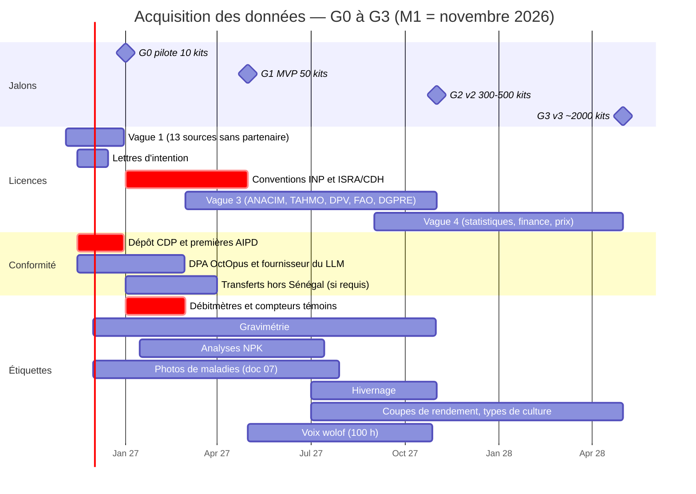

# 15 — Acquisition des données (phase 3)

Confidentiel — réservé aux partenaires de travail.

Ce document répond à la phase 3 du brief IA, Data et MLOps du 27/10/2026 : pour chaque donnée du doc 13, il dit comment l'obtenir, sous quelle licence, à quel coût, dans quel ordre et sous la responsabilité de quel rôle. Il traite en particulier les 35 avertissements de licence que le validateur lève aujourd'hui, car ils bloquent à la fois la mise en production de certains modèles et tout export vers OctOpus.

- **Source de vérité** : `ml/catalog/sources.yaml` (104 sources). Les champs `commercial`, `licence`, `access`, `cost`, `verified` et `evidence` portent l'état de chaque source ; `python -m agriml.catalog check` liste les avertissements. Voir [ml/catalog/README.md](../ml/catalog/README.md).
- **Détail complet** : [A1 — Sources](annexes/A1_sources.md) pour la fiche de chaque source, [A4 — Matrices](annexes/A4_matrice.md) pour les croisements source × modèle. Ce document ne les recopie pas : il en tire un plan d'action.
- **Avant** : les données dans le [doc 13](13_inventaire_donnees.md), les modèles dans le [doc 14](14_cartographie_modeles.md). **Après** : l'architecture OctOpus et le contrôle d'export dans le [doc 16](16_architecture_octopus.md).

**Conventions.**

- **[NV]** : fait non vérifié. **Hypothèse** : valeur de travail à remplacer par un devis ou une mesure. Seules 22 sources sur 104 ont été vérifiées en ligne, le 01/11/2026.
- **Montants** en millions de FCFA (M), hors taxes, avec 1 $ ≈ 600 FCFA et 1 € = 655,957 FCFA, comme le doc 07.
- **Calendrier** : M1 = novembre 2026. Les portes sont celles du [doc 07 § 4](07_feuille_de_route_budget.md) : G0 fin décembre 2026 (10 kits), G1 fin avril 2027 (50 kits), G2 fin octobre 2027 (300 à 500 kits), G3 fin avril 2028 (environ 2 000 kits).
- **Versions du catalogue** : MVP ≈ v1 du doc 07 (M3–M6) ; V1.1 = M7–M8 ([doc 12](12_plan_developpement.md)) ; V2 ≈ v2 (M7–M12) ; V3 ≈ v3 (M13–M18).
- **Responsables** : des rôles du doc 07 § 5, jamais des personnes. « Juriste » désigne le conseil externe financé par la ligne « Juridique et conformité » du doc 07.

## 1. Ce qu'il faut retenir

1. **Les partenariats sont le goulot, pas la technique.** Sur 17 sources partenaires, 16 portent un avertissement de licence ; seule l'analyse de sol en laboratoire est déjà libre. Aucune convention n'est signée à ce jour. Les lettres d'intention doivent partir en M1, c'est-à-dire maintenant.
2. **Trois voies pour lever les 35 avertissements** (§ 4) :
   - **(a)** obtenir ou confirmer la licence ;
   - **(b)** remplacer la source par un équivalent ouvert ;
   - **(c)** l'écarter de l'export, ou la rendre optionnelle ou réservée à la recherche.

   13 sources se règlent sans partenaire avant G0. 22 demandent une convention ou une confirmation écrite.
3. **Le chemin critique passe par l'INP et l'ISRA/CDH.** Trois des quatre modèles entraînés sur OctOpus (`soil_nowcast`, `irr_need_24h`, `yield_forecast`) remontent à `inp_soil_map` ; `irr_need_24h` et `phenology_stage` remontent aussi à `isra_cdh_references`. Seul `vis_disease` n'en dépend pas. Les signatures doivent tomber avant G1.
4. **La lignée du catalogue est prudente : elle rend obligatoires des sources d'enrichissement.** `irr_water_balance`, livré au MVP, hérite de `inp_soil_map`, `isra_cdh_references`, `hwsd` et `fao_crop_calendar` parce que le catalogue ne distingue pas, dans les entrées d'un jeu, l'indispensable de l'enrichissement. Conséquence pratique : chaque jeu concerné doit pouvoir se construire **sans** la source en attente (voie ouverte), et la source n'entre qu'une fois la licence levée (§ 4.5).
5. **Lever la licence ne suffit pas pour exporter.** Le validateur ne connaît que la licence. L'exporteur doit aussi exiger le DPA d'OctOpus, l'AIPD des exports et une déclaration CDP couvrant le transfert (§ 4.4). Sans ces trois pièces, aucun export réel ne part, même d'un jeu dont toutes les sources sont libres.
6. **Deux échéances du doc 07 sont trop tardives.**
   - **Le débitmètre** est classé « avant la V2 » dans le doc 13, alors que la porte G1 exige une économie d'eau **mesurée** contre des parcelles témoins. Il faut des compteurs dès janvier 2027 (§ 9.1).
   - **La déclaration CDP** n'est exigée « faite » qu'à G2 dans les portes du doc 07, alors que son registre des risques (R8) la prévoit en M2–M6 et que le pilote traite déjà des données personnelles réelles (téléphones, contours GPS). Elle doit être **déposée** en M2 au plus tard, et son récépissé devient un critère de G1 (§ 12).
7. **Le coût hors budget du doc 07 reste faible : 4,24 à 19,71 M**, soit 1,3 à 6,1 % du scénario standard. La moitié haute de la fourchette vient d'un seul risque : le prix réel des analyses de laboratoire (§ 11).
8. **Deux hypothèses de coût sont probablement trop basses** : la transcription vocale en wolof (3 à 8 k par heure dans le doc 13, plutôt 15 à 30 k [NV]) et le débitmètre sur des conduites de 1 à 2 pouces (§ 5).
9. **La sonde NPK doit passer une porte avant d'être étalonnée en masse.** Les sondes RS485 bon marché estiment N, P et K à partir de la conductivité [NV, hypothèse]. Sur les 50 premières paires sonde–laboratoire, on décide de poursuivre ou d'arrêter (§ 5.7).
10. **La page locale du kit collecte des étiquettes gratuites** : forçages manuels, changements de seuils, acquittements. Elle devient aussi le point d'arrivée de l'étalonnage par kit et des seuils NPK calculés dans le cloud (§ 9.2, doc 16).

## 2. Canaux d'acquisition

| Canal (`kind`) | Sources | En attente de licence | Non commerciales | Vérifiées | Personnelles | Mode d'acquisition | Risque principal |
|---|---|---|---|---|---|---|---|
| Données ouvertes (open_data) | 37 | 12 | 1 (`gyga`) | 16 | 0 | Téléchargement planifié : S3, COG, GRIB2, API | Licences contradictoires, arrêt ou changement de service |
| Interne (internal) | 24 | 0 | 0 | 0 | 21 | Kit, application, back-office | Qualité de saisie ; firmware v1.1 non compilé |
| Partenaires (partner) | 17 | 16 | 0 | 0 | 3 | Convention, échange de fichiers | Délai de signature, format, continuité |
| Saisie des utilisateurs (user_input) | 10 | 0 | 0 | 0 | 10 | Application, page locale du kit | Biais de déclaration, données manquantes |
| Référentiels (reference) | 7 | 2 | 0 | 2 | 0 | Saisie unique, versionnée | Droits de reproduction |
| Modèles pré-entraînés (pretrained) | 6 | 3 | 2 (`mms_models`, `nllb_models`) | 3 | 0 | Poids épinglés ou API | Licence des poids |
| API publiques (public_api) | 2 | 1 | 0 | 1 | 0 | Appels planifiés avec cache | Quotas, usage commercial |
| Commercial | 1 | 1 | 0 | 0 | 0 | Devis | Coût, droits de diffusion |
| **Total** | **104** | **35** | **3** | **22** | **34** | | |

**Lecture.**

- **Les 34 sources personnelles sont toutes à nous ou à nos utilisateurs**, sauf trois sources partenaires : `soil_lab_analyses` et `cnaas_insurance` (indirectes) et `mfi_credit_outcomes` (directe). Leur acquisition relève du consentement (`consents`) et de la CDP, pas d'une licence.
- **Les sources internes n'ont pas besoin d'être vérifiées en ligne**, mais elles dépendent du firmware et de l'application, dont aucun n'est encore validé sur le terrain.
- **Les 37 sources ouvertes sont les plus faciles à brancher et les plus traîtres** : 12 ont une licence inconnue ou contractuelle, et deux services changent d'ici fin 2026 (§ 6).

## 3. Sources externes par domaine

Ce tableau dit quoi brancher d'abord, avec quel repli, et ce qui vient plus tard. Les versions viennent du champ `available` des jeux qui consomment chaque source.

| Domaine | À brancher d'abord | Repli | Plus tard | Précaution |
|---|---|---|---|---|
| Météo | `open_meteo` (offre payante), `era5_land`, `chirps` | `ecmwf_open_data`, `noaa_gfs`, `nasa_power`, `agera5` | `anacim_stations`, `tahmo` (V2) ; `agrhymet_presass` (V3) | L'API gratuite d'Open-Meteo est non commerciale ; CHIRPS passe en v3 |
| Sols | `isdasoil`, `soilgrids` (fichiers) | `soil_field_kits` à l'installation | `inp_soil_map` (convention), `soil_lab_analyses` | API SoilGrids en pause ; `hwsd` écarté |
| Satellite | `sentinel2`, `hls`, `deafrica` (V2) | `landsat`, `sentinel1` | `modis_viirs`, `wapor` (V2) ; `planetscope` (V3, après ablation) | Le coût est le calcul par parcelle, pas l'image |
| Drone | — | — | `drone_rgb`, `drone_multispectral`, `drone_thermal` (V3, par prestataire) | RAS 06, autorisation et assurance du prestataire |
| IoT | `kit_telemetry`, `kit_events`, `kit_config` ; `kit_flowmeter`, `kit_power`, `kit_soil_extended`, `kit_microclimate` (matériel à ajouter avant G1, § 9.1) | Estimation durée × débit nominal | `kit_espcam` (V2) | `telemetry.v2` à spécifier ; firmware non compilé |
| Phytosanitaire | `advisor_diagnoses`, `farmer_photos`, `scouting_reports`, `csp_pesticides` | `plantdoc` pour le pré-entraînement | `dpv_alerts`, `famews`, `fao_locust`, `gbif` | Produits homologués par le CSP uniquement |
| Agronomie | `crop_cycles_user`, `operations_log`, `fao56_tables` | Durées de stades FAO-56 | `isra_cdh_references` (convention) ; `aquacrop`, `sarra` (V3) | `fao_crop_calendar` et `gyga` écartés |
| Économie | `input_prices_survey`, `energy_tariffs`, `logistics_costs` (V2) | — | `farm_accounts`, `payments`, `sim_csa`, `arm_prices`, `fews_net`, `giews_fpma` (V2) ; `cnaas_insurance`, `mfi_credit_outcomes` (V3) | Données financières : consentement distinct |
| Géospatial | `user_field_boundaries`, `geoboundaries`, `copernicus_dem`, `worldcover`, `jrc_gsw`, `hydrosheds` | — | `osm` (V2) ; `field_boundaries_open` (V3) | ODbL pour OSM ; GADM écarté |
| Eau | `irrigation_water_quality`, `well_inventory` (V1.1) | — | `dgpre_groundwater` (V3, convention) | — |
| Historique | `farmer_harvests`, `faostat` (V1.1) | — | `dapsa_surveys`, `ansd_stats` (V1.1, conventions) ; `research_trials` (V3) | Rendements déclarés biaisés : les recaler sur des coupes |
| Utilisateurs | `user_accounts`, `farm_registry`, `consents`, `reco_feedback`, `app_usage` | — | — | Consentement par finalité dès la v0.1 |
| Langue | `assistant_logs`, `claude_api`, `embedding_models` | — | `speech_consented`, `common_voice`, `open_wolof_speech`, `xlsr_models` (V2) | `mms_models` et `nllb_models` : recherche seulement |
| Connaissances | `agronomist_qa` | Textes sous licence ouverte | `technical_sheets` (droits à obtenir) | Droits de reproduction des fiches |

## 4. Lever les 35 avertissements de licence

### 4.1 Les trois voies

| Voie | Quand la choisir | Ce qui change dans le catalogue |
|---|---|---|
| **(a) Obtenir ou confirmer** | La source apporte un gain mesuré et le détenteur est joignable | Preuve dans `evidence`, date dans `verified`, puis `commercial: open` et la convention citée dans `licence` |
| **(b) Remplacer** | Un équivalent ouvert existe, au prix d'un peu de précision | La source sort des entrées du jeu ; l'équivalent y entre |
| **(c) Écarter** | La source n'est utile que pour la recherche, ou son gain n'est pas démontré | Jeu marqué `research_only`, source rendue optionnelle, ou jeu exclu de l'export |

**Règle de décision.** On ne négocie une licence (voie a) que si l'ablation montre un gain, ou si la source est la seule à couvrir le besoin. Sinon, on remplace ou on écarte. Une négociation coûte des semaines de temps du CTO.

### 4.2 Source par source

« Requis dès » : première version où un modèle déclare la source obligatoire, d'après la lignée du catalogue. Un astérisque signale une obligation qui ne vient que de la lignée prudente (§ 4.5) : le modèle peut tourner sans la source si le jeu se construit par la voie ouverte.

| # | Source | Statut | Requis dès | Vague | Voie | Action | Responsable |
|---|---|---|---|---|---|---|---|
| 1 | `open_meteo` | contrat | MVP | 1 | a | Abonnement Standard dès le pilote, puisque le projet est commercial ; cache par maille ; repli `ecmwf_open_data` et `noaa_gfs` | CTO |
| 2 | `cmsaf_sarah` | inconnu | MVP | 1 | a, sinon b | Demander à EUMETSAT si un produit dérivé peut servir commercialement ; sinon rayonnement de `era5_land`, `agera5` ou `nasa_power` | Data scientist |
| 3 | `hwsd` | inconnu | MVP* | 1 | b | Remplacer par `isdasoil` et `soilgrids` | Data scientist |
| 4 | `fao_crop_calendar` | inconnu | MVP* | 1 | b | Calendriers tirés de `crop_cycles_user` et des durées de `fao56_tables` | Agronome |
| 5 | `vision_backbones` | contrat | MVP | 1 | a | Épingler des poids sous Apache 2.0, MIT ou BSD ; licence relue modèle par modèle et consignée dans MLflow | Data scientist |
| 6 | `claude_api` | contrat | MVP | 1 | a | Conditions commerciales, DPA, région de traitement, non-réutilisation des données ; transfert déclaré à la CDP | CTO, juriste |
| 7 | `embedding_models` | inconnu | MVP | 1 | a | Vérifier la licence du modèle retenu (MIT annoncé [NV]) et l'épingler | Data scientist |
| 8 | `gbif` | contrat | V2 | 1 | a | Ne télécharger que les jeux CC0 et CC BY ; citer le DOI de chaque téléchargement | Data scientist |
| 9 | `ansd_admin` | contrat | V2 | 1 | b | `geoboundaries` pour les limites ; l'ANSD seulement si la « licence ouverte » est confirmée par écrit | Data scientist |
| 10 | `osm` | contrat | V2 | 1 | a | Avis juridique sur l'ODbL (base dérivée ou œuvre produite) ; auto-hébergement à partir des extraits Geofabrik | Juriste |
| 11 | `planetscope` | contrat | V2* | 1 | c | Optionnel ; Sentinel-2 et HLS par défaut ; achat seulement après une ablation favorable | Data scientist |
| 12 | `plantvillage` | inconnu | V2 | 1 | c | Recherche seulement ; pré-entraînement de production sur `plantdoc` (CC BY 4.0) | Data scientist |
| 13 | `aquacrop` | inconnu | V3 | 1 | a | Lire la LICENSE du cœur open source ; repli `sarra` | Data scientist |
| 14 | `inp_soil_map` | contrat | MVP* | 2 | a | Convention INP : lettre d'intention en M1, signature avant G1 ; d'ici là, sols par la voie ouverte | CTO |
| 15 | `isra_cdh_references` | contrat | MVP* | 2 | a | Convention ISRA/CDH (§ 8) ; d'ici là, `fao56_tables` seules | Agronome |
| 16 | `technical_sheets` | contrat | MVP* | 2 | a | Droits de reproduction (ISRA, ANCAR, FAO) ; d'ici là, corpus limité à `agronomist_qa` et aux textes sous licence ouverte | Agronome |
| 17 | `open_wolof_speech` | inconnu | V2 | 2 | a, sinon c | Licence corpus par corpus ; ne garder que ceux qui permettent l'usage commercial ; `common_voice` (CC0) en base | Data scientist |
| 18 | `anacim_stations` | contrat | V2 | 3 | a | Convention ANACIM : séries horaires, droit d'entraîner et de sous-traiter | CTO |
| 19 | `tahmo` | contrat | V2 | 3 | a | Lire la Data Policy ; devis commercial | Data scientist |
| 20 | `dpv_alerts` | contrat | V2 | 3 | a | Convention DPV : historique des alertes et relais | Agronome |
| 21 | `famews` | inconnu | V2 | 3 | a | Accord écrit de la FAO pour l'export | Agronome |
| 22 | `fao_locust` | inconnu | V2 | 3 | a | Compte et licence du jeu complet | Data scientist |
| 23 | `dgpre_groundwater` | contrat | V2 | 3 | a | Convention DGPRE : piézométrie et salinité | CTO |
| 24 | `agrhymet_presass` | contrat | V3 | 4 | a | Données sous convention ; bulletins publics en attendant | Data scientist |
| 25 | `ansd_stats` | inconnu | V3 | 4 | a | Faire confirmer par écrit la « licence ouverte » | Data scientist |
| 26 | `dapsa_surveys` | contrat | V3 | 4 | a | Convention DAPSA : enquêtes par département | Chef de produit |
| 27 | `research_trials` | contrat | V3 | 4 | a | Accord jeu par jeu (ISRA, centres du CGIAR) | Agronome |
| 28 | `field_boundaries_open` | inconnu | V3 | 4 | a | Licence de Fields of The World et des autres jeux [NV] | Data scientist |
| 29 | `cnaas_insurance` | contrat | V3 | 4 | a | Convention CNAAS : sinistres et indemnités agrégés | Chef de produit |
| 30 | `mfi_credit_outcomes` | contrat | V3 | 4 | a | Convention par IMF et consentement de chaque emprunteur ; local strict | Chef de produit, juriste |
| 31 | `wapor` | inconnu | V3 | 4 | a ou c | Demander à la FAO la licence applicable ; sinon exclure de l'export | Data scientist |
| 32 | `arm_prices` | contrat | V3 | 4 | a | Convention ARM | Chef de produit |
| 33 | `fews_net` | inconnu | V3 | 4 | a | Lire les conditions d'utilisation | Data scientist |
| 34 | `giews_fpma` | inconnu | V3 | 4 | a | Licence et couverture du Sénégal | Data scientist |
| 35 | `sim_csa` | contrat | V3 | 4 | a | Convention CSA | Chef de produit |

**Deux conflits de calendrier.**

- **`anacim_stations`, `tahmo`, `dpv_alerts`, `famews`, `fao_locust` et `gbif`** sont recommandés ou optionnels dès le MVP ou la V1.1 (`irr_et0`, `wx_blend`, `reco_engine`, `risk_rules`) mais n'arrivent qu'en vague 3. Jusqu'à leur levée, ces modèles tournent sans elles. C'est acceptable parce qu'aucune n'est obligatoire avant la V2.
- **`inp_soil_map`, `isra_cdh_references` et `technical_sheets`** sont obligatoires au MVP d'après la lignée, mais leur convention ne sera pas signée avant G1. La voie ouverte du § 4.5 est donc une condition du MVP, pas une option.

### 4.3 Vagues et exports débloqués

| Vague | Échéance | Sources levées | Jeux exportables débloqués (cumul) |
|---|---|---|---|
| 1 | Avant G0 (fin décembre 2026) | 13, toutes réglables sans partenaire (n° 1 à 13) | `features.rain_events`, `features.disease_images`, `features.sensor_anomaly`, `features.crop_type`, `features.reco_bandit`, plus `features.pest_trap_images` déjà libre : **6** |
| 2 | Avant G1 (fin avril 2027) | 4 : INP, ISRA/CDH, fiches techniques, corpus vocaux (n° 14 à 17) | + `features.soil_nowcast`, `features.irrigation_need`, `features.phenology` : **9** |
| 3 | Avant G2 (fin octobre 2027) | 6 : ANACIM, TAHMO, DPV, FAMEWS, criquet pèlerin, DGPRE (n° 18 à 23) | + `features.local_weather_bias`, `features.pest_risk`, `features.npk_calibration` : **12** |
| 4 | Avant G3 (fin avril 2028) | 12 : statistiques, essais, contours ouverts, finance, prix (n° 24 à 35) | + `features.yield`, `features.salinity_risk`, `features.price_forecast` : **15** |

**Ce que montre ce tableau.**

- **Après la vague 1, aucun des quatre modèles OctOpus n'est exportable** sauf `vis_disease` par `features.disease_images`. C'est cohérent avec le doc 14 : OctOpus n'accélère rien avant la V2.
- **`features.yield` attend la vague 4** à cause des statistiques régionales (`ansd_stats`, `dapsa_surveys`). Une variante de l'export sans `historique.regional_stats` serait débloquée dès la vague 2. Elle vaut la peine si `yield_forecast` doit être entraîné sur OctOpus avant G3.
- **Les quatre jeux interdits d'export** (`features.water_savings`, `features.field_boundaries`, `features.agri_risk`, `features.asr_speech`) le restent quelle que soit la vague : ce sont des jeux en local strict.

### 4.4 Ce qu'il faut pour exporter réellement

Le validateur applique deux règles ([ml/src/agriml/catalog/rules.py](../ml/src/agriml/catalog/rules.py)) :

- **`licence.pending`** : une source `contract` ou `unknown` utilisée par un modèle. Elle ne disparaît **que** si la source passe à `commercial: open`.
- **`octopus.licence`** : un jeu exportable dont une source amont est en attente et dont `licence_cleared` vaut `false`.

**Procédure de levée.**

1. Archiver la preuve (convention signée, courriel du détenteur, page de licence datée) et la citer dans `evidence`.
2. Renseigner `verified` à la date de la preuve.
3. Passer `commercial` à `open` et citer la convention dans `licence`.
4. Relancer `check` et régénérer les annexes (`render`).

**`licence_cleared: true`** ne sert que dans un cas : la source reste sous contrat, mais la convention autorise **explicitement** la sous-traitance à OctOpus et à ses hébergeurs. On le pose sur le jeu exporté, avec la référence de la clause.

**Ce que le validateur ne vérifie pas.** Une source peut devenir `open` sans qu'aucune pièce de conformité n'existe. L'exporteur, première barrière du [doc 09 § 4.4](09_octopus_ml.md), doit donc refuser tout export tant que manquent :

- le **DPA signé avec OctOpus**, avec la liste de ses sous-traitants et la région d'hébergement ;
- l'**AIPD des exports**, l'une des six du doc 13 § 8.1 ;
- le **récépissé de la déclaration CDP** couvrant le transfert hors du Sénégal.

Le doc 16 décrit ce contrôle dans la chaîne d'export.

### 4.5 Changements proposés au catalogue (non appliqués)

Ces changements modifient le schéma ou des choix de modélisation. Ils sont proposés ici et attendent une décision.

1. **Niveau par entrée de jeu.** Aujourd'hui, toutes les entrées d'un jeu sont traitées comme obligatoires par la lignée. Ajouter un niveau (`enrichment`) aux entrées, ou scinder les jeux concernés en une version ouverte et une version enrichie, pour `inp_soil_map`, `isra_cdh_references`, `technical_sheets`, `planetscope`, `hwsd` et `fao_crop_calendar`.
2. **Retirer `hwsd` de `raw.sols.grids` et `fao_crop_calendar` de `raw.agronomie.reference`** (voie b).
3. **Remplacer `ansd_admin` par `geoboundaries`** dans `raw.geo.official` tant que la licence n'est pas confirmée.
4. **Réserver `plantvillage` à la recherche** : sortir de `raw.phyto.public_images` toute voie de production.
5. **Sortir `raw.satellite.planet` des entrées de `satellite.field_indices`** et le traiter comme une entrée optionnelle distincte.
6. **Exclure `wapor` des jeux exportés** tant que la FAO n'a pas tranché.
7. **Ajouter `commercial: granted` avec une date d'expiration** : une convention a une durée, et l'avertissement doit revenir quand elle expire. Aujourd'hui, `open` est définitif.
8. **Faire vérifier par l'exporteur** la présence du DPA, de l'AIPD et du récépissé CDP (§ 4.4, doc 16).

## 5. Arbitrages à trois variantes

Même grille que le doc 14 : **compétition** (le meilleur résultat sans contrainte), **production** (la cible industrialisée), **compromis** (ce qu'on peut faire maintenant).

### 5.1 Prévisions météo

- **Compétition** : offre Professional d'Open-Meteo (historique, ensembles, rayonnement), plus ensembles ECMWF.
- **Production** : ingestion directe de `ecmwf_open_data` et `noaa_gfs` en GRIB2, et de `era5` par le CDS ; aucune dépendance commerciale ; rayonnement prévu inclus [NV].
- **Compromis** : offre Standard (environ 29 $ par mois [NV]) avec un cache par maille ; ingestion ECMWF en V1.1. Si le Standard ne fournit pas le rayonnement, ET0 de Hargreaves en attendant, ou passage au Professional (+0,50 M par an).
- **Avis** : compromis. Le volume d'appels suit la flotte (720 par kit et par mois en horaire) : 7 200 pour 10 kits, 360 000 pour 500, 1,44 million pour 2 000. Un appel par **maille** et par heure, pas par kit, divise ce volume par le nombre de kits voisins. Le quota de l'offre Standard est à confirmer [NV].

### 5.2 Imagerie satellite

- **Compétition** : PlanetScope à 3 m, quotidien, en plus de Sentinel-1 et Sentinel-2.
- **Production** : Sentinel-2 L2A et HLS par Digital Earth Africa (`deafrica`, région AWS af-south-1 [NV]), Sentinel-1 pour l'hivernage nuageux.
- **Compromis** : Sentinel-2 et HLS, masque de nuages, statistiques par parcelle.
- **Avis** : compromis jusqu'en V3. Le programme NICFI a pris fin le 23/01/2025 ; l'offre Éducation et Recherche de Planet est non commerciale. On n'achète du Planet qu'après une ablation qui montre un gain sur des parcelles de moins de 0,5 ha.

### 5.3 Sols

- **Compétition** : carte numérique des sols par apprentissage sur des centaines de prélèvements, plus la carte INP.
- **Production** : `isdasoil` (30 m) et `soilgrids` (250 m), carte INP, paires sonde–laboratoire.
- **Compromis** : `isdasoil` et `soilgrids` téléchargés dès maintenant ; test de texture à l'installation (`soil_field_kits`) ; INP dès signature.
- **Avis** : compromis. iSDAsoil est sur un S3 public en us-west-2 ; SoilGrids se télécharge en fichiers puisque l'API REST est en pause.

### 5.4 Pluie observée

- **Compétition** : 1 kit de référence sur 20 (pluviomètre, pyranomètre, anémomètre), plus TAHMO, ANACIM et un mélange CHIRPS–IMERG.
- **Production** : CHIRPS v3, `imerg` et les stations ANACIM.
- **Compromis** : CHIRPS v3 (v2 s'arrête après décembre 2026), IMERG Early pour la latence, et 3 kits microclimat pour valider.
- **Avis** : compromis. Les 3 kits microclimat coûtent 0,18 à 0,45 M ; les 25 kits d'une couverture « 1 sur 20 » à 500 kits coûteraient 1,5 à 3,75 M (V2).

### 5.5 Voix en wolof

- **Compétition** : 300 h de parole consentie, plusieurs parlers, plus un ajustement de MMS (recherche seulement).
- **Production** : XLS-R (`xlsr_models`, Apache 2.0) ajusté sur 100 à 300 h consenties, plus `common_voice`.
- **Compromis** : 100 h ciblées sur les intentions fréquentes ; le wolof écrit d'abord ; l'audio pour les menus et les questions courtes.
- **Avis** : compromis. MMS et NLLB sont sous CC BY-NC : ils servent de point de comparaison, jamais en production. Pour la synthèse vocale, aucun modèle wolof ouvert et commercial n'a été identifié [NV] ; la voie est d'entraîner sur `speech_consented` avec un consentement qui le prévoit.

### 5.6 Pré-entraînement de la vision

- **Compétition** : grands réseaux de base, PlantVillage, PlantDoc et images GBIF sous CC0 ou CC BY.
- **Production** : réseau de base sous licence permissive, `plantdoc`, puis nos images validées.
- **Compromis** : identique à la production.
- **Avis** : production. PlantVillage reste un point de comparaison en recherche : l'original n'a pas de licence et la chaîne de droits du dérivé CC0 n'est pas claire.

### 5.7 Étalonnage NPK au laboratoire

- **Compétition** : 1 000 paires sonde–laboratoire par an.
- **Production** : 600 paires par an, stratifiées par type de sol et par culture.
- **Compromis** : 300 paires (le budget du doc 07), dont **50 d'abord**.
- **Avis** : compromis, avec une **porte à 50 paires**. Si la sonde n'explique pas les valeurs du laboratoire mieux qu'une simple fonction de la conductivité (seuil à fixer, hypothèse : R² ≥ 0,5 sur N), on arrête l'étalonnage par apprentissage. `fert_reco` passe alors sur les analyses de laboratoire par classe de sol, et la page locale cesse d'afficher N, P et K comme des mesures (risque R2 du doc 07).

### 5.8 Débitmètre

- **Compétition** : débitmètre électromagnétique sur chaque kit.
- **Production** : débitmètre à effet Hall au refoulement sur tous les kits à partir de la v1.2, dans `telemetry.v2`.
- **Compromis** : débitmètres sur les 50 kits du MVP, compteurs mécaniques relevés chaque semaine sur 20 parcelles témoins, estimation durée × débit nominal ailleurs, marquée « estimée ».
- **Avis** : compromis. Le prix de 3 à 10 k du doc 13 vaut pour de petits capteurs ; sur une conduite de 1 à 2 pouces, il faut plutôt compter 15 à 30 k [NV]. Sur un kit à 115 k, +5 k représentent +4,3 % de la nomenclature, et +15 k, +13 %.

### 5.9 Étiquetage

- **Compétition** : équipe d'annotation dédiée, 1 000 analyses de laboratoire, 300 h de voix.
- **Production** : étiquettes produites dans l'application (« étiqueter là où l'on sert », doc 13 § 5), 150 analyses par an, 100 h de voix.
- **Compromis** : étiquettes de l'application, plus des **campagnes ciblées** sur le holdout et les strates rares ; 300 puis 600 analyses ; 100 h de voix.
- **Avis** : compromis. Les étiquettes de l'application ne suffisent pas pour le holdout : il doit venir de campagnes à protocole fixe, sinon il hérite des biais de saisie (§ 9).

## 6. Migrations imposées

Ces changements ne sont pas des choix : ils découlent d'un arrêt de service ou d'une licence.

| Sujet | Fait | Action | Échéance |
|---|---|---|---|
| CHIRPS | La v2 cesse d'être produite après décembre 2026 (vérifié le 01/11/2026) | Passer à la v3 (CC BY 4.0) ; vérifier la profondeur d'archive et la latence | Avant G0 |
| SoilGrids | L'API REST est en pause (vérifié le 01/11/2026) | Télécharger les fichiers et les servir depuis notre stockage | Avant G0 |
| PlanetScope | NICFI a pris fin le 23/01/2025 | Pas de Planet gratuit ; voie (c) | Fait |
| GADM | Licence non commerciale | `geoboundaries` | Avant V2 |
| GYGA | CC BY-NC-SA | Recherche seulement (`gyga` est déjà `restricted`) | Fait |
| MMS, NLLB | CC BY-NC | Recherche seulement ; XLS-R en production | Avant V2 |
| Contenus FAO | Une partie sous CC BY-NC-SA 3.0 IGO | Écarter `fao_crop_calendar` ; vérifier chaque contenu FAO avant usage | Avant G0 |
| OSM | Tuiles et API publiques interdites en production | Auto-héberger depuis les extraits Geofabrik | Avant V2 |
| Open-Meteo | API gratuite réservée au non commercial | Offre payante dès le pilote, ou auto-hébergement (AGPLv3) | Maintenant |
| WaPOR | Licence contradictoire selon la page | Demander à la FAO ; sinon voie (c) | Avant V3 |

## 7. Recherches restantes

Liste des vérifications à faire, par ordre d'échéance. Chaque résultat met à jour `verified` et `evidence` dans le catalogue, puis les annexes.

| # | Question | Pourquoi | Échéance | Responsable |
|---|---|---|---|---|
| 1 | Prix, quotas et contenu des offres Standard et Professional d'Open-Meteo (rayonnement, historique) | Coût du pilote et choix de variante (§ 5.1) | M1 | CTO |
| 2 | Conditions commerciales, DPA, région et sous-traitants de l'API Claude | Assistant au MVP ; déclaration CDP | M1 | CTO |
| 3 | Région, DPA, sous-traitants et offre Enterprise/VPC d'OctOpus | Condition de tout export | M1 | CTO |
| 4 | Textes complets : loi 2008-12, délais de la CDP, régime des transferts hors du Sénégal | Calendrier du § 12 | M1 | Juriste |
| 5 | Licence des produits CM SAF dérivés pour un usage commercial | `cmsaf_sarah` obligatoire au MVP | M1 | Data scientist |
| 6 | Licence de HWSD et des contenus FAO utilisés | Voie (b) confirmée | M1 | Data scientist |
| 7 | Licences des poids de vision et du modèle d'embeddings retenus | Modèles MVP | M1 | Data scientist |
| 8 | CHIRPS v3 : profondeur d'archive, latence, format | Migration avant G0 | M1 | Data scientist |
| 9 | Registre Modbus de la sonde 7-en-1 : CE et température exposées ? | Manque n° 3 du doc 13 § 6, coût nul s'il l'est | M1 | Ingénieur embarqué |
| 10 | Devis de deux laboratoires de sol (NPK, gravimétrie, délais) | Risque de prix (§ 11) | M1 | Agronome |
| 11 | Prix des débitmètres DN25 à DN50 et des compteurs mécaniques | Nomenclature (§ 5.8) | M1 | Ingénieur embarqué |
| 12 | LICENSE d'AquaCrop | Voie (a) | M2 | Data scientist |
| 13 | Volume de GBIF sous CC0 et CC BY pour les ravageurs du Sénégal | Utilité réelle de `gbif` | M2 | Data scientist |
| 14 | Chaîne de droits de PlantVillage et licence de PlantDoc | Pré-entraînement (§ 5.6) | M2 | Data scientist |
| 15 | Licence de geoBoundaries au niveau ADM3 pour le Sénégal | Remplacement de `ansd_admin` | M2 | Data scientist |
| 16 | Avis juridique sur l'ODbL pour nos variables dérivées d'OSM | `osm` | M3 | Juriste |
| 17 | Quotas du Copernicus Data Space et produits de Digital Earth Africa | Chaîne satellite | M3 | Data scientist |
| 18 | Prix de Google Earth Engine en usage commercial | Repli de calcul satellite | M3 | Data scientist |
| 19 | NASA POWER, ERA5-Land, AgERA5 : latence, licence, biais au Sénégal | Repli météo | M3 | Data scientist |
| 20 | Data Policy de TAHMO et densité de stations au Sénégal | Vague 3 | M4 | Data scientist |
| 21 | Corpus vocaux wolof (Common Voice, ALFFA, Kallaama) : volume, licence, parlers | Voix (§ 5.5) | M4 | Data scientist |
| 22 | Coût réel de la transcription en wolof par heure | Risque de sous-estimation (§ 11) | M4 | Chef de produit |
| 23 | Appels de Lacuna Fund ou d'équivalents pour des jeux étiquetés [NV] | Cofinancement (§ 9.3) | M4 | Chef de produit |
| 24 | Prix de PlanetScope pour quelques centaines d'hectares | Ablation de la V3 | M8 | Data scientist |
| 25 | FAOSTAT, FEWS NET, GIEWS : conditions, couverture des marchés sénégalais | Vague 4 | M8 | Data scientist |
| 26 | SIM/CSA et ARM : format, historique, fréquence | Vague 4 | M8 | Chef de produit |
| 27 | Licence de WaPOR | Vague 4 | M10 | Data scientist |
| 28 | Licence de Fields of The World pour le Sénégal | `field_boundaries_open` | M10 | Data scientist |
| 29 | Régime des drones professionnels (RAS 06) et prestataires autorisés | Drone en V3 | M10 | Agronome |

## 8. Partenariats et clauses

### 8.1 Partenaires

| Partenaire | Sources | Ce qu'on demande | Ce qu'on peut offrir | Vague | Responsable |
|---|---|---|---|---|---|
| INP | `inp_soil_map` | Carte pédologique numérique, droit d'entraîner et de sous-traiter | Analyses de sol géolocalisées, agrégées ; co-publication | 2 | CTO |
| ISRA / CDH, ANCAR | `isra_cdh_references`, `technical_sheets`, `research_trials` | Référentiels culturaux (Kc locaux, stades, variétés), fiches techniques, essais | Séries du kit sur leurs parcelles d'essai, co-publication ; analyses en nature (hypothèse) | 2 (essais : 4) | Agronome |
| ANACIM | `anacim_stations` | Séries horaires des stations | Données des kits microclimat ; biais locaux mesurés | 3 | CTO |
| TAHMO | `tahmo` | Données des stations, conditions commerciales | Site d'accueil pour une station (hypothèse) | 3 | Data scientist |
| DPV | `dpv_alerts` | Historique des alertes, canal de relais | Relevés de dépistage et de piégeage agrégés | 3 | Agronome |
| FAO | `famews`, `fao_locust`, `fao_crop_calendar`, `wapor`, `giews_fpma` | Licences écrites, export FAMEWS | Relevés FAMEWS saisis par les animateurs | 3–4 | Data scientist |
| DGPRE | `dgpre_groundwater` | Piézométrie, salinité des nappes | Qualité de l'eau des puits (`irrigation_water_quality`) | 3 | CTO |
| AGRHYMET | `agrhymet_presass` | Prévisions saisonnières en données | — | 4 | Data scientist |
| ANSD | `ansd_admin`, `ansd_stats` | Confirmation écrite de la licence ouverte | — | 1 et 4 | Data scientist |
| DAPSA | `dapsa_surveys` | Enquêtes agricoles par département | Rendements agrégés par commune | 4 | Chef de produit |
| SIM/CSA, ARM | `sim_csa`, `arm_prices` | Séries de prix | Prix relevés par les coopératives | 4 | Chef de produit |
| CNAAS | `cnaas_insurance` | Sinistres et indemnités agrégés | Coupes de rendement, indices ; cofinancement des coupes (hypothèse) | 4 | Chef de produit |
| IMF | `mfi_credit_outcomes` | Remboursements, avec consentement | Score de risque avec contrôle d'équité | 4 | Chef de produit, juriste |
| Laboratoire de sol | `soil_lab_analyses` | Devis, délais, protocole | Volume garanti sur 12 mois | G0 | Agronome |
| Anthropic | `claude_api` | Conditions commerciales, DPA | — | 1 | CTO |
| OctOpus | Sous-traitant, pas une source | DPA, sous-traitants, région | — | 1 | CTO |

**Ordre de traitement.** Les lettres d'intention partent en M1 vers l'INP et l'ISRA/CDH, puis vers l'ANACIM, la DPV et la DGPRE. Une lettre ne coûte rien et fait courir le délai administratif. Les partenaires des vagues 3 et 4 sont contactés après G0, quand les kits pilotes donnent quelque chose à montrer.

**Charge.** En scénario léger, le CTO porte cinq conventions et deux DPA en six mois, en plus de la technique. Il faut confier le suivi à un rôle désigné (chef de produit à mi-temps) et le juridique au conseil externe.

### 8.2 Dix clauses à négocier

1. **Finalité** : entraînement, évaluation et service de modèles, **y compris à usage commercial**. Une clause « recherche » ne suffit pas.
2. **Sous-traitance** : hébergement cloud, OctOpus et ses hébergeurs (Cloudflare, Supabase, Modal, Railway [NV]), fournisseur du LLM, y compris hors du Sénégal. Sans cette clause, `licence_cleared` ne peut pas être posé.
3. **Propriété des modèles dérivés** : les poids, variables et prédictions appartiennent à SmartAgri92.
4. **Pas de redistribution brute** : on ne republie jamais les données du partenaire telles quelles.
5. **Attribution** : mention dans l'application et dans la documentation des modèles.
6. **Survie des modèles** : à la fin de la convention, les modèles déjà entraînés restent utilisables ; les données brutes sont supprimées.
7. **Données personnelles** : rôles (responsable de traitement, sous-traitant), base légale, déclaration CDP de chaque partie.
8. **Contrepartie** : ce que le partenaire reçoit (données agrégées, co-publication, accès au tableau de bord).
9. **Format et continuité** : format, fréquence, délai de livraison, interlocuteur technique.
10. **Confidentialité et durée** : durée de la convention, préavis, reconduction. Cette date alimente le `commercial: granted` proposé au § 4.5.

## 9. Étiquetage : campagnes et financement

### 9.1 Campagnes ciblées

Les volumes viennent du doc 13 § 5. Ce tableau ajoute le calendrier, le protocole et ce qui change.

| Campagne | Modèles | Volume | Protocole | Quand | Coût hors doc 07 |
|---|---|---|---|---|---|
| **Eau apportée** | `irr_need_24h`, `water_savings`, `pump_health` | 50 kits équipés, 20 parcelles témoins | Débitmètre sur le kit ; compteur mécanique relevé chaque semaine sur les témoins ; relevé manuel des compteurs si le firmware v1.2 tarde | Pose en janvier–février 2027 | 0,45 à 1,30 M |
| **Humidité gravimétrique** | `sm_calibration`, `soil_nowcast` | 3 profondeurs × 5 dates × 30 parcelles = 450 | Prélèvement au pied de la sonde, étuve du laboratoire ; les deux saisons | Décembre 2026 – octobre 2027 | 0,45 à 1,35 M |
| **Paires NPK** | `npk_calibration`, `fert_reco` | 300 (dont 50 pour la porte du § 5.7) | Prélèvement au pied de la sonde, le même jour | À partir de mi-janvier 2027 | Risque de prix seulement |
| **Photos de maladies** | `vis_disease`, `vis_quality` | 10 000 (doc 07) | Application, validation par les conseillers, apprentissage actif | Décembre 2026 – juillet 2027 | Déjà au doc 07 |
| **Pièges à ravageurs** | `vis_pest_count`, `pest_risk_ml` | 30 pièges, environ 3 000 images | Relevé hebdomadaire **avec les zéros** ; double annotation sur 10 % | Hivernage 2027 | 0,45 à 1,35 M |
| **Coupes de rendement** | `yield_forecast`, `yield_crop_model` | 300 carrés par campagne | Échantillon stratifié par culture et par zone ; pesée sur place | Récoltes de l'hivernage 2027 et de la contre-saison 2027–28 | 1,50 à 4,50 M |
| **Types de culture** | `crop_type_map` | 2 000 points | Relevés géolocalisés au bord des champs | Pendant les deux saisons | 0,50 à 1,50 M |
| **Voix** | `asst_asr`, `asst_tts` | 100 h | Collecte guidée, consentement écrit, transcription double sur 10 % | Mai – octobre 2027 | 0,30 à 0,80 M (hypothèse basse) |
| **Contours** | `field_boundary` | 5 000 polygones | Extraits des parcelles consenties, vérifiés sur image | En continu | Nul |

**Trois règles ajoutées à celles du doc 13 § 5.**

1. **Le holdout d'abord.** La première moitié de chaque campagne alimente le jeu de référence figé, stratifié par saison, zone et culture. Les étiquettes de l'application servent à l'entraînement, pas au holdout.
2. **Les deux saisons comptent.** La contre-saison (novembre à juin) apporte l'irrigation ; l'hivernage (juillet à octobre) apporte les maladies. Manquer un hivernage décale d'un an les modèles de maladies (risque R13 du doc 07).
3. **Pas de campagne sans techniciens.** Le scénario léger du doc 07 n'en prévoit aucun. Les campagnes de G2 demandent les deux techniciens du scénario standard ; à défaut, on réduit les coupes à 150 carrés et les points de culture à 1 000, et on l'écrit dans les critères de G3.

### 9.2 Ce que la page locale et l'application collectent sans coût

- **Forçages manuels de la pompe et changements de seuils**, journalisés dans `raw.iot.events` avec le déclencheur, l'origine et `param_version`. Un agriculteur qui arrête la pompe avant le seuil dit quelque chose du besoin réel : c'est une étiquette faible pour `irr_need_24h` et pour les seuils conseillés de `irr_water_balance`.
- **Acquittements d'alerte et réponses aux recommandations**, dans `utilisateurs.reco_events` : étiquettes de `reco_bandit` et de la pertinence des alertes.
- **La carte « eau consommée »** de la page locale n'existe qu'avec le débitmètre. Sans lui, elle affiche une estimation marquée comme telle.
- **La campagne gravimétrique** produit une courbe d'étalonnage par kit (`sm_calibration`), poussée au kit par le canal des paramètres du doc 16.
- **Les paires NPK** fixent les seuils de `fert_reco` par culture et par stade, puis `npk_calibration`. Ils arrivent au kit par le même canal ; d'ici là, la page affiche « indicatif, à confirmer » (doc 14 § 4.2.1).

### 9.3 Financement

- **Doc 07** : 4,5 M pour 300 analyses de laboratoire et 2,0 M pour 10 000 images annotées. Le reste est chiffré au § 11.
- **Cofinancements possibles** :
  - fonds dédiés aux jeux de données étiquetés pour l'agriculture, comme Lacuna Fund [NV : appels en cours non vérifiés] ;
  - co-publication avec l'ISRA, avec analyses en nature ;
  - intérêt de la CNAAS pour des coupes de rendement qui calent ses indices (hypothèse) ;
  - coopératives, qui fournissent des animateurs contre un accès au tableau de bord ;
  - sources générales du doc 07 § 7.4.
- **Règle** : un jeu cofinancé ne doit jamais imposer une licence de diffusion qui interdirait son usage commercial (clause 1 du § 8.2).

## 10. Plan G0 à G3

| Porte | Ce qui doit être acquis | Ce qui doit être signé ou déposé |
|---|---|---|
| **G0** (fin décembre 2026) | CHIRPS v3 et SoilGrids en fichiers ; Open-Meteo payant ; `isdasoil` ; consentements par finalité dans l'application ; premières mesures gravimétriques | Vague 1 levée ; lettres d'intention envoyées ; **déclaration CDP déposée** ; devis du laboratoire |
| **G1** (fin avril 2027) | 50 kits avec débitmètre et 20 témoins avec compteur ; 50 paires NPK et décision de la porte ; 3 kits microclimat | Conventions INP et ISRA/CDH ; **récépissé CDP** ; DPA OctOpus et LLM ; AIPD assistant, photos et exports |
| **G2** (fin octobre 2027) | 300 paires NPK ; 450 mesures gravimétriques ; un hivernage de pièges et de photos ; 100 h de voix | Vague 3 ; AIPD voix ; transferts autorisés si la loi l'exige |
| **G3** (fin avril 2028) | 300 coupes par campagne sur deux campagnes ; 2 000 points de culture ; 5 000 contours | Vague 4 ; AIPD partage partenaires et score de risque ; conventions CNAAS et IMF |

## 11. Coûts hors budget du doc 07

| Poste | Hypothèse | Porte | Min (M) | Max (M) |
|---|---|---|---|---|
| Open-Meteo Standard, 12 mois | 29 $ par mois [NV] | G0–G2 | 0,21 | 0,21 |
| Débitmètres sur 50 kits | 3 à 10 k pièce (doc 13) | G1 | 0,15 | 0,50 |
| Compteurs mécaniques sur 20 témoins | 15 à 40 k pièce | G1 | 0,30 | 0,80 |
| INA219 sur 50 kits | 2 à 5 k pièce | G1 | 0,10 | 0,25 |
| 3 kits microclimat | 60 à 150 k pièce | G1 | 0,18 | 0,45 |
| Gravimétrie, 450 prélèvements | 1 à 3 k pièce (étuve, pesée, transport) | G1–G2 | 0,45 | 1,35 |
| Risque de prix du laboratoire | 300 analyses à 40 k au lieu de 15 k | G1 | 0 | 7,50 |
| Coupes de rendement, 300 carrés | 5 à 15 k pièce | G2 | 1,50 | 4,50 |
| Types de culture, 2 000 points | 250 à 750 FCFA pièce | G2 | 0,50 | 1,50 |
| Pièges, 30 | 5 à 15 k pièce | G2 | 0,15 | 0,45 |
| Annotation de 3 000 images de pièges | 100 à 300 FCFA pièce | G2–G3 | 0,30 | 0,90 |
| Voix, 100 h | 3 à 8 k par heure (doc 13) | G2 | 0,30 | 0,80 |
| Calcul satellite | Extraction par parcelle | G1–G2 | 0,10 | 0,50 |
| **Total** | | | **4,24** | **19,71** |

**Lecture.**

- **Part du budget** : 1,3 à 6,1 % du scénario standard (325,6 M) ; 2,2 à 10,3 % du scénario léger (192 M).
- **Sans le risque de prix du laboratoire**, le total tombe à 4,24 – 12,21 M. Deux devis en M1 (recherche n° 10) suffisent à le lever.
- **Voix** : à 15 – 30 k par heure, plus réaliste [NV], le total passe à 5,44 – 21,91 M.
- **Open-Meteo Professional** : +0,50 M sur 12 mois (0,71 M par an au total).
- **Imprévus** : le doc 07 applique 15 % à son propre budget ; ces montants s'y ajoutent sans imprévus.

**Coûts ultérieurs, hors total** : contours vérifiés sur image 0,5 à 1,5 M ; drones par prestataire (300 ha à 5 – 15 k par hectare, hypothèse) 1,5 à 4,5 M ; microclimat 1 kit sur 20 à 500 kits 1,5 à 3,75 M ; Planet sur devis ; laboratoire à 600 analyses 9 à 24 M, à 1 000 analyses 15 à 40 M.

**Nomenclature.** Débitmètre et INA219 ajoutent 5 à 15 k par kit, soit +4,3 à +13 % sur 115 k. Pour la flotte vendue de la v2 et de la v3, ce surcoût pèse sur le fonds de roulement du doc 07 § 7.3, pas sur ce tableau.

## 12. Démarches réglementaires

Les points suivants sont **à valider par un juriste au Sénégal** ; le doc 13 § 8 en donne le contexte.

| Démarche | Objet | Échéance proposée | Responsable |
|---|---|---|---|
| **Déclaration CDP** | Traitement principal : comptes, parcelles, télémétrie, photos, assistant | **Dépôt en M2 au plus tard**, récépissé avant G1 | CTO, juriste |
| **Transferts hors du Sénégal** | Hébergement à Paris, OctOpus et ses hébergeurs, fournisseur du LLM | Avec la déclaration ; autorisation si la loi l'exige [NV] | Juriste |
| **AIPD (6)** | Exports OctOpus, assistant, photos : avant G1. Voix : avant la collecte (mai 2027). Partage partenaires, score de risque : avant la V3 | Voir colonne | Data scientist, juriste |
| **Consentement par finalité** | Service, amélioration des modèles, partage, voix, photos (`consents`) | Dans l'application dès la v0.1 | Chef de produit |
| **Contrat de collecte vocale** | Consentement écrit, rémunération, retrait, pas d'identification par la voix | Avant mai 2027 | Juriste |
| **DPA** | OctOpus, fournisseur du LLM, hébergeur, messagerie WhatsApp/SMS | Avant fin février 2027 | CTO |
| **Drones** | Prestataire autorisé, autorisation et assurance archivées par vol | Avant le premier vol (V3) | Agronome |
| **Conventions partenaires** | Les dix clauses du § 8.2 | Selon la vague | Chef de produit |

**Pourquoi déposer en M2 et non à G2.**

- Le doc 13 § 8.1 situe la déclaration « avant toute donnée réelle hors du pilote ». Or le pilote traite déjà des données personnelles réelles : téléphones, contours GPS, photos. La loi 2008-12 prévoit une formalité **préalable** au traitement [NV] ; elle ne prévoit pas d'exemption pour un pilote.
- Le délai de traitement de la CDP n'est pas connu (risque R8 du doc 07). Déposer tôt est la seule façon de le neutraliser.
- **Proposition pour le doc 07** : ajouter « récépissé CDP » aux critères de G1, et remplacer « déclaration CDP faite » à G2 par « transferts autorisés et AIPD à jour ».

## 13. Risques et limites

| Risque | Effet | Parade |
|---|---|---|
| Conventions plus longues que prévu (6 à 12 mois, hypothèse) | Modèles OctOpus bloqués après la V2 | Voie ouverte pour chaque jeu (§ 4.5) ; lettres d'intention en M1 |
| Prix des analyses de laboratoire | Jusqu'à +7,5 M | Deux devis en M1 ; porte à 50 paires (§ 5.7) |
| Sonde NPK fondée sur la conductivité | `npk_calibration` sans signal | Porte à 50 paires ; repli sur le laboratoire par classe de sol |
| Firmware v1.2 en retard | Pas de débitmètre lu par le kit à G1 | Compteurs mécaniques relevés à la main sur kits et témoins |
| Pas de techniciens en scénario léger | Campagnes de G2 incomplètes | Passer au standard après G1, ou réduire les volumes et l'écrire |
| Convention expirée sans alerte | Usage hors licence | `commercial: granted` avec expiration (§ 4.5) |
| Validateur aveugle aux DPA et à la CDP | Export sans base légale | Contrôle dans l'exporteur (§ 4.4, doc 16) |
| Qualité inconnue des données partenaires | Gain plus faible que prévu | Ablation avant d'investir dans une vague |
| Hivernage manqué | Un an de retard sur la vision | Campagne de juillet 2027 protégée dans le plan |

**Limites de ce document.**

- **82 sources sur 104 ne sont pas vérifiées.** Les coûts, licences et délais des partenaires sont des hypothèses ; le § 7 dit comment les remplacer.
- **Taille du pilote incohérente entre documents.** Le doc 13 calcule les volumes pour un pilote de 100 kits et prévoit 20 débitmètres « au pilote » ; le doc 07 prévoit 10 kits à G0 et 50 à G1. Ce document suit le doc 07. Les volumes du doc 13 restent valables en ordre de grandeur.
- **Le catalogue décrit l'état visé.** Aucune des acquisitions de ce document n'est branchée dans le code, sauf la télémétrie v1, les comptes, les parcelles et les prévisions météo.
- **Rien n'a été envoyé à un partenaire ni à un service externe** pour produire ce document : toutes les vérifications ont porté sur des pages publiques.
