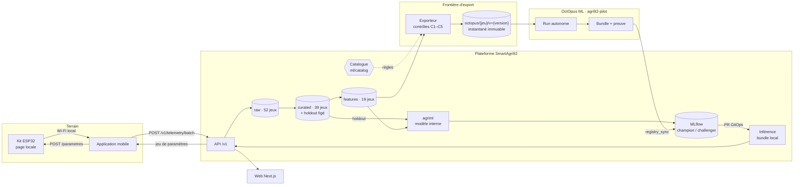
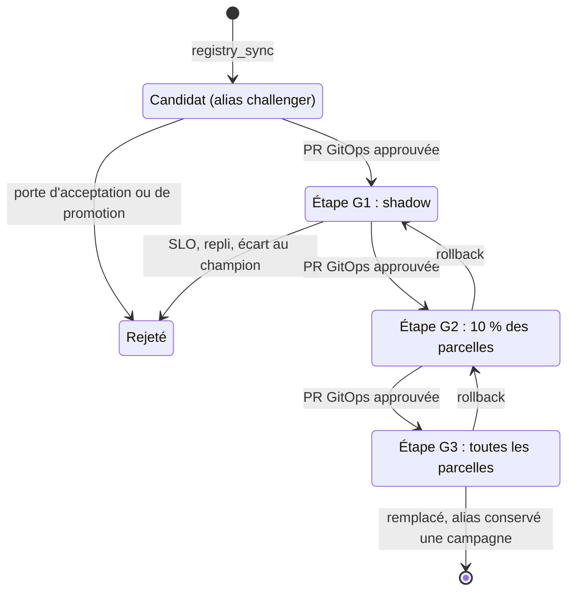
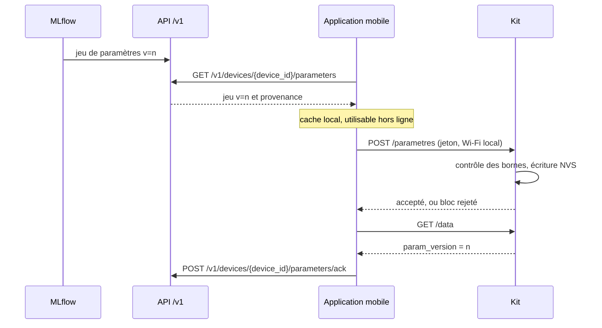

# 16 — Architecture OctOpus ML : IA, Data et MLOps (phase 4)

Confidentiel — réservé aux partenaires de travail.

Ce document répond à la phase 4 du brief IA, Data et MLOps du 27/10/2026. Il devient **la référence officielle de l'architecture IA, Data et MLOps** de SmartAgri92. Il décrit l'état du système au 08/11/2026, tel qu'il ressort du code et du catalogue, puis l'architecture cible d'intégration avec OctOpus ML. Il ne modifie ni code, ni YAML, ni firmware, ni composant web ou mobile : les changements proposés sont des diffs théoriques (§ 8), à appliquer plus tard. Une fois validé, il est gelé en **baseline v1** (§ 10), et la phase web construit ses écrans et ses API simulées à partir du § 9.

- **Source de vérité** : le catalogue `ml/catalog/` (`sources.yaml`, `datasets.yaml`, `models.yaml`, voir [ml/catalog/README.md](../ml/catalog/README.md)), les programmes `ml/src/agriml/octopus/programs/*.yaml` et le paquet `agriml` (`octopus/`, `mlops/`, `catalog/`, `monitoring/`).
- **Avant** : les principes OctOpus du [doc 09](09_octopus_ml.md), les données du [doc 13](13_inventaire_donnees.md), les modèles du [doc 14](14_cartographie_modeles.md), les licences du [doc 15](15_acquisition_donnees.md). **Après** : la phase web (docs 17 et 18, à écrire) part du § 9.
- **Gel** : les règles de la baseline v1 et de ses révisions sont au § 10.

**Conventions.**

- **[NV]** : fait non vérifié. **Hypothèse** (ou [hyp]) : valeur de travail à remplacer par une mesure. **À vérifier** : point du contrat OctOpus (route, champ, garantie) non confirmé par le fournisseur ; voir les questions du doc 09 § 11.
- **Calendrier** : M1 = novembre 2026. Une **porte G0–G3 du doc 07** est un jalon du projet ([doc 07 § 4](07_feuille_de_route_budget.md)). Une **étape G1/G2/G3** est une étape de mise en production d'un modèle (§ 5). Les deux numérotations sont indépendantes.
- **Versions du catalogue** : MVP ≈ M3–M6 ; V1.1 = M7–M8 ; V2 ≈ M7–M12 ; V3 ≈ M13–M18 (comme le doc 15).
- **Responsables** : des rôles du doc 07 § 5, jamais des personnes. CTO = CTO / architecte principal ; BE = développeur backend / DevOps ; DS = data scientist / ML ; MLOps = data engineer / MLOps (M13+, BE avant) ; AGR = agronome terrain ; PO = chef de produit ; SEC = SRE / sécurité (M13+, CTO avant) ; WEB = développeur mobile et web ; EMB = ingénieur embarqué / IoT ; JUR = juriste, le conseil externe.
- **Références de code** : `fichier` l. N, état au 08/11/2026 ; elles bougeront avec le code. Les comptages du catalogue viennent du doc 15 : `python -m agriml.catalog check` n'a pas été relancé pour ce document (scikit-learn absent de l'environnement local), mais chaque identifiant cité a été relu dans les YAML.

## 0. Ce qu'il faut retenir

1. **OctOpus est un challenger, jamais le décideur.** Le modèle de production reste le modèle interne d'`agriml` tant qu'un modèle OctOpus n'a pas passé les critères du § 5. Toute promotion passe par une PR GitOps revue par un humain (doc 09 § 2, doc 11).
2. **15 jeux sur 110 sont exportables, aucun n'est conforme.** 13 sont pseudonymisés et 2 publics. Un seul a ses licences levées (`pest_trap_images`), et aucun n'a le DPA, l'AIPD et le récépissé CDP.
3. **5 contrôles de conformité par export, 1 seul est codé** : la protection des données personnelles. La licence, le DPA, l'AIPD et la CDP ne sont vérifiés par aucun code (§ 2.3).
4. **Les groupes et la stratégie de validation ne partent pas chez OctOpus.** Le manifeste de l'instantané les contient, mais pas la requête de run. OctOpus peut donc mélanger une parcelle entre entraînement et validation (§ 3.2).
5. **Le rendement doit être validé par campagne complète**, en *leave-one-campaign-out*, ce qui demande au moins 4 campagnes. Aujourd'hui, le programme valide par parcelle et mélange les campagnes (§ 3.3).
6. **La porte de promotion compte des lignes, pas des parcelles ni des cas positifs, et promeut d'office le premier modèle** (§ 7.2).
7. **Trois tâches indépendantes tournent le lundi**, sans état partagé ni reprise. La cible est un seul workflow hebdomadaire, `agri92_weekly` (§ 4).
8. **Mise en production en trois étapes** : G1 shadow, G2 sur 10 % des parcelles, G3 sur toutes. Le repli automatique est spécifié mais pas codé (§ 5.5).
9. **Le kit reçoit un jeu de paramètres versionné et affiche la provenance** de chaque valeur. Le § 9 fixe les 18 services d'IA que le front web va simuler.

## 1. Architecture cible OctOpus ML

### 1.1 Vue d'ensemble

Le lac SmartAgri92 reste la seule copie complète des données. OctOpus ne reçoit que des **instantanés** de la zone `features`, filtrés et pseudonymisés par l'exporteur, et ne voit jamais le holdout. Il renvoie un bundle et une preuve, qui deviennent un **challenger** dans MLflow. Le modèle interne reste le champion tant que le challenger n'a pas gagné sur notre holdout figé.



### 1.2 Flux de données

1. **Collecte** : télémétrie du kit relayée par l'application (`POST /v1/telemetry/batch`), saisies des utilisateurs, fichiers des partenaires, données ouvertes téléchargées.
2. **raw** (52 jeux) : la donnée brute, telle que reçue. Elle n'est jamais exportée.
3. **curated** (39 jeux) : la donnée nettoyée par les contrôles du doc 04 § 4. Le holdout figé est découpé ici, dans `curated/holdout/<jeu>/`.
4. **features** (19 jeux) : les tables d'entraînement. 15 sont éligibles à l'export ; 4 restent strictement locales.
5. **Référence interne** : `agriml` entraîne le modèle interne et le score sur le holdout figé.
6. **Export** : l'exporteur applique la politique du jeu, passe les contrôles C1–C5 et écrit un instantané immuable.
7. **Run OctOpus** : un programme approuvé devient une requête `POST /api/run` [à vérifier] ; OctOpus rend un bundle et une preuve.
8. **Retour** : `registry_sync` vérifie le bundle, le manifeste et la preuve, puis enregistre un challenger. Les portes d'acceptation et de promotion décident, et la promotion passe par une PR GitOps (§ 5).

### 1.3 Composants

| Composant | Emplacement | Rôle | État au 08/11/2026 |
|---|---|---|---|
| Catalogue | `ml/catalog/*.yaml`, `agriml/catalog/` | Sources, jeux, modèles, règles d'export | Livré, 177 tests |
| Exporteur | `agriml/octopus/exporter.py` | Instantané filtré et pseudonymisé | Livré ; 1 contrôle de conformité sur 5 |
| Client OctOpus | `agriml/octopus/client.py` | `POST /api/run`, `/api/discover`, planifications | Livré ; contrat à vérifier ; jamais appelé sur des données réelles |
| Programmes | `agriml/octopus/programs.py`, `programs/*.yaml` | 4 programmes et un gabarit de compétition | Livré ; groupes et CV non transmis |
| Synchronisation | `agriml/octopus/registry_sync.py` | Bundle et preuve → challenger MLflow | Livré ; contrôle du holdout circulaire (§ 2.4) |
| Portes | `programs.py` (`check_acceptance`), `mlops/promotion.py` | Acceptation, promotion | Livré ; écarts au § 7 |
| Réentraînement | `mlops/retrain_flow.py`, `ml/pipelines/airflow/retrain_dag.py` | Réentraînement du modèle interne | Livré ; promotion automatique dans un registre local |
| Dérive | `agriml/monitoring/drift.py` | `RetrainPolicy` | Livré ; sans CLI |
| Tâches K8s | `infra/k8s/base/ml/` | Réentraînement, dérive, inférence | Suspendues ; elles appellent des modules absents |
| Inférence backend | `backend/app/services/inference/` | Backends `none`, `local`, `octopus` ; erreur 503 | Livré ; sans chaîne de repli |
| Registre | `infra/k8s/base/ml/mlflow.yaml` | Versions et alias de modèles | Déployable |
| Kit | firmware v1.1 | Page locale, `POST /parametres` | Ni compilé ni testé |

### 1.4 Sources de données

Le catalogue compte 104 sources ([A1](annexes/A1_sources.md), doc 15 § 2) : 37 données ouvertes, 24 internes, 17 partenaires, 10 saisies utilisateur, 7 références, 6 modèles pré-entraînés, 2 API publiques et 1 commerciale. 35 sont en attente de licence, 3 sont non commerciales, 34 portent des données personnelles, et 22 ont été vérifiées en ligne le 01/11/2026. Une source n'est jamais exportée telle quelle : seuls des jeux `features` dérivés peuvent partir, et ils héritent des contraintes de licence de toutes leurs sources amont.

### 1.5 Jeux éligibles

Les 15 jeux éligibles sont tous dans la zone `features`. Leur nom OctOpus est le suffixe de l'identifiant (`features.soil_nowcast` → `soil_nowcast`). La vague est celle de la levée de licence au doc 15.

| Jeu | Politique | Dispo | Vague | Modèle(s) entraîné(s) | Programme OctOpus |
|---|---|---|---|---|---|
| `soil_nowcast` | pseudonymisé | MVP | 2 | `soil_nowcast` | `soil_moisture_nowcast` |
| `irrigation_need` | pseudonymisé | V2 | 2 | `irr_need_24h` | `irrigation_need` |
| `local_weather_bias` | pseudonymisé | V2 | 3 | `wx_local_bias` | nouveau : `local_weather_bias` |
| `rain_events` | public | V2 | 1 | `wx_rain_prob` | nouveau : `rain_event_probability` |
| `disease_images` | pseudonymisé | V2 | 1 | `vis_disease` | `disease_image_classification` |
| `pest_trap_images` | pseudonymisé | V3 | 1 (licences levées) | `vis_pest_count` | aucun (détection d'objets hors des tâches) |
| `pest_risk` | pseudonymisé | V2 | 3 | `pest_risk_ml` | nouveau : `pest_risk_forecast` |
| `npk_calibration` | pseudonymisé | V2 | 3 | `npk_calibration` | aucun (150 à 1 000 paires) |
| `yield` | pseudonymisé | V3 | 4 (2 sans `historique.regional_stats`) | `yield_forecast` | `yield_forecast` |
| `sensor_anomaly` | pseudonymisé | V2 | 1 | `anomaly_ml`, `pump_health` | nouveau : `sensor_anomaly_detection` |
| `phenology` | pseudonymisé | V2 | 2 | `phenology_stage` | aucun (règles BBCH, statistiques) |
| `crop_type` | pseudonymisé | V3 | 1 | `crop_type_map` | nouveau : `crop_type_classification` |
| `reco_bandit` | pseudonymisé | V3 | 1 | `reco_bandit` | aucun (apprentissage en ligne) |
| `salinity_risk` | pseudonymisé | V3 | 4 | `salinity_risk` | aucun (petits volumes) |
| `price_forecast` | public | V3 | 4 | `price_forecast` | nouveau : `price_forecast_4w` |

### 1.6 Jeux exclus

95 jeux sont interdits d'export (politique `forbidden`, la valeur par défaut) :

| Zone | Jeux exclus | Raison |
|---|---|---|
| raw | 52 sur 52 | Règle du catalogue : la donnée brute ne sort jamais |
| curated | 39 sur 39 | Donnée nettoyée mais non minimisée ; le holdout y vit |
| features | 4 sur 19 | Strictement locaux : `water_savings` (confidentiel), `field_boundaries`, `agri_risk` et `asr_speech` (personnels) |

Par classification, les 95 se répartissent en 44 confidentiels, 22 publics, 15 personnels et 14 internes. Les 22 jeux publics restent interdits par défaut : leur version `features` suffit, et les exporter n'apporterait rien.

### 1.7 Critères d'éligibilité

Les règles sont dans `agriml/catalog/rules.py` (l. 268–307, `_octopus_shape`) :

- aucun contenu identifiant en amont (voix, par exemple) ;
- jamais la zone `raw` ;
- `octopus.name` obligatoire et unique ;
- politique `public` : aucune donnée personnelle, classification `publique` ou `interne` ;
- politique `pseudonymised` : zone `features`, donnée qui n'est plus directement identifiante après minimisation, et `holdout: true` ;
- règle `octopus.licence` : ERREUR si une source amont est `restricted`, AVERTISSEMENT si une source `contract` ou `unknown` n'a pas `licence_cleared`.

Une règle s'ajoute dans la cible : **un jeu n'est exporté que pour un programme approuvé** (minimisation). Les 6 jeux éligibles sans programme ne partent donc pas : `pest_trap_images`, `npk_calibration`, `phenology`, `reco_bandit`, `salinity_risk`, et `sensor_anomaly` tant que son programme n'est pas approuvé.

### 1.8 Gouvernance des données

- **Espaces de travail** (doc 09 § 4.4) : `sandbox` (données synthétiques de `ml/scripts/make_synthetic.py` et données publiques), `agri92-pilot` (données pseudonymisées, approbation du propriétaire pour chaque nouveau jeu), `prod` (clé dédiée), `agri92-comp-<slug>` (compétitions, jamais mélangées avec nos données). Chaque espace a sa clé dans Secrets Manager.
- **Deux barrières** : l'exporteur filtre avant tout envoi ; les `guardrails` du programme sont la deuxième barrière, appliquée côté OctOpus (doc 09 § 4.4).
- **Pseudonymisation** : HMAC-SHA256 avec un sel d'au moins 32 caractères, propre à chaque environnement et rangé dans Secrets Manager. Une donnée pseudonymisée reste une donnée personnelle au sens de la loi : le DPA et la CDP restent exigés.
- **Instantanés immuables** : une version publiée n'est jamais réécrite. Une correction donne une nouvelle version.
- **Holdout** : il ne quitte jamais le lac. Il est renouvelé à chaque saison (doc 09 § 8.2).
- **Effacement** : une demande d'effacement produit une nouvelle version sans la personne concernée ; la clause d'effacement du DPA oblige OctOpus à supprimer les versions précédentes et leurs dérivés [à vérifier].
- **Registre des exports** (proposé) : jeu, version, empreinte du manifeste, pièces de conformité, espace, run.
- **Client** : seul `agriml.octopus.client` parle à OctOpus, en HTTP. Le paquet PyPI `octopus-ml` n'est jamais installé.

| Activité | Réalise | Approuve | Consulté | Informé |
|---|---|---|---|---|
| Classer un jeu, choisir sa politique d'export | DS | CTO | JUR, AGR | PO |
| C1 licence (conventions, confirmations écrites) | PO | CTO | JUR | DS |
| C2 DPA OctOpus | CTO | CTO | JUR, SEC | PO |
| C3 AIPD des exports | SEC | CTO | JUR | PO, DS |
| C4 déclaration et récépissé CDP | PO | CTO | JUR | toute l'équipe |
| Lancer un export ou un run | DS | CTO | MLOps | PO |
| Accepter un challenger | DS | CTO | AGR | PO |
| Promouvoir (étapes G1 à G3) | MLOps | CTO | DS, AGR, PO | WEB, Support |
| Rollback | MLOps | CTO | DS | PO, Support |

## 2. Pipeline d'acquisition

- **15 jeux de données sur 110 sont actuellement exportables.** « Exportable » veut dire que la politique du jeu l'autorise et que les règles du catalogue le classent éligible. Ce n'est pas une autorisation d'envoi.
- **Chaque export doit satisfaire 5 contrôles de conformité** : licence, DPA, AIPD, CDP, protection des données personnelles (§ 2.3).
- **L'outil d'export actuel n'effectue qu'un seul de ces contrôles** : le cinquième.

### 2.1 Étapes

| Étape | Fréquence | Contrôles | Sortie |
|---|---|---|---|
| Ingestion vers raw | En continu (kit), à la réception (partenaires), planifiée (données ouvertes) | Schéma, unicité de la clé | `raw.<domaine>.<jeu>` |
| Nettoyage vers curated | Horaire à quotidienne | Plages, fraîcheur, complétude, cohérence (doc 04 § 4) | `curated.*`, holdout figé |
| Construction des features | Fréquence du jeu (§ 2.2) | Absence de fuite temporelle, cible présente | `features.*` |
| Export | Hebdomadaire, dans `agri92_weekly` (§ 4) | C1–C5, contrôles techniques (§ 2.4) | `octopus/<jeu>/v=<version>/` |

### 2.2 Fiche par jeu

Responsable par défaut : DS pour la construction, AGR pour les étiquettes, EMB pour la qualité des capteurs. Transformation commune à tous les jeux pseudonymisés : suppression des identifiants directs, pseudonymisation des clés (`field_key`, `device_id`, `farm_key`, `user_id`), arrondi des coordonnées, retrait de la fenêtre de holdout. Les seuils chiffrés ci-dessous sont des hypothèses.

| Jeu | Jeux amont | Fréquence | Responsable | Contrôles qualité propres | Transformation propre | Conditions d'envoi |
|---|---|---|---|---|---|---|
| `soil_nowcast` | `iot.telemetry_hourly`, `iot.irrigation_events`, `meteo.forecast_asof`, `meteo.grid_daily`, `sols.field_profile` | Quotidienne | DS, EMB | Humidité 0–100 %, complétude ≥ 90 %, cohérence pompe → humidité sous 30 min | Prévisions « as-of » seulement | C1–C5, vague 2 |
| `irrigation_need` | les 5 précédents, `agronomie.crop_cycles`, `agronomie.crop_params`, `geo.field_context`, `satellite.field_indices` | Quotidienne | DS, AGR | Cible ≥ 0 ; cycle cultural actif | — | C1–C5, vague 2 |
| `local_weather_bias` | `iot.telemetry_hourly`, `meteo.forecast_asof`, `meteo.stations_clean` | Quotidienne | DS, EMB | Horloge du kit fiable (`heure_ok`), écart kit–station borné | — | C1–C5, vague 3 |
| `rain_events` | `meteo.grid_daily`, `meteo.forecast_asof` | Quotidienne | DS | Prévision émise avant l'observation | Aucune (public) | C1, C2 ; vague 1 |
| `disease_images` | `images.labelled`, `images.public_reference`, `images.espcam_series` | Hebdomadaire | AGR, DS | Double étiquetage, accord κ ≥ 0,7, netteté (`vis_quality`) | EXIF et GPS retirés ; images avec visage écartées | C1–C5, vague 1 |
| `pest_trap_images` | `images.espcam_series`, `images.labelled` | Hebdomadaire | AGR | Double comptage sur 10 % des images | EXIF et GPS retirés | C2–C5 ; pas de programme |
| `pest_risk` | `phyto.outbreaks`, `phyto.reference`, `meteo.grid_daily`, `meteo.forecast_asof`, `satellite.field_indices`, `agronomie.crop_cycles`, `geo.field_context` | Hebdomadaire | DS, AGR | Foyer daté après la date de prévision (pas de fuite) | — | C1–C5, vague 3 |
| `npk_calibration` | `iot.telemetry_clean`, `sols.lab_results`, `eau.water_quality` | Par campagne | AGR, EMB | Délai sonde–laboratoire ≤ 7 jours | — | Pas de programme |
| `yield` | `historique.yields`, `satellite.field_indices`, `meteo.grid_daily`, `meteo.seasonal_outlook`, `iot.telemetry_hourly`, `sols.field_profile`, `agronomie.crop_cycles`, `geo.field_context`, `historique.regional_stats` | Décadaire en saison | DS, AGR | Rendement plausible par culture, surface > 0, campagne close | Identifiant de campagne ajouté (§ 3.3) | C1–C5, vague 4 ; ≥ 4 campagnes |
| `sensor_anomaly` | `iot.telemetry_clean`, `iot.device_health`, `iot.irrigation_events`, `meteo.forecast_asof` | Quotidienne | EMB, DS | Incidents étiquetés et datés | — | C1–C5, vague 1 ; programme approuvé |
| `phenology` | `satellite.field_indices`, `agronomie.crop_cycles`, `agronomie.crop_params`, `meteo.grid_daily` | À chaque passage satellite | AGR | Stade BBCH monotone dans un cycle | — | Pas de programme |
| `crop_type` | `satellite.field_indices`, `satellite.s2_chips`, `agronomie.crop_cycles` | Par campagne | AGR, DS | Culture vérifiée sur le terrain | — | C1–C5, vague 1 |
| `reco_bandit` | `utilisateurs.reco_events`, `agronomie.crop_cycles`, `geo.field_context` | Quotidienne | DS | Propension journalisée, retour sous 14 jours | — | Pas de programme |
| `salinity_risk` | `eau.water_quality`, `sols.field_profile`, `iot.telemetry_hourly`, `geo.field_context`, `satellite.regional_products` | Par campagne | AGR | Conductivité en dS/m | — | Pas de programme |
| `price_forecast` | `economie.prices_weekly`, `historique.regional_stats`, `satellite.regional_products` | Hebdomadaire | DS, PO | Couple (marché, semaine) unique, prix > 0 en FCFA/kg | Aucune (public) | C1, C2 ; vague 4 |

Pour les deux jeux publics, l'AIPD et la CDP ne s'appliquent pas, puisqu'ils ne portent aucune donnée personnelle ; le DPA reste exigé pour encadrer l'usage du compte. Le contrôle C5 est exécuté quand même.

### 2.3 Les 5 contrôles de conformité

| # | Contrôle | Preuve exigée | Responsable | Codé ? | État au 08/11/2026 |
|---|---|---|---|---|---|
| C1 | Licence de toutes les sources amont | Règle `octopus.licence` sans erreur ni avertissement | PO, JUR | La règle existe dans le catalogue, mais l'exporteur ne l'appelle pas | Levée pour 1 jeu sur 15 (`pest_trap_images`) |
| C2 | DPA OctOpus signé | Contrat avec clause d'effacement et localisation | CTO, JUR | Non | Aucun |
| C3 | AIPD des exports | AIPD approuvée (une des six du doc 13 § 8.1) | SEC, JUR | Non | Non rédigée |
| C4 | Récépissé CDP | Déclaration couvrant le transfert hors du Sénégal | PO, JUR | Non | Non déposée (cible M2, doc 15 § 12) |
| C5 | Protection des données personnelles | Politique appliquée, puis `find_violations` sans résultat | DS | **Oui** : `_sanitize_all` (`exporter.py` l. 248–256) lève « Export refusé, données interdites » | Fonctionnel et testé |

Bilan : **15 jeux éligibles, 1 avec licences levées, 0 conforme aux 5 contrôles.** Avant C2–C4, seul l'espace `sandbox` est utilisable, avec des données synthétiques ou publiques.

### 2.4 Contrôles techniques de l'exporteur

Déjà en place dans `export_snapshot` (l. 274) :

- sel présent et d'au moins 32 caractères (`load_salt`, l. 100) ;
- version immuable : refus si le manifeste existe déjà ;
- cible présente dans la table d'entraînement ;
- refus **avant** toute écriture.

Manquants :

- `holdout_sent` est écrit en dur à `False` (l. 270). Le contrôle de `registry_sync._check_dataset` (l. 78–84) relit donc une valeur que personne n'a calculée : il est circulaire.
- `holdout_window` est recopiée dans le manifeste, mais les lignes de cette fenêtre ne sont pas retirées.
- Rien ne vérifie que la table `test` ne contient pas la cible.
- `groups` et `time_column` figurent dans le manifeste, mais pas dans la requête de run (§ 3.2).

### 2.5 Chaîne cible

0. Le programme est approuvé et le jeu inscrit au registre de conformité.
1. C1 : la règle `octopus.licence` est exécutée sur la lignée du jeu.
2. C2–C4 : les pièces sont lues dans le registre (§ 2.6) ; une pièce absente ou expirée arrête l'export.
3. Les contrôles qualité du jeu (§ 2.2) passent.
4. Les lignes de `holdout_window` sont retirées, puis l'exporteur vérifie que la table `test` ne porte pas la cible.
5. La politique est appliquée, puis C5.
6. L'instantané est écrit, avec un manifeste enrichi, et inscrit au registre des exports.

Extrait du manifeste cible (valeurs d'illustration) :

```json
{
  "dataset": "irrigation_need", "version": "2027-03-01", "target": "target_need_mm_24h",
  "groups": "field_key", "time_column": "ts",
  "compliance": {
    "licence": {"rule": "octopus.licence", "errors": 0, "warnings": 0},
    "dpa": {"ref": "DPA-OCTOPUS-1", "valid_until": "2028-01-31"},
    "aipd": {"ref": "AIPD-EXPORT-1", "approved_on": "2027-02-10"},
    "cdp": {"receipt": "CDP-RECEPISSE-1", "filed_on": "2026-12-15"},
    "pii_scan": {"violations": 0}
  },
  "holdout": {"window": ["2027-01-01", "2027-02-28"], "rows_removed": 41230, "sent": false}
}
```

`holdout.sent` est alors calculé : il vaut `false` seulement si `rows_removed` couvre toute la fenêtre et qu'aucune ligne restante n'y tombe.

### 2.6 Registre de conformité (proposé)

Fichier proposé, non créé : `ml/octopus/compliance.yaml`. Il est tenu par le PO et relu par le JUR ; il ne contient que des références, jamais les pièces elles-mêmes.

```yaml
documents:
  dpa:  {ref: DPA-OCTOPUS-1, signed_on: null, valid_until: null}
  cdp:  {receipt: null, filed_on: null, covers: [transfert_hors_senegal]}
  aipd: {AIPD-EXPORT-1: {approved_on: null, datasets: [soil_nowcast, irrigation_need]}}
datasets:
  irrigation_need: {program: irrigation_need, workspace: agri92-pilot, approved_by: CTO, approved_on: null}
```

## 3. Programmes d'entraînement

### 3.1 Les 4 programmes existants

Tous visent l'espace `agri92-pilot`. Le gabarit `competition_template.yaml` vise `agri92-comp-<slug>`, avec un budget de 240 min.

| Programme | Jeu | Tâche, métrique, cible | Groupes, temps | CV déclarée | Budget | Acceptation | Planification |
|---|---|---|---|---|---|---|---|
| `soil_moisture_nowcast` | `soil_nowcast` | forecast, rmse, `soil_moisture_pct` | `device_id`, `ts` | `purged_time`, 4 blocs, `gap_hours: 72`, `horizons: [24, 48, 72]` | 90 min | gain 2 %, écart CV/holdout 15 % | `0 3 * * *`, `score_and_drift` |
| `irrigation_need` | `irrigation_need` | regression, mae, `target_need_mm_24h` | `field_key`, `ts` | `purged_time`, 5 blocs, `gap_hours: 72`, `groups: field_key` | 120 min | gain 2 %, seuil absolu 3,0 mm, écart 15 %, tranches 3 % | `0 2 * * 1`, `retrain` |
| `disease_image_classification` | `disease_images` | image_classification, f1_macro, `label` | `plant_id` | `stratified_group`, 5 plis, `groups: plant_id` | 240 min | gain 2 %, écart 10 %, tranches 5 %, revue humaine | — |
| `yield_forecast` | `yield` | regression, rmse, `yield_t_ha` | `field_id`, `year` | `group`, 5 plis, `groups: field_id` | 120 min | gain 1 %, écart 10 %, tranches 2 %, revue humaine | — |

### 3.2 Limites communes

- **Groupes, temps et CV ne sont pas transmis.** `run_request` (`programs.py` l. 71–75) n'envoie que le jeu, la cible, la tâche, la métrique, l'objectif, l'espace, le budget, les indices et les garde-fous. La requête `RunRequest` du client n'a pas de champ pour le reste.
- **Clés de CV inconnues.** `gap_hours`, `horizons` et `groups` ne sont pas des champs de `CVConfig` (`scheme`, `n_splits`, `gap`, `embargo`, `forward`, `block_size_deg`, `shuffle`). Rien ne les rejette, rien ne les lit.
- **Validation des clés stricte par accident.** Une clé inconnue au premier niveau fait échouer `OctopusProgram(**raw)` (l. 89–96), et une clé inconnue dans `acceptance` fait échouer `cls(**data)` (l. 39–44), dans les deux cas sur un `TypeError` sans message métier.
- **`schedule` n'est jamais lu** : aucune `ScheduleRequest` n'est envoyée.
- **La revue humaine ne bloque pas** : `check_acceptance` (l. 116–130) accepte avec la raison « validation humaine requise avant promotion ».
- **Sans référence, aucun contrôle de gain** : `_gain_reasons` (l. 103) ne compare rien quand `baseline_score` vaut `None`.
- **Métriques manquantes** dans `metrics.py` : Brier, PR-AUC, MASE, couverture d'intervalle, ECE.
- **Aucun jeu n'est conforme** : aucun run réel n'est possible avant C2–C4.

### 3.3 Programme rendement

- **Le programme rendement doit être validé par campagne complète.** Un modèle de rendement sert à prévoir une campagne future : la validation doit simuler ce cas, une campagne entière jamais vue.
- **La validation actuelle n'isole pas une campagne entière.** Le programme fait un `GroupKFold` par parcelle : une même campagne, avec sa météo et ses prix, se trouve à la fois en entraînement et en validation. La configuration interne `ml/configs/yield_regression.yaml` découpe en blocs d'années (`purged_time`, `forward: false`) : elle isole des années, pas des campagnes, et elle entraîne aussi sur les années futures. Le holdout est compté en lignes (§ 7.2). Enfin, `models.yaml` annonce « GroupKFold par parcelle + validation leave-one-season-out », ce qui contredit le programme.
- **Les paramètres de validation ne sont pas transmis à Octopus.**
- **Les groupes ne sont pas transmis à Octopus.**

Conception cible :

- **Campagne** : `campaign_id` = (année, saison) [hyp], relié à la table `campaigns` du backend (hivernage, contre-saison).
- **Holdout externe** : la dernière campagne complète, figée, jamais exportée (doc 14 l. 572).
- **Validation interne** : *leave-one-campaign-out*, c'est-à-dire `scheme: group`, groupe `campaign_id`, `n_splits` égal au nombre exact de campagnes d'entraînement.
- **Minimum** : 3 campagnes d'entraînement et 1 campagne de holdout, soit **4 campagnes**.
- **Tranches** : erreur par campagne, par région et par culture, et une tranche « nouvelles parcelles » (parcelles absentes de l'entraînement).
- **Transmission** : par R1 (§ 8). Si OctOpus n'accepte pas le champ, une colonne `fold` et un indice le décrivent. Dans tous les cas, `agriml` recalcule le score sur le holdout figé, et seul ce score compte.

### 3.4 Améliorations attendues

| Programme | Limite | Amélioration | Reco |
|---|---|---|---|
| `soil_moisture_nowcast` | `gap_hours` et `horizons` non lus ; planification quotidienne déclarée mais non envoyée | `gap: 3` (jours, unité de la colonne temps) ; horizons dans les indices en attendant un champ confirmé ; score par horizon et couverture p10–p90 | R1, R2, R10 |
| `irrigation_need` | `groups` dans `cv` ; collision avec les tâches du lundi 02:00 | Groupes au premier niveau ; planification portée par `agri92_weekly` | R1, R2, R11 |
| `disease_image_classification` | Revue humaine non bloquante ; pas de calibration mesurée | Revue bloquante ; ECE sur le holdout terrain ; seuil d'abstention | R5, R10 |
| `yield_forecast` | Validation par parcelle ; holdout en lignes | *Leave-one-campaign-out* ; planchers de campagnes et de parcelles | R1, R3, R6 |

### 3.5 Nouveaux programmes concurrents (proposés)

| Programme | Jeu | Tâche | Métrique | Validation | Référence interne | Vague |
|---|---|---|---|---|---|---|
| `rain_event_probability` | `rain_events` | binaire, P(pluie ≥ s) pour s ∈ {1, 5, 10, 20} mm [hyp] | Brier, PR-AUC | `purged_time`, `forward: true`, écart = horizon | `wx_rain_prob` | 1 |
| `sensor_anomaly_detection` | `sensor_anomaly` | binaire | PR-AUC | `group` par `device_id` | `anomaly_rules` | 1 |
| `crop_type_classification` | `crop_type` | multiclasse | f1_macro | `group` par parcelle et campagne | — (référence à construire) | 1 |
| `pest_risk_forecast` | `pest_risk` | binaire, foyer à 7 et 14 jours | PR-AUC, Brier | `purged_time`, `forward: true` | `risk_rules`, `pest_phenology` | 3 |
| `local_weather_bias` | `local_weather_bias` | régression | MAE | `group` par `device_id` + purge temporelle | `wx_local_bias` | 3 |
| `price_forecast_4w` | `price_forecast` | forecast | MASE | `purged_time`, `forward: true`, écart 4 semaines | saisonnalité naïve | 4 |

Tous visent `agri92-pilot` ; les deux jeux publics peuvent être explorés dans `sandbox`. Ils dépendent de R10 pour les métriques. `pump_health` pourra rejoindre `sensor_anomaly_detection` quand des pannes étiquetées existeront. Sept modèles n'auront pas de programme : `vis_pest_count` (détection d'objets), `npk_calibration` et `salinity_risk` (petits volumes), `phenology_stage` (règles BBCH), `reco_bandit` (en ligne), `index_insurance` (transparence contractuelle), `irr_scheduler` (optimisation).

**Le modèle de production reste le modèle interne tant que les critères d'évaluation ne sont pas atteints.** Un modèle OctOpus ne remplace le champion qu'après les critères du § 5.3 et une PR approuvée.

## 4. Orchestration

### 4.1 État actuel : trois tâches indépendantes, tous les lundis

| Tâche | Où | Planification | État | Ce qu'elle fait |
|---|---|---|---|---|
| CronJob de réentraînement | `infra/k8s/base/ml/retrain-cronjob.yaml` | `0 2 * * 1`, Africa/Dakar | `suspend: true` | `python -m agriml.pipelines.retrain --source octopus --register-candidate` : le module n'existe pas |
| Planification OctOpus d'`irrigation_need` | `programs/irrigation_need.yaml` | `0 2 * * 1` | Déclarée, jamais envoyée | Réentraînement côté OctOpus |
| DAG Airflow | `ml/pipelines/airflow/retrain_dag.py` | `0 3 * * 1`, fuseau par défaut d'Airflow (UTC, soit l'heure de Dakar) | Code présent | `agriml_retrain_weekly` sur `configs/yield_regression.yaml`, puis `run_retrain_flow(..., force=True)` (l. 61–62) ; aucun réessai |

S'y ajoutent des tâches quotidiennes : le CronJob de dérive (`30 4 * * *`, suspendu, CLI absente), la planification `0 3 * * *` de `soil_moisture_nowcast` (déclarée, jamais envoyée) et le déploiement d'inférence (`inference.yaml`), qui lance `agriml.predict serve`, une sous-commande qui n'existe pas.

Problèmes :

- aucun état partagé, aucun identifiant de corrélation entre les trois tâches ;
- deux tâches à 02:00 le lundi, sur le même sujet ;
- `force=True` : la dérive n'est évaluée qu'une fois, dans la branche du DAG, et le flux ne la revérifie pas ;
- aucun intervalle minimal entre deux réentraînements, alors que le doc 09 § 8.2 en exige 14 jours ;
- aucune reprise : un échec relance tout la semaine suivante.

### 4.2 Cible : un workflow hebdomadaire `agri92_weekly`

Un seul workflow, le lundi à 02:00 (Africa/Dakar), avec une gestion centrale. Il traite chaque programme approuvé de façon isolée : l'échec d'un programme n'arrête pas les autres, sauf un échec de conformité.

| # | Étape | Sortie | En cas d'échec | Reprise |
|---|---|---|---|---|
| 0 | Verrou et identifiant `agri92_weekly-2026-W46` | Marqueur de démarrage | Arrêt et alerte si un verrou est actif | Le verrou expire après 12 h [hyp] |
| 1 | Catalogue (`check`) et registre de conformité | Rapport | **Arrêt global** | Relance de l'étape |
| 2 | Qualité des données (doc 04 § 4) par jeu | Rapport qualité | Programme sauté | Relance de l'étape |
| 3 | Dérive, `RetrainPolicy`, intervalle ≥ 14 jours | Décision par programme | Programme sauté, sans erreur | — |
| 4 | Référence interne entraînée et scorée sur le holdout figé | Score et tranches | Programme sauté | Relance de l'étape |
| 5 | Export, ou réutilisation si l'empreinte est identique | Instantané et manifeste | Refus = programme arrêté | Idempotent (version immuable) |
| 6 | Run OctOpus et attente (`wait_for_run`) | Identifiant de run | 3 essais (client), puis passe suivante | Reprise sur le run existant, jamais de nouveau run |
| 7 | `registry_sync` | Challenger dans MLflow | Refus = challenger rejeté | Idempotent par run |
| 8 | Portes d'acceptation et de promotion, **sans promouvoir** | Décision et raisons | — | Recalcul |
| 9 | PR GitOps d'étape G1 si accepté, rapport hebdomadaire, notification | PR, rapport | Réessai de la notification | — |

- **Journalisation complète** : chaque ligne porte `workflow_run_id`, `program`, `step`, `dataset_version`, `octopus_run_id`, `manifest_sha256`, la durée, le statut et la raison. Le rapport hebdomadaire reprend une ligne par programme.
- **Contrôle des erreurs** :
  - erreur transitoire (429, 503, réseau) : réessais du client, puis passe suivante ;
  - erreur de données : programme sauté ;
  - erreur de conformité : arrêt global ;
  - budget : annulation au-delà de 1,2 × `time_budget_min` [hyp].
- **Reprise automatique** : un marqueur `workdir/<run_id>/<program>/<step>.json` est écrit après chaque étape réussie. Une relance repart de la première étape sans marqueur. La clé d'idempotence est (programme, semaine ISO).
- **Concurrence** : 2 programmes à la fois [hyp].
- **Horaires** : les étapes 0 à 5 finissent avant 05:00 pour ne pas gêner le lot d'inférence de la nuit (doc 09) ; durée totale ≤ 12 h [hyp].
- **Mise en œuvre** : au MVP, un seul CronJob `python -m agriml.pipelines.weekly` (proposé), à la place des trois tâches. Airflow ou Dagster en V2 (doc 04).

## 5. Mise en production

### 5.1 Cycle de vie



### 5.2 Étapes

| Étape | Exposition | Durée minimale | Sortie |
|---|---|---|---|
| **G1 shadow** | 0 % : le modèle calcule en parallèle, sans aucun impact utilisateur | 7 jours et au moins un cycle complet d'inférence (doc 09 § 8.2) | Comparaison au champion sur les mêmes entrées |
| **G2 activation partielle** | 10 % des parcelles, tirées par un hachage stable du `field_id` pseudonymisé et stratifiées par région et culture | 14 jours [hyp] | Écarts mesurés, retours des utilisateurs |
| **G3 généralisation** | 100 % des parcelles | — | L'alias du champion précédent est conservé une campagne |

Le doc 04 § 6.4 prévoit un canary automatique à partir de M13 : « automatique » désigne l'analyse et le repli, pas la décision de promotion, qui reste une PR revue.

### 5.3 Critères de promotion

Tous sont requis :

1. Preuve OctOpus vérifiée et empreinte du bundle conforme (`registry_sync`).
2. Manifeste de l'instantané conforme : C1–C5 et `holdout.sent` calculé à `false`.
3. Gain sur la référence interne, sur le holdout figé, d'au moins `min_relative_gain`.
4. Seuil absolu atteint, quand le programme en fixe un.
5. Écart CV/holdout dans `max_cv_holdout_gap`.
6. Aucune tranche dégradée de plus de `max_slice_regression` ; une tranche absente compte comme dégradée.
7. Holdout suffisant : 200 lignes, 30 groupes [hyp], une campagne complète pour le rendement, 50 cas positifs pour une tâche binaire [hyp].
8. Calibration : ECE ≤ 0,05 pour une sortie de probabilité [hyp].
9. Étape G1 réussie : SLO tenus (p95 < 300 ms tabulaire, < 1,5 s image), repli < 5 %.
10. Revue humaine : DS et AGR, approbation CTO.

### 5.4 Critères de rejet

Un candidat est rejeté si l'un des critères du § 5.3 échoue, si la preuve n'est pas vérifiable, si le manifeste est incomplet, ou si le challenger arrive sans champion ni référence interne. Un rejet est journalisé avec ses raisons ; le même instantané n'est pas relancé sans changement.

### 5.5 Rollback et repli automatique

- **Rollback** : une PR GitOps remet l'alias précédent (doc 11 : jamais de `kubectl` ni de `helm` manuel en production). Déclencheurs : baisse de performance > 10 %, repli > 5 %, erreurs OctOpus > 2 %, incident signalé sur le terrain. Délai cible ≤ 1 h [hyp].
- **Chaîne de repli** (CONVENTIONS l. 197) : bundle local (0) → lot OctOpus (1, seulement après C2–C4 et l'espace `prod`) → règles (2) → `MODEL_UNAVAILABLE` (3). Chaque réponse porte `fallback_step`. Alerte si un repli dure plus d'un jour ou dépasse 5 % des appels.
- **Repli par modèle** (doc 14 l. 552–564) : météo → GFS → climatologie ; `irr_et0` → climatologie décadaire ; `irr_water_balance` → seuils du firmware ; `ndvi_gapfill` → dernière valeur claire ; `anomaly_rules` → recommandation refusée ; assistant → FAQ ; API Claude → FAQ et conseiller ; `yield_forecast` → décision humaine et statistiques régionales.
- **État du code** : `model_unavailable()` renvoie 503 (`base.py` l. 26) et `predict_or_503` (`factory.py` l. 35) n'essaie qu'un backend. La chaîne n'est pas codée (R12).

## 6. Intégration Kit Terrain

### 6.1 Paramètres envoyés

Le cloud produit un jeu de paramètres versionné, enregistré dans MLflow : `{version, emis_a, seuils{start,stop}, npk{n,p,k}, etalonnage{adc_sec,adc_eau}, agro{...}}`.

| Bloc | Producteur | Bornes contrôlées par le kit | Validité |
|---|---|---|---|
| `seuils` | `irr_water_balance`, puis `irr_need_24h` | Entiers, 0 ≤ start, start + 5 ≤ stop ≤ 100 (CONVENTIONS) | 7 jours |
| `npk` | `fert_reco`, puis `npk_calibration` | 0–2 000 mg/kg [hyp] | 30 jours |
| `etalonnage` | `sm_calibration` | 0 ≤ adc_eau < adc_sec ≤ 4095 [hyp] | 180 jours |
| `agro` (proposé) | `agronomie.crop_cycles`, `agronomie.crop_params` | `culture`, `stade`, `date_semis`, `kc` entre 0,1 et 1,5 | Durée du cycle |
| En-tête | Plateforme | `version` strictement croissante, `emis_a` daté | — |

- Les seuils ne sont appliqués que si l'utilisateur les accepte (`PUT /v1/devices/{id}/thresholds`, existant). Sinon, la page les affiche comme « seuil conseillé » à côté du réglage choisi.
- Le kit rejette un bloc hors bornes et garde le précédent. Il peut revenir aux valeurs d'usine.
- Le bloc `agro` dépend du backlog firmware E1 (doc 12). Aujourd'hui, les seuils NPK sont codés en dur (N < 20, P < 10, K < 80) et l'étalonnage est fixé à la compilation.

### 6.2 Acheminement



Les deux routes `/v1` sont proposées. `POST /parametres` et `param_version` dans `/data` sont décrits au doc 05 (l. 155–158) ; l'accusé de réception peut aussi passer par la télémétrie. MQTT prend le relais en V2.

### 6.3 Affichage local

| Information | Clé locale | Règle d'affichage |
|---|---|---|
| Source | `source` : `regle_firmware`, `modele_serveur` ou `repli` | « Règle du kit », « Calculé par le serveur », « Valeur de secours » |
| Version | `version` | Version du modèle ou du jeu de paramètres |
| Date de calcul | `calcule_a` | Date et heure, seulement si `heure_ok` |
| Âge de la donnée | dérivé de `calcule_a` | « il y a 3 h » ; libellé « périmé » au-delà de la validité (`perime`) |
| Confiance du modèle | `confiance` | Seulement si le modèle est calibré ; sinon rien |

- La page n'invente jamais une confiance (le prototype affiche 94 %) et ne recalcule jamais `alerteEngrais` : elle lit `/data`.
- Les valeurs NPK restent « indicatives, à confirmer » tant que l'étalonnage n'est pas validé.
- Un verdict de vision sous le seuil d'abstention (0,7 [hyp], le seuil déjà utilisé par `DISEASE_MIN_CONFIDENCE`) s'affiche « incertain, faites vérifier ».
- Une valeur en cache n'est jamais présentée comme fraîche (doc 14 l. 434).
- Correspondance avec le contrat web (§ 9.2) : `source` ↔ `provenance.source`, `version` ↔ `model_version`, `calcule_a` ↔ `computed_at`, `perime` ↔ `stale`, `confiance` ↔ `confidence`, `repli` ↔ `fallback_step > 0`.

## 7. Analyse des écarts

### 7.1 `programs.py`

| Écart | Où | Effet | Reco |
|---|---|---|---|
| Validation des clés YAML stricte par accident au premier niveau, absente dans `cv` | `load_program` l. 89–96, `from_mapping` l. 39–44 | `TypeError` sans message ; `gap_hours`, `horizons` et `cv.groups` acceptés puis ignorés | R2 |
| Groupes non transmis | `run_request` l. 71–75 | OctOpus peut mettre une parcelle des deux côtés : score CV optimiste | R1 |
| Stratégie de validation non transmise | idem | Purge, écart et schéma ignorés | R1 |
| `schedule` jamais lu | — | Planification déclarée, jamais envoyée | R11 |
| Revue humaine non bloquante | `check_acceptance` l. 116–130 | Acceptation avec une simple raison | R5 |
| Pas de gain exigé sans référence | `_gain_reasons` l. 103 | Un challenger seul passe | R4 |

### 7.2 `promotion.py`

| Écart | Où | Effet | Reco |
|---|---|---|---|
| Réservation du jeu de test fondée sur les lignes | `PromotionPolicy.min_holdout_rows = 200` (l. 27), `decide_promotion` l. 61–62 | 200 lignes horaires = un kit pendant 8 jours | R3 |
| Aucun contrôle par parcelle | — | Un holdout d'une seule parcelle passe | R3 |
| Aucun contrôle des cas positifs | — | Une tâche binaire sans positif passe | R3 |
| Premier modèle promu automatiquement | l. 63–64 | « aucun champion : premier modèle promu » | R4 |
| Tranche absente ignorée | `slice_regressions` l. 46 (intersection des tranches) | Une culture disparue du challenger passe | R9 |
| Promotion directe par le flux | `retrain_flow.py` l. 122 | Contourne la PR GitOps | R8 |

### 7.3 Autres écarts

| Écart | Où | Reco |
|---|---|---|
| C1–C4 absents, `holdout_sent` en dur, `holdout_window` non filtrée, table `test` non contrôlée | `exporter.py` | R7 |
| Rendement : configuration interne en blocs d'années avec futur ; contradiction avec `models.yaml` | `ml/configs/yield_regression.yaml`, `ml/catalog/models.yaml` | R6 |
| Métriques Brier, PR-AUC, MASE, couverture, ECE absentes | `metrics.py` | R10 |
| Pas d'intervalle minimal ni de CLI de dérive | `monitoring/drift.py` l. 113 | R11 |
| Modules absents : `agriml.pipelines`, `predict serve` | CronJobs, `inference.yaml` | R11, R12 |
| Trois tâches du lundi | § 4.1 | R11 |
| Pas de chaîne de repli ni de provenance | `backend/app/services/inference/` | R12 |
| Pas de provenance, de confiance, de fraîcheur ni de repli dans les types | `web/lib/types.ts` | R14 |
| `KpiReport.scope` vaut `org`, `farm` ou `field`, alors que CONVENTIONS prévoit `campaign` | `web/lib/types.ts` | R14 |
| NPK en dur, étalonnage à la compilation, pas de route de paramètres | firmware (hors périmètre de ce document) | R13 |

## 8. Recommandations

### 8.1 Synthèse

| # | Proposition | Fichiers | Impact | Risque | Priorité |
|---|---|---|---|---|---|
| R1 | Transmettre `cv`, `groups`, `time_column` | `client.py`, `programs.py` | Scores CV comparables aux nôtres | Champ refusé par OctOpus [à vérifier] → colonne `fold` | P0 |
| R2 | Valider explicitement les clés du programme et de `cv` | `programs.py`, `programs/*.yaml` | Erreurs claires, plus de clé ignorée | Les 4 YAML doivent migrer en même temps | P0 |
| R3 | Planchers de holdout en groupes, campagnes et positifs | `promotion.py`, `retrain_flow.py` | Promotion sur un holdout représentatif | Rejets plus fréquents au début | P0 |
| R4 | Refuser une promotion sans champion ni référence | `promotion.py`, `programs.py` | Plus de premier modèle promu d'office | Il faut une référence pour chaque modèle | P0 |
| R5 | Revue humaine bloquante | `programs.py` | Conforme au doc 09 § 2 | Un clic de plus | P1 |
| R6 | Rendement en *leave-one-campaign-out* | `yield_forecast.yaml`, `yield_regression.yaml`, `models.yaml` | Validation fidèle à l'usage | Bloqué jusqu'à 4 campagnes | P1 |
| R7 | Exporteur : C1–C4, retrait du holdout, test sans cible, `holdout_sent` calculé | `exporter.py`, `compliance.yaml` | Aucun envoi non conforme | Aucun | P0 |
| R8 | Le flux ne promeut plus : alias challenger et PR GitOps | `retrain_flow.py`, `retrain_dag.py` | Une seule voie de promotion | Délai de revue | P0 |
| R9 | Tranche absente = tranche dégradée | `promotion.py` | Couverture des cultures garantie | Faux rejets si une tranche est rare | P1 |
| R10 | Métriques Brier, PR-AUC, MASE, couverture, ECE | `metrics.py` | Nouveaux programmes possibles | Faible | P2 |
| R11 | Workflow `agri92_weekly` et CLI de dérive | `agriml/pipelines/weekly.py` (nouveau), CronJob unique | Une seule planification, reprise | Migration des tâches | P1 |
| R12 | Chaîne de repli et bloc `provenance` dans le backend | `services/inference/factory.py` | Contrat du § 9 tenu | Moyen | P1 |
| R13 | Contrat kit : routes `parameters` et `ack`, provenance dans `/data` | backend, backlog firmware E1 | Paramètres poussés au kit | Firmware non testé | P1 |
| R14 | Provenance, confiance, fraîcheur et repli dans les types web et les mocks | `web/lib/types.ts` | Écrans honnêtes dès les mocks | Faible | P0 |

**Priorités** : P0 = avant le premier export réel ou avant la phase web (R1, R2, R3, R4, R7, R8, R14). P1 = avant la première étape G1 (R5, R6, R9, R11, R12, R13). P2 = R10, avant les nouveaux programmes.

### 8.2 Diffs théoriques (non appliqués)

Contexte abrégé ; les numéros de ligne sont ceux du 08/11/2026.

**R1** — `client.py` (`RunRequest`) et `programs.py` (l. 71–75) :

```diff
     guardrails: Mapping[str, Any] = field(default_factory=dict)
+    cv: Mapping[str, Any] = field(default_factory=dict)  # à vérifier : champ accepté par /api/run
+    groups: str | None = None
+    time_column: str | None = None
@@ programs.py, OctopusProgram.run_request
-                          guardrails=self.guardrails.to_dict())
+                          guardrails=self.guardrails.to_dict(), cv=dict(self.cv),
+                          groups=self.groups, time_column=self.time_column)
```

**R2** — `programs.py` :

```diff
+PROGRAM_KEYS = frozenset({"name", "dataset", "workspace", "task", "target", "metric", "objective",
+                          "acceptance", "guardrails", "groups", "time_column", "cv",
+                          "time_budget_min", "hints", "schedule"})
+CV_KEYS = frozenset({"scheme", "n_splits", "gap", "embargo", "forward", "block_size_deg", "shuffle"})
 def load_program(name_or_path):
     raw = yaml.safe_load(...) or {}
+    unknown = (set(raw) - PROGRAM_KEYS) | (set(raw.get("cv") or {}) - CV_KEYS)
+    if unknown:
+        raise ValueError(f"Programme {name_or_path} : clés inconnues {sorted(unknown)}")
```

Migration simultanée des YAML : `gap_hours: 72` → `gap: 3` (jours, unité de la colonne temps) ; `cv.groups` → `groups` au premier niveau ; `horizons` → indices, en attendant un champ confirmé. Le même contrôle s'applique dans `AcceptanceCriteria.from_mapping`.

**R3 et R4** — `promotion.py` :

```diff
 class PromotionPolicy:
     min_holdout_rows: int = 200
+    min_holdout_groups: int = 30        # hypothèse
+    min_holdout_campaigns: int = 0      # 1 pour le rendement
+    min_holdout_positives: int = 0      # 50 pour une tâche binaire, hypothèse
+    require_champion: bool = True
 def decide_promotion(champion_score, challenger_score, greater_is_better, n_holdout, policy=PromotionPolicy(),
-                     champion_slices=None, challenger_slices=None):
+                     champion_slices=None, challenger_slices=None, n_groups=None, n_campaigns=None, n_positives=None):
+    floors = (("lignes", n_holdout, policy.min_holdout_rows), ("groupes", n_groups, policy.min_holdout_groups),
+              ("campagnes", n_campaigns, policy.min_holdout_campaigns),
+              ("positifs", n_positives, policy.min_holdout_positives))
+    for label, value, floor in floors:
+        if floor and (value is None or value < floor):
+            return PromotionDecision(False, (f"hold-out insuffisant en {label} ({value} < {floor})",))
-    if champion_score is None:
-        return PromotionDecision(True, ("aucun champion : premier modèle promu",))
+    if champion_score is None and policy.require_champion:
+        return PromotionDecision(False, ("aucun champion ni référence : promotion refusée",))
```

R4 ajoute aussi dans `_gain_reasons` (`programs.py` l. 103) la raison « référence absente » quand `baseline_score` vaut `None`.

**R5** — `programs.py`, `check_acceptance` :

```diff
-def check_acceptance(criteria, holdout_score, baseline_score, ...):
+def check_acceptance(criteria, holdout_score, baseline_score, ..., human_approved: bool = False):
-    if not reasons and criteria.human_review:
-        return AcceptanceDecision(True, ("validation humaine requise avant promotion",))
+    if criteria.human_review and not human_approved:
+        reasons.append("en attente de revue humaine (PR GitOps)")
```

**R6** — `yield_forecast.yaml`, `yield_regression.yaml` et `models.yaml` :

```diff
-groups: field_id
-cv: {scheme: group, n_splits: 5, groups: field_id}
+groups: campaign_id
+cv: {scheme: group, n_splits: 3}   # = nombre exact de campagnes d'entraînement
 hints:
-  - "GroupKFold par parcelle (field_id) : une même parcelle ne doit jamais être à la fois en entraînement et en validation."
+  - "Leave-one-campaign-out : chaque pli valide une campagne entière, jamais vue en entraînement."
+  - "Rapporter l'erreur sur les parcelles absentes de l'entraînement (tranche nouvelles parcelles)."
```

`yield_regression.yaml` passe de `purged_time` à `scheme: group` sur `campaign_id`, et la phrase de `models.yaml` devient « leave-one-campaign-out, holdout = dernière campagne complète ».

**R7** — `exporter.py`, `export_snapshot` (l. 274) :

```diff
     salt, salt_id = load_salt(env)
+    check_compliance(spec, load_register(env))          # C1 (règle octopus.licence) et C2–C4 ; lève ExportRefused
+    train, removed = drop_holdout_window(train, spec)   # lignes de holdout_window retirées
+    if test is not None and spec.target in test.columns:
+        raise ExportRefused("La table test ne doit pas contenir la cible.")
@@ build_snapshot_manifest
-        "holdout_window": ..., "holdout_sent": False,
+        "compliance": compliance_block(spec), "holdout": holdout_block(spec, removed),
```

**R8** — `retrain_flow.py` (l. 122) :

```diff
-    backend = promote(model_name, version, registry=registry) if decision.promote else None
+    backend = set_alias(model_name, version, CHALLENGER, registry=registry) if decision.promote else None
+    if decision.promote:
+        open_promotion_request(model_name, version, stage="G1", reasons=decision.reasons)  # PR GitOps
```

**R9** — `promotion.py`, `slice_regressions` (l. 46) :

```diff
-    for key in sorted(set(champion) & set(challenger)):
+    worse += [f"{key} (absente)" for key in sorted(set(champion) - set(challenger))]
+    for key in sorted(set(champion) & set(challenger)):
```

R10 à R14 sont décrits au § 8.1 sans diff : ils créent des modules ou touchent le backend, le web et le firmware, qui suivent leurs propres documents.

## 9. Préparation de la phase Web

**Ce chapitre servira directement à la construction des APIs mockées du frontend.** Chaque service ci-dessous devient un écran ou un widget, et une route simulée qui respecte exactement le contrat décrit ici.

### 9.1 Principes

- Enveloppe de CONVENTIONS : `{success, data, error{code, message, details}, meta}`. Une ressource d'une autre organisation renvoie 404. Rôles : `farmer`, `coop_manager`, `agronomist`, `admin`.
- Chaque résultat d'IA porte un bloc `provenance` (§ 9.2). Une réponse simulée porte `meta.mock: true`.
- Les routes existantes gardent leur forme actuelle ; les routes proposées suivent la même convention.
- Temps de réponse cible par défaut, pour la lecture d'un résultat précalculé : p95 < 300 ms (doc 09).

### 9.2 Contrat de provenance

```json
"provenance": {
  "model_name": "irr_need_24h", "model_version": "3", "source": "agriml",
  "fallback_step": 0, "computed_at": "2027-03-02T06:00:00Z", "data_as_of": "2027-03-02T05:00:00Z",
  "stale": false,
  "confidence": {"kind": "interval", "value": null, "p10": 4.1, "p90": 7.9, "calibrated": true}
}
```

`source` vaut `agriml`, `octopus` ou `rules`. `confidence.kind` vaut `probability`, `interval`, `class_probability` ou `none`. `fallback_step` suit le § 5.5. `stale` passe à `true` au-delà de la validité du résultat. Une confiance non calibrée est renvoyée avec `calibrated: false` et n'est pas affichée en pourcentage.

### 9.3 Services, modèles et routes

« Existant » = route déjà codée dans `backend/app/api/v1/` ; « proposé » = route à créer, simulée d'abord.

| # | Service | Modèles | Route | Modules web | Dispo |
|---|---|---|---|---|---|
| 1 | `weather` | `wx_blend`, `wx_rain_prob`, `wx_local_bias`, `irr_et0` | `GET /v1/fields/{field_id}/weather?days=` (existant) | 1, 5, 7 | MVP, V2 |
| 2 | `soil_forecast` | `soil_nowcast` | `GET /v1/fields/{field_id}/soil-forecast?horizons=24,48,72` (proposé) | 1, 3 | V2 |
| 3 | `irrigation_need` | `irr_need_24h`, `irr_water_balance` | `GET /v1/fields/{field_id}/irrigation-need` (proposé) | 3, 7 | MVP, V2 |
| 4 | `irrigation_plan` | `irr_scheduler` | `GET /v1/farms/{farm_id}/irrigation-plan?date=` (proposé) | 7, 10 | V3 |
| 5 | `recommendations` | `reco_engine`, `risk_rules`, `fert_reco` | `GET /v1/fields/{field_id}/recommendations`, `POST /v1/recommendations/{id}/feedback` (existants) | 1, 7 | MVP |
| 6 | `fertilization` | `fert_reco`, `npk_calibration` | `GET /v1/fields/{field_id}/fertilization` (proposé) | 6 | V1.1, V2 |
| 7 | `kit_parameters` | `irr_water_balance`, `sm_calibration`, `fert_reco`, `npk_calibration` | `GET /v1/devices/{device_id}/parameters` (proposé) ; `GET` et `PUT /v1/devices/{id}/thresholds` (existants) | 3, 10 | V1.1 |
| 8 | `disease_diagnosis` | `vis_disease` | `POST /v1/diagnoses/analyze` (proposé) ; `POST /v1/diagnoses` (existant, enregistre un verdict calculé ailleurs) | 8 | V2 |
| 9 | `pest_risk` | `risk_rules`, `pest_phenology`, `pest_risk_ml` | `GET /v1/fields/{field_id}/pest-risk` (proposé) | 4, 7, 8 | V1.1, V2 |
| 10 | `trap_counts` | `vis_pest_count` | `GET /v1/devices/{device_id}/trap-counts?from=&to=` (proposé) | 8 | V3 |
| 11 | `vegetation` | `ndvi_gapfill`, `phenology_stage`, `vis_canopy` | `GET /v1/fields/{field_id}/vegetation?from=&to=` (proposé) | 3, 4, 6 | V2 |
| 12 | `yield_forecast` | `yield_forecast`, `yield_crop_model` | `GET /v1/fields/{field_id}/yield-forecast?refresh=` (existant) | 9, 11 | V3 |
| 13 | `device_health` | `anomaly_rules`, `anomaly_ml`, `pump_health` | `GET /v1/alerts`, `POST /v1/alerts/{id}/ack` (existants) ; `GET /v1/devices/{device_id}/health` (proposé) | 1, 10 | MVP, V2 |
| 14 | `water_savings` | `water_savings` | `GET /v1/reports/kpis` (existant) | 1, 11, 13 | V1.1 |
| 15 | `price_forecast` | `price_forecast` | `GET /v1/markets/prices?crop=&market=` (proposé) | 11, 13 | V3 |
| 16 | `assistant_chat` | `asst_retrieval`, `asst_llm`, `asst_guard` | `POST /v1/assistant/chat` (existant) | 12 | MVP |
| 17 | `assistant_transcribe` | `asst_asr` | `POST /v1/assistant/transcribe` (proposé) | 12 | V2 |
| 18 | `map_layers` | `crop_type_map`, `salinity_risk`, `field_boundary` | `GET /v1/farms/{farm_id}/map` (existant) avec `?layers=crop_type,salinity` (proposé) | 3, 4, 6 | V3 |

### 9.4 Entrées, sorties, fréquence, temps de réponse, confiance

| # | Entrées | Sorties (dans `data`, plus `provenance`) | Fréquence (calcul ; appel du front) | Temps cible | Confiance renvoyée |
|---|---|---|---|---|---|
| 1 | `field_id`, `days` | Par jour : températures, pluie en mm, P(pluie ≥ seuil), ET0, biais local appliqué | 4 fois/j ; à l'ouverture, cache 1 h [hyp] | p95 < 300 ms | `probability` pour la pluie, `none` sinon |
| 2 | `field_id`, `horizons` | Humidité p10, p50, p90 par horizon ; seuils actifs | Horaire ; à l'ouverture, toutes les 15 min [hyp] | p95 < 300 ms | `interval` |
| 3 | `field_id` | Besoin en mm sur 24 h ; report conseillé si pluie prévue | Toutes les 6 h ; à l'ouverture | p95 < 300 ms | `interval` (V2), `none` (bilan MVP) |
| 4 | `farm_id`, `date` | Créneaux par parcelle et par pompe, volumes | Toutes les 6 h ; à l'ouverture | p95 < 300 ms | `none` |
| 5 | `field_id` ; retour : statut | Liste : type, priorité, texte, justification, `valid_until` ; retour `followed`, `partially_followed`, `ignored`, `not_applicable` | Horaire et sur événement ; à l'ouverture | p95 < 300 ms | `none` |
| 6 | `field_id` (cycle actif) | Doses N, P, K en kg/ha, classe NPK, mention « indicatif » tant que l'étalonnage n'est pas validé | À la demande | < 1 s | `none` (V1.1), `interval` (V2) |
| 7 | `device_id` | Jeu de paramètres du § 6.1, provenance par bloc | Quotidien ou à chaque nouveau jeu ; à la synchronisation | p95 < 300 ms | `none` |
| 8 | Image (413 au-delà de la taille maximale), `device_id` ou `field_id`, `captured_at` | `label` (`healthy`, `suspect`, `sick`), `disease_code`, 3 classes les plus probables, `abstained` | À la demande | p95 < 1,5 s (doc 09), plafond 2 s (catalogue) | `class_probability` calibrée ; abstention sous 0,7 [hyp] |
| 9 | `field_id` | Par ravageur ou maladie : niveau, P(foyer à 7 et 14 jours), facteurs | Quotidien ; à l'ouverture | p95 < 300 ms | `probability` (ML), `none` (règles) |
| 10 | `device_id`, période | Comptage par image, série | 4 fois/j ; à l'ouverture | p95 < 300 ms | `none` |
| 11 | `field_id`, période | Série NDVI et EVI (`gapfilled` par point), stade BBCH estimé, couvert | À chaque passage (5 j) ; à l'ouverture | p95 < 300 ms | `none`, avec drapeau `gapfilled` |
| 12 | `field_id`, `refresh` | `forecast{model_name, model_version, predicted_t_ha, p10, p90, created_at}`, `crop_cycle`, `actual_t_ha`, `caveat` ; 404 `NO_ACTIVE_CYCLE` | Décadaire en saison ; à l'ouverture | Lecture p95 < 300 ms ; `refresh` < 2 s [hyp] | `interval` p10–p90 |
| 13 | Filtres ; `device_id` | Alertes : type, gravité, depuis, acquittement ; santé : état des capteurs, P(panne de pompe sous 48 h) | En flux (règles), horaire (ML), quotidien (pompe) ; à l'ouverture et toutes les 5 min [hyp] | p95 < 300 ms | `none` (règles), `probability` (ML) |
| 14 | Portée, période | Eau économisée en m³ et en %, méthode (parcelles témoins) | Mensuel et en fin de campagne ; à l'ouverture | p95 < 300 ms | `interval` |
| 15 | `crop`, `market` | Prix en FCFA/kg à 1–4 semaines, p10 et p90 | Hebdomadaire ; à l'ouverture | p95 < 300 ms | `interval` |
| 16 | Message, conversation, langue | Réponse en flux, citations, refus motivé | À la demande | p95 < 8 s en flux | `none`, avec citations |
| 17 | Audio ≤ 60 s [hyp], langue (`wo`, `ff`, `fr`) | Texte modifiable, langue détectée | À la demande | < 3 s pour 10 s d'audio | `none` affichée |
| 18 | `farm_id`, `layers` | GeoJSON par parcelle : culture et probabilité, classe de salinité, contour proposé à valider | 2 fois par saison, saisonnier, à la demande ; à l'ouverture | p95 < 300 ms | `class_probability` (culture), `none` (salinité, contour) |

Hors des 18 services : `vis_quality` et `asst_tts` tournent sur le mobile ; `reco_bandit` ordonne les recommandations côté serveur sans route propre ; `agri_risk_score` et `index_insurance` sont réservés aux partenaires et passeront par l'API partenaires, pas par le front web.

### 9.5 Erreurs, états et règles des mocks

- **Erreurs à simuler** : `MODEL_UNAVAILABLE` 503 (seulement après toute la chaîne de repli), `WEATHER_UNAVAILABLE` 503, `NO_ACTIVE_CYCLE` 404, `ASSISTANT_*` 503 ou 502, `RATE_LIMITED` 429 avec `Retry-After`, 404 pour une autre organisation, `THRESHOLDS_INVALID` 400, `VALIDATION_ERROR` 422, `PAYLOAD_TOO_LARGE` 413, `NOT_READY` 503.
- **États à simuler** : frais, périmé (`stale`), repli (`fallback_step` > 0), abstention, expérimental (étape G1, jamais montré à l'utilisateur), vide.
- **Règles** :
  - même enveloppe, mêmes codes et mêmes noms de champs que le contrat ;
  - scénarios `nominal`, `stale`, `fallback`, `abstention`, `error_503` et `empty`, sélectionnables en développement seulement ;
  - données déterministes et réalistes, sans aucune donnée personnelle réelle ;
  - latence simulée proche du temps cible ;
  - jamais de confiance inventée ;
  - mocks derrière un interrupteur d'environnement ; chacun est retiré quand sa route est codée, avec un test de contrat.

## 10. Baseline v1

- **Gelée le 08/11/2026** : l'architecture (§ 1), les contrôles C1–C5 (§ 2.3), la règle du modèle de production (§ 3.5), le cycle de mise en production (§ 5), le contrat kit (§ 6) et le contrat web (§ 9).
- **Non gelés** : les valeurs marquées [hyp], les points « à vérifier » du contrat OctOpus et les numéros de ligne.
- **Révisions** : toute modification passe par une révision v1.x de ce document, avec une ligne au journal. Un changement incompatible du § 9 donne une v2 et une mise à jour des mocks. Approbation : CTO et PO, plus DS pour les §§ 3 et 5.
- **Suite** : la phase Frontend construit les écrans et les API simulées qui correspondent exactement aux 18 services du § 9.

| Version | Date | Changement |
|---|---|---|
| v1.0 | 08/11/2026 | Baseline initiale |

## 11. Risques et limites

- Le contrat OctOpus n'est pas confirmé : routes, champs et garanties restent « à vérifier » (doc 09 § 11).
- Le contrôle du catalogue n'a pas été relancé pour ce document ; les comptages viennent du doc 15.
- Aucun jeu n'est conforme : avant C2–C4, seul l'espace `sandbox` est utilisable, avec des données synthétiques ou publiques.
- Le rendement demande 4 campagnes : pas avant fin 2028 [hyp], sauf historique fourni par un partenaire.
- Le firmware v1.1 n'est ni compilé ni testé, et le contrat kit dépend du backlog E1.
- Les durées, tailles d'échantillon et seuils marqués [hyp] sont à confirmer par la mesure.
- Les références de ligne bougeront avec le code.
- Les types web actuels ne portent pas encore le contrat du § 9 (R14).
