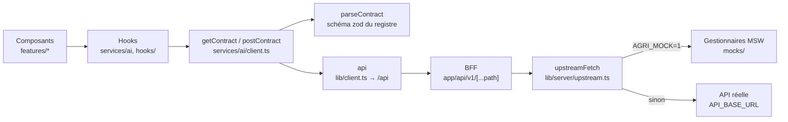

# 17 — Frontend v0.2 : écrans, services simulés et passage à l'API réelle

Confidentiel — réservé aux partenaires de travail.

Ce document décrit le frontend web (`web/`) au jalon **Smart Agri v0.1**, atteint le 09/11/2026. Il part du § 9 du [doc 16](16_architecture_octopus.md) (baseline v1, gelée le 08/11/2026) sans le modifier. Les 18 contrats de services, les modèles et les décisions d'IA viennent de là. Ce document dit comment les écrans consomment ces contrats, comment fonctionnent les simulations et comment chacune est retirée quand sa route réelle est livrée.

- **Source de vérité** : le code de `web/`. Le registre [lib/contracts/registry.ts](../web/lib/contracts/registry.ts) recopie le doc 16 § 9.3 ; les schémas sont dans [lib/contracts/](../web/lib/contracts/), les simulations dans [mocks/](../web/mocks/). La mise en route est décrite dans [web/README.md](../web/README.md).
- **Avant** : les 13 modules et l'UX du [doc 10](10_web_ux.md), les contrats du doc 16 § 9. **Après** : le [doc 18](18_ecrans_services_ia.md) fixe les écrans des services 3, 7, 6 et 9 (sprint A, livré en v0.2), puis 13, 17 et 8 (sprint B, livré en v0.2.1), et l'ordre des sprints suivants (§ 4).
- **Limites de ce document** : il ne modifie ni les docs 00 à 16, ni les contrats, ni le comportement figé des simulations. Un écart constaté est noté au § 12, il n'est pas corrigé ici.

**Conventions.** « Socle » désigne les routes de l'API qui ne relèvent d'aucun des 18 services (session, référentiel, mesures, seuils, campagnes, matériel). Les numéros de service sont ceux du doc 16 § 9.3. Les chemins de fichiers sont relatifs à `web/`.

## 1. Jalon v0.1

| Critère du jalon | État au 09/11/2026 | Où le vérifier |
|---|---|---|
| Écrans Connexion, Tableau de bord, Carte, Parcelles, Recommandations, Assistant | faits | `lib/modules.ts` (`complete: true`), test « les écrans du jalon v0.1 sont complets » de `tests/config.test.ts` |
| Les 18 services sont simulés et affichent provenance, confiance et version du modèle | fait | `mocks/handlers/ai.ts`, `mocks/provenance.ts`, `components/Provenance.tsx`, `tests/mocks-ai*.test.ts` |
| Erreurs et latence simulées | fait | six scénarios et facteur de latence (§ 7) |
| Les simulations se remplacent par l'API réelle sans toucher aux composants React | fait | un seul point de bascule, `lib/server/upstream.ts` (§ 2 et § 3) ; `tests/hooks.test.ts` suit le trajet des composants |

Au-delà du jalon, quatre autres écrans sont complets : Exploitations, Météo, Rapports et Alertes. La v0.2 ajoute quatre écrans de service, hors des 13 modules (§ 4), puis le sprint B (v0.2.1) : Maladies (service 8), la saisie vocale de l'assistant (service 17) et la santé du matériel sur Kit et Équipements (service 13). Cultures, Campagnes et Rendement sont des coquilles : l'écran annonce le module et sa version prévue. Rendement lit déjà le service 12 ; Équipements garde son inventaire et y ajoute la santé d'un kit.

**Contrôles au 09/11/2026** (sorties réelles au § 10) : ESLint sans avertissement, `tsc` sans erreur, 521 tests réussis, contrôle i18n sans erreur, `next build` réussi.

## 2. Architecture du front

Règles :

1. **Aucun `fetch` dans un composant.** Un composant appelle un hook. Le hook d'un service d'IA appelle `getContract` ou `postContract` ; celui d'une route du socle appelle `api` (`lib/client.ts`).
2. **Toute réponse d'un service passe par son schéma.** `parseContract` (`lib/contracts/envelope.ts`) valide la charge utile avec le schéma du registre. Une réponse non conforme lève `ApiError("BAD_RESPONSE", …, 502)` avec le service et les cinq premiers écarts ; l'écran montre son état d'erreur, jamais une donnée à moitié lue.
3. **Clés de cache.** Les clés React Query des services sont dans `services/ai/keys.ts`, préfixées par l'objet métier (`fields`, `farms`, `devices`, `alerts`, `reports`, `markets`) pour invalider tout un objet d'un coup. Exemple : acquitter une alerte invalide `alerts` et `farms`.
4. **Fraîcheur et reprises.** Le `staleTime` d'un service est son `staleMs` du registre (`staleFor`). Les routes du socle gardent le défaut de 60 s (`components/Providers.tsx`). Une erreur 4xx n'est jamais réessayée ; une erreur réseau ou 5xx l'est deux fois.
5. **Session.** Les jetons vivent dans des cookies `httpOnly`, `SameSite=strict` (`sa_at`, `sa_rt`) que le navigateur ne lit pas. Sur un 401, `lib/api.ts` fait **un seul** rafraîchissement, partagé par les requêtes en attente, puis renvoie vers `/{locale}/login?next=…` avec la page en cours (pas depuis la page de connexion elle-même).
6. **Gardes du BFF.** Segments de chemin contrôlés ; `/v1/auth/*` et `/v1/telemetry/*` bloqués (la session a ses routes dédiées, la télémétrie est réservée aux kits et au téléphone relais) ; requêtes mutantes protégées par `checkCsrf` (en-tête `X-Requested-With` et `Origin`) ; corps JSON limité à 256 Kio ; `Set-Cookie` de l'API jamais relayé.
7. **Rien ne sort du navigateur vers un tiers.** La CSP impose un nonce, `connect-src 'self'` et `img-src 'self' data: blob:`. La carte dessine les parcelles en vecteurs, sans tuiles cartographiques externes.

## 3. Retirer une simulation

Le doc 16 § 9.5 fixe la règle : chaque simulation est retirée quand sa route est codée, avec un test de contrat. Cette section dit comment.

**Condition.** La route réelle est codée dans `backend/app/api/v1` et servie par l'environnement d'intégration ([doc 11](11_deploiement.md)).

**Étapes**, dans cet ordre :

1. **Test de contrat.** Ajouter dans `tests/` un test qui fait passer une réponse réelle, enregistrée ou synthétique et sans donnée personnelle, par le schéma `serviceById(id).schema` et par l'enveloppe. Le test doit réussir avant toute suppression.
2. **Suppression.** Retirer de `mocks/handlers/ai.ts` le gestionnaire `aiRoute` de la route, les constructeurs et données de `mocks/builders/` et `mocks/fixtures/` qu'il est seul à utiliser, et ses cas dans `tests/mocks-ai*.test.ts`.
3. **Registre.** Le statut de la route ne passe de `proposed` à `existing` dans `lib/contracts/registry.ts` qu'au travers d'une révision v1.x du doc 16, approuvée par le CTO et le PO (doc 16 § 10). Le registre suit le doc 16, il ne le devance pas.
4. **Rien d'autre.** Aucun changement dans `features/`, `services/ai/`, `hooks/` ni `lib/client.ts`. Si un composant doit changer, c'est que le contrat a changé : la demande repart au doc 16 § 10.

**Conséquences.**

- La session est simulée elle aussi (`mocks/auth.ts`). Une même session ne peut donc pas mélanger routes simulées et routes réelles : en mode simulé, tout vient de `mocks/` ; hors mode simulé, tout vient de l'API.
- En mode simulé, une route retirée répond 404 « Route non simulée. » et son écran montre l'état d'erreur. L'écran d'un service dont la simulation a été retirée se développe donc contre l'API d'intégration : `AGRI_MOCK` absent, `API_BASE_URL` renseigné.
- Les champs candidats v1.1 (§ 9) n'imposent rien : tant que l'API ne les envoie pas, ils valent `null` et l'écran le dit.
- Les gestionnaires du socle (`mocks/handlers/core.ts`) simulent des routes déjà livrées. Ils ne servent qu'au mode simulé (démonstration, tests) et la session simulée en dépend.

## 4. Écrans, composants, hooks et services

| Écran | Route | Composants (`features/`) | Hooks | Services |
|---|---|---|---|---|
| Connexion | `/[locale]/login` | `auth/LoginForm`, `auth/DemoAccounts` | — | — |
| Tableau de bord | `/tableau` | `dashboard/Dashboard` | `useAlerts`, `useFarmMaps`, `useDevices` (socle) | 13, 18 |
| Carte | `/carte` | `map/FieldMap`, `FieldMapCanvas`, `FieldMapTable`, `FieldPanel` | `useFarmMaps`, `useFarmMapLayers`, `useWeather` (panneau de parcelle) | 18, 1 |
| Parcelles | `/parcelles`, `/parcelles/[id]` | `fields/FieldsList`, `FieldDetail`, `MoistureChart`, `PumpState`, `ThresholdForm` | `hooks/places.ts`, `hooks/field-data.ts`, `hooks/devices.ts` | socle seul (seuils : § 8) |
| Recommandations | `/recommandations` | `recommendations/RecommendationsList`, `RecommendationCards` | `useRecommendations`, `useRecommendationFeedback` | 5 |
| Assistant | `/assistant` | `assistant/AssistantChat`, `VoiceInput` (v0.2.1) | `useChat`, `useTranscribe` | 16, 17 |
| Alertes | `/alertes` | `alerts/AlertsLog` | `useAlerts`, `useAckAlert` | 13 |
| Rapports | `/rapports` | `reports/ReportsView` | `useKpis` | 14 |
| Météo | `/meteo` | `weather/WeatherView` | `useWeather` | 1 |
| Rendement (coquille) | `/rendement` | `shells/YieldShell` | `useYieldForecast` | 12 |
| Irrigation (v0.2) | `/irrigation` | `irrigation/IrrigationView` | `useIrrigationNeed` | 3 |
| Paramètres du kit (v0.2) | `/kit` | `kit/KitView` | `useKitParameters` | 7 |
| Fertilisation (v0.2) | `/fertilisation` | `fertilization/FertilizationView` | `useFertilization` | 6 |
| Risques (v0.2) | `/risques` | `pest-risk/PestRiskView` | `usePestRisk` | 9 |
| Maladies (v0.2.1) | `/maladies` | `diagnosis/DiagnosisView`, `prepareImage` | `useDiagnosis` | 8 |
| Santé du matériel (v0.2.1) | `/kit` et `/equipements` | `kit/KitHealth`, `KitHealthSection`, `DevicePicker` | `useDeviceHealth` | 13 |

**Écrans de service (v0.2).** Ils sont déclarés dans `lib/service-screens.ts` (`SERVICE_SCREENS`), séparé de `MODULES` qui reste à 13 entrées ; la barre latérale les affiche dans leur groupe, après les modules. Chacun suit le même patron : page serveur, vue cliente (`QueryState` > `FieldPicker` ou choix du kit > `QueryState`), calculs purs dans `lib/` et affichage de la provenance par `ProvenanceNote`. Règles d'affichage : une confiance non calibrée n'est jamais montrée en pourcentage, une valeur périmée n'est jamais présentée comme fraîche, un `fallback_step` > 0 s'affiche « Valeur de secours ». Sur /risques, le contrat ne dit pas si un organisme est un ravageur ou une maladie : un dictionnaire d'affichage de `messages/fr.json` (`pestRisk.organisms`) donne nom et type, un code inconnu va dans « Non classé », et le « niveau le plus élevé » est dérivé des lignes, pas un score du modèle.

**Sprint B (v0.2.1).** Trois services reçoivent leur écran, sans nouveau module. *Maladies* (service 8) : la photo est contrôlée (JPEG, PNG ou WebP, 12 Mo au plus), réduite dans le navigateur puis ré-encodée en JPEG sous la limite du BFF (256 Kio de JSON), ce qui retire aussi ses métadonnées (lieu, appareil). Le verdict est recalculé côté web (`diagnosisVerdict`) : si le service s'abstient, s'il ne donne aucune hypothèse ou si la première est sous `VISION_ABSTAIN_BELOW` (0,7), l'écran affiche « Incertain, faites vérifier » quelle que soit l'étiquette reçue, et les hypothèses sont présentées comme « non confirmées ». *Assistant* (service 17) : un bouton micro enregistre 60 secondes au plus, envoie le son à la transcription et place le texte dans le brouillon ; rien n'est envoyé à l'assistant sans que la personne l'ait relu. *Santé du matériel* (service 13) : état par capteur et risque de panne de pompe à 48 h, sur /kit et sur /equipements, avec la même règle de confiance (aucun pourcentage si elle n'est pas calibrée).

**Cinq services sans écran** : 2 `soil_forecast`, 4 `irrigation_plan`, 10 `trap_counts`, 11 `vegetation`, 15 `price_forecast`. Chacun a déjà son hook (`services/ai/`), sa simulation et ses tests. Son écran viendra avec son module (Cultures, Maladies, Rendement, Équipements…) ; le [doc 18](18_ecrans_services_ia.md) en fixe l'ordre : sprint A livré (services 3, 7, 6 et 9), sprint B livré (services 13, 17 et 8).

Barre d'onglets mobile : Accueil, Carte, Alertes, Assistant (`MOBILE_TABS`). Langue disponible : français. Le wolof et le pulaar sont prévus mais non implémentés à ce stade ; les fichiers de traduction correspondants sont actuellement vides et l'interface s'affiche en français. (Fichiers : `messages/fr.json`, `messages/wo.json`, `messages/ff.json` ; en wolof ou en pulaar, le bandeau `TranslationBanner` signale que l'écran reste en français.)

## 5. Contrats et registre

`lib/contracts/` contient l'enveloppe (`envelope.ts`, format de réponse de `CONVENTIONS.md` § 5), la provenance (`provenance.ts`), le registre (`registry.ts`) et les schémas par objet : parcelle (`field.ts`), kit et alertes (`device.ts`), organisation et carte (`org.ts`), assistant (`assistant.ts`).

Chaque entrée du registre (`ServiceDef`) porte : le numéro et l'identifiant du service, ses routes avec leur statut (`existing` ou `proposed`), ses modèles, sa disponibilité (MVP, V1.1, V2, V3), ses modules du doc 10, son schéma, sa durée de fraîcheur (`staleMs`) et sa latence simulée (`mockLatencyMs`).

| N° | Service | Routes (statut) | Disponibilité | Fraîcheur | Latence simulée |
|---|---|---|---|---|---|
| 1 | `weather` | `GET /v1/fields/{id}/weather?days=` (existante) | MVP, V2 | 1 h | 350 ms |
| 2 | `soil_forecast` | `GET /v1/fields/{id}/soil-forecast` (proposée) | V2 | 15 min | 300 ms |
| 3 | `irrigation_need` | `GET /v1/fields/{id}/irrigation-need` (proposée) | MVP, V2 | 6 h | 300 ms |
| 4 | `irrigation_plan` | `GET /v1/farms/{farm_id}/irrigation-plan?date=` (proposée) | V3 | 6 h | 450 ms |
| 5 | `recommendations` | `GET /v1/fields/{id}/recommendations`, `POST /v1/recommendations/{id}/feedback` (existantes) | MVP | 15 min | 400 ms |
| 6 | `fertilization` | `GET /v1/fields/{id}/fertilization` (proposée) | V1.1, V2 | 6 h | 400 ms |
| 7 | `kit_parameters` | `GET /v1/devices/{id}/parameters` (proposée) ; `GET` et `PUT /v1/devices/{id}/thresholds` (existantes) | V1.1 | 1 h | 300 ms |
| 8 | `disease_diagnosis` | `POST /v1/diagnoses/analyze` (proposée) ; `POST /v1/diagnoses` (existante) | V2 | aucune | 900 ms |
| 9 | `pest_risk` | `GET /v1/fields/{id}/pest-risk` (proposée) | V1.1, V2 | 6 h | 350 ms |
| 10 | `trap_counts` | `GET /v1/devices/{id}/trap-counts?from=&to=` (proposée) | V3 | 1 h | 350 ms |
| 11 | `vegetation` | `GET /v1/fields/{id}/vegetation?from=&to=` (proposée) | V2 | 6 h | 500 ms |
| 12 | `yield_forecast` | `GET /v1/fields/{id}/yield-forecast?refresh=` (existante) | V3 | 6 h | 450 ms |
| 13 | `device_health` | `GET /v1/alerts`, `POST /v1/alerts/{id}/ack` (existantes) ; `GET /v1/devices/{id}/health` (proposée) | MVP, V2 | 5 min | 250 ms |
| 14 | `water_savings` | `GET /v1/reports/kpis` (existante) | V1.1 | 1 h | 400 ms |
| 15 | `price_forecast` | `GET /v1/markets/prices?crop=&market=` (proposée) | V3 | 6 h | 400 ms |
| 16 | `assistant_chat` | `POST /v1/assistant/chat` (existante) | MVP | aucune | 1 800 ms |
| 17 | `assistant_transcribe` | `POST /v1/assistant/transcribe` (proposée) | V2 | aucune | 1 200 ms |
| 18 | `map_layers` | `GET /v1/farms/{farm_id}/map` (existante) ; `?layers=crop_type,salinity` (proposé) | V3 | 15 min | 450 ms |

Les modèles de chaque service sont ceux du doc 16 § 9.3 ; le registre les recopie et `tests/contracts.test.ts` vérifie qu'il compte 18 services aux identifiants et numéros uniques. Ajouter ou renommer un service passe d'abord par le doc 16 (révision v1.x et ligne de journal), puis par le registre.

## 6. Provenance et confiance à l'écran

Tout résultat d'IA porte le bloc de provenance du doc 16 § 9.2 (`ProvenanceSchema`) :

| Champ | Contenu |
|---|---|
| `model_name`, `model_version` | Modèle du catalogue (doc 14) et version servie |
| `source` | `agriml`, `octopus` ou `rules` |
| `fallback_step` | 0 : modèle embarqué ; 1 : lot OctOpus ; 2 : règles ; au-delà, `MODEL_UNAVAILABLE` |
| `computed_at`, `data_as_of` | Heure du calcul et heure de la dernière donnée d'entrée (peut manquer) |
| `stale` | Résultat servi depuis le cache après expiration |
| `confidence` | `kind` (`probability`, `interval`, `class_probability`, `none`), `value`, `p10`, `p90`, `calibrated` |

Règles d'affichage (`lib/contracts/provenance.ts`, `components/Provenance.tsx`) :

- **État.** `provenanceState` rend `fallback` dès que `fallback_step > 0`, sinon `stale` ou `fresh`. Un résultat en cache n'est jamais présenté comme frais.
- **Confiance.** `confidenceView` ne rend un pourcentage que pour une probabilité calibrée ; un intervalle p10–p90 est montré avec la mention « non calibré » le cas échéant ; une probabilité non calibrée ne montre que cette mention ; sinon rien. `ConfidenceText` n'affiche jamais de pourcentage inventé.
- **Note de provenance.** `ProvenanceNote` montre l'état, le modèle et sa version, la source, l'âge du calcul et de la donnée, l'étape de repli et la confiance. Sans bloc de provenance, elle affiche « Provenance non communiquée par l'API. », jamais une provenance supposée.
- **Abstention.** Elle est portée par la charge utile : refus de l'assistant (`refusal`), diagnostic sous le seuil `VISION_ABSTAIN_BELOW = 0.7` (doc 16 § 9.4, service 8), affiché « incertain, faites vérifier » (doc 16 § 6). Le vide aussi : une liste vide est un état, pas une erreur.

## 7. Mode simulé

**Variables d'environnement** (lues par le serveur Next, jamais par le navigateur) :

| Variable | Valeurs | Effet |
|---|---|---|
| `AGRI_MOCK` | `1` seulement | Le BFF répond par les gestionnaires MSW de `mocks/`, en mémoire, sans appel réseau. Toute autre valeur : API réelle. |
| `API_BASE_URL` | URL interne de l'API | Obligatoire hors mode simulé ; jamais exposée au navigateur. |
| `AGRI_MOCK_SCENARIO` | un des six scénarios | Scénario global au démarrage ; `nominal` par défaut ou si la valeur est inconnue. |
| `AGRI_MOCK_LATENCY` | nombre ≥ 0, plafonné à 10 | Facteur appliqué aux latences ; `0` supprime l'attente (tests), `1` par défaut. |

Les simulations visent l'hôte réservé `http://api.mock.invalid` (RFC 6761) : une fuite vers le réseau échoue au lieu d'atteindre un tiers. Toute réponse simulée porte `meta.mock: true` et `meta.scenario`. Une route que rien ne simule répond 404 « Route non simulée. ».

**Scénarios** (doc 16 § 9.5), globaux ou par service :

| Scénario | Ce que répond le service simulé |
|---|---|
| `nominal` | Modèle nominal, calcul récent, confiance tirée de la charge utile |
| `stale` | Même résultat, marqué `stale: true`, calculé il y a au moins 3 h |
| `fallback` | Modèle de repli (`fallback_step` 1 ou 2, voir `mocks/provenance.ts`), confiance `none` |
| `abstention` | Charge utile d'abstention (refus de l'assistant, diagnostic incertain…), confiance `none` sauf pour le diagnostic |
| `error_503` | 503 avec `Retry-After: 30` et le code `MODEL_UNAVAILABLE`, ou `WEATHER_UNAVAILABLE` pour la météo et `ASSISTANT_UNAVAILABLE` pour l'assistant. Exception : `water_savings` est un bloc de `/v1/reports/kpis`, la route répond 200 et seul le bloc vaut `null`. |
| `empty` | Listes vides, aucune donnée exploitable |

Ordre de traitement d'une route de service : session (401 sans jeton), latence du registre, scénario `error_503`, puis résolveur. Les routes du socle attendent 120 ms et n'ont pas de scénario.

**Pilotage en développement.** La route `/api/dev/mock` n'existe qu'en mode simulé (404 sinon) et exige la session simulée :

- `GET` rend le scénario global, les surcharges par service, les listes de scénarios et de services, et le facteur de latence ;
- `POST {scenario, service?}` change le scénario global ou celui d'un service ; `scenario: null` avec un service retire sa surcharge ;
- `DELETE` revient au nominal partout et vide l'état modifiable (seuils, acquittements, retours).

Les requêtes mutantes passent par `checkCsrf`. Le bandeau `features/dev/MockBanner.tsx`, affiché en haut de chaque écran en mode simulé, signale la simulation et pilote ces scénarios ; il n'importe rien de `mocks/`.

**Comptes de démonstration** (mot de passe `demo`, `mocks/auth.ts`) :

| Compte | Rôle | Organisation |
|---|---|---|
| `agriculteur@demo.sn` | `farmer` | Exploitation démo — Ndiol |
| `cooperative@demo.sn` | `coop_manager` | Coopérative démo — Niayes |
| `agronome@demo.sn` | `agronomist` | Coopérative démo — Niayes |
| `admin@demo.sn` | `admin` | les deux |

Une ressource d'une autre organisation répond 404, un rôle insuffisant 403 (règles de `lib/roles.ts`).

## 8. Seuils d'irrigation

- **Routes du socle.** Les seuils se lisent et s'écrivent par `GET` et `PUT /v1/devices/{id}/thresholds`, routes existantes. L'écran Parcelle les modifie par `ThresholdForm` et `useUpdateThresholds`.
- **Règle de validation.** `lib/thresholds.ts` applique la règle du firmware v1.1 et du backend (`validate_thresholds`) : entiers, 0 ≤ démarrage, démarrage + 5 ≤ arrêt ≤ 100. Une chaîne n'est acceptée que si elle contient 1 à 3 chiffres ; décimaux et booléens sont refusés.
- **Droits.** Agriculteur, responsable de coopérative et administrateur, dans leur organisation. L'agronome ne règle pas les seuils.
- **Application au kit.** Le kit n'est pas joignable depuis le serveur (ADR 007). Un seuil enregistré reste « en attente » jusqu'au passage du téléphone relais, qui l'envoie au kit.
- **Seuils conseillés.** Le service 7 `kit_parameters` (V1.1, `GET /v1/devices/{id}/parameters`, route proposée) ne fait que **conseiller** des seuils, calculés par `irr_water_balance` et `sm_calibration`. Le web ne les applique jamais. L'écran qui les montrera les affichera comme « seuil conseillé », avec leur provenance, à côté du réglage choisi par l'utilisateur. Depuis la v0.2, l'écran `/kit` l'appelle et compare les seuils conseillés et appliqués au réglage courant. Sans jeu de paramètres publié, la simulation répond 404.

## 9. Champs candidats v1.1 des routes existantes

Le doc 16 § 9.1 garde la forme actuelle des routes existantes. Les champs d'IA que le § 9 leur associe (provenance, probabilité de pluie…) sont donc des **candidats v1.1** : le front les lit déjà, mais comme optionnels, et ils valent `null` (ou une liste ou un objet vide) tant que l'API ne les envoie pas. Leur ajout à l'API passe par une révision v1.x du doc 16 (doc 16 § 10).

| N° | Route existante | Champs candidats | Valeur par défaut |
|---|---|---|---|
| 1 | `GET /v1/fields/{id}/weather` | par jour : `rain_probability`, `rain_threshold_mm`, `local_bias_c` ; `provenance` | `null` |
| 5 | `GET /v1/fields/{id}/recommendations` | par recommandation : `priority`, `valid_until`, `justification`, `provenance` | `null` |
| 12 | `GET /v1/fields/{id}/yield-forecast` | `provenance` | `null` |
| 13 | `GET /v1/alerts` | `provenance` | `null` |
| 14 | `GET /v1/reports/kpis` | bloc `kpis.water_savings` : `saved_m3`, `saved_pct`, `method`, `control_fields`, `provenance` | `null` |
| 16 | `POST /v1/assistant/chat` | `citations`, `refusal`, `provenance` | `[]`, `null`, `null` |
| 18 | `GET /v1/farms/{farm_id}/map` | `layers` (provenance par couche), `provenance` ; paramètre `?layers=` (proposé) | `{}`, `null` |

Tant qu'un champ manque, l'écran le dit (« Provenance non communiquée par l'API. », tiret pour une valeur absente) et n'invente rien.

## 10. Tests et couverture

Vitest 5 en environnement Node, sans DOM. Vingt et un fichiers dans `tests/` :

| Fichier | Ce qu'il vérifie |
|---|---|
| `contracts.test.ts` | Provenance, confiance, `parseContract`, enveloppe, registre des 18 services |
| `mocks-ai.test.ts`, `mocks-ai-routes.test.ts` | Les 18 services simulés, les six scénarios, chaque route contre son schéma |
| `mocks-core.test.ts` | Routes simulées du socle, droits par rôle, cloisonnement des organisations |
| `services.test.ts` | Fonctions d'appel de `services/ai/` contre les simulations |
| `hooks.test.ts` | Hooks React Query par le client du navigateur : requêtes, contrats, invalidations, rafraîchissement de session |
| `api.test.ts` | Client HTTP, erreurs, rafraîchissement unique |
| `config.test.ts` | Rôles, modules, CSP, cookies, bascule du mode simulé |
| `irrigation.test.ts`, `kit.test.ts`, `fertilization.test.ts`, `pests.test.ts` | Calculs purs des quatre écrans de service (v0.2) : états de lecture, validité des blocs, doses, niveaux et probabilités |
| `device-health.test.ts`, `voice.test.ts`, `diagnosis.test.ts` | Sprint B (v0.2.1) : états des capteurs et risque de pompe ; format et durée de l'enregistrement, résultat de la transcription, ajout au brouillon ; contrôle et réduction de la photo, verdict avec abstention sous 0,7 |
| `format.test.ts`, `ranges.test.ts`, `status.test.ts`, `chart-option.test.ts`, `map-style.test.ts`, `nav.test.ts` | Formats, plages, états, graphiques, styles de carte, navigation |

Les hooks sont testés par un rendu serveur (`renderToString`), puis par l'exécution des requêtes enregistrées dans le cache. Le seul maillon remplacé est le BFF : `fetch` est redirigé vers les simulations, avec le jeton qu'ajouterait le BFF.

La couverture porte sur `lib/`, `services/` et `mocks/`, hors `lib/server/` et `lib/types.ts`. Résultats du 09/11/2026 :

| Mesure | Instructions | Branches | Fonctions | Lignes |
|---|---|---|---|---|
| Tous fichiers couverts | 97,69 % | 88,85 % | 98,76 % | 99,12 % |
| `services/ai` | 100 % | 84,78 % | 100 % | 100 % |

Autres contrôles : `npm run lint` (ESLint, zéro avertissement toléré), `npm run typecheck`, `npm run i18n:check` (512 appels, 652 clés françaises, 0 erreur, 34 clés signalées inutilisées : voir § 12), `npm run build`.

## 11. Dépendances et environnement

- **Node** `>=22.12 <25` (développé sous Node 24.14). Versions épinglées sans plage dans `package.json`, chacune publiée depuis au moins deux semaines.
- **Pile** : Next 15.5, React 19.0, TypeScript 5.8 strict, zod 4, TanStack Query 5, msw 2, next-intl 3, Leaflet 1.9 avec react-leaflet 5, Recharts 3, Tailwind 3.4 ; Vitest 5 et Vite 7 pour les tests.
- **Rollup en WebAssembly.** Le contrôle d'applications de Windows bloque le binaire natif de Rollup que charge Vite. `overrides.rollup` le remplace par `@rollup/wasm-node@4.68.0` : même API, un peu plus lent.
- **typescript-eslint.** `overrides` fixe `@typescript-eslint/eslint-plugin` et `@typescript-eslint/parser` à 8.71.2. La version tirée par `eslint-config-next` faisait planter ESLint 9.39.
- **postcss** est aligné sur la version déclarée (`"$postcss"`).
- `package-lock.json` est régénéré et fait foi ; installer avec `npm ci` en intégration continue.

## 12. Limites et observations

Les simulations sont figées par la baseline v1 : les observations ci-dessous sont notées pour la révision du doc 16 ou pour l'API réelle, pas corrigées ici.

1. **Plan d'irrigation (service 4).** La simulation propose 29,5 m³ sur 0,5 ha (environ 59 mm) en 11,8 h, avec des créneaux qui débordent sur le lendemain. Le volume est élevé pour une journée.
2. **Couches de carte (service 18).** Sans `?layers=`, la simulation sert toutes les couches ; le doc 16 ne fixe pas de valeur par défaut.
3. **Position des kits.** Les kits simulés ont toujours `position_estimated: true`.
4. **i18n.** Le contrôle signale 35 clés inutilisées (`errors.*`, `modules.*`, `versions.*`, `locale.*`, `kit.seuils*`). Ce sont de faux positifs : ces clés sont lues par une variable (`t(error.code)` dans `components/QueryState.tsx`, `tm(m.key)` et `tv(m.version)` dans `components/Sidebar.tsx`), forme que `scripts/i18n-check.mjs` ne suit pas. Le contrôle est à étendre, pas les clés à supprimer.
5. **Pas de mélange simulé et réel** dans une même session (§ 3).
6. **Pas de DOM dans les tests** : aucun test ne clique dans un écran. Les hooks sont testés par rendu serveur, les écrans par `next build` et par la revue. Le micro et la réduction de la photo (canvas) dépendent du navigateur : leur logique pure est testée (`voice.test.ts`, `diagnosis.test.ts`), leur exécution réelle ne l'est pas encore (sprint C).
7. **Outils de Windows** : Rollup en WebAssembly et typescript-eslint épinglé (§ 11) sont des contournements à revoir à chaque montée de version.
8. **Doc 18** : rédigé le 09/11/2026 ([18_ecrans_services_ia.md](18_ecrans_services_ia.md)). Il couvre les écrans des services 3, 7, 6 et 9 (livrés en v0.2), ceux des services 13, 17 et 8 (sprint B, livré en v0.2.1) et l'ordre des sprints C et D, dont le passage à l'API réelle.

## 13. Journal

| Version | Date | Changement |
|---|---|---|
| v0.1 | 09/11/2026 | Première version : jalon Smart Agri v0.1, retrait des simulations, seuils, champs candidats v1.1. |
| v0.1.1 | 09/11/2026 | § 4 : seule la langue française est disponible ; le wolof et le pulaar sont prévus, leurs fichiers de traduction sont vides. Renvois vers le doc 18 (en-tête, § 4, § 12). |
| v0.2 | 09/11/2026 | Sprint A du doc 18 : écrans /irrigation, /kit, /fertilisation et /risques (§ 4), `SERVICE_SCREENS`, 499 tests, `next build` réussi. Le fichier garde son nom `17_frontend_v0_1.md` pour ne casser aucun renvoi. |
| v0.2.1 | 09/11/2026 | Sprint B du doc 18 : santé du matériel (service 13) sur /kit et /equipements, saisie vocale dans /assistant (service 17), écran /maladies (service 8) avec abstention sous 0,7 (§ 4) ; 521 tests, `next build` réussi. |
