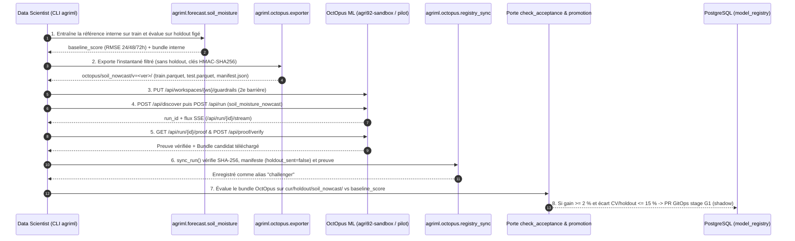

# 42 — Plan d'Onboarding et d'Intégration OctOpus ML

**Date** : 14 novembre 2026  
**Statut** : Plan opérationnel d'onboarding OctOpus ML (Phase IA Réelle) — *Confidentiel — réservé aux partenaires de travail.*  
**Références** : [`09_octopus_ml.md`](./09_octopus_ml.md), [`16_architecture_octopus.md`](./16_architecture_octopus.md) (gelé en baseline v1), [`33_readiness_ia_reelle.md`](./33_readiness_ia_reelle.md), [`41_data_inventory.md`](./41_data_inventory.md), et code existant dans [`plateforme/ml/src/agriml/octopus/`](../ml/src/agriml/octopus/) et [`plateforme/backend/app/services/inference/`](../backend/app/services/inference/).  
**Contraintes respectées** : Aucune modification du Frontend (`plateforme/web`), aucune modification du Backend (`plateforme/backend`), aucune modification de [`16_architecture_octopus.md`](./16_architecture_octopus.md), aucun modèle entraîné.

---

## 1. Principes directeurs de l'intégration OctOpus ML

Conformément à [`09_octopus_ml.md`](./09_octopus_ml.md) § 1 et [`16_architecture_octopus.md`](./16_architecture_octopus.md) § 0–1, l'intégration d'OctOpus ML repose sur cinq règles d'architecture non négociables :

1. **OctOpus est un challenger, jamais le décideur ni la source de vérité des données** :
   - Le lac de données de référence demeure chez SmartAgri92 (PostgreSQL 16 / TimescaleDB + S3 `raw/` et `curated/`).
   - Chaque cas d'usage dispose d'abord d'une **base de référence interne `agriml`** entraînée et évaluée localement.
   - OctOpus exécute des runs autonomes (EDA, ingénierie de variables, sélection de modèles, preuve d'exécution) et renvoie un bundle candidat enregistré uniquement sous l'alias **`challenger`** via [`registry_sync.py`](../ml/src/agriml/octopus/registry_sync.py).
2. **Double barrière de protection des données (Zéro PII, Zéro Holdout chez OctOpus)** :
   - **1re barrière (locale, avant tout envoi)** : [`agriml/octopus/exporter.py`](../ml/src/agriml/octopus/exporter.py) supprime les colonnes identifiantes (`drop`), pseudonymise les clés (`device_id`, `field_key`, `farm_key`) par **HMAC-SHA256** avec un sel secret de $\ge 32$ caractères (`AGRIML_PSEUDO_SALT`), arrondit les coordonnées GPS à $0,01^\circ$ ($\approx 1,1\text{ km}$, suffixes `lat_r`, `lon_r`), scanne les valeurs par expressions régulières (`EMAIL_RE`, `PHONE_RE`) et refuse toute écriture en cas de violation (`ExportRefused`).
   - **2e barrière (côté OctOpus)** : configuration des `guardrails` de l'espace de travail (`PUT /api/workspaces/{nom}/guardrails`) et dans chaque requête `POST /api/run`.
   - **Isolation absolue du Holdout** : le jeu de validation finale (`curated/holdout/<jeu>/`) ne quitte **jamais** l'infrastructure SmartAgri92 (`holdout_sent: false`). Le bundle téléchargé depuis OctOpus est évalué localement sur ce holdout figé.
3. **Interdiction stricte du paquet PyPI `octopus-ml`** :
   - Le paquet public `octopus-ml` sur PyPI appartient à un auteur tiers sans lien avec OctOpus ML (risque de chaîne d'approvisionnement). Seul notre client interne [`agriml/octopus/client.py`](../ml/src/agriml/octopus/client.py) construit sur `httpx` est autorisé.
4. **Inférence souveraine en production avec chaîne de repli à 3 paliers** :
   - En production, l'API FastAPI sert prioritairement le **bundle téléchargé localement et vérifié par empreinte SHA-256** (`LocalBundleBackend`, `fallback_step = 0` dans [`backend/app/services/inference/local.py`](../backend/app/services/inference/local.py)).
   - Le scoring batch distant via `POST /api/run/{run_id}/predict-file` (`OctopusBatchBackend`, `fallback_step = 1` dans [`backend/app/services/inference/octopus.py`](../backend/app/services/inference/octopus.py)) n'envoie que des lignes anonymes `r0, r1, ...` contenant exclusivement les features numériques déclarées, avant repli sur les règles agronomiques (`fallback_step = 2`) puis `503 MODEL_UNAVAILABLE` (`fallback_step = 3`).
5. **Promotion par PR GitOps revue humainement (G1 Shadow → G2 10 % → G3 100 %)** :
   - Aucun modèle OctOpus ne passe directement en production sans vérification de sa preuve (`POST /api/proof/verify`), gain démontré sur le holdout figé, et validation humaine (DS + Agronome + approbation CTO).

---

## 2. État des composants techniques OctOpus déjà livrés dans le dépôt

L'audit du code montre que toute la plomberie logicielle est déjà en place et testée unitairement :

| Composant | Fichier | État actuel | Tests existants |
|---|---|---|---|
| **Client HTTP OctOpus** | [`ml/src/agriml/octopus/client.py`](../ml/src/agriml/octopus/client.py) (358 l.) | **Livré** : `discover`, `start_run`, `status`, `cancel`, `hint`, `proof`, `verify_proof`, `list_schedules`, `create_schedule`, `get_guardrails`, `set_guardrails`, `predict_file`, `stream_events` (SSE WHATWG), `wait_for_run`. HTTPS obligatoire hors localhost, masquage de la clé dans `__repr__`, backoff exponentiel sur `429/503`. | [`ml/tests/test_octopus_client.py`](../ml/tests/test_octopus_client.py) |
| **Exporteur d'instantanés** | [`ml/src/agriml/octopus/exporter.py`](../ml/src/agriml/octopus/exporter.py) (326 l.) | **Livré** : `PrivacyPolicy`, `pseudonymize_series` (HMAC-SHA256 16 hex), `apply_policy`, `find_violations`, `export_snapshot` produisant `train.parquet`, `test.parquet`, `manifest.json` et `README.md` sous `octopus/<jeu>/v=<version>/`. | [`ml/tests/test_octopus_exporter.py`](../ml/tests/test_octopus_exporter.py) + test réel documenté dans `RESULTS_SMOKE.md` § 8 |
| **Chargeur de programmes & Portes** | [`ml/src/agriml/octopus/programs.py`](../ml/src/agriml/octopus/programs.py) (130 l.) + [`programs/*.yaml`](../ml/src/agriml/octopus/programs/) | **Livré** : 4 programmes métier (`soil_moisture_nowcast`, `irrigation_need`, `disease_image_classification`, `yield_forecast`) + 1 gabarit `competition_template`. Fonction `check_acceptance`. | [`ml/tests/test_octopus_programs_sync.py`](../ml/tests/test_octopus_programs_sync.py) |
| **Synchronisation Registre** | [`ml/src/agriml/octopus/registry_sync.py`](../ml/src/agriml/octopus/registry_sync.py) (144 l.) | **Livré** : vérification SHA-256 du bundle (`verify_bundle`), contrôle `holdout_sent is False`, vérification cryptographique de la preuve (`proof_is_valid`), enregistrement comme `challenger` dans MLflow ou `LocalRegistry`. | [`ml/tests/test_octopus_programs_sync.py`](../ml/tests/test_octopus_programs_sync.py) |
| **Passerelle d'inférence Backend** | [`backend/app/services/inference/octopus.py`](../backend/app/services/inference/octopus.py) (126 l.) & [`local.py`](../backend/app/services/inference/local.py) (132 l.) | **Livré** : `OctopusBatchBackend` (CSV pseudonyme `r0..rN` sans identifiant métier, réordonnancement sécurisé) et `LocalBundleBackend` (chargement `.joblib`/`.onnx` vérifié par SHA-256 depuis la table SQL `model_registry`). | `backend/tests/` (218 tests passants) |

---

## 3. Le premier projet à créer dans OctOpus : `soil_moisture_nowcast`

### 3.1 Pourquoi `soil_moisture_nowcast` est le premier projet OctOpus à ouvrir

Conformément à [`33_readiness_ia_reelle.md`](./33_readiness_ia_reelle.md) § 2 et [`41_data_inventory.md`](./41_data_inventory.md) § 5, le premier projet à créer dans OctOpus est **`soil_moisture_nowcast`** (associé au jeu `soil_nowcast` et au modèle `soil_nowcast` pour le service `#2 soil_forecast`) :

1. **Programme YAML déjà écrit et validé** : [`ml/src/agriml/octopus/programs/soil_moisture_nowcast.yaml`](../ml/src/agriml/octopus/programs/soil_moisture_nowcast.yaml).
2. **Modèle de référence interne (`agriml`) déjà opérationnel** : [`ml/src/agriml/forecast/soil_moisture.py`](../ml/src/agriml/forecast/soil_moisture.py), qui fournit immédiatement le score de référence (`baseline_score`) exigé par la porte d'acceptation `check_acceptance`.
3. **Auto-supervision totale sur les capteurs existants du kit v1.1** : aucune attente de débitmètre (contrairement à `irrigation_need`), d'annotation photo double (contrairement à `disease_image_classification`) ou de 4 campagnes de récolte (contrairement à `yield_forecast`).

> [!TIP]
> **Projet compagnon sur données 100 % publiques (`rain_event_probability`)** : En parallèle de `soil_moisture_nowcast`, le jeu `features.rain_events` (modèle `wx_rain_prob`, prévision calibrée de probabilité de pluie $\ge 1, 5, 10, 20\text{ mm}$ à partir d'ERA5-Land / CHIRPS v3 / GFS) est classé `public` dans `datasets.yaml` (aucune donnée personnelle, aucun capteur matériel requis, Vague 1). Il constitue le candidat idéal pour tester un run OctOpus sur **données réelles publiques du Sénégal** dès la phase `agri92-sandbox`, avant même la signature du récépissé CDP.

### 3.2 Fiche technique complète du premier projet OctOpus (`soil_moisture_nowcast`)

| Paramètre OctOpus | Valeur en Phase A (Qualification immédiate J1–J10) | Valeur en Phase B (Pilote terrain réel) |
|---|---|---|
| **Nom du projet / programme** | `soil_moisture_nowcast` | `soil_moisture_nowcast` |
| **Espace de travail (`workspace`)** | `agri92-sandbox` *(données synthétiques + météo publique, 0 donnée personnelle)* | `agri92-pilot` *(télémétrie réelle pseudonymisée des kits pilotes)* |
| **Nom du jeu (`dataset`)** | `soil_nowcast` (`v=20261123-sandbox01`) | `soil_nowcast` (`v=<AAAAMMJJ>-<git_sha7>`) |
| **Tâche (`task`)** | `forecast` (prévision multi-horizon sur le delta $\Delta y_h = y(t+h) - y(t)$) | `forecast` |
| **Colonne cible (`target`)** | `soil_moisture_pct` (et ses variations à $+24\text{ h}$, $+48\text{ h}$, $+72\text{ h}$) | `soil_moisture_pct` (quantiles `p10`, `p50`, `p90` par horizon) |
| **Métrique primaire (`metric`)** | `rmse` (comparée obligatoirement au RMSE de la persistance $y(t+h)=y(t)$) | `rmse` (+ couverture de l'intervalle `p10–p90` à $80\,\% \pm 5\,\%$) |
| **Colonne de groupe (`groups`)** | `device_id` (pseudonymisé en HMAC-SHA256 16 caractères hexadécimaux) | `device_id` (pseudonymisé en HMAC-SHA256) |
| **Colonne temporelle (`time_column`)** | `ts` (horodatage UTC au pas horaire régulier `1h`) | `ts` (horodatage UTC au pas horaire régulier `1h`) |
| **Schéma de validation (`cv`)** | `purged_time`, `n_splits: 4`, purge de `72 h` (`gap: 3` jours / `72 h`), `horizons: [24, 48, 72]` | `purged_time`, `n_splits: 4`, purge de `72 h`, `horizons: [24, 48, 72]` |
| **Budget de calcul (`time_budget_min`)** | `90` minutes | `90` minutes |
| **Garde-fous (`guardrails`)** | `drop: [owner_name, phone, email]`<br>`pseudonymize: [device_id, field_key]`<br>`round_coords: [lat, lon]` (`0.01°`) | `drop: [owner_name, phone, email]`<br>`pseudonymize: [device_id, field_key]`<br>`round_coords: [lat, lon]` (`0.01°`) |
| **Critères d'acceptation (`acceptance`)** | `min_relative_gain: 0.02` ($+2\,\%$ vs référence `agriml` sur holdout figé)<br>`max_cv_holdout_gap: 0.15` ($\le 15\,\%$ d'écart CV / holdout)<br>`require_proof_verified: true` | Idem + validation sur $\ge 5$ kits distincts en holdout et $\text{skill} \ge 20\,\%$ vs persistance à 24 h |

### 3.3 Schéma exact de l'instantané envoyé à OctOpus (`octopus/soil_nowcast/v=<version>/`)

L'exporteur [`agriml/octopus/exporter.py`](../ml/src/agriml/octopus/exporter.py) produit quatre fichiers immuables :
1. **`train.parquet`** : lignes d'entraînement antérieures à la fenêtre de holdout, avec la cible et les clés pseudonymisées :
   - `device_id` (`string`, ex. `"a94f3c8102b7e4d1"`),
   - `ts` (`timestamp` UTC horaire),
   - `soil_moisture_pct` (`float`, `[0.0, 100.0]`, mis à `NaN` si `soil_sensor_ok == False`, interpolé seulement si trou $\le 3\text{ h}$),
   - `air_temp_c` (`float`), `air_humidity_pct` (`float`), `pressure_hpa` (`float`),
   - `pump_on` (`bool` / ratio horaire `[0.0, 1.0]`),
   - `threshold_start_pct` (`int`), `threshold_stop_pct` (`int`),
   - `rain_mm` (`float`, pluie observée/prévue *as-of*),
   - `lat_r`, `lon_r` (`float` arrondis à $0,01^\circ$, si présents).
2. **`test.parquet`** : lignes d'évaluation sans la cible (pour vérifier `predict-file` et comparer les prédictions), **jamais le holdout étiqueté**.
3. **`manifest.json`** : empreintes `sha256` de chaque fichier, `git_sha`, version d'`agriml`, `salt_id`, colonnes supprimées/pseudonymisées/arrondies, et `holdout_sent: false`.
4. **`README.md`** : fiche descriptive automatique générée par `_readme()`.

---

## 4. Prérequis techniques, sécurité et conformité avant ouverture des espaces

### 4.1 Variables d'environnement et secrets requis

| Variable | Où la configurer | Valeur / Règle de sécurité |
|---|---|---|
| `OCTOPUS_BASE_URL` | Environnement `agriml` & Backend | `https://octopus.ml` (HTTPS vérifié par `check_base_url` ; redirections HTTP désactivées `follow_redirects=False` pour ne jamais divulguer le jeton `Bearer`) |
| `OCTOPUS_API_KEY` | AWS Secrets Manager → External Secrets | Clé API propre à chaque espace (`agri92-sandbox`, puis `agri92-pilot`, puis `agri92-prod`). Masquée dans `OctopusClient.__repr__()` |
| `AGRIML_PSEUDO_SALT` | AWS Secrets Manager (local au pipeline d'export) | Chaîne aléatoire hexadécimale d'au moins **32 caractères** (`secrets.token_hex(32)`). **Ne quitte jamais SmartAgri92**, jamais écrite dans `manifest.json` |
| `AGRIML_PSEUDO_SALT_ID` | Environnement `agriml` | Identifiant public de rotation du sel (ex. `pseudo-2026-q4`), inscrit dans `manifest.json` |
| `MODEL_BUNDLE_DIR` | Backend FastAPI (`app/core/config.py`) | Répertoire local sécurisé contenant les bundles promus (vérifiés contre `model_registry.sha256` par `LocalBundleBackend`) |

### 4.2 Écarts P0 du code `plateforme/ml/` à lever pendant les 10 jours (identifiés dans Doc 16 § 7–8)

Avant de lancer le premier run réel dans OctOpus, les **6 écarts P0** documentés au § 8 de [`16_architecture_octopus.md`](./16_architecture_octopus.md) doivent être appliqués dans `plateforme/ml/` (sans toucher au Backend ni au Frontend) :

| Réf. Doc 16 | Fichier(s) dans `plateforme/ml/` | Problème actuel | Correctif exact à appliquer (J4 à J6) |
|---|---|---|---|
| **R1 (P0)** | `src/agriml/octopus/client.py`, `programs.py` | `RunRequest` n'envoie ni `cv`, ni `groups`, ni `time_column` : OctOpus risque de faire un split aléatoire qui mélange les heures d'un même kit entre train et validation. | Ajouter `cv`, `groups` et `time_column` à `RunRequest` et les renseigner dans `OctopusProgram.run_request()` (+ fournir une colonne `fold` pré-calculée en secours si l'API OctOpus ignore `cv`). |
| **R2 (P0)** | `src/agriml/octopus/programs.py`, `programs/*.yaml` | Les clés `gap_hours`, `horizons` et `cv.groups` des YAML ne sont pas dans `CVConfig` et sont ignorées sans erreur. | Valider explicitement `PROGRAM_KEYS` et `CV_KEYS` dans `load_program()` et harmoniser les 4 fichiers YAML (`gap_hours: 72` → unité cohérente avec `purged_time_splits`). |
| **R3 (P0)** | `src/agriml/mlops/promotion.py` | `min_holdout_rows = 200` ne compte que des lignes (soit 8 jours d'un seul kit) sans vérifier le nombre de kits (`n_groups`) ni de cas positifs. | Ajouter `min_holdout_groups` (ex. $\ge 5$ kits au pilote, $30$ en cible) et `min_holdout_positives` dans `PromotionPolicy` et `decide_promotion()`. |
| **R4 (P0)** | `src/agriml/mlops/promotion.py`, `programs.py` | Si `champion_score is None`, `decide_promotion()` promeut d'office le premier modèle venu ; si `baseline_score is None`, `_gain_reasons()` ne vérifie aucun gain. | Imposer `require_champion: bool = True` et refuser tout challenger tant que la référence interne `agriml` n'a pas été scorée sur le même holdout. |
| **R7 (P0)** | `src/agriml/octopus/exporter.py`, `ml/octopus/compliance.yaml` | `holdout_sent: False` est écrit en dur sans filtrer `holdout_window`, `test` n'est pas contrôlé pour l'absence de `target`, et C1–C4 ne sont pas vérifiés. | Créer `ml/octopus/compliance.yaml`, filtrer physiquement `holdout_window` dans `export_snapshot()`, lever `ExportRefused` si `spec.target in test.columns`, et calculer réellement `holdout.sent`. |
| **R8 (P0)** | `src/agriml/mlops/retrain_flow.py` | `retrain_flow.py` appelle directement `promote()` au lieu d'enregistrer un `challenger` soumis à une PR GitOps. | Remplacer l'appel direct à `promote()` par `set_alias(..., CHALLENGER)` et la génération d'un rapport de demande de promotion G1. |

### 4.3 Les 5 contrôles de conformité avant passage de `agri92-sandbox` à `agri92-pilot`

Conformément à [`16_architecture_octopus.md`](./16_architecture_octopus.md) § 2.3 :
- **En espace `agri92-sandbox` (J1–J10)** : seuls des jeux synthétiques (`make_synthetic.py`) ou des jeux 100 % publics (`features.rain_events`) sont utilisés. Aucune donnée personnelle n'étant traitée, les tests techniques d'onboarding peuvent démarrer **immédiatement**.
- **Avant tout envoi vers `agri92-pilot` (données pseudonymisées des kits terrain)**, les 5 contrôles **C1 à C5** doivent être au vert dans `ml/octopus/compliance.yaml` :
  - **C1 (Licences amont)** : règle `octopus.licence` à 0 erreur (pour `soil_nowcast` : construire le jeu par la **voie ouverte** de Doc 15 § 4.5 avec `isdasoil`/`soilgrids` et `ecmwf_open_data`/`noaa_gfs` ou Open-Meteo Standard payant, sans dépendre de `inp_soil_map` tant que la convention INP n'est pas signée).
  - **C2 (DPA OctOpus)** : contrat de sous-traitance signé avec OctOpus ML incluant la localisation de l'hébergement, l'interdiction de réutilisation par les fournisseurs de LLM tiers et la clause d'effacement.
  - **C3 (AIPD)** : Analyse d'Impact relative à la Protection des Données (`AIPD-EXPORT-1`) approuvée par le CTO/Juriste.
  - **C4 (CDP Sénégal)** : déclaration déposée auprès de la Commission de Protection des Données Personnelles couvrant le transfert international de données pseudonymisées.
  - **C5 (Scan PII technique)** : déjà actif et testé dans `exporter.py` (`find_violations`).

---

## 5. Procédure opérationnelle pas-à-pas du premier run OctOpus (`soil_moisture_nowcast`)

Une fois la préparation des données (J1–J9) achevée et le feu vert donné pour l'entraînement :



### Commandes exactes associées (à exécuter uniquement après validation de la phase de préparation)

1. **Vérification du catalogue et de la lignée de `soil_nowcast`** :
   ```powershell
   cd plateforme/ml
   $env:PYTHONPATH="src"
   python -m agriml.catalog check
   python -m agriml.catalog lineage soil_nowcast
   ```
2. **Construction de l'instantané pseudonymisé via l'exporteur** :
   ```powershell
   $env:AGRIML_PSEUDO_SALT=(python -c "import secrets; print(secrets.token_hex(32))")
   $env:AGRIML_PSEUDO_SALT_ID="sandbox-2026-11"
   python -m agriml.octopus.exporter `
     --program soil_moisture_nowcast `
     --train data/curated/soil_nowcast_train.parquet `
     --test data/curated/soil_nowcast_test_nolabel.parquet `
     --version 20261123-sandbox01 `
     --out data/curated `
     --source-query soil_nowcast_v1.sql
   ```
3. **Vérification des 7 points du contrat HTTP OctOpus lors du premier appel réel (`docs/09_octopus_ml.md` § 11)** :
   Lors de la connexion initiale avec `OCTOPUS_API_KEY` sur `agri92-sandbox`, consigner les réponses exactes de l'API OctOpus pour figer les dataclasses de [`client.py`](../ml/src/agriml/octopus/client.py) :
   - Clé d'identifiant renvoyée par `POST /api/run` (`run_id`, `id` ou `runId` — déjà géré par `run_id_of()`),
   - Noms exacts des états terminaux de `GET /api/run/{id}/status` (`TERMINAL_STATES`),
   - Acceptation des champs `cv`, `groups` et `time_column` dans `POST /api/run` (sinon passage par la colonne `fold` pré-calculée),
   - Format de la réponse publique `POST /api/proof/verify` (`valid`, `verified` ou `ok` — déjà géré par `proof_is_valid()`),
   - Structure du bundle téléchargé pour son chargement par `LocalBundleBackend`.

---

## 6. Récapitulatif : Classement de faisabilité & Feuille de route 10 jours

### 6.1 Synthèse du classement des projets OctOpus

| Statut | Projets / Programmes OctOpus | Justification |
|---|---|---|
| **1. Faisable immédiatement (Espace `agri92-sandbox`)** | - **`soil_moisture_nowcast`** (sur jeu synthétique calibré + météo réelle)<br>- **`rain_event_probability`** (sur données météo publiques ouvertes ERA5-Land / CHIRPS v3) | Aucune donnée personnelle réelle exposée ; code `agriml`, exporteur et programme YAML déjà prêts ; permet de valider 100 % du flux technique OctOpus en 10 jours. |
| **2. Faisable avec données supplémentaires (Espace `agri92-pilot`, Court/Moyen terme)** | - **`soil_moisture_nowcast`** (production pilote)<br>- **`sensor_anomaly_detection`** (`anomaly_ml`)<br>- **`local_weather_bias`** (`wx_local_bias`) | Requiert 6 à 8 semaines de télémétrie réelle des 5–10 premiers kits pilotes dans `measurements` + étalonnage `sm_calibration` + validation des pièces C1–C4 (`compliance.yaml`). |
| **3. Bloqué (Moyen/Long terme)** | - **`irrigation_need`** (`irr_need_24h` : bloqué par l'absence de débitmètre sur le kit v1.1)<br>- **`disease_image_classification`** (`vis_disease` : bloqué par la collecte et double annotation terrain de $\ge 500$ photos/classe)<br>- **`yield_forecast`** (bloqué par l'exigence de $\ge 4$ campagnes complètes en *leave-one-campaign-out*)<br>- **`price_forecast_4w`** (bloqué par la convention SIM/CSA) | Dépendances matérielles (débitmètre v1.2), campagnes d'annotation terrain ou accumulation pluriannuelle de récoltes. En attendant, le Backend sert proprement le bilan physique FAO-56 (`irr_water_balance`) ou les règles prudentes. |

### 6.2 Feuille de route d'exécution sur 10 jours (Phase de préparation — sans entraînement immédiat)

1. **J1** : Validation de l'inventaire des données ([`41_data_inventory.md`](./41_data_inventory.md)) et du présent plan d'onboarding ([`42_octopus_onboarding_plan.md`](./42_octopus_onboarding_plan.md)).
2. **J2** : Qualification de l'environnement Python `plateforme/ml` (ajout des extras `lightgbm`, `httpx`, `onnx`, `onnxruntime` dans le venv ML ; vérification `agriml.catalog check` et `pytest`).
3. **J3** : Spécification et script de construction de la table `features.soil_nowcast` (jointure `measurements_1h` + météo *as-of* + découpage physique du holdout temporel `curated/holdout/soil_nowcast/`).
4. **J4** : Implémentation de **R7** dans `agriml/octopus/exporter.py` et création de `ml/octopus/compliance.yaml` (contrôles C1–C4, retrait automatique de `holdout_window`, interdiction de `target` dans `test`, calcul strict de `holdout.sent`).
5. **J5** : Implémentation de **R1** et **R2** dans `agriml/octopus/client.py`, `programs.py` et `programs/*.yaml` (transmission de `cv`, `groups`, `time_column` + colonne `fold` de secours ; validation stricte des clés YAML).
6. **J6** : Implémentation de **R3**, **R4**, **R5**, **R8** et **R9** dans `agriml/mlops/promotion.py` et `retrain_flow.py` (planchers de groupes/kits sur le holdout, obligation d'un score de référence `agriml`, enregistrement exclusif en `challenger` + génération du dossier de PR GitOps).
7. **J7** : Ingestion du premier jeu réel public (`meteo` ERA5-Land / CHIRPS v3 / Open-Meteo sur les Niayes et la Vallée du Fleuve) et construction de `features.rain_events`.
8. **J8** : Livraison des gabarits terrain dans `ml/data/templates/` pour l'étalonnage gravimétrique des sondes (`sm_calibration`) et la saisie des barèmes signés ISRA/CDH/DPV (`fertilization_reference`, `pest_reference`).
9. **J9** : Génération à blanc du premier instantané complet `octopus/soil_nowcast/v=20261123-sandbox01/` et vérification cryptographique de son manifeste et de l'absence de fuite vers le holdout.
10. **J10** : Test d'intégration du client `OctopusClient` sur l'espace `agri92-sandbox` (`/api/discover`, `/api/workspaces/agri92-sandbox/guardrails`) et jalon Go/No-Go pour lancer le premier entraînement de référence `agriml` puis le premier run challenger OctOpus.
