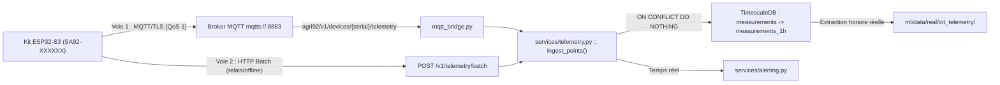

# 47 — Préparation de l'Ingestion IoT (`IA-REAL-04`)

**Date** : 16 novembre 2026  
**Statut** : Référentiel technique d'ingestion prêt pour le premier kit physique — *Confidentiel — réservé aux partenaires de travail.*  
**Périmètre** : Chaîne complète ESP32-S3 → API/MQTT → TimescaleDB → Data Lake National (`ml/data/real/iot_telemetry/`).  
**Contraintes respectées** : Aucun modèle entraîné ; aucune donnée synthétique ; aucune modification du Frontend ni du Backend.

---

## 1. Architecture d'ingestion déjà en place (prête Jour 1)

Le Backend [`plateforme/backend/`](../backend/) expose deux voies d'ingestion unifiées convergeant vers [`app/services/telemetry.py`](../backend/app/services/telemetry.py) (`ingest_points`) et la table PostgreSQL/TimescaleDB `measurements` :

---

## 2. Contrats de transport et d'authentification

### 2.1 Voie A — MQTT temps réel (`app/ingestion/mqtt_bridge.py`)
- **Protocole obligatoire en `staging`/`prod`** : `mqtts://` sur port `8883` (`TLS` requis par `settings.is_strict`, sinon refus de démarrage).
- **Sujets normalisés (`TOPIC_PREFIX = "agri92/v1/devices"`)** :
  - `agri92/v1/devices/SA92-XXXXXX/telemetry` (publication kit → plateforme, `QoS = 1`, taille max `16 Kio`),
  - `agri92/v1/devices/SA92-XXXXXX/events` (événements kit avec champ `type` $\le 64$ car.),
  - `agri92/v1/devices/SA92-XXXXXX/commands` (plateforme → kit pour mise à jour des seuils),
  - `agri92/v1/devices/SA92-XXXXXX/commands/ack` (acquittement `{"id": "...", "ok": true|false}`).
- **Identité & Sécurité** :
  - Format de numéro de série imposé : `^SA92-\d{6}$`.
  - En production, l'ACL du broker MQTT autorise chaque kit à publier **uniquement** sous son propre `SA92-XXXXXX`.
  - Le kit doit être `status = "active"` dans la table SQL `devices`, sinon `mqtt_bridge.py` ignore le message (`kit inconnu ou inactif`).

### 2.2 Voie B — HTTP Batch (`POST /v1/telemetry/batch`)
- **Capacité** : jusqu'à `MAX_BATCH_POINTS = 1000` points par requête (au-delà : `413 BATCH_TOO_LARGE`).
- **Authentification** :
  - Soit directement par le kit via en-tête `X-Device-Key` (vérifié contre `devices.key_hash` avec `DEVICE_KEY_PEPPER`, refus `403 DEVICE_MISMATCH` si le lot contient un autre numéro de série),
  - Soit par un relais mobile/technicien via JWT (`TELEMETRY_WRITERS`).
- **Utilisation terrain** : vidage automatique du tampon SD/flash du kit après coupure réseau GSM/LTE ou synchronisation via l'application relais.

---

## 3. Contrat de données `telemetry.v1` (Clés Firmware vs Clés Plateforme)

Le schéma [`TelemetryPoint`](../backend/app/schemas/telemetry.py) accepte soit `m` (clés normalisées), soit `kit` (clés brutes du firmware v1.1, mappées par `KIT_KEY_MAP`). Le pont MQTT accepte également un JSON brut firmware v1.1 sans enveloppe, qu'il horodate à réception UTC.

| Clé brute Firmware (`kit`) | Clé normalisée Plateforme (`m` & SQL) | Type | Plage valide (`services/telemetry.py`) | Signification métier |
| :--- | :--- | :--- | :--- | :--- |
| `sol` | `soil_moisture_pct` | `float` | `[0.0, 100.0]` | Humidité du sol (%) à $-20\text{ cm}$ |
| `temp` | `air_temp_c` | `float` | `[-10.0, 60.0]` | Température de l'air (°C) |
| `hum` | `air_humidity_pct` | `float` | `[0.0, 100.0]` | Humidité relative de l'air (%) |
| `pres` | `pressure_hpa` | `float` | `[800.0, 1100.0]` | Pression atmosphérique (hPa) |
| `n` / `p` / `k` | `n_mgkg` / `p_mgkg` / `k_mgkg` | `int` | `[0, 1999]` | Lectures indicatives sonde NPK (mg/kg) |
| `pompe` | `pump_on` | `bool` | `true \| false` | État marche/arrêt de la pompe |
| `defautPompe` | `pump_fault` | `bool` | `true \| false` | Défaut électrique / marche à sec pompe |
| `capteurSolOk` | `soil_sensor_ok` | `bool` | `true \| false` | Santé sonde capacitive sol |
| `bmeOk` | `bme_ok` | `bool` | `true \| false` | Santé capteur air BME280 |
| `npkOk` | `npk_ok` | `bool` | `true \| false` | Santé sonde NPK RS485 |
| `alerteEngrais` / `alertePlante` | `alert_fertilizer` / `alert_plant` | `bool` | `true \| false` | Drapeaux d'alerte locaux firmware |
| `seuilStart` / `seuilStop` | `threshold_start_pct` / `threshold_stop_pct` | `int` | `start ∈ [0, 95]`, `stop ∈ [5, 100]`, `start + 5 ≤ stop` | Seuils actifs sur le boîtier |

---

## 4. Rattachement automatique au Data Lake National (tout le Sénégal)

Dès qu'un kit est associé à une parcelle géolocalisée `(lat, lon)` n'importe où au Sénégal :
1. **Rattachement grille nationale** : les coordonnées `(lat, lon)` déterminent sans configuration manuelle sa cellule `cell_id` dans [`senegal_grid_0p05.parquet`](../ml/data/real/geo/senegal_grid_0p05.parquet) et sa maille `power_cell_id` dans [`power_cells_0p5x0p625.parquet`](../ml/data/real/geo/power_cells_0p5x0p625.parquet).
2. **Enrichissement contextuel immédiat** : le kit hérite automatiquement de la pluie quotidienne CHIRPS, de l'$ET_0$ FAO-56, de la texture/capacité au champ `iSDAsoil` et de l'occupation du sol `WorldCover` de sa cellule.
3. **Zone de destination ML** : les séries horaires réelles extraites de `measurements_1h` seront écrites exclusivement dans [`ml/data/real/iot_telemetry/`](../ml/data/real/iot_telemetry/SCHEMA.md), strictement séparées de `ml/data/synthetic/`.

---

## 5. Check-list Go / No-Go avant expédition du premier kit

| # | Prérequis d'infrastructure | Critère de validation |
| :-: | :--- | :--- |
| **1** | Base PostgreSQL / TimescaleDB | Migrations `001`, `002` (RLS) et `003` (`device_parameter_sets`) appliquées ; hypertable `measurements` et vue `measurements_1h` actives. |
| **2** | Secrets Backend | `JWT_SECRET` et `DEVICE_KEY_PEPPER` ($\ge 32$ octets), `MQTT_URL=mqtts://...` configurés en `staging`/`prod`. |
| **3** | Worker MQTT actif | `python -m app.ingestion.mqtt_bridge` démarré en service managé avec reconnexion exponentielle (`1s → 120s`). |
| **4** | Enregistrement du kit | Kit créé dans `devices` avec `serial = SA92-XXXXXX`, `status = 'active'`, `key_hash` généré, rattaché à `organization_id` et `field_id`. |
| **5** | Test de fumée à blanc | Envoi d'un point `telemetry.v1` réel (kit sur banc avant départ) → `accepted: 1`, puis renvoi identique → `duplicates: 1` (idempotence vérifiée). |
