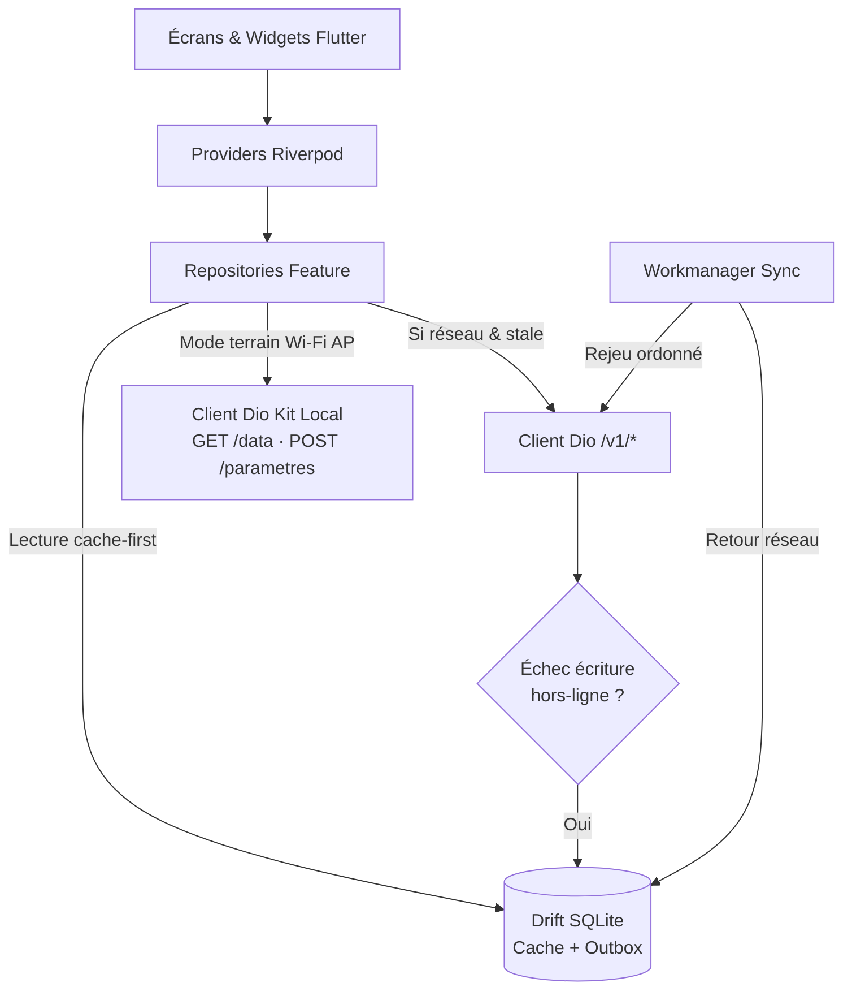
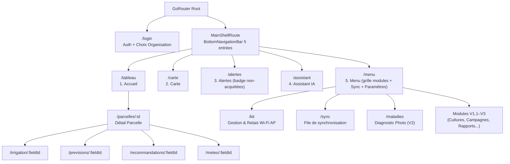

# 80 — Architecture Complète de l'Application Mobile Flutter (`plateforme/mobile`)

> **Statut** : Document de conception pure (MISSION MOBILE-01).  
> **Périmètre** : Architecture cible de l'application mobile Flutter SmartAgri92. Aucun écran ni code UI n'est créé dans cette phase.  
> **Sources de référence lues** :
> - [`plateforme/web/PASSATION.md`](../web/PASSATION.md) (état Web « Product Ready » et Backend Sprint D)
> - [`plateforme/docs/16_architecture_octopus.md`](./16_architecture_octopus.md) (Baseline v1 : flux Kit ↔ Mobile ↔ API, contrat de provenance § 9.2, 18 services IA § 9.3–9.4)
> - [`plateforme/docs/67_firmware_v1_2_spec.md`](./67_firmware_v1_2_spec.md) (protocole local Kit ESP32-S3 : `GET /data`, `POST /parametres`, mode AP Wi-Fi)
> - Frontend SmartAgri (`plateforme/web/lib/modules.ts`, `service-screens.ts`, `roles.ts`, `lib/contracts/*.ts`, `features/map/`, `features/assistant/`, `features/kit/`, `features/soil-forecast/`)
> - *Note documentaire* : les fichiers `64_soilnowcast_productization.md` et `65_smartagri_assistant_v1.md` n'étaient pas présents dans le dépôt ; les spécifications `soil_forecast` (`soil_nowcast`) et `assistant` (`assistant_chat`, `assistant_transcribe`) s'appuient donc directement sur `16_architecture_octopus.md` et les contrats Zod implémentés dans `plateforme/web/lib/contracts/`.

---

## 1. Architecture Flutter complète

### 1.1 Principes directeurs

L'application mobile Flutter (`plateforme/mobile`) n'est pas un simple portage du frontend Web : le Web mobile (`375 px`) est déjà complet pour les usages connectés (`PASSATION.md` § 5). L'application native Flutter répond à **trois besoins terrain spécifiques** :
1. **Hors-ligne prolongé** en zone rurale à connectivité intermittente (consultation des parcelles, prévisions en cache, saisie terrain différée).
2. **Relais local Kit ESP32-S3** en Wi-Fi AP local (`GET /data`, `POST /parametres`, remontée différée `POST /v1/telemetry/batch` et `POST /v1/devices/{id}/parameters/ack`).
3. **Capteurs mobiles & notifications** (prise de vue optimisée pour `vis_disease`, capture vocale `wo`/`ff`/`fr` pour `assistant_transcribe`, alertes critiques push OS).

### 1.2 Stack technique retenue

| Couche | Choix technique | Justification |
|---|---|---|
| **Framework** | Flutter (Dart 3.x, null-safety strict) | Cible Android prioritaire (terrain Sénégal) + iOS |
| **Architecture** | **Clean Architecture par Feature** (`data` / `domain` / `presentation`) | Isolation stricte des contrats API, du cache local et de l'UI |
| **Gestion d'état** | **Riverpod (`flutter_riverpod` + `riverpod_annotation`)** | Testabilité, gestion native `AsyncValue`, invalidation réactive post-sync |
| **Navigation** | **GoRouter** | Deep links (notifications push), ShellRoute (barre 5 onglets), guards Auth/RBAC |
| **Réseau HTTP** | **Dio** + intercepteurs (Auth JWT, Refresh, Retry, Logging, Mock/Dev) | Support timeout, annulation, compression, upload JSON ≤ 256 Kio |
| **Sérialisation & Contrats** | **Freezed + `json_serializable`** | Modèles immuables alignés 1:1 sur `plateforme/web/lib/contracts/*.ts` |
| **Stockage structuré hors-ligne** | **Drift (SQLite typé)** | Cache relationnel par `organization_id`, table Outbox transactionnelle |
| **Stockage sécurisé** | **`flutter_secure_storage`** | Jetons JWT (`access_token`, `refresh_token`), clé locale kit, PIN éventuel |
| **Synchronisation background** | **`workmanager`** + **`connectivity_plus`** | Vidage de la file Outbox dès retour réseau |
| **Cartographie** | **`flutter_map`** + tuiles MBTiles/PMTiles locales + GeoJSON | Rendu hors-ligne léger sans dépendance propriétaire Google Maps |
| **i18n** | **`intl` / ARB** (`fr`, `wo`, `ff`) | Aligné sur les 3 locales du Web (`PASSATION.md` § 1.1) |
| **IA embarquée légère** | **`tflite_flutter`** (optionnel V2) + **`flutter_tts`** | Contrôle qualité photo `vis_quality` et synthèse vocale `asst_tts` (Doc 16 § 9.4) |

### 1.3 Flux de données global



---

## 2. Modules

Les modules mobiles reprennent la taxonomie officielle de **Doc 10 § 3.2** (13 modules) et **Doc 18 / `service-screens.ts`** (9 écrans de service IA), enrichis des modules transverses propres au mobile.

| Groupe | Modules métier & Services couverts | Disponibilité cible |
|---|---|---|
| **Core & Socle** | `auth` (connexion, sélection organisation), `sync` (Outbox, conflits, état réseau), `notifications` (push FCM + alertes locales), `settings` (langue `fr`/`wo`/`ff`, thème clair/sombre, gestion cache cartes) | **MVP** |
| **Pilotage** | `dashboard` (Tableau de bord, KPIs, alertes critiques), `reports` (Rapports & `water_savings` #14) | **MVP** (`dashboard`), **V1.1** (`reports`) |
| **Terrain** | `farms` (Exploitations), `fields` (Parcelles & détail), `map` (Carte interactive + `map_layers` #18), `weather` (Météo #1) | **MVP** (`fields`, `map`, `weather`, `farms`) |
| **Cultures** | `crops` (Cultures), `campaigns` (Campagnes), `fertilization` (#6), `vegetation` (#11), `yield` (#12), `markets` (`price_forecast` #15) | **V1.1–V3** |
| **IA & Décision** | `irrigation` (`irrigation_need` #3), `soil_forecast` (`soil_nowcast` #2), `recommendations` (#5 + feedback), `irrigation_plan` (#4), `pest_risk` (#9), `diseases` (`disease_diagnosis` #8), `assistant` (`assistant_chat` #16 + `assistant_transcribe` #17) | **MVP** (`irrigation`, `soil_forecast`, `recommendations`, `assistant`), **V1.1–V2** (`diseases`, `pest_risk`, `irrigation_plan`) |
| **Matériel & Terrain Kit** | `alerts` (#13 + ack), `kit` (`kit_parameters` #7 + **relais Wi-Fi AP local** `GET /data`, `POST /parametres`, `POST /v1/telemetry/batch`), `equipment` (Pompes/capteurs), `traps` (`trap_counts` #10) | **MVP** (`alerts`, `kit` relais), **V1.1–V2** (`equipment`, `traps`) |

---

## 3. Dossiers (`plateforme/mobile/`)

Structure **feature-first** avec noyau partagé (`core/`), strictement miroir des responsabilités du frontend Web :

```text
plateforme/mobile/
├── pubspec.yaml
├── l10n/
│   ├── app_fr.arb
│   ├── app_wo.arb
│   └── app_ff.arb
├── assets/
│   ├── models/                 # TFLite léger (vis_quality.tflite en V2)
│   ├── map/                    # Styles carte hors-ligne
│   └── icons/
└── lib/
    ├── main.dart
    ├── app.dart                # ProviderScope, MaterialApp.router, Thème WCAG AA
    ├── core/
    │   ├── config/             # Env, baseUrl, feature flags, mode dev/mock
    │   ├── network/            # DioClient, AuthInterceptor, RetryInterceptor, EnvelopeParser
    │   ├── contracts/          # Modèles Freezed partagés (Envelope, Provenance, Confidence, Roles)
    │   ├── storage/            # Drift AppDatabase (tables cache, outbox, tile_regions), SecureStorage
    │   ├── sync/               # SyncEngine, OutboxProcessor, ConflictResolver, WorkmanagerDispatcher
    │   ├── permissions/        # RBAC guards (THRESHOLD_WRITERS, FEEDBACK_WRITERS, ALERT_ACKERS)
    │   ├── router/             # GoRouter, ShellRoute, redirections auth & deep links
    │   ├── theme/              # Tokens couleurs clair/sombre conformes WCAG 2.1 AA
    │   └── widgets/            # ProvenanceBadge, ConfidenceView, SyncBanner, QueryStateView, StaleBanner
    └── features/
        ├── auth/               # data/ (dto, repo) · domain/ (entities) · presentation/ (screens, controllers)
        ├── dashboard/
        ├── farms/
        ├── fields/
        ├── map/                # Inclut TileCacheManager (MBTiles) + GeoJsonLayerRenderer
        ├── weather/
        ├── irrigation/
        ├── soil_forecast/
        ├── recommendations/
        ├── alerts/
        ├── assistant/          # Chat texte + VoiceRecorder (≤60s) + TtsPlayer
        ├── kit/                # API cloud parameters + KitLocalWifiService (GET /data, POST /parametres)
        ├── diseases/           # CameraCapture + ImageCompressor (≤256 Kio) + VisQualityGate
        ├── fertilization/
        ├── pest_risk/
        ├── irrigation_plan/
        ├── vegetation/
        ├── crops/
        ├── campaigns/
        ├── equipment/
        ├── traps/
        ├── yield/
        ├── markets/
        ├── reports/
        └── settings/           # Langue, thème, gestion stockage hors-ligne & file de sync
```

---

## 4. Écrans (Architecture UI transversale)

L'inventaire détaillé de tous les écrans du MVP (et du périmètre complet) figure dans [`81_mobile_screen_inventory.md`](./81_mobile_screen_inventory.md). Sur le plan architectural, chaque écran respecte **5 invariants transverses** hérités du frontend Web (`PASSATION.md` § 1.1 & Doc 16 § 6.3, § 9.5) :

1. **Enveloppe d'état unifiée (`QueryStateView`)** : tout écran asynchrone gère explicitement 5 états : `loading` (skeleton), `data` (frais), `stale` (donnée en cache ou `provenance.stale == true`), `empty` (illustration + action), `error` (code métier mappé, ex. `503 MODEL_UNAVAILABLE`, `404 NO_ACTIVE_CYCLE`, `429 RATE_LIMITED`).
2. **Transparence IA systématique (`ProvenanceWidget`)** : toute carte affichant un résultat des 18 services IA rend obligatoirement `source` (`agriml` / `octopus` / `rules`), `model_version`, `computed_at` (âge relatif), `fallback_step > 0` (« Valeur de secours ») et `confidence` via `ConfidenceView` (jamais de pourcentage inventé si `calibrated == false`).
3. **Bandeau de synchronisation global (`SyncBanner`)** : affiché en haut du `Scaffold` dès que l'appareil est hors-ligne ou que la file Outbox contient ≥ 1 action en attente, avec accès direct à l'écran `SyncQueueScreen`.
4. **Contrôle d'accès UI (`RoleGate`)** : masque les boutons d'écriture selon `web/lib/roles.ts` (`THRESHOLD_WRITERS`, `FEEDBACK_WRITERS`, `ALERT_ACKERS`), tout en sachant que l'API reste seule juge (`403`).
5. **Accessibilité terrain & WCAG 2.1 AA** : zones tactiles ≥ `48×48 dp`, contrastes clair/sombre validés, repères terrain explicites (ex. `1 mm = 1 L/m² = 10 m³/ha` sur Irrigation).

---

## 5. Navigation

### 5.1 Structure à 2 niveaux (alignée sur `MOBILE_TABS` de `web/lib/modules.ts`)



### 5.2 Règles de routage
- **StatefulShellRoute (IndexedStack)** sur les 5 onglets principaux afin de préserver l'état de la carte (`/carte`) et de la conversation (`/assistant`) lors des changements d'onglet.
- **Guards GoRouter** :
  - Redirection vers `/login` si aucun `access_token` valide ni session hors-ligne mise en cache.
  - Validation stricte des deep links (équivalent `safeNext` de `web/lib/nav.ts`) pour les notifications push d'alertes (`/alertes?id=...`) ou de parcelles (`/parcelles/:id`).
- **Sélecteur de contexte global** : `activeOrganizationId` et `activeFarmId` stockés dans un provider Riverpod persisté ; tout changement invalide les caches mémoire actifs.

---

## 6. Gestion hors-ligne

### 6.1 Stratégie par type de donnée

| Catégorie | Stratégie réseau/cache | TTL / Règle de péremption | Stockage |
|---|---|---|---|
| **Référentiels** (Organisations, Exploitations, Parcelles, Équipements) | **Cache-First + Refresh silencieux** | 24 h (utilisable indéfiniment hors-ligne) | Drift SQLite |
| **Services IA précalculés** (`weather`, `soil_forecast`, `irrigation_need`, `recommendations`, `device_health`) | **Stale-While-Revalidate** | Aligné sur `staleMs` de `registry.ts` (ex. `device_health`: 5 min, `soil_forecast`: 15 min, `weather`: 1 h, `irrigation_need`: 6 h) | Drift SQLite (JSON + `fetched_at` + `provenance`) |
| **Jeu de paramètres Kit** (`kit_parameters` #7) | **Cache obligatoire pour relais terrain** | Validité par bloc (Doc 16 § 6.1) : `seuils` 7 j, `npk` 30 j, `etalonnage` 180 j | Drift SQLite |
| **Actions à la demande** (`assistant_chat`, `assistant_transcribe`, `disease_diagnosis`) | **Online-only** (ou mise en attente brouillon) | Pas de cache de réponse générative ; brouillons photo/audio conservés localement en cas d'échec réseau | Fichiers locaux chiffrés + Outbox (pour `POST /v1/diagnoses`) |
| **Télémétrie brute Kit** (`GET /data` en Wi-Fi AP) | **Capture locale immédiate** | Stockée localement jusqu'à `POST /v1/telemetry/batch` réussi | Drift SQLite (`telemetry_outbox`) |

### 6.2 Règles d'affichage hors-ligne (Doc 16 § 6.3)
- **Une valeur en cache n'est jamais présentée comme fraîche** : si `now - fetched_at > staleMs` ou si l'appareil est hors-ligne, l'UI affiche un badge `Hors-ligne · Calculé il y a X h` ou `Périmé` (`stale`).
- **Blocage intelligent** : les actions purement dépendantes du LLM serveur (`assistant_chat`) affichent un état explicite « Connexion requise pour interroger l'assistant » tout en permettant la consultation de l'historique local des conversations.

---

## 7. Synchronisation

### 7.1 Architecture Outbox (File d'attente transactionnelle)

Toutes les mutations effectuées hors-ligne ou vers le Kit sont enregistrées dans la table Drift `sync_outbox` :
- Champs : `id` (UUID client / clé d'idempotence), `operation_type`, `endpoint`, `method`, `payload_json`, `attachment_path`, `created_at`, `retry_count`, `next_retry_at`, `status` (`pending`, `in_flight`, `failed_permanent`, `conflict`), `last_error`.

### 7.2 Flux de synchronisation supportés

1. **Écritures Plateforme différées** :
   - `POST /v1/recommendations/{id}/feedback` (retour agronome/agriculteur)
   - `POST /v1/alerts/{id}/ack` (acquittement alerte)
   - `PUT /v1/devices/{id}/thresholds` (seuils agriculteur)
   - `POST /v1/diagnoses` (enregistrement diagnostic validé)
2. **Boucle Relais Terrain Kit ESP32-S3 (Doc 16 § 6.2 & Doc 67 § 2.2)** :
   - **Phase Connectée (pré-tournée)** : l'app télécharge `GET /v1/devices/{id}/parameters` et le stocke en cache local.
   - **Phase Terrain (Wi-Fi AP du Kit, sans Internet)** :
     - L'app se connecte au point d'accès du Kit (`192.168.4.1` [hyp]).
     - Lit `GET /data` (télémétrie instantanée, `param_version`, `heure_ok`, `uv`, `lux`) → stocke dans `telemetry_outbox` avec horodatage téléphone si `heure_ok == false`.
     - Envoie `POST /parametres` avec le jeu de paramètres en cache + jeton local → vérifie le retour (`ok: true` ou bloc rejeté hors bornes).
     - Enregistre localement l'acquittement en attente dans `sync_outbox`.
   - **Phase Retour Connectivité** :
     - `Workmanager` rejoue `POST /v1/telemetry/batch` puis `POST /v1/devices/{id}/parameters/ack`.

### 7.3 Résolution de conflits & reprise sur erreur
- **Politique par défaut** : *Server-Wins* pour les états calculés par le serveur, *Idempotency-Key + Last-Write-Wins horodaté* pour les acquittements (`alerts/ack`, `recommendations/feedback`).
- **Conflit sur seuils (`PUT /thresholds`)** : si le serveur retourne `409 Conflict` ou une version plus récente, la mutation passe en `conflict` et l'utilisateur choisit dans `SyncQueueScreen` entre « Garder ma saisie » ou « Adopter la version serveur ».
- **Backoff exponentiel** : `30s → 2m → 10m → 1h` sur erreurs `5xx` / timeout ; passage immédiat en `failed_permanent` (avec notification utilisateur) sur `400`/`403`/`422`.

---

## 8. Gestion des cartes

Alignée sur `plateforme/web/features/map/FieldMap.tsx` et le service 18 (`map_layers` — `GET /v1/farms/{farm_id}/map`).

### 8.1 Moteur et couches
- **Moteur** : `flutter_map` (rendu natif performant, tuiles configurables, aucune dépendance Google Play Services obligatoire).
- **Couches affichées** :
  1. **Fond de carte** : tuiles raster/vectorielles OpenStreetMap ou satellite (avec sélecteur de fond).
  2. **Polygones parcelles (`GeoJSON`)** : colorés dynamiquement selon les 4 modes du Web (`FieldMapCanvas.tsx`) :
     - `moisture` (humidité du sol `%`)
     - `ndvi` (indice de végétation)
     - `salinity` (classe `none`, `low`, `moderate`, `high`)
     - `crop_type` (culture détectée + probabilité)
  3. **Contours proposés (`field_boundary`)** : affichés en pointillés si `showBoundaries == true`.
  4. **Marqueurs Kits (`device`)** : pastilles colorées par statut (`active`, `inactive`, `retired`) + badge alertes ouvertes + indication si `position_estimated == true`.

### 8.2 Cartes hors-ligne (MBTiles / Tile Cache)
- **Pré-téléchargement par emprise** : depuis l'écran Carte ou Paramètres, l'utilisateur peut télécharger les tuiles de l'emprise (`LatLonBounds`) de son exploitation (`zoom 12 → 17`) dans une base MBTiles locale (`tile_regions`).
- **Quota & nettoyage** : plafond configurable (ex. 250 Mo par défaut) avec affichage de l'espace occupé et suppression par exploitation.
- **Fallback accessible** : tout comme `FieldMapTable.tsx` sur le Web, un basculement instantané « Vue Liste / Tableau » permet de consulter toutes les parcelles et kits sans fond cartographique si les tuiles ne sont pas en cache.

---

## 9. Consommation des modèles IA

### 9.1 Contrats et validation stricte
- Chaque réponse des **18 services IA** (`web/lib/contracts/registry.ts`) est validée côté client à la désérialisation (`EnvelopeParser` + modèles `Freezed`). En cas de rupture de schéma, l'app lève une erreur typée `BAD_RESPONSE` plutôt que d'afficher une valeur corrompue.
- **Bloc `provenance` obligatoire** (Doc 16 § 9.2) :
  - `source` : `agriml` | `octopus` | `rules`
  - `fallback_step` : `0` (nominal) | `1` (lot OctOpus) | `2` (règles) — affiché comme « Valeur de secours » dès que `> 0`.
  - `stale` : booléen géré en combinaison avec l'âge du cache local.
  - `confidence` :
    - `none` → rien affiché.
    - `interval` → fourchette `p10 – p90` (signalée « non calibré » si `calibrated == false`).
    - `probability` / `class_probability` → pourcentage affiché **uniquement** si `calibrated == true`.

### 9.2 Contraintes d'inférence et médias (Doc 16 § 9.4 & `assistant.ts`)
- **Vision (`disease_diagnosis` #8 — `POST /v1/diagnoses/analyze`)** :
  - Pré-traitement mobile obligatoire : redimensionnement + compression JPEG/WebP pour garantir **JSON total ≤ 256 Kio** (`UPLOAD_MAX_RAW_BYTES` ≈ 190 Kio brut avant base64).
  - Règle d'abstention : si `abstained == true` ou probabilité `< 0.7` (`VISION_ABSTAIN_BELOW`), affichage obligatoire « Incertain, faites vérifier par un agronome ».
- **Inférence locale embarquée (hors des 18 routes API, Doc 16 § 9.4 l. 761)** :
  - `vis_quality` (V2, TFLite léger) : vérifie netteté et luminosité avant d'envoyer une photo sur le réseau rural (évite la consommation de data inutile).
  - `asst_tts` : synthèse vocale locale sur appareil pour lire les réponses de l'assistant.

---

## 10. Consommation de l'assistant

Alignée sur `plateforme/web/lib/contracts/assistant.ts` et `features/assistant/AssistantChat.tsx` (Services 16 & 17).

### 10.1 Flux texte (`assistant_chat` #16 — `POST /v1/assistant/chat`)
- **Entrée** : `message` (1–2000 caractères), `conversation_id` (nullable), `organization_id`, `locale` (`wo` | `ff` | `fr`).
- **Suggestions rapides** : 3 raccourcis cliquables à l'ouverture d'une nouvelle conversation (irrigation, ravageurs, NPK), identiques au durcissement UX Web (`PASSATION.md` § 1.1).
- **Rendu sécurisé** : `reply` affiché en **texte brut** (`SelectableText`), sans interprétation HTML ni Markdown dynamique.
- **Métadonnées & garde-fous** :
  - Affichage des `citations` (titre, source, extrait).
  - Bandeaux d'alerte dédiés si `fallback_used`, `truncated`, `limit_reached`, ou `refusal != null`.
  - Gestion des erreurs `503 ASSISTANT_UNAVAILABLE`, `502 ASSISTANT_BAD_RESPONSE`, `429 RATE_LIMITED` (respect de `Retry-After`).

### 10.2 Flux vocal (`assistant_transcribe` #17 — `POST /v1/assistant/transcribe`)
- **Capture audio** : enregistrement natif AAC/Opus/WAV plafonné strictement à **60 secondes** (`AUDIO_MAX_SECONDS = 60`), encodé en base64 dans la limite JSON **≤ 256 Kio**.
- **Transcription éditable** : le texte retourné (`text`, `language` détectée `wo`/`ff`/`fr`) est inséré dans le champ de saisie pour **relecture/correction par l'utilisateur** avant envoi à `/v1/assistant/chat` (exactement comme `VoiceInput` sur le Web).
- **Restitution vocale (`asst_tts`)** : bouton « Écouter » sur chaque réponse de l'assistant utilisant le moteur TTS du téléphone (`fr` natif ; extension audio/TTS `wo`/`ff` en V2).
- **Historique hors-ligne** : les conversations passées sont persistées dans Drift SQLite pour relecture terrain sans réseau.
