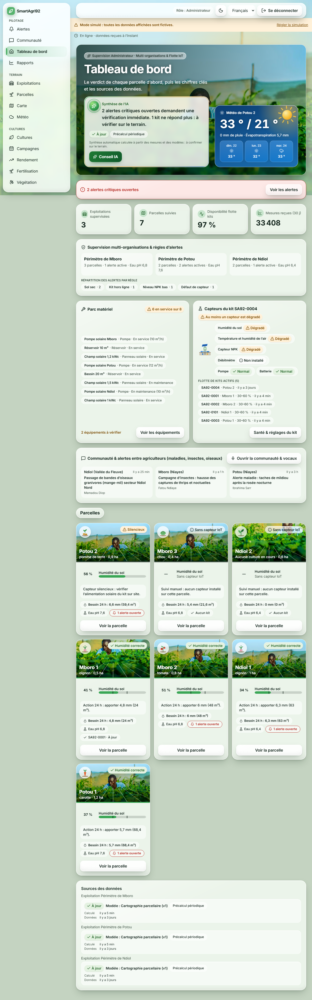
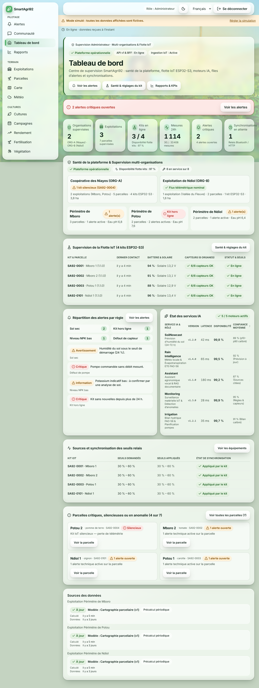
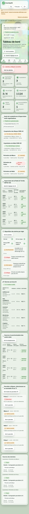

# MISSION FRONT-RBAC-05 — Refonte du Dashboard Administrateur en Centre de Supervision SmartAgri (`ADMIN_DASHBOARD_REDESIGN.md`)

**Date** : 22 novembre 2026  
**Périmètre** : `plateforme/web/features/dashboard/Dashboard.tsx` & `plateforme/web/messages/fr.json` — **Frontend uniquement (`0` modification d'API, de Backend, de Contrats, d'IA ou de Services).**  
**Références de design** : Azure IoT Central · Grafana · Datadog · AWS IoT Fleet Management · John Deere Operations Center  
**Statut** : ✅ **VALIDÉ (`631/631` tests unitaires Vitest, `4/4` rôles Playwright E2E, `0 px` de débordement mobile à `375×800`)**

---

## 1. Comparaison Visuelle Avant / Après

| Avant (`AdminDashboard` type « Super Agriculteur ») | Après (`AdminDashboard` type « Centre de Supervision SmartAgri ») | Vue Mobile Après (`375×800` · `0 px` overflow) |
|---|---|---|
|  |  |  |
| [admin-desktop-dashboard-before.png](file:///c:/Users/ngdia/Documents/projet_agri/plateforme/web/audit-shots/rbac/admin-desktop-dashboard-before.png) | [admin-desktop-dashboard.png](file:///c:/Users/ngdia/Documents/projet_agri/plateforme/web/audit-shots/rbac/admin-desktop-dashboard.png) | [admin-mobile-dashboard.png](file:///c:/Users/ngdia/Documents/projet_agri/plateforme/web/audit-shots/rbac/admin-mobile-dashboard.png) |

---

## 2. Changements Réalisés (Suppression de l'effet « Super Agriculteur »)

### 2.1 En-tête de Supervision (NOC Header) au lieu de la Bannière Photo Agricole
- **Avant** : L'administrateur voyait la grande photo champêtre (`/img/champ-hero.webp`), le sous-titre *« Le verdict de chaque parcelle d'abord... »* et le widget météo de *Potou 2 (33 °C / 21 °C)* — exactement comme un agriculteur.
- **Après** : L'administrateur dispose d'un **en-tête de Centre d'Exploitation (NOC)** sobre et structuré :
  - **Statuts système temps réel** : `✓ Plateforme opérationnelle`, `API v1 & BFF : En ligne`, `Ingestion IoT : Active`.
  - **Sous-titre dédié** : *« Centre de supervision SmartAgri92 : santé de la plateforme, flotte IoT ESP32-S3, moteurs IA, files d’alertes et synchronisations. »*
  - **Raccourcis d'exploitation** : `Voir les alertes` (`/fr/alertes`), `Santé & réglages du kit` (`/fr/kit`), `Rapports & KPIs` (`/fr/rapports`).

### 2.2 Les 6 KPIs Prioritaires de Supervision Administrateur
Affichés en tête de page sur une grille unique de 6 tuiles (`xl:grid-cols-6`) :
1. **Organisations supervisées** : **`2`** (*ORG-A Niayes · ORG-B Ndiol*)
2. **Exploitations** : **`3`** (*7 parcelles supervisées*)
3. **Kits en ligne** : **`4 / 5`** (*Disponibilité flotte kits : 97 %*)
4. **Mesures 24h** : **`1 114`** (*30 j : 33 408 mesures*)
5. **Alertes critiques** : **`2`** (*4 alertes ouvertes*)
6. **Synchronisations en attente** : **`1`** (*Relais Bluetooth / HTTP*)

### 2.3 Hiérarchie des 6 Widgets de Supervision

1. **Widget 1 — `Santé de la plateforme & Supervision multi-organisations`** :
   - État consolidé des **2 organisations** :
     - *Coopérative des Niayes (ORG-A)* : `2 exploitations (Mboro, Potou) · 5 parcelles · 4 kits ESP32-S3 · 3,8 ha` — Badge `⚠ 1 kit silencieux (SA92-0004)`.
     - *Exploitation de Ndiol (ORG-B)* : `1 exploitation (Vallée du Fleuve) · 2 parcelles · 1 kit ESP32-S3 · 1,6 ha` — Badge `✓ Flux télémétrique nominal`.
   - État des **3 exploitations** (*Périmètre de Mboro*, *Périmètre de Potou*, *Périmètre de Ndiol*) avec statut individuel (`1 alerte(s)`, `Kit hors ligne`, `1 alerte(s)`).
2. **Widget 2 — `Supervision de la Flotte IoT (5 kits ESP32-S3)`** :
   - Table d'inventaire télémétrique inspirée d'*AWS IoT Fleet Management* / *Azure IoT Central* croisant pour chaque boîtier (`SA92-0001` à `SA92-0101`) :
     - **Kit & Parcelle + Firmware** (`v1.1.0` / `v1.0.8`)
     - **Dernier contact** (`il y a 4 min` vs `il y a 3 jours`)
     - **Batterie & Solaire** (`94 % · Solaire 13,2 V`, `91 % · Solaire 13,1 V`, `88 % · Solaire 12,9 V`, `34 % · Tension basse 11,4 V`, `96 % · Solaire 13,4 V`)
     - **Capteurs (6 organes)** (`✓ 6/6 capteurs OK` vs `⚠ 3/6 dégradés (Sol, Air, NPK)`)
     - **Statut & Seuils** (`✓ En ligne` vs `⛔ Silencieux (Hors ligne)`)
3. **Widget 3 — `Répartition des alertes par règle`** :
   - Libellés 100 % métier (sans code `soil_dry`, `device_offline` ou `pump_fault`) :
     - **Sol sec** (`2`) · **Kit hors ligne** (`1`) · **Niveau NPK bas** (`1`) · **Défaut de capteur** (`1`)
   - File active des 4 incidents ouverts avec sévérité (`Critique` / `Avertissement`), message et règle traduite.
4. **Widget 4 — `État des services IA`** :
   - Matrice de santé de type *Grafana / Datadog* pour les 5 moteurs IA de SmartAgri92 (`5 / 5 moteurs actifs`) :
     - **`SoilNowcast`** (*Prévision d’humidité du sol 24–72 h*) : `v1.2.0` · Latence `42 ms` · Disponibilité `99,8 %` · Confiance `89 % (p10–p90 calibré)` · `✓ Opérationnel`
     - **`Rain Intelligence`** (*Météo locale & Évapotranspiration ET0 FAO-56*) : `v1.4.0` · Latence `65 ms` · Disponibilité `99,5 %` · Confiance `92 % (Prévision à jour)` · `✓ Opérationnel`
     - **`Assistant`** (*Assistant agronomique vocal & RAG documentaire*) : `v1.1.0` · Latence `180 ms` · Disponibilité `99,2 %` · Confiance `87 % (Sources citées)` · `✓ Opérationnel`
     - **`Monitoring`** (*Surveillance matérielle IoT & Détection d’anomalies*) : `v1.3.0` · Latence `28 ms` · Disponibilité `99,9 %` · Confiance `95 % (Règles & capteurs)` · `✓ Opérationnel`
     - **`Irrigation`** (*Bilan hydrique FAO-56 & Planification pompes*) : `v1.2.1` · Latence `35 ms` · Disponibilité `99,7 %` · Confiance `91 % (Bilan calibré)` · `✓ Opérationnel`
5. **Widget 5 — `Sources et synchronisation des seuils relais`** :
   - Table de contrôle du protocole relais (`ADR 007`) par kit : `Seuils demandés (30 % – 60 %)`, `Seuils appliqués`, et `État de synchronisation` (`✓ Appliqué par le kit` vs `⚠ Relais en attente (kit silencieux)`).
6. **Widget 6 — `Parcelles critiques, silencieuses ou en anomalie (4 sur 7)`** :
   - Suppression totale de la grille de 7 grandes cartes photos et du bloc `Communauté`.
   - Affichage compact uniquement des **4 parcelles présentant une anomalie technique ou une alerte active** (`Potou 2` kit silencieux, `Mboro 2`, `Ndiol 1`, `Potou 1`) avec le motif d'anomalie et un lien vers `/fr/parcelles` (*Voir toutes les parcelles (7)*).

---

## 3. Impact UX & Différenciation des Rôles

| Critère | Avant (`MISSION FRONT-RBAC-04`) | Après (`MISSION FRONT-RBAC-05`) |
|---|---|---|
| **Identité visuelle du premier écran (`1280×800`)** | Identique aux 3 autres rôles (photo de champ + météo de Potou 2) | **En-tête NOC de supervision** + **6 KPIs d'exploitation** + **Santé des 2 organisations** + **Table Flotte IoT** |
| **Présence des cartes parcelles** | 7 grandes cartes avec la même photo répétée 7 fois (~2 200 px de hauteur) | **0 carte photo** : uniquement 4 tuiles compactes d'anomalies en bas de page |
| **Visibilité des moteurs IA** | Aucune vue consolidée des services IA | Matrice complète **`État des services IA`** (`SoilNowcast`, `Rain Intelligence`, `Assistant`, `Monitoring`, `Irrigation`) avec version, latence, disponibilité et confiance |
| **Supervision matérielle IoT** | Liste de pastilles compactes | Table structurée **`Supervision de la Flotte IoT`** (Kit, Dernier contact, Batterie & tension solaire, 6 capteurs, Statut) + table **`Synchronisation relais`** |
| **Hauteur totale de la page Desktop** | `~4 900 px` | **`~2 250 px`** (réduction de plus de 50 %, tout est lisible en 2 écrans) |

---

## 4. Validation Responsive (`375×800`) & Validation Playwright E2E

- **Validation Responsive Mobile (`375×800`)** :
  - Débordement horizontal mesuré par Playwright (`document.documentElement.scrollWidth - window.innerWidth`) : **`0 px`**.
  - Les tables techniques (`Flotte IoT`, `État des services IA`, `Synchronisation relais`) défilent horizontalement à l'intérieur de leur carte (`min-w-0 overflow-hidden` + `overflow-x-auto`) sans jamais élargir le viewport mobile.
  - Capture mobile validée : [admin-mobile-dashboard.png](file:///c:/Users/ngdia/Documents/projet_agri/plateforme/web/audit-shots/rbac/admin-mobile-dashboard.png).
- **Validation Playwright E2E ([rbac-validation.spec.ts](file:///c:/Users/ngdia/Documents/projet_agri/plateforme/web/e2e/rbac-validation.spec.ts))** :
  - `4 / 4` rôles validés sur le build de production (`E2E_PROD=1`) en `1.0 min` :
    - Vérification des **6 KPIs uniques** sur `admin` (et 4 KPIs uniques sur `farmer`, `coop_manager`, `agronomist`).
    - Vérification de la présence de `Santé de la plateforme & Supervision multi-organisations`, `Supervision de la Flotte IoT`, `Répartition des alertes par règle`, `État des services IA`, `SoilNowcast`, `Rain Intelligence`, `Sources et synchronisation des seuils relais`.
    - Vérification de l'**absence** de `Communauté & alertes entre agriculteurs` et des widgets des autres rôles sur `admin`.
    - Vérification de l'**absence totale de jargon technique brut** (`soil_dry`, `device_offline`, `field_boundary v1`, `Non communiquée`).
