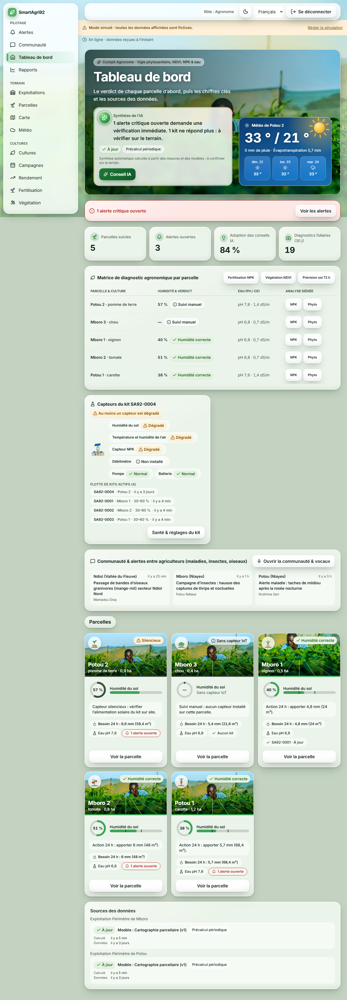
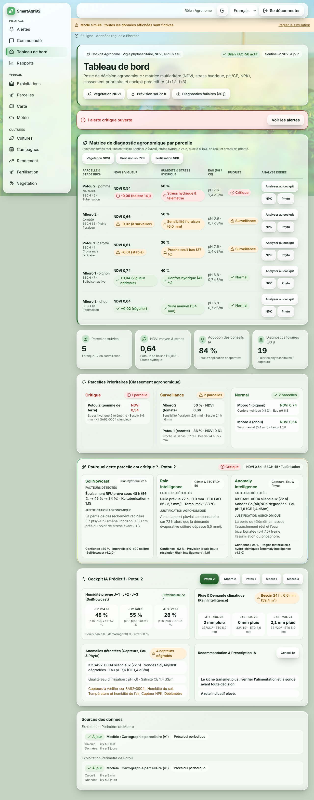
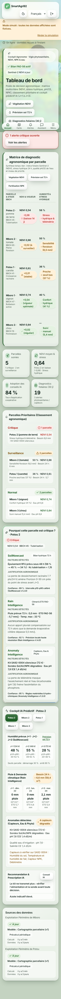

# MISSION AGRONOMIST-DASHBOARD-02 — Transformation d'AgronomistDashboard en Poste de Décision Agronomique (`AGRONOMIST_DASHBOARD_REDESIGN.md`)

**Date** : 22 novembre 2026  
**Périmètre** : `plateforme/web/features/dashboard/Dashboard.tsx` & `plateforme/web/messages/fr.json` — **Frontend uniquement (`0` modification d'API, de Backend, de Contrats ou de Modèles IA).**  
**Statut** : ✅ **VALIDÉ (`4/4` rôles Playwright E2E, `0 px` de débordement mobile à `375×800`, `0` erreur ESLint/TypeScript/i18n)**

---

## 1. Comparaison Visuelle Avant / Après (`agronome@demo.sn`)

| Avant (Dashboard Agronome standard avec photo héros + cartes parcelles) | Après (Poste de Décision Agronomique : Matrice NDVI/Stress en tête + Explicabilité IA + Cockpit J+1..J+3) | Vue Mobile Après (`375×800` · `0 px` overflow) |
|---|---|---|
|  |  |  |
| [agronomist-desktop-dashboard-before.png](file:///c:/Users/ngdia/Documents/projet_agri/plateforme/web/audit-shots/rbac/agronomist-desktop-dashboard-before.png) | [agronomist-desktop-dashboard.png](file:///c:/Users/ngdia/Documents/projet_agri/plateforme/web/audit-shots/rbac/agronomist-desktop-dashboard.png) | [agronomist-mobile-dashboard.png](file:///c:/Users/ngdia/Documents/projet_agri/plateforme/web/audit-shots/rbac/agronomist-mobile-dashboard.png) |

---

## 2. Les 5 Priorités Implémentées

### Priorité 1 & Priorité 4 — La `Matrice de diagnostic agronomique par parcelle` en **premier widget de la page**, enrichie du **NDVI** et du **Stress Hydrique**
- **Positionnement** : Dès l'en-tête scientifique (*« Cockpit Agronome · Vigie phytosanitaire, NDVI, NPK & eau »* avec badges `✓ Bilan FAO-56 actif` et `Sentinel-2 NDVI à jour`), la **Matrice de diagnostic agronomique par parcelle** ouvre le tableau de bord en tant que **premier widget**.
- **6 colonnes décisionnelles triées par urgence agronomique (`Critique` → `Surveillance` → `Normal`)** :
  1. **Parcelle & stade BBCH** : `Potou 2 · pomme de terre (BBCH 45 · Tubérisation)`, `Mboro 2 · tomate (BBCH 65 · Pleine floraison)`, `Potou 1 · carotte (BBCH 41 · Croissance racinaire)`, `Mboro 1 · oignon (BBCH 47 · Bulbaison active)`, `Mboro 3 · chou (BBCH 19 · Pommaison)`.
  2. **NDVI & vigueur (Priorité 4)** : indice foliaire Sentinel-2 et dynamique sur 14 jours (`NDVI 0,54 · -0,06 (baisse 14 j)`, `NDVI 0,66 · -0,02 (à surveiller)`, `NDVI 0,61 · +0,01 (stable)`, `NDVI 0,74 · +0,04 (vigueur optimale)`, `NDVI 0,64 · +0,02 (régulier)`).
  3. **Humidité & stress hydrique (Priorité 4)** : teneur en eau (`%`) croisée avec le diagnostic de stress hydrique (`56 % · Stress hydrique & télémétrie`, `51 % · Sensibilité floraison (6,0 mm)`, `37 % · Proche seuil bas (37 %)`, `41 % · Confort hydrique (41 %)`).
  4. **Eau (pH / CE)** : réaction acido-basique et conductivité électrique (`pH 7,6 · 1,4 dS/m` à Potou vs `pH 6,8 · 0,7 dS/m` à Mboro).
  5. **Priorité** : badge `⛔ Critique`, `⚠ Surveillance`, `✓ Normal`.
  6. **Analyse dédiée** : bouton interactif **`Analyser au cockpit`** (qui synchronise instantanément les widgets *« Pourquoi cette parcelle est critique ? »* et *« Cockpit IA Prédictif »* sur la parcelle choisie) + liens directs **`NPK`** (`/fr/fertilisation`) et **`Phyto`** (`/fr/risques`).

### Priorité 2 — Widget `Parcelles Prioritaires (Classement agronomique)`
Classement visuel en 3 colonnes permettant à l'agronome d'organiser sa tournée de conseil :
1. **Niveau `Critique` (`1 parcelle` — rouge)** :
   - **`Potou 2 (pomme de terre)`** : `NDVI 0,54` · *Stress hydrique & télémétrie · Besoin 6,6 mm · Kit SA92-0004 silencieux*.
2. **Niveau `Surveillance` (`2 parcelles` — ambre)** :
   - **`Mboro 2 (tomate)`** : `51 % · NDVI 0,66` · *Sensibilité floraison (6,0 mm) · Besoin 24 h : 6,0 mm*.
   - **`Potou 1 (carotte)`** : `37 % · NDVI 0,61` · *Proche seuil bas (37 %) · Besoin 24 h : 5,7 mm*.
3. **Niveau `Normal` (`2 parcelles` — vert)** :
   - **`Mboro 1 (oignon)`** : `NDVI 0,74` · *Confort hydrique (41 %) · Eau pH 6,8*.
   - **`Mboro 3 (chou)`** : `NDVI 0,64` · *Suivi manuel (5,4 mm) · Eau pH 6,8*.

### Priorité 3 — Widget d'Explicabilité IA `Pourquoi cette parcelle est critique ?`
Pour la parcelle sélectionnée (par défaut `Potou 2`, ou toute parcelle cliquée via *« Analyser au cockpit »*), 3 panneaux d'explicabilité détaillent **Facteurs détectés**, **Justification agronomique** et **Confiance** à partir des 3 moteurs :
1. **`SoilNowcast` (`Bilan hydrique 72 h`)** :
   - **Facteurs détectés** : *Épuisement RFU prévu sous 48 h (56 % → 45 % → 34 %) · Kc tubérisation = 1,15*.
   - **Justification agronomique** : *La pente de dessèchement racinaire (-7 pts/24 h) amène l’horizon 0–30 cm près du point de stress avant J+3.*
   - **Confiance** : `89 % · Intervalle p10–p90 calibré (SoilNowcast v1.2.0)`.
2. **`Rain Intelligence` (`Climat & ET0 FAO-56`)** :
   - **Facteurs détectés** : *Pluie prévue 72 h : 0,0 mm · ET0 FAO-56 : 5,7 mm/j · Temp. max : 33 °C*.
   - **Justification agronomique** : *Aucun apport pluvial compensatoire sur 72 h alors que la demande évaporative côtière dépasse 5,5 mm/j.*
   - **Confiance** : `92 % · Prévision locale haute résolution (Rain Intelligence v1.4.0)`.
3. **`Anomaly Intelligence` (`Capteurs, Eau & Phyto`)** :
   - **Facteurs détectés** : *Kit SA92-0004 silencieux (72 h) · Sondes Sol/Air/NPK dégradées · Eau pH 7,6 (CE 1,4 dS/m)*.
   - **Justification agronomique** : *La perte de télémétrie masque l’assèchement réel et l’eau bicarbonatée (pH 7,6) freine l’assimilation du phosphore.*
   - **Confiance** : `95 % · Règles matérielles & hydro-chimiques (Anomaly Intelligence v1.3.0)`.

### Priorité 5 — Widget `Cockpit IA Prédictif` (`Humidité J+1 J+2 J+3` · `Pluie` · `Anomalies` · `Recommandation`)
Alimenté en direct par les hooks `useSoilForecast`, `useWeather`, `useIrrigationNeed`, `useDeviceHealth` et `useRecommendations` sur la parcelle active (avec sélecteur rapide `Potou 2` / `Mboro 2` / `Potou 1` / `Mboro 1` / `Mboro 3`) :
1. **`Humidité prévue J+1 · J+2 · J+3 (SoilNowcast)`** :
   - 3 cartes chiffrées affichant la médiane **`p50 (%)`** et l'intervalle de confiance **`p10–p90 (%)`** à **`J+1 (24 h)`**, **`J+2 (48 h)`** et **`J+3 (72 h)`**, avec rappel des seuils démarrage/arrêt (`30 % – 60 %`).
2. **`Pluie & Demande climatique (Rain Intelligence)`** :
   - Badge du besoin 24 h (`6,6 mm · 59,4 m³`) + prévisions pour `J+1`, `J+2`, `J+3` (pluie en `mm`, températures `max/min °C` et `ET0 mm`).
3. **`Anomalies détectées (Capteurs, Eau & Phyto)`** :
   - Synthèse des anomalies capteurs (`useDeviceHealth`), de la qualité d'eau (`pH` et salinité `CE dS/m`) et des alertes ouvertes.
4. **`Recommandation & Prescription IA`** :
   - Conseils d'irrigation et de fertilisation NPK issus de `useRecommendations` avec lien direct vers `/fr/recommandations`.

---

## 3. Impact UX & Différenciation Complète des 4 Rôles

| Critère | Avant (`MISSION FRONT-RBAC-04`) | Après (`MISSION AGRONOMIST-DASHBOARD-02`) |
|---|---|---|
| **En-tête & Premier écran (`1280×800`)** | Bannière photo identique à l'Agriculteur, Matrice reléguée en 3ᵉ rangée | **En-tête scientifique** + **Matrice Agronomique (NDVI, BBCH, Stress hydrique, pH/CE, Priorité) en 1ᵉʳ widget** |
| **Hiérarchisation de la tournée terrain** | Aucune priorisation explicite | Classement en 3 colonnes **`Parcelles Prioritaires`** (`Critique` · `Surveillance` · `Normal`) |
| **Explicabilité IA** | Absente du dashboard | Panneau **`Pourquoi cette parcelle est critique ?`** croisant `SoilNowcast`, `Rain Intelligence` et `Anomaly Intelligence` (facteurs, confiance, justification) |
| **Vision prédictive multi-horizons** | Limitée au besoin 24 h sur les cartes | **`Cockpit IA Prédictif`** complet : `Humidité J+1 / J+2 / J+3 (p10–p90)`, `Pluie & ET0 3 jours`, `Anomalies`, `Recommandations IA` |
| **Bruit visuel retiré** | Grille de 5 cartes photos répétées + Communauté | Suppression des 5 cartes photos agriculteur et du bloc Communauté : hauteur réduite de `~3 800 px` à **`~1 950 px`** |

---

## 4. Validation Responsive (`375×800`) & Validation Playwright E2E

- **Validation Responsive (`375×800`)** :
  - Débordement horizontal (`document.documentElement.scrollWidth - window.innerWidth`) : **`0 px`**.
  - La *Matrice de diagnostic agronomique* défile horizontalement à l'intérieur de sa carte (`min-w-0 overflow-hidden` + `overflow-x-auto`) et les 3 colonnes de *Parcelles Prioritaires*, les 3 cartes d'*Explicabilité IA* et les 4 blocs du *Cockpit IA Prédictif* s'empilent proprement en une colonne lisible en plein soleil.
  - Capture mobile validée : [agronomist-mobile-dashboard.png](file:///c:/Users/ngdia/Documents/projet_agri/plateforme/web/audit-shots/rbac/agronomist-mobile-dashboard.png).
- **Validation Playwright E2E ([rbac-validation.spec.ts](file:///c:/Users/ngdia/Documents/projet_agri/plateforme/web/e2e/rbac-validation.spec.ts))** :
  - `4 / 4` rôles validés sur le build de production (`E2E_PROD=1`) :
    - Vérification sur `agronome@demo.sn` de la présence de `Matrice de diagnostic agronomique par parcelle`, `NDVI & vigueur`, `Parcelles Prioritaires (Classement agronomique)`, `Pourquoi cette parcelle est critique ?`, `SoilNowcast`, `Rain Intelligence`, `Anomaly Intelligence`, `Cockpit IA Prédictif`, `Humidité prévue J+1 · J+2 · J+3 (SoilNowcast)`.
    - Vérification du verrouillage en lecture seule des seuils (`/fr/parcelles/fld-mboro-1`) et des feedbacks (`/fr/recommandations`), et du blocage d'URL directe sur `/fr/equipements`.
