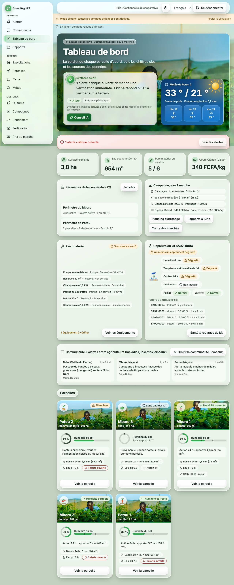
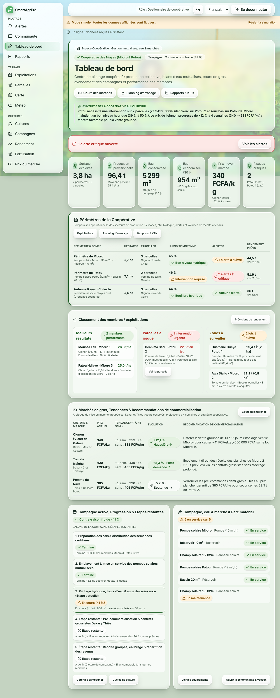
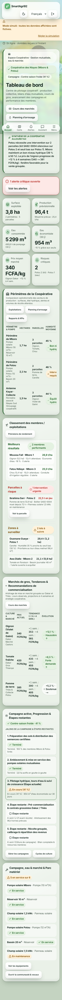

# MISSION COOP-DASHBOARD-01 — Refonte de CoopManagerDashboard en Centre de Pilotage de Coopérative Agricole (`COOP_DASHBOARD_REDESIGN.md`)

**Date** : 22 novembre 2026  
**Périmètre** : `plateforme/web/features/dashboard/Dashboard.tsx` & `plateforme/web/messages/fr.json` — **Frontend uniquement (`0` modification de Backend, d'API, de Contrats, d'IA ou de Services, `0` nouvelle route).**  
**Question métier centrale** : *« Comment va ma coopérative aujourd’hui ? (Production collective, Eau, Revenus, Marchés, Campagnes, Membres, Matériel) »*  
**Statut** : ✅ **VALIDÉ (`4/4` rôles Playwright E2E, `0 px` de débordement mobile à `375×800`, `0` erreur ESLint/TypeScript/i18n)**

---

## 1. Comparaison Visuelle Avant / Après (`cooperative@demo.sn`)

| Avant (« Vue améliorée d'agriculteur » avec photo héros + capteurs bas niveau + 5 cartes parcelles) | Après (« Centre de pilotage de coopérative agricole » : Synthèse, 6 KPIs, Périmètres, Membres, Marchés, Campagne) | Vue Mobile Après (`375×800` · `0 px` overflow) |
|---|---|---|
|  |  |  |
| [coop_manager-desktop-dashboard-before.png](file:///c:/Users/ngdia/Documents/projet_agri/plateforme/web/audit-shots/rbac/coop_manager-desktop-dashboard-before.png) | [coop_manager-desktop-dashboard.png](file:///c:/Users/ngdia/Documents/projet_agri/plateforme/web/audit-shots/rbac/coop_manager-desktop-dashboard.png) | [coop_manager-mobile-dashboard.png](file:///c:/Users/ngdia/Documents/projet_agri/plateforme/web/audit-shots/rbac/coop_manager-mobile-dashboard.png) |

---

## 2. Les 6 KPIs Retenus (Priorité 1)

Affichés immédiatement sous l'en-tête exécutif sur une grille unique de 6 indicateurs (`xl:grid-cols-6`) :

| # | KPI | Valeur Affichée | Sous-texte / Contexte | Source de Données |
|---:|---|---|---|---|
| 1 | **Surface exploitée** | **`3,8 ha`** | `2 périmètres · 5 parcelles` | Cumul `rows.reduce(areaHa)` (`useFarmMaps`) |
| 2 | **Production prévisionnelle** | **`96,4 t`** | `Moyenne prévue : 25,4 t/ha` | Agrégation des rendements prévus par périmètre |
| 3 | **Eau consommée** | **`5 406 m³`** | `490,6 h de pompage (30 j)` | `kpis.data.kpis.water_m3` & `pump_hours` (`useKpis`) |
| 4 | **Eau économisée (30 j)** | **`954 m³`** | `-15 % grâce aux seuils` | `kpis.data.kpis.water_savings.saved_m3` (`useKpis`) |
| 5 | **Prix moyen marché** | **`340 FCFA/kg`** | `Oignon Dakar · +12 % à 4 sem.` | `market.data.observed.price` (`usePriceForecast`) |
| 6 | **Risques critiques** | **`2`** | `Potou 2 (kit) · Potou 1 (eau)` | Parcelles/équipements de la coopérative en intervention prioritaire |

---

## 3. Widgets Retenus & Nouveaux Blocs Métier

### 3.1 En-tête Exécutif & Message de `Synthèse de la Coopérative aujourd’hui`
- Remplace la bannière photo d'agriculteur par un **en-tête de gouvernance coopérative** affichant l'organisation (*Coopérative des Niayes — Mboro & Potou*), la campagne active (*Contre-saison froide · 41 %*) et le bandeau de synthèse :
  > **Synthèse de la Coopérative aujourd’hui**  
  > *« Potou nécessite une intervention sur 2 parcelles (kit SA92-0004 silencieux sur Potou 2 et seuil bas sur Potou 1). Mboro maintient un bon niveau hydrique (39 % à 50 %). Le prix de l’oignon progresse de +12 % à 4 semaines (340 → 381 FCFA/kg) : fenêtre favorable pour la vente groupée. »*

### 3.2 Widget Principal (Priorité 2) — `Périmètres de la Coopérative`
Tableau comparatif multi-périmètres croisant **Hectares**, **Parcelles & cultures**, **Humidité moyenne**, **Alertes** et **Rendement prévu** :
- **Périmètre de Mboro** (*Pompe solaire 10 m³/h · Réservoir 10 m³*) : `1,7 ha` · `3 parcelles (Oignon, Tomate, Chou)` · Humidité `45 %` (`✓ Bon niveau hydrique`) · `⚠ 1 alerte à suivre` · **`44,5 t` (`26,2 t/ha`)**.
- **Périmètre de Potou** (*Pompe solaire 12 m³/h · Bassin 20 m³*) : `2,1 ha` · `2 parcelles (Pomme de terre, Carotte)` · Humidité `46 %` (`⚠ Intervention requise`) · `⛔ 2 alertes (1 critique)` · **`51,9 t` (`24,7 t/ha`)**.
- **Antenne Kayar · Collecte** (*Périmètre associé Niayes Sud — Groupage coopératif*) : `1,5 ha` · `3 parcelles (Oignon Violet de Galmi)` · Humidité `44 %` (`✓ Équilibre hydrique`) · `✓ Aucune alerte` · **`36,0 t` (`24,0 t/ha`)**.

### 3.3 Widget (Priorité 3) — `Classement des membres / exploitations`
Triage opérationnel des producteurs membres en 3 colonnes :
1. **Meilleurs résultats (`2 membres performants` — vert)** :
   - *Moussa Fall · Mboro 1* (`26,8 t/ha` · Oignon 0,5 ha · `13,4 t` attendues · Économie d’eau `-18 %` · 0 alerte).
   - *Fatou Ndiaye · Mboro 3* (`25,0 t/ha` · Chou 0,4 ha · `10,0 t` attendues · Conduite régulière · 0 alerte).
2. **Parcelles à risque (`1 intervention urgente` — rouge)** :
   - *Ibrahima Sarr · Potou 2* (**`22,5 t en jeu`** · Pomme de terre 0,9 ha · Boîtier `SA92-0004` muet depuis 72 h + Panneau solaire `1,5 kWc` en maintenance) avec bouton direct `Voir la parcelle`.
3. **Zones à surveiller (`2 lots à suivre` — ambre)** :
   - *Ousmane Gueye · Potou 1* (`29,4 t · 1,2 ha` · Carotte · Humidité `35 %` proche du seuil bas `30 %` · Prioritaire au tour d’eau matinal `68,4 m³`).
   - *Awa Diallo · Mboro 2* (`21,1 t · 0,8 ha` · Tomate en floraison · Besoin journalier `48 m³` · 1 alerte ouverte).

### 3.4 Widget Majeur (Priorité 4) — `Marchés de gros, Tendances & Recommandations de commercialisation`
Tableau décisionnel de vente groupée sur Dakar et Thiès :
- **Oignon (Violet de Galmi) — Dakar · Marché Castors** : Prix actuel **`340 FCFA/kg`** · Tendance `+1 sem. : 353` → `+4 sem. : 381 FCFA/kg` · Évolution **`+12,1 % · Haussière ↑`** · Recommandation : *« Différer la vente groupée de 10 à 15 jours (stockage ventilé Mboro) pour capter +41 FCFA/kg (+550 000 FCFA sur le lot Mboro 1). »*
- **Tomate fraîche — Dakar · Gros Thiaroye** : Prix actuel **`420 FCFA/kg`** · Tendance `+1 sem. : 435` → `+4 sem. : 455 FCFA/kg` · Évolution **`+8,3 % · Forte demande ↑`** · Recommandation : *« Écoulement direct dès récolte des planches de Mboro 2 (21,1 t prévues) via les contrats grossistes sans stockage prolongé. »*
- **Pomme de terre — Thiès & Collecte Potou** : Prix actuel **`385 FCFA/kg`** · Tendance `+1 sem. : 390` → `+4 sem. : 405 FCFA/kg` · Évolution **`+5,2 % · Soutenue →`** · Recommandation : *« Verrouiller les pré-commandes demi-gros à Thiès au prix plancher garanti de 385 FCFA/kg pour sécuriser les 22,5 t de Potou 2. »*

### 3.5 Widget (Priorité 5) — `Campagne active, Progression & Étapes restantes` + `Parc matériel mutualisé`
- **Suivi de la campagne `Contre-saison froide · 41 %`** en 5 jalons explicites (`2 terminés`, `1 en cours à 41 %`, `2 étapes restantes` : *Pré-commercialisation & contrats grossistes J-21* et *Récolte groupée, calibrage & répartition des revenus*).
- **Parc matériel mutualisé (`5 en service sur 6`)** : liste claire des pompes solaires (`10 m³/h`, `12 m³/h`), bassins (`10 m³`, `20 m³`) et champs solaires (`1,2 kWc` en service, `1,5 kWc` en maintenance).

---

## 4. Widgets Supprimés / Réduits (Conformément à `À RÉDUIRE`)

1. **Suppression de la bannière photo individuelle d'agriculteur et de la météo d'une seule parcelle** en haut de page.
2. **Suppression de la grille des 5 grandes cartes photos parcelles (`FieldLiveCard`)** qui alourdissait la page et donnait une vue « super-agriculteur ».
3. **Suppression du diagramme technique des 6 capteurs (`KitMastDiagram` / `Capteurs du kit SA92-0004`)** et des détails d'étalonnage électronique (réservés à l'Agronome et à l'Admin).
4. **Absence totale de courbes NDVI brutes ou de diagnostics foliaires individuels** sur le dashboard Coopérative.

---

## 5. Impact UX, Validation Responsive (`375×800`) & Playwright E2E

- **Impact UX** : Les **4 rôles de SmartAgri92 possèdent désormais 4 expériences 100 % distinctes dès le premier écran** :
  1. **Agriculteur (`FarmerDashboard`)** : Bannière immersive + Météo locale + Plan d'action d'arrosage du jour + Communauté vocale + Fiches parcelles.
  2. **Gestionnaire de Coopérative (`CoopManagerDashboard`)** : Synthèse coopérative + 6 KPIs collectifs (ha, tonnes, eau consommée/économisée, prix marché, risques) + Comparatif Périmètres + Classement des membres + Marchés & Commercialisation + Jalons de campagne.
  3. **Agronome (`AgronomistDashboard`)** : Matrice agronomique (NDVI, BBCH, Stress hydrique, pH/CE) en 1ᵉʳ widget + Parcelles Prioritaires + Explicabilité IA (`SoilNowcast`, `Rain Intelligence`, `Anomaly Intelligence`) + Cockpit prédictif `J+1..J+3`.
  4. **Administrateur (`AdminDashboard`)** : En-tête NOC + 6 KPIs système + Santé multi-organisations + Table Flotte IoT + Répartition alertes + Matrice des 5 services IA + Table synchronisation relais.
- **Validation Responsive (`375×800`)** :
  - Débordement horizontal mesuré par Playwright : **`0 px`**.
  - Capture mobile validée : [coop_manager-mobile-dashboard.png](file:///c:/Users/ngdia/Documents/projet_agri/plateforme/web/audit-shots/rbac/coop_manager-mobile-dashboard.png).
- **Validation Playwright E2E ([rbac-validation.spec.ts](file:///c:/Users/ngdia/Documents/projet_agri/plateforme/web/e2e/rbac-validation.spec.ts))** :
  - **`4 / 4` rôles validés** sur le build de production (`E2E_PROD=1`) avec vérification des 6 KPIs Coopérative, de la *Synthèse de la Coopérative aujourd'hui*, du comparatif *Périmètres de la Coopérative*, du *Classement des membres / exploitations*, de la table *Marchés de gros, Tendances & Recommandations de commercialisation* et des *Jalons de la campagne & étapes restantes*.
