# MISSION FRONT-RBAC-04 — Rapport Visuel Exécutif des Expériences par Rôle (`ROLE_EXPERIENCE_SHOWCASE.md`)

**Plateforme** : SmartAgri92 — Pilotage Hydro-Agricole, IoT & IA pour le Sénégal (Niayes, Vallée du Fleuve, Bassin Arachidier, Casamance)  
**Date** : 22 novembre 2026  
**Statut** : ✅ **Prêt pour démonstration devant jury (`4/4` rôles validés par Playwright E2E sur Desktop `1280×800` & Mobile `375×800`)**

---

## 1. Vue d'Ensemble Exécutive (Synthèse Jury)

SmartAgri92 adapte dynamiquement **son menu de navigation**, **son tableau de bord**, **ses KPIs**, **ses actions d'écriture** et **son périmètre de données (Multi-tenancy / RLS)** selon l'acteur connecté :

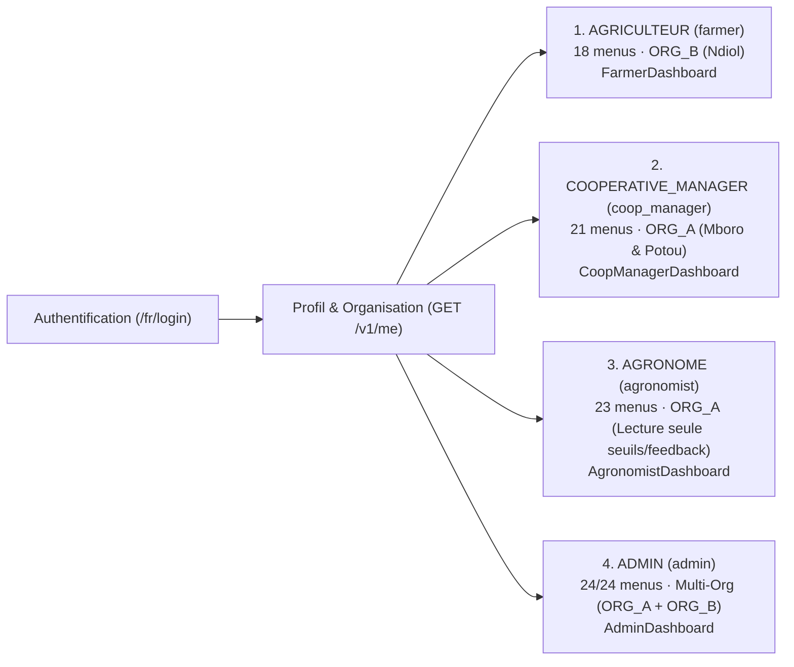

| Rôle Métier | Compte de Démonstration | Périmètre de Données (RLS) | Menus Visibles | Menus Masqués & Bloqués (URL directe) | Philosophie du Dashboard |
|---|---|---|:---:|:---:|---|
| **1. `AGRICULTEUR`** (`farmer`) | `agriculteur@demo.sn` *(mdp : `demo`)* | **Exploitation de Ndiol** (`ORG_B` — Vallée du Fleuve, `2 parcelles`, `1,6 ha`) | **18 / 24** | **6 bloqués** (`/exploitations`, `/rapports`, `/kit`, `/vegetation`, `/previsions`, `/equipements`) | **Action terrain immédiate** : dose d'eau du jour, pH de l'eau, météo, prix du marché et alertes vocales communautaires |
| **2. `COOPERATIVE_MANAGER`** (`coop_manager`) | `cooperative@demo.sn` *(mdp : `demo`)* | **Coopérative des Niayes** (`ORG_A` — Mboro & Potou, `5 parcelles`, `3,8 ha`) | **21 / 24** | **3 bloqués** (`/kit`, `/vegetation`, `/previsions`) | **Gestion mutualisée** : comparaison des périmètres, économies d'eau 30 j, parc pompes solaires, campagnes et vente groupée |
| **3. `AGRONOME`** (`agronomist`) | `agronome@demo.sn` *(mdp : `demo`)* | **Coopérative des Niayes** (`ORG_A` — Mboro & Potou, `5 parcelles`) | **23 / 24** | **1 bloqué** (`/equipements`) + **Seuils & Feedback en lecture seule** | **Vigie scientifique & IA** : matrice par parcelle (humidité, pH/CE, NPK, NDVI, ravageurs), diagnostics foliaires et adoption IA |
| **4. `ADMIN`** (`admin`) | `admin@demo.sn` *(mdp : `demo`)* | **Multi-Organisations** (`ORG_A + ORG_B` — `3 exploitations`, `7 parcelles`, `5,4 ha`) | **24 / 24** | **0 bloqué** (Accès total) | **Supervision système & flotte IoT** : disponibilité des 5 kits ESP32-S3, 33 408 mesures 30 j, santé des 6 capteurs et alertes par règle |

---

## 2. Rôle 1 — `AGRICULTEUR` (`agriculteur@demo.sn`)

> **Positionnement Jury** : L'agriculteur consulte SmartAgri92 sur son smartphone au bord du champ. L'interface élimine toute complexité administrative ou électronique (pas d'étalonnage ADC `/kit`, pas de rapports comptables `/rapports`, pas de courbes satellite brutes `/vegetation`) pour répondre en moins de 10 secondes à ses 4 questions quotidiennes : *« Combien arroser aujourd'hui ? Mon eau a-t-elle un bon pH ? Y a-t-il une alerte ravageurs/oiseaux dans la zone ? À quel prix vendre mes oignons ? »*

### 2.1 Captures Visuelles (`FarmerDashboard`, Sidebar & Mobile)

| 1. Capture Dashboard Desktop (`1280×800`) | 2. Capture Sidebarfiltrée (`18 entrées`) | 3. Capture Mobile (`375×800`) | 4. Blocage URL Directe (`/fr/exploitations`) |
|---|---|---|---|
| 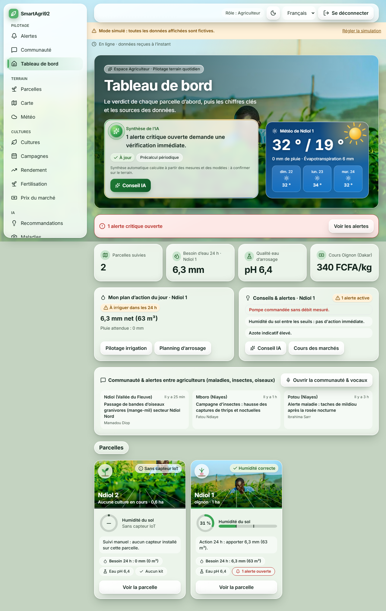 | 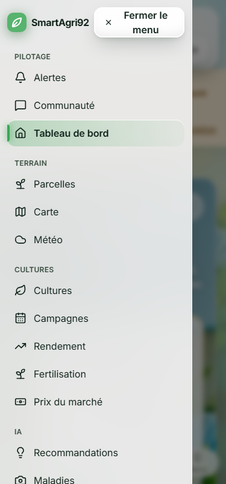 | 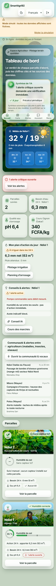 | 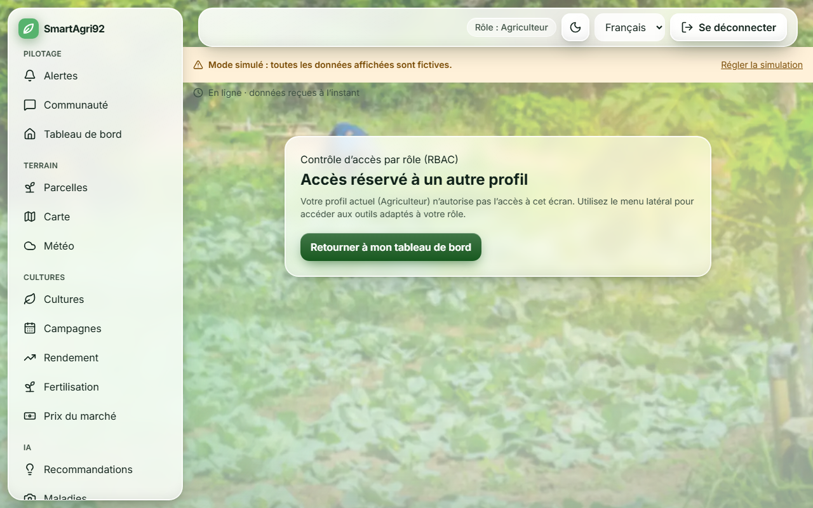 |
| [farmer-desktop-dashboard.png](file:///c:/Users/ngdia/Documents/projet_agri/plateforme/web/audit-shots/rbac/farmer-desktop-dashboard.png) | [farmer-mobile-sidebar.png](file:///c:/Users/ngdia/Documents/projet_agri/plateforme/web/audit-shots/rbac/farmer-mobile-sidebar.png) | [farmer-mobile-dashboard.png](file:///c:/Users/ngdia/Documents/projet_agri/plateforme/web/audit-shots/rbac/farmer-mobile-dashboard.png) | [farmer-blocked-exploitations.png](file:///c:/Users/ngdia/Documents/projet_agri/plateforme/web/audit-shots/rbac/farmer-blocked-exploitations.png) |

### 2.2 Menus Visibles (`18`) vs Menus Masqués (`6`)

- **Menus visibles (`18`)** :
  - **Pilotage (3)** : `Alertes` (`/fr/alertes`), `Communauté` (`/fr/communaute`), `Tableau de bord` (`/fr/tableau`)
  - **Terrain (3)** : `Parcelles` (`/fr/parcelles`), `Carte` (`/fr/carte`), `Météo` (`/fr/meteo`)
  - **Cultures (5)** : `Cultures` (`/fr/cultures`), `Campagnes` (`/fr/campagnes`), `Rendement` (`/fr/rendement`), `Fertilisation` (`/fr/fertilisation`), `Prix du marché` (`/fr/marches`)
  - **IA (6)** : `Recommandations` (`/fr/recommandations`), `Maladies` (`/fr/maladies`), `Assistant IA` (`/fr/assistant`), `Irrigation` (`/fr/irrigation`), `Risques phytosanitaires` (`/fr/risques`), `Planning d’arrosage` (`/fr/planning`)
  - **Matériel (1)** : `Pièges à insectes` (`/fr/pieges`)
- **Menus masqués & bloqués en accès URL direct (`6`)** :
  - ⛔ `/fr/exploitations` *(gère une seule ferme : Ndiol)*
  - ⛔ `/fr/rapports` *(rapports KPI multi-exploitations & export CSV comptable)*
  - ⛔ `/fr/kit` *(étalonnage bas niveau ADC `adc_sec` / `adc_eau` et coefficient `Kc`)*
  - ⛔ `/fr/vegetation` *(séries temporelles brutes NDVI/EVI Sentinel-2)*
  - ⛔ `/fr/previsions` *(fuseaux probabilistes `p10–p90` à 72 h)*
  - ⛔ `/fr/equipements` *(inventaire mécanique de coopérative)*

### 2.3 Principaux KPIs & Widgets du `FarmerDashboard`

1. **Bandeau de synthèse IA + Météo locale de Ndiol** (`33 °C / 18 °C`, `0 mm de pluie`, `ET0 5,5 mm`).
2. **4 KPIs opérationnels** :
   - **Parcelles sèches** (`0`)
   - **Besoin d’eau 24 h · Ndiol 2** (`0 mm` / sur `Ndiol 1` : `6,3 mm · 63 m³`)
   - **Qualité eau d’arrosage** (`pH 6,4` — légèrement acide, optimal pour l'assimilation NPK sur oignon)
   - **Cours Oignon (Dakar)** (`340 FCFA/kg`)
3. **Carte « Mon plan d’action du jour »** : dose nette à apporter en `mm` et `m³`, pluie attendue et boutons directs *Pilotage irrigation* & *Planning d’arrosage*.
4. **Carte « Communauté & alertes entre agriculteurs »** : écoute vocale en 1 clic des alertes oiseaux granivores (*mange-mil à Ndiol Nord*), campagnes d'insectes et mildiou.
5. **Fiches Parcelles en direct (`Ndiol 1`, `Ndiol 2`)** : jauge d'humidité du sol (`32 %`), air (`25,3 °C · 53 %`), pression (`1010 hPa`), `Eau pH 6,4`, `N 71 · P 31 · K 125 mg/kg`, état de la pompe et seuils (`30 % – 60 %`).

### 2.4 Cas d'Usage Métier (Scénario de Démonstration Jury)
- **Scénario** : *Mamadou Diop*, producteur d'oignon à Ndiol (Vallée du Fleuve), ouvre l'application à 6 h 30.
- **Parcours à montrer au jury** :
  1. Sur `/fr/tableau`, il voit immédiatement que sa parcelle `Ndiol 1` est à `32 %` d'humidité (proche du seuil bas de `30 %`), que le besoin sur 24 h est de `6,3 mm (63 m³)` et que l'eau du fleuve est à `pH 6,4`.
  2. Il clique sur `/fr/communaute` pour écouter le message vocal signalant un passage d'oiseaux granivores (*Quelea quelea*) à Ndiol Nord et publie à son tour une note vocale.
  3. Il ouvre `/fr/assistant` et pose sa question à la voix (*« Dois-je arroser demain ? »*) : l'Assistant IA lui répond avec lecture vocale intégrée.

---

## 3. Rôle 2 — `COOPERATIVE_MANAGER` (`cooperative@demo.sn`)

> **Positionnement Jury** : Le gestionnaire de la *Coopérative des Niayes* pilote plusieurs périmètres maraîchers (*Mboro* et *Potou*, `3,8 ha`), répartit les tours d'eau sur les pompes solaires partagées, surveille les économies d'eau sur 30 jours (`954 m³ économisés`), prépare la commercialisation groupée selon les cours de Dakar/Thiès et exporte les rapports CSV pour le conseil d'administration.

### 3.1 Captures Visuelles (`CoopManagerDashboard`, Sidebar & Mobile)

| 1. Capture Dashboard Desktop (`1280×800`) | 2. Capture Sidebar filtrée (`21 entrées`) | 3. Capture Mobile (`375×800`) | 4. Blocage URL Directe (`/fr/kit`) |
|---|---|---|---|
| 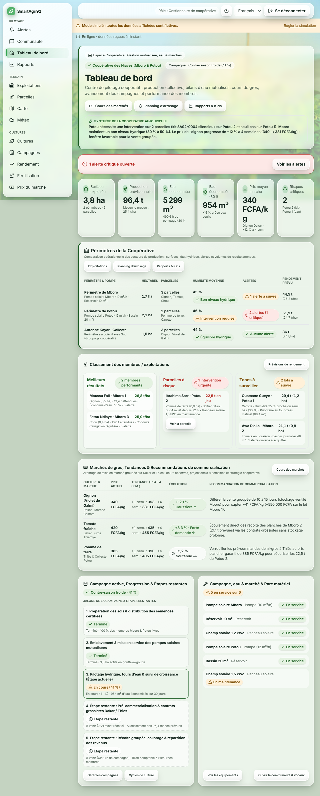 | 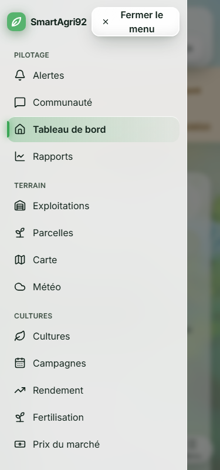 | 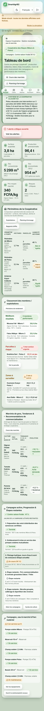 | 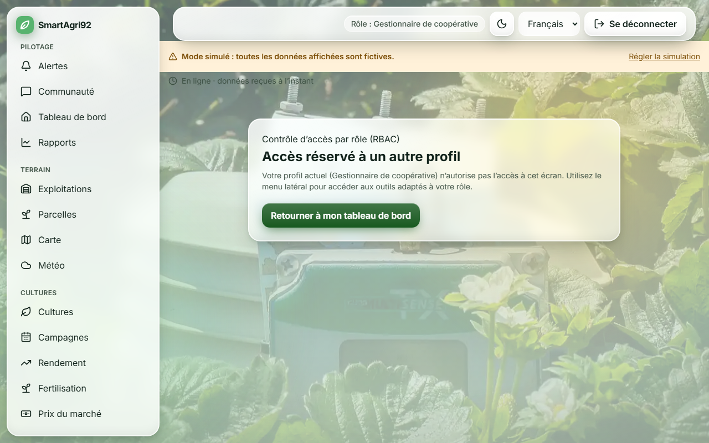 |
| [coop_manager-desktop-dashboard.png](file:///c:/Users/ngdia/Documents/projet_agri/plateforme/web/audit-shots/rbac/coop_manager-desktop-dashboard.png) | [coop_manager-mobile-sidebar.png](file:///c:/Users/ngdia/Documents/projet_agri/plateforme/web/audit-shots/rbac/coop_manager-mobile-sidebar.png) | [coop_manager-mobile-dashboard.png](file:///c:/Users/ngdia/Documents/projet_agri/plateforme/web/audit-shots/rbac/coop_manager-mobile-dashboard.png) | [coop_manager-blocked-kit.png](file:///c:/Users/ngdia/Documents/projet_agri/plateforme/web/audit-shots/rbac/coop_manager-blocked-kit.png) |

### 3.2 Menus Visibles (`21`) vs Menus Masqués (`3`)

- **Menus visibles (`21`)** :
  - **Pilotage (4)** : `Alertes`, `Communauté`, `Tableau de bord`, **`Rapports`** (`/fr/rapports`)
  - **Terrain (4)** : **`Exploitations`** (`/fr/exploitations`), `Parcelles`, `Carte`, `Météo`
  - **Cultures (5)** : `Cultures`, `Campagnes`, `Rendement`, `Fertilisation`, `Prix du marché`
  - **IA (6)** : `Recommandations`, `Maladies`, `Assistant IA`, `Irrigation`, `Risques phytosanitaires`, `Planning d’arrosage`
  - **Matériel (2)** : **`Équipements`** (`/fr/equipements`), `Pièges à insectes`
- **Menus masqués & bloqués en accès URL direct (`3`)** :
  - ⛔ `/fr/kit` *(étalonnage électronique ADC réservé à l'agronome et à l'admin)*
  - ⛔ `/fr/vegetation` *(séries scientifiques NDVI/EVI réservées à l'agronome)*
  - ⛔ `/fr/previsions` *(courbes probabilistes `p10–p90` réservées à l'agronome)*

### 3.3 Principaux KPIs & Widgets du `CoopManagerDashboard`

1. **6 KPIs de gouvernance coopérative** :
   - **Surface exploitée** : `3,8 ha` (répartis sur 2 périmètres et 5 parcelles)
   - **Parcelles sèches** : `0`
   - **Eau économisée (30 j)** : `954 m³` (`15 %` d'économie grâce au pilotage par seuils)
   - **Parc matériel en service** : `5 / 6` équipements opérationnels (`1` panneau solaire `1,5 kWc` en maintenance)
   - **Campagne active** : `Contre-saison froide (41 %)`
   - **Cours Oignon (Dakar)** : `340 FCFA/kg` (prévision à +1 semaine : `353 FCFA/kg`)
2. **Carte « Périmètres de la coopérative (2) »** : synthèse comparative *Périmètre de Mboro* (`3 parcelles · 0 à arroser · Eau pH 6,8`) vs *Périmètre de Potou* (`2 parcelles · 0 à arroser · Eau pH 7,6`).
3. **Carte « Campagne, eau & marché »** : disponibilité des kits (`96,8 %`), heures de pompage (`490,6 h`) et raccourcis vers *Planning d’arrosage*, *Rapports & KPIs* et *Cours des marchés*.
4. **Section « Parc matériel & Capteurs »** : état des pompes solaires (`10 m³/h` à Mboro, `12 m³/h` à Potou), bassins de stockage (`10 m³`, `20 m³`) et champs solaires.

### 3.4 Cas d'Usage Métier (Scénario de Démonstration Jury)
- **Scénario** : *Awa Ndiaye*, gestionnaire de la Coopérative des Niayes, prépare la réunion hebdomadaire de répartition de l'eau et de vente groupée.
- **Parcours à montrer au jury** :
  1. Sur `/fr/tableau`, elle compare en un coup d'œil les périmètres de *Mboro* et *Potou*, identifie le panneau solaire `1,5 kWc` en maintenance et vérifie la hausse prévue du cours de l'oignon (`340 → 353 FCFA/kg`).
  2. Elle ouvre `/fr/planning` pour consulter les créneaux d'arrosage mutualisés par pompe solaire afin d'éviter toute chute de pression.
  3. Elle ouvre `/fr/rapports` et télécharge l'export CSV officiel des économies d'eau (`954 m³`) sur 30 jours.

---

## 4. Rôle 3 — `AGRONOME` (`agronome@demo.sn`)

> **Positionnement Jury** : L'agronome conseille la coopérative sans jamais interférer avec la commande physique des vannes ou la maintenance mécanique. Il dispose d'accès exclusifs aux modules scientifiques (`/fr/vegetation` NDVI/EVI, `/fr/previsions` humidité du sol 72 h `p10–p90`, `/fr/kit` paramètres agronomiques `Kc`), tandis que la modification des seuils relais (`ThresholdForm`) et les boutons de feedback agriculteur sont **verrouillés en lecture seule**.

### 4.1 Captures Visuelles (`AgronomistDashboard`, Sidebar & Mobile)

| 1. Capture Dashboard Desktop (`1280×800`) | 2. Capture Sidebar filtrée (`23 entrées`) | 3. Capture Mobile (`375×800`) | 4. Blocage URL Directe (`/fr/equipements`) |
|---|---|---|---|
| 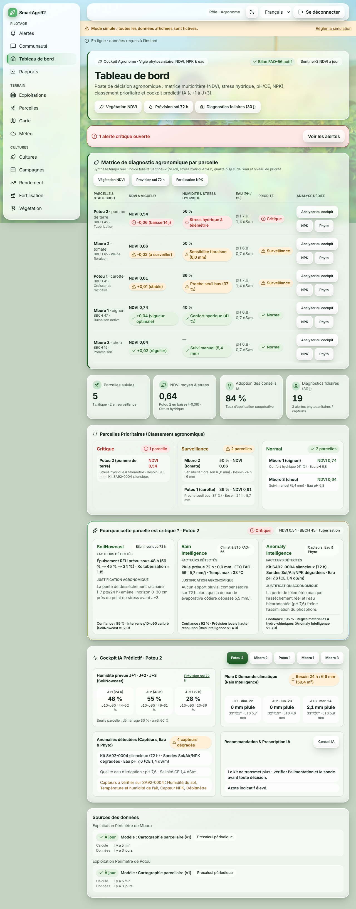 | 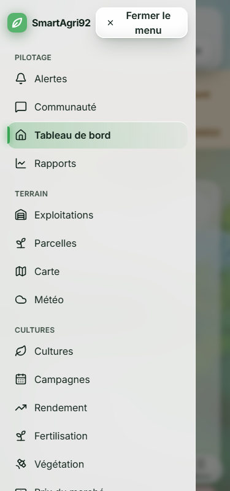 | 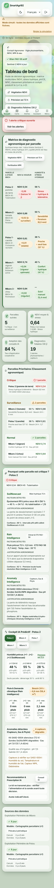 | 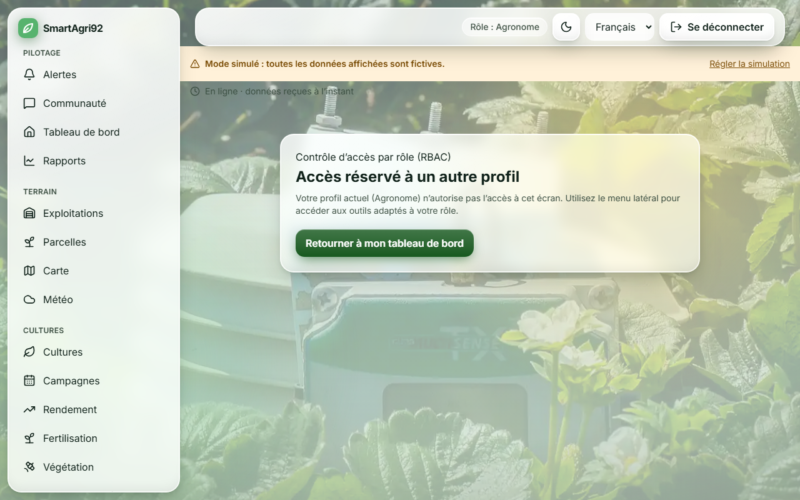 |
| [agronomist-desktop-dashboard.png](file:///c:/Users/ngdia/Documents/projet_agri/plateforme/web/audit-shots/rbac/agronomist-desktop-dashboard.png) | [agronomist-mobile-sidebar.png](file:///c:/Users/ngdia/Documents/projet_agri/plateforme/web/audit-shots/rbac/agronomist-mobile-sidebar.png) | [agronomist-mobile-dashboard.png](file:///c:/Users/ngdia/Documents/projet_agri/plateforme/web/audit-shots/rbac/agronomist-mobile-dashboard.png) | [agronomist-blocked-equipements.png](file:///c:/Users/ngdia/Documents/projet_agri/plateforme/web/audit-shots/rbac/agronomist-blocked-equipements.png) |

### 4.2 Menus Visibles (`23`) vs Menu Masqué (`1`) & Verrous d'Écriture

- **Menus visibles (`23`)** :
  - **Pilotage (4)** : `Alertes`, `Communauté`, `Tableau de bord`, `Rapports`
  - **Terrain (4)** : `Exploitations`, `Parcelles`, `Carte`, `Météo`
  - **Cultures (6)** : `Cultures`, `Campagnes`, `Rendement`, `Fertilisation`, **`Végétation`** (`/fr/vegetation`), `Prix du marché`
  - **IA (7)** : `Recommandations`, `Maladies`, `Assistant IA`, `Irrigation`, `Risques phytosanitaires`, **`Humidité prévue`** (`/fr/previsions`), `Planning d’arrosage`
  - **Matériel (2)** : **`Paramètres du kit`** (`/fr/kit`), `Pièges à insectes` (`/fr/pieges`)
- **Menu masqué & bloqué en accès URL direct (`1`)** :
  - ⛔ `/fr/equipements` *(maintenance mécanique des pompes et réservoirs)*
- **Restrictions fines d'écriture vérifiées par E2E** :
  - 🔒 Sur `/fr/parcelles/[id]` : formulaire de modification des seuils `Démarrage (%)` / `Arrêt (%)` **masqué** (`canEditThresholds = false`, et `403 Forbidden` côté API FastAPI).
  - 🔒 Sur `/fr/recommandations` : boutons *Suivi / Partiellement suivi / Ignoré* **masqués** (`canGiveFeedback = false`).

### 4.3 Principaux KPIs & Widgets de l'`AgronomistDashboard`

1. **4 KPIs scientifiques** :
   - **Parcelles suivies** (`5` parcelles maraîchères : pomme de terre, chou, oignon, tomate, carotte)
   - **Parcelles sèches** (`0`)
   - **Adoption des conseils IA** (suivi du taux d'application par les producteurs)
   - **Diagnostics foliaires (30 j)** (`19` analyses photo réalisées sur la période)
2. **Widget exclusif « Matrice de diagnostic agronomique par parcelle »** :
   - Tableau synthétique croisant pour chaque parcelle :
     - **Parcelle & culture** (`Potou 2 · pomme de terre`, `Mboro 3 · chou`, `Mboro 1 · oignon`, `Mboro 2 · tomate`, `Potou 1 · carotte`)
     - **Humidité & verdict** (`58 %`, `42 % Humidité correcte`, `52 % Humidité correcte`, `37 % Humidité correcte`)
     - **Eau (pH / CE)** : ex. `pH 7,6 · 1,4 dS/m` à Potou (eau légèrement alcaline à surveiller contre l'entartrage goutte-à-goutte) vs `pH 6,8 · 0,7 dS/m` à Mboro (eau optimale)
     - **Analyse dédiée** : boutons d'accès direct **`NPK`** (`/fr/fertilisation`) et **`Phyto`** (`/fr/risques`) par parcelle + raccourcis **`Fertilisation NPK`**, **`Végétation NDVI`** et **`Prévision sol 72 h`**.

### 4.4 Cas d'Usage Métier (Scénario de Démonstration Jury)
- **Scénario** : *Dr. Cheikh Ba*, ingénieur agronome, effectue sa tournée de diagnostic phytosanitaire et hydrique.
- **Parcours à montrer au jury** :
  1. Sur `/fr/tableau`, la *Matrice de diagnostic agronomique* lui révèle que l'eau d'irrigation de *Potou 1 & 2* affiche un `pH 7,6` et une conductivité `1,4 dS/m` (plus alcaline et minéralisée qu'à Mboro `pH 6,8 · 0,7 dS/m`), et que le kit `SA92-0004` présente une sonde NPK dégradée.
  2. Il clique sur **`Végétation NDVI`** (`/fr/vegetation`) puis sur **`Prévision sol 72 h`** (`/fr/previsions`) pour inspecter la vigueur foliaire Sentinel-2 et la trajectoire d'humidité `p10–p90`.
  3. Il ouvre `/fr/parcelles/fld-mboro-1` : le jury constate qu'il voit toutes les courbes télémétriques mais que le formulaire de modification des seuils relais est absent (sécurité opérationnelle).

---

## 5. Rôle 4 — `ADMIN` (`admin@demo.sn`)

> **Positionnement Jury** : L'administrateur supervise l'ensemble de la plateforme SmartAgri92 à l'échelle nationale (**toutes les organisations `ORG_A + ORG_B`** : `3 exploitations`, `7 parcelles`, `5 kits IoT ESP32-S3`, `8 équipements`). Son tableau de bord met au premier plan la santé télémétrique (`33 408 mesures reçues sur 30 j`, `97 % de disponibilité flotte`), l'état des 6 capteurs par kit et la répartition des alertes par règle de détection.

### 5.1 Captures Visuelles (`AdminDashboard`, Sidebar & Mobile)

| 1. Capture Dashboard Desktop (`1280×800`) | 2. Capture Sidebar complète (`24 / 24 entrées`) | 3. Capture Mobile (`375×800`) |
|---|---|---|
| 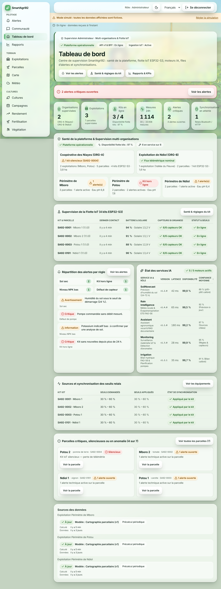 |  | 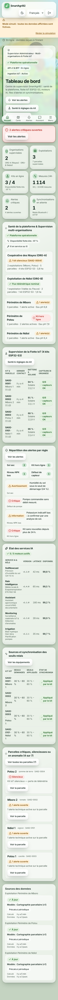 |
| [admin-desktop-dashboard.png](file:///c:/Users/ngdia/Documents/projet_agri/plateforme/web/audit-shots/rbac/admin-desktop-dashboard.png) | [admin-mobile-sidebar.png](file:///c:/Users/ngdia/Documents/projet_agri/plateforme/web/audit-shots/rbac/admin-mobile-sidebar.png) | [admin-mobile-dashboard.png](file:///c:/Users/ngdia/Documents/projet_agri/plateforme/web/audit-shots/rbac/admin-mobile-dashboard.png) |

### 5.2 Menus Visibles (`24 / 24`) vs Menus Masqués (`0`)

- **Menus visibles (`24 / 24`)** :
  - **Pilotage (4)** : `Alertes`, `Communauté`, `Tableau de bord`, `Rapports`
  - **Terrain (4)** : `Exploitations`, `Parcelles`, `Carte`, `Météo`
  - **Cultures (6)** : `Cultures`, `Campagnes`, `Rendement`, `Fertilisation`, `Végétation`, `Prix du marché`
  - **IA (7)** : `Recommandations`, `Maladies`, `Assistant IA`, `Irrigation`, `Risques phytosanitaires`, `Humidité prévue`, `Planning d’arrosage`
  - **Matériel (3)** : `Équipements`, `Paramètres du kit`, `Pièges à insectes`
- **Menus masqués (`0`)** : accès intégral à 100 % des écrans et à 100 % des organisations.

### 5.3 Principaux KPIs & Widgets de l'`AdminDashboard`

1. **7 KPIs de supervision globale (Multi-Organisations)** :
   - **Parcelles suivies** : `7` (cumul `ORG_A` Mboro/Potou + `ORG_B` Ndiol)
   - **Parcelles sèches** : `0`
   - **Kits silencieux** : `1` (`SA92-0004` sur Potou 2, silencieux depuis 3 jours)
   - **Alertes ouvertes** : `4` (dont `2 alertes critiques ouvertes`)
   - **Exploitations supervisées** : `3` (*Périmètre de Mboro*, *Périmètre de Potou*, *Périmètre de Ndiol*)
   - **Disponibilité flotte kits** : `97 %`
   - **Mesures reçues (30 j)** : `33 408` trames télémétriques ingérées
2. **Widget exclusif « Supervision multi-organisations & règles d’alertes »** :
   - Cartes des 3 exploitations (*Mboro : 3 parcelles · Eau pH 6,8* ; *Potou : 2 parcelles · Eau pH 7,6* ; *Ndiol : 2 parcelles · Eau pH 6,4*).
   - **Répartition des alertes par règle** : `soil_dry : 2`, `device_offline : 1`, `fertilizer_low : 1`, `sensor_fault : 1`.
3. **Centre de contrôle matériel & flotte des 5 kits actifs** (`SA92-0001`, `SA92-0002`, `SA92-0003`, `SA92-0004`, `SA92-0101`) + `8 équipements` multi-organisations.
4. **Grille complète des 7 parcelles** et **Provenance des données multi-exploitations**.

### 5.4 Cas d'Usage Métier (Scénario de Démonstration Jury)
- **Scénario** : L'équipe d'exploitation technique SmartAgri92 audite la santé de la flotte IoT et la qualité des flux de données sur l'ensemble du territoire sénégalais.
- **Parcours à montrer au jury** :
  1. Sur `/fr/tableau`, l'Administrateur montre que la plateforme agrège en temps réel les **3 exploitations** (`Mboro`, `Potou`, `Ndiol`), **7 parcelles** et **33 408 mesures**, et repère immédiatement l'alerte `device_offline : 1` sur le kit `SA92-0004`.
  2. Il ouvre `/fr/carte` pour présenter la **Carte Nationale du Sénégal** avec ses 6 zones agro-écologiques, ses 4 cours d'eau et les parcelles réparties sur le territoire.
  3. Il ouvre `/fr/kit` pour inspecter l'étalonnage ADC (`adc_sec` / `adc_eau`) et l'état de santé individuel des 6 capteurs de chaque boîtier ESP32-S3.

---

## 6. Protocole de Démonstration Rapide devant le Jury (3 minutes)

1. **URL de démonstration** : `http://localhost:3000/fr/login`
2. **Enchaînement conseillé** :
   - **Étape 1 (`agriculteur@demo.sn` / `demo`)** : Montrer la simplicité du `FarmerDashboard` (plan d'action du jour, pH de l'eau `6,4`, cours de l'oignon `340 FCFA/kg`, communauté vocale `/fr/communaute`), puis tenter d'ouvrir `/fr/exploitations` dans la barre d'adresse pour prouver le **blocage RBAC instantané**.
   - **Étape 2 (`cooperative@demo.sn` / `demo`)** : Montrer l'apparition de `Exploitations`, `Rapports` et `Équipements` dans la sidebar, le comparatif *Mboro vs Potou* et les `954 m³` d'eau économisés sur le `CoopManagerDashboard`.
   - **Étape 3 (`agronome@demo.sn` / `demo`)** : Montrer la *Matrice de diagnostic agronomique par parcelle* (`pH / CE`, `NPK`, `Phyto`), l'accès aux courbes `/fr/vegetation` et `/fr/previsions`, et le verrouillage en lecture seule des seuils sur `/fr/parcelles/fld-mboro-1`.
   - **Étape 4 (`admin@demo.sn` / `demo`)** : Montrer la vue consolidée des `3 exploitations`, `7 parcelles`, `5 kits IoT` et `33 408 mesures` sur l'`AdminDashboard`.
