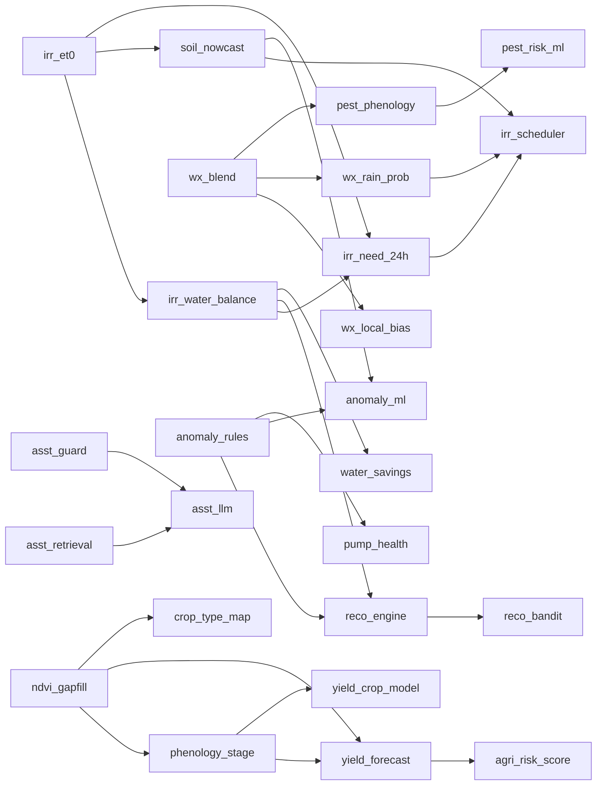

# Annexe A4 — Matrices de couverture

> Confidentiel - réservé aux partenaires de travail.
> Fichier généré par `python -m agriml.catalog render` depuis `ml/catalog/*.yaml` — ne pas modifier à la main.

Légende : ● obligatoire, ◐ recommandé, ○ optionnel ; case vide = domaine non utilisé.

## A4.1 Modèles × domaines de données

Niveau le plus fort par lequel le modèle atteint une source du domaine, via la lignée complète (jeux curated et features, puis jeux raw, puis sources).

Domaines : Mét = Météo et climat ; Sol = Sols ; Sat = Satellite ; Dro = Drone ; IoT = IoT (kit) ; Phy = Phytosanitaire ; Agr = Agronomie ; Éco = Économie ; Géo = Géospatial ; Eau = Eau et irrigation ; Hist = Historique ; Util = Utilisateurs et consentements ; Lang = Langue et voix ; Conn = Connaissances (RAG).

| Modèle | Version | Mét | Sol | Sat | Dro | IoT | Phy | Agr | Éco | Géo | Eau | Hist | Util | Lang | Conn |
|---|---|---|---|---|---|---|---|---|---|---|---|---|---|---|---|
| `irr_et0` | MVP | ● |  |  |  | ◐ |  |  |  |  |  |  |  |  |  |
| `irr_water_balance` | MVP | ● | ● | ○ |  | ● |  | ● |  | ● |  |  | ● |  |  |
| `soil_nowcast` | V2 | ● | ● | ○ |  | ● |  |  |  | ● |  |  | ● |  |  |
| `irr_need_24h` | V2 | ● | ● | ● |  | ● |  | ● |  | ● |  |  | ● |  |  |
| `irr_scheduler` | V3 | ● | ● | ● |  | ● |  | ● | ● | ● | ○ |  | ● |  |  |
| `wx_blend` | MVP | ● |  |  |  |  |  |  |  |  |  |  |  |  |  |
| `wx_local_bias` | V2 | ● |  |  |  | ● |  |  |  | ○ |  |  | ○ |  |  |
| `wx_rain_prob` | V2 | ● |  |  |  |  |  |  |  |  |  |  |  |  |  |
| `vis_quality` | MVP |  |  |  |  |  | ● |  |  |  |  |  |  |  |  |
| `vis_disease` | V2 | ○ |  | ○ |  | ● | ● | ○ |  | ○ |  |  | ○ |  |  |
| `vis_pest_count` | V3 |  |  |  |  | ● | ● |  |  |  |  |  |  |  |  |
| `vis_canopy` | V2 |  |  | ◐ | ○ | ● |  |  |  | ◐ |  |  | ◐ |  |  |
| `risk_rules` | V1.1 | ● |  |  |  |  | ● | ● |  |  |  |  |  |  |  |
| `pest_phenology` | V2 | ● |  |  |  | ◐ | ● | ● |  |  |  |  |  |  |  |
| `pest_risk_ml` | V2 | ● |  | ● |  | ○ | ● | ● |  | ● |  |  | ● |  |  |
| `asst_llm` | MVP | ◐ |  |  |  |  | ● | ● |  |  |  |  |  | ● | ● |
| `asst_retrieval` | MVP |  |  |  |  |  | ● | ● |  |  |  |  |  | ● | ● |
| `asst_guard` | MVP |  |  |  |  |  | ● |  |  |  |  |  |  | ● |  |
| `asst_asr` | V2 |  |  |  |  |  |  |  |  |  |  |  |  | ● |  |
| `asst_tts` | V2 |  |  |  |  |  | ◐ | ◐ |  |  |  |  |  | ● | ◐ |
| `npk_calibration` | V2 |  | ● |  |  | ● |  |  |  | ● | ● |  | ● |  |  |
| `fert_reco` | V1.1 |  | ● | ○ |  | ○ |  | ● | ◐ | ● | ○ |  | ● |  |  |
| `reco_engine` | MVP | ● |  |  |  | ● | ◐ | ● |  |  |  |  | ◐ |  |  |
| `reco_bandit` | V3 |  |  |  |  | ● |  | ● |  | ● |  |  | ● |  |  |
| `ndvi_gapfill` | V2 |  |  | ● |  |  |  |  |  | ● |  |  | ● |  |  |
| `phenology_stage` | V2 | ● |  | ● | ○ | ◐ |  | ● |  | ● |  |  | ● |  |  |
| `yield_forecast` | V3 | ● | ● | ● |  | ● |  | ● |  | ● |  | ● | ● |  |  |
| `yield_crop_model` | V3 | ● | ● |  |  | ◐ |  | ● |  | ● |  |  | ● |  |  |
| `crop_type_map` | V3 |  |  | ● |  |  |  | ● |  | ● |  |  | ● |  |  |
| `field_boundary` | V3 |  |  | ● |  |  |  |  |  | ● |  |  | ● |  |  |
| `agri_risk_score` | V3 | ● | ● | ● |  | ● |  | ● | ● | ● |  | ● | ● |  |  |
| `index_insurance` | V3 | ● |  | ● |  |  |  |  |  |  |  | ● |  |  |  |
| `anomaly_rules` | MVP |  |  |  |  | ● |  |  |  |  |  |  |  |  |  |
| `sm_calibration` | V1.1 |  | ● |  |  | ● |  |  |  | ● |  |  | ● |  |  |
| `anomaly_ml` | V2 | ● |  |  |  | ● |  |  |  |  |  |  |  |  |  |
| `pump_health` | V2 | ● |  |  |  | ● |  |  | ○ |  |  |  |  |  |  |
| `water_savings` | V1.1 | ● |  |  |  | ● |  | ● | ● |  |  |  |  |  |  |
| `price_forecast` | V3 |  |  | ● |  |  |  |  | ● |  |  | ● |  |  |  |
| `salinity_risk` | V3 |  | ● | ● |  | ● |  |  |  | ● | ● |  | ● |  |  |

## A4.2 Plateformes × versions

| Plateforme | MVP | V1.1 | V2 | V3 |
|---|---|---|---|---|
| web:1 | wx_blend, reco_engine, anomaly_rules | water_savings | soil_nowcast | — |
| web:3 | irr_water_balance | — | soil_nowcast, irr_need_24h, phenology_stage | field_boundary |
| web:4 | — | — | vis_canopy, pest_risk_ml, ndvi_gapfill | crop_type_map, field_boundary, salinity_risk |
| web:5 | irr_et0, wx_blend | — | wx_local_bias, wx_rain_prob | — |
| web:6 | — | fert_reco | vis_canopy, npk_calibration, ndvi_gapfill, phenology_stage | salinity_risk |
| web:7 | irr_et0, irr_water_balance, reco_engine | risk_rules, fert_reco | irr_need_24h, wx_rain_prob | irr_scheduler, reco_bandit |
| web:8 | — | risk_rules | vis_disease, pest_phenology, pest_risk_ml | vis_pest_count |
| web:9 | — | — | — | yield_forecast, yield_crop_model |
| web:10 | anomaly_rules | sm_calibration | anomaly_ml, pump_health | irr_scheduler |
| web:11 | — | water_savings | — | yield_forecast, price_forecast |
| web:12 | asst_llm, asst_retrieval, asst_guard | — | asst_asr | — |
| web:13 | — | water_savings | — | price_forecast |
| mobile | irr_et0, irr_water_balance, wx_blend, vis_quality, asst_llm, asst_retrieval, asst_guard, reco_engine, anomaly_rules | risk_rules, fert_reco | soil_nowcast, irr_need_24h, wx_local_bias, wx_rain_prob, vis_disease, pest_phenology, pest_risk_ml, asst_asr, asst_tts, anomaly_ml, pump_health | reco_bandit, field_boundary, price_forecast |
| kit | irr_water_balance, anomaly_rules | fert_reco, sm_calibration | irr_need_24h, wx_local_bias, vis_disease, npk_calibration | irr_scheduler, vis_pest_count |
| partner | — | water_savings | — | yield_forecast, yield_crop_model, crop_type_map, agri_risk_score, index_insurance |

## A4.3 Criticité des sources

Nombre de modèles qui atteignent la source, par niveau. Les sources obligatoires pour beaucoup de modèles et dont l'usage commercial n'est pas « ouvert » sont les priorités d'acquisition (doc 15).

| Source | Domaine | Usage commercial | ● obligatoires | ◐ recommandées | ○ optionnelles |
|---|---|---|---|---|---|
| `consents` | Utilisateurs et consentements | ouvert | 17 | 1 | 2 |
| `farm_registry` | Utilisateurs et consentements | ouvert | 17 | 1 | 2 |
| `user_accounts` | Utilisateurs et consentements | ouvert | 17 | 1 | 2 |
| `user_field_boundaries` | Géospatial | ouvert | 17 | 1 | 2 |
| `kit_config` | IoT (kit) | ouvert | 15 | 3 | 1 |
| `kit_flowmeter` | IoT (kit) | ouvert | 15 | 3 | 1 |
| `kit_microclimate` | IoT (kit) | ouvert | 15 | 3 | 1 |
| `kit_power` | IoT (kit) | ouvert | 15 | 3 | 1 |
| `kit_soil_extended` | IoT (kit) | ouvert | 15 | 3 | 1 |
| `kit_telemetry` | IoT (kit) | ouvert | 15 | 3 | 1 |
| `crop_cycles_user` | Agronomie | ouvert | 15 | 1 | 1 |
| `operations_log` | Agronomie | ouvert | 15 | 1 | 1 |
| `ecmwf_open_data` | Météo et climat | ouvert | 14 | 2 | 1 |
| `noaa_gfs` | Météo et climat | ouvert | 14 | 2 | 1 |
| `open_meteo` | Météo et climat | contrat | 14 | 2 | 1 |
| `agera5` | Météo et climat | ouvert | 14 | 1 | 3 |
| `chirps` | Météo et climat | ouvert | 14 | 1 | 3 |
| `cmsaf_sarah` | Météo et climat | à vérifier | 14 | 1 | 3 |
| `era5_land` | Météo et climat | ouvert | 14 | 1 | 3 |
| `era5` | Météo et climat | ouvert | 14 | 1 | 3 |
| `imerg` | Météo et climat | ouvert | 14 | 1 | 3 |
| `nasa_power` | Météo et climat | ouvert | 14 | 1 | 3 |
| `tamsat` | Météo et climat | ouvert | 14 | 1 | 3 |
| `deafrica` | Satellite | ouvert | 11 | 1 | 4 |
| `soil_field_kits` | Sols | ouvert | 11 | 0 | 0 |
| `soil_lab_analyses` | Sols | ouvert | 11 | 0 | 0 |
| `hwsd` | Sols | à vérifier | 10 | 0 | 0 |
| `inp_soil_map` | Sols | contrat | 10 | 0 | 0 |
| `isdasoil` | Sols | ouvert | 10 | 0 | 0 |
| `soilgrids` | Sols | ouvert | 10 | 0 | 0 |
| `fao56_tables` | Agronomie | ouvert | 9 | 2 | 0 |
| `fao_crop_calendar` | Agronomie | à vérifier | 9 | 2 | 0 |
| `isra_cdh_references` | Agronomie | contrat | 9 | 2 | 0 |
| `kit_events` | IoT (kit) | ouvert | 9 | 2 | 0 |
| `hls` | Satellite | ouvert | 9 | 1 | 4 |
| `landsat` | Satellite | ouvert | 9 | 1 | 4 |
| `sentinel1` | Satellite | ouvert | 9 | 1 | 4 |
| `sentinel2` | Satellite | ouvert | 9 | 1 | 4 |
| `planetscope` | Satellite | contrat | 8 | 1 | 4 |
| `ansd_admin` | Géospatial | contrat | 7 | 0 | 2 |
| `copernicus_dem` | Géospatial | ouvert | 7 | 0 | 2 |
| `geoboundaries` | Géospatial | ouvert | 7 | 0 | 2 |
| `hydrosheds` | Géospatial | ouvert | 7 | 0 | 2 |
| `jrc_gsw` | Géospatial | ouvert | 7 | 0 | 2 |
| `osm` | Géospatial | contrat | 7 | 0 | 2 |
| `worldcover` | Géospatial | ouvert | 7 | 0 | 2 |
| `csp_pesticides` | Phytosanitaire | ouvert | 6 | 4 | 0 |
| `pest_biology_reference` | Phytosanitaire | ouvert | 6 | 4 | 0 |
| `advisor_diagnoses` | Phytosanitaire | ouvert | 4 | 1 | 2 |
| `ansd_stats` | Historique | à vérifier | 4 | 0 | 0 |
| `dapsa_surveys` | Historique | contrat | 4 | 0 | 0 |
| `faostat` | Historique | ouvert | 4 | 0 | 0 |
| `farm_accounts` | Économie | ouvert | 3 | 1 | 1 |
| `kit_espcam` | IoT (kit) | ouvert | 3 | 1 | 1 |
| `farmer_photos` | Phytosanitaire | ouvert | 3 | 0 | 1 |
| `modis_viirs` | Satellite | ouvert | 3 | 0 | 0 |
| `vision_backbones` | Phytosanitaire | contrat | 3 | 0 | 0 |
| `wapor` | Satellite | à vérifier | 3 | 0 | 0 |
| `energy_tariffs` | Économie | ouvert | 2 | 1 | 1 |
| `input_prices_survey` | Économie | ouvert | 2 | 1 | 1 |
| `logistics_costs` | Économie | ouvert | 2 | 1 | 1 |
| `agronomist_qa` | Connaissances (RAG) | ouvert | 2 | 1 | 0 |
| `technical_sheets` | Connaissances (RAG) | contrat | 2 | 1 | 0 |
| `agrhymet_presass` | Météo et climat | contrat | 2 | 0 | 2 |
| `dgpre_groundwater` | Eau et irrigation | contrat | 2 | 0 | 2 |
| `irrigation_water_quality` | Eau et irrigation | ouvert | 2 | 0 | 2 |
| `well_inventory` | Eau et irrigation | ouvert | 2 | 0 | 2 |
| `common_voice` | Langue et voix | ouvert | 2 | 0 | 0 |
| `farmer_harvests` | Historique | ouvert | 2 | 0 | 0 |
| `open_wolof_speech` | Langue et voix | à vérifier | 2 | 0 | 0 |
| `research_trials` | Historique | contrat | 2 | 0 | 0 |
| `speech_consented` | Langue et voix | ouvert | 2 | 0 | 0 |
| `anacim_stations` | Météo et climat | contrat | 1 | 4 | 1 |
| `tahmo` | Météo et climat | contrat | 1 | 4 | 1 |
| `dpv_alerts` | Phytosanitaire | contrat | 1 | 1 | 3 |
| `famews` | Phytosanitaire | à vérifier | 1 | 1 | 3 |
| `fao_locust` | Phytosanitaire | à vérifier | 1 | 1 | 3 |
| `gbif` | Phytosanitaire | contrat | 1 | 1 | 3 |
| `scouting_reports` | Phytosanitaire | ouvert | 1 | 1 | 3 |
| `treatments_log` | Phytosanitaire | ouvert | 1 | 1 | 3 |
| `app_usage` | Utilisateurs et consentements | ouvert | 1 | 1 | 0 |
| `aquacrop` | Agronomie | à vérifier | 1 | 1 | 0 |
| `assistant_logs` | Langue et voix | ouvert | 1 | 1 | 0 |
| `field_boundaries_open` | Géospatial | à vérifier | 1 | 1 | 0 |
| `reco_feedback` | Utilisateurs et consentements | ouvert | 1 | 1 | 0 |
| `sarra` | Agronomie | ouvert | 1 | 1 | 0 |
| `plantdoc` | Phytosanitaire | ouvert | 1 | 0 | 1 |
| `plantvillage` | Phytosanitaire | à vérifier | 1 | 0 | 1 |
| `arm_prices` | Économie | contrat | 1 | 0 | 0 |
| `claude_api` | Langue et voix | contrat | 1 | 0 | 0 |
| `cnaas_insurance` | Économie | contrat | 1 | 0 | 0 |
| `embedding_models` | Langue et voix | à vérifier | 1 | 0 | 0 |
| `fews_net` | Économie | à vérifier | 1 | 0 | 0 |
| `giews_fpma` | Économie | à vérifier | 1 | 0 | 0 |
| `mfi_credit_outcomes` | Économie | contrat | 1 | 0 | 0 |
| `payments` | Économie | ouvert | 1 | 0 | 0 |
| `sim_csa` | Économie | contrat | 1 | 0 | 0 |
| `xlsr_models` | Langue et voix | ouvert | 1 | 0 | 0 |
| `drone_multispectral` | Drone | ouvert | 0 | 0 | 2 |
| `drone_rgb` | Drone | ouvert | 0 | 0 | 2 |
| `drone_thermal` | Drone | ouvert | 0 | 0 | 2 |
| `gyga` | Agronomie | non commercial | 0 | 0 | 2 |
| `mms_models` | Langue et voix | non commercial | 0 | 0 | 1 |
| `nllb_models` | Langue et voix | non commercial | 0 | 0 | 1 |

## A4.4 Dépendances entre modèles

